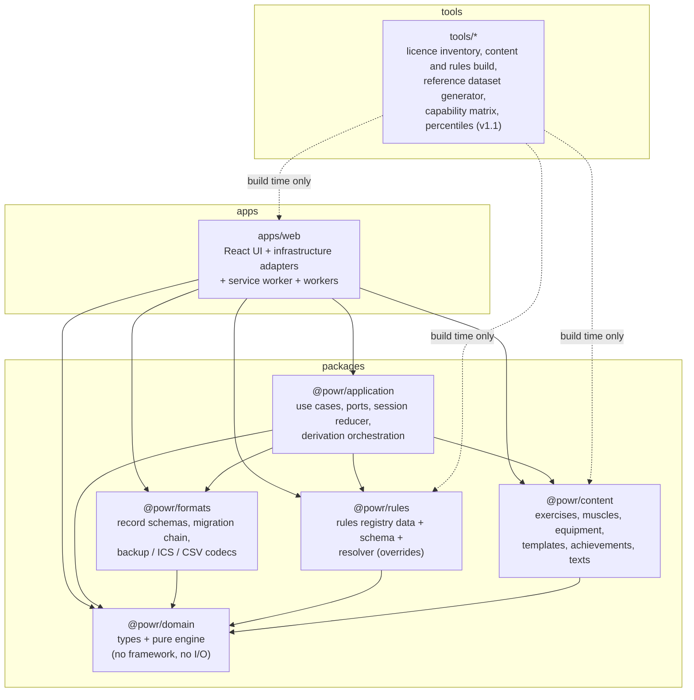
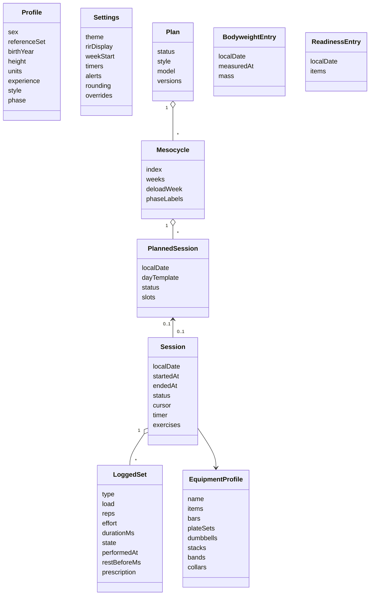
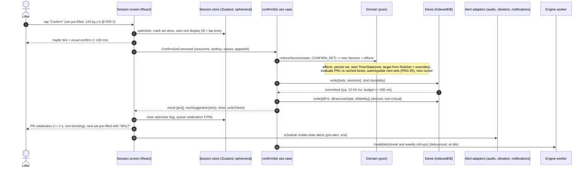
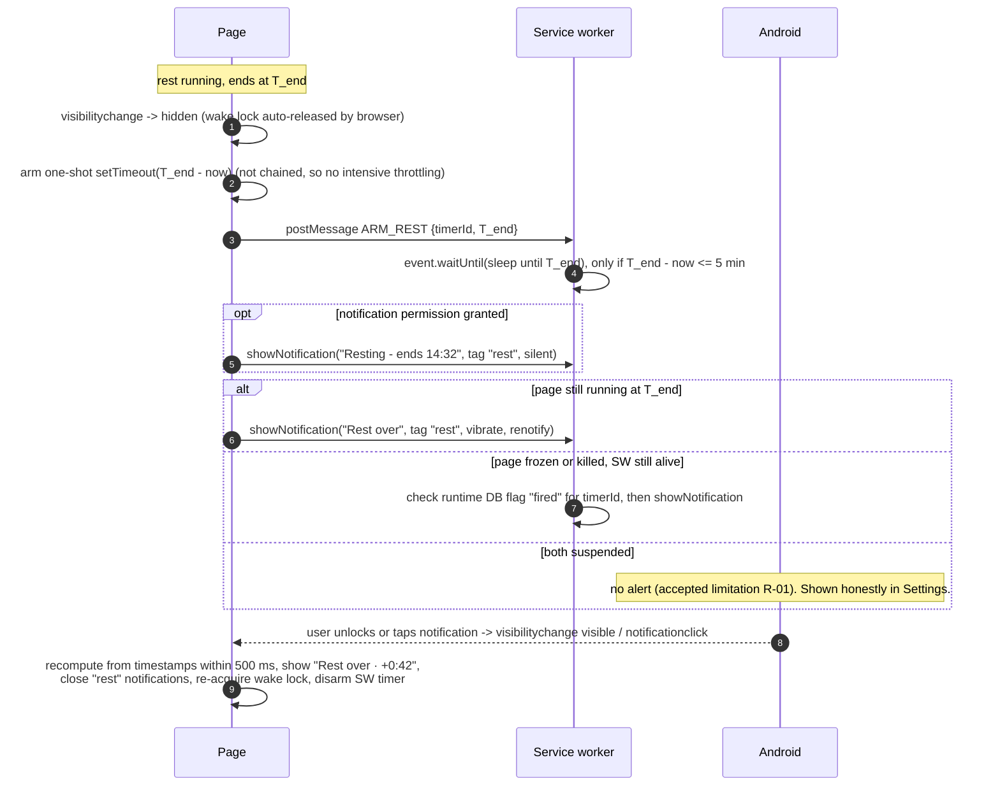
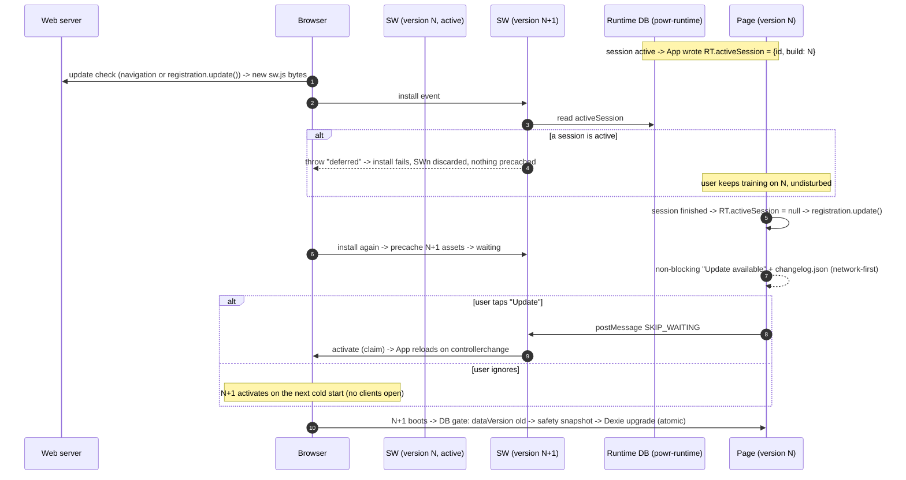
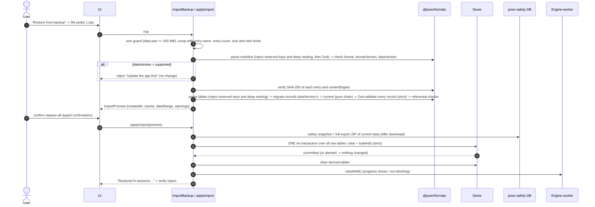
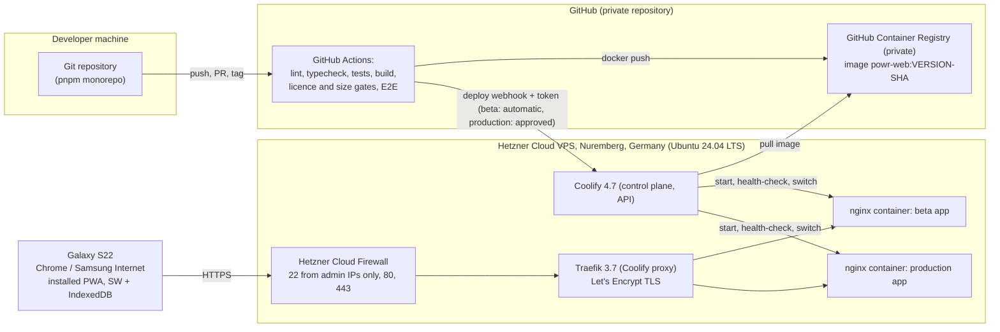
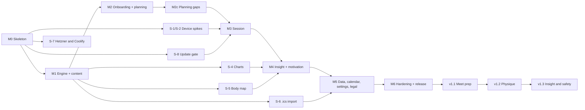

# POWR: Technical Concept (architecture documentation, arc42)

> Local-first, offline training planner and tracker PWA. This document tells the implementation agent **how** to build what the PRD specifies.

## 0. Document information

| Field | Value |
|---|---|
| Title | POWR (working title): Technical Concept |
| Version | 0.11 |
| Date | 2026-11-25 |
| Status | Draft v0.11: all open questions resolved; M0 (walking skeleton), M1 (engine, rules registry, content pipeline), M2 (planning core, the onboarding and planning screens, and the M2 tooling), M2c (planning gaps), M3 (session core M3a, timers and alerts M3t, session screens M3b), M4 (analytics core M4a, charts, body map and timer extras M4v with spikes S-4 and S-5, insight screens M4b) and M5 (data, calendar and PWA M5d; settings, legal and explainability M5s; content and engine follow-ups M5p; bundle trim, fixes and docs M5z) implemented and their deviations folded in; what remains is M6 (hardening and release; in progress since v0.10: the agent-side hardening M6a, the agent-side release-checklist rows M6c and the kill-anomaly investigation with its fixes M6d are done and folded in, and the release-readiness documents are in `docs/release/`) with the device and validation tasks: S-1, S-2 and S-6 and the M4 and M5 device checks on the S22 (§8.8.5, TD-38, TD-50, TD-66), the legal review (V-05, V-06) and the production domain |
| Owner / publisher | Simeon Zimmermann, SZ WEB DEVELOPMENT, Switzerland |
| Author | Architecture agent, for the product owner (sole developer) |
| Audience | Implementation agent, product owner, testers |
| Sources | (1) **PRD v0.2** `docs/PRD.md`, authoritative for all requirements. (2) **Evidence base** `reports/Strength and hypertrophy evidence base.md` ("EB"), source of all training formulas and defaults. (3) Braindump `app.requirements.md` (background). (4) **npm registry metadata**, queried 2026-11-23: versions, licences and publish dates of every recommended package (Appendix B). (5) **MDN browser-compat-data 8.1.10**, which lists Chrome for Android 158 and Samsung Internet 31.0 (Blink 148, released 2026-09-23) as current: browser capability claims (Appendix C). (6) Vendor and platform documentation (Appendix D). (7) **Product-owner decisions of 2026-11-24** on the open questions (hosting on Hetzner + Coolify, oxlint and oxfmt instead of ESLint and Prettier, domain strategy, GitHub, Labs audio test); new facts re-checked on the npm registry, GitHub and vendor docs on 2026-11-24. (8) **M0 implementation log** `IMPLEMENTATION_NOTES.md` (repository root; §3 lists every deviation from v0.2) and the **product-owner decisions of 2026-11-24 on the M0 cleanup**: docs v0.3, lazy-loaded backup path, unused dependencies removed, `#ui/*` alias for the shadcn CLI approved, licence exceptions approved. (9) **M1 implementation log** (`IMPLEMENTATION_NOTES.md` §5 "M1 shared contract", "M1-B content", "M1-A engine and rules") and the **product-owner decisions of 2026-11-24 on M1**: TD-21 resolved (keep `#ui/cn`, shadcn colour bridge), load–rep curve class of the competition squat and deadlift, content licence entries approved as own work. (10) **M2 implementation log** (`IMPLEMENTATION_NOTES.md` "M2a planning core", "M2b screens", "M2 tooling (TD-09, TD-10, TD-12)") and the **product-owner decisions of 2026-11-24 on M2**: the design mock-up `docs/design-idea.jpg` as the visual direction with WCAG 2.2 AA taking precedence, time-budget prioritisation, the empty "Custom" preset, the deload and maintenance defaults, the curve-class rename (TD-30), no Sentry package anywhere in the dependency tree (licence-gate block list) and `argparse` excluded rather than PSF-2.0 allowed. (11) **M3 implementation log** (`IMPLEMENTATION_NOTES.md` "M3a session core", "M3t timers and alerts", "M3b session screens") and the **product-owner decisions of 2026-11-24 on M3**: PRs as built (no e1RM PR from a set without effort; its load × reps can still set rep, load and volume PRs), the alert code loaded lazily on first use (entry JS target ≤ about 179 KB, budget unchanged at 186 KB), the alert defaults with a selectable pre-alert time (5, 10 or 15 s), development databases at version 2 cleared once instead of migrated, the M3a/M3t design values accepted as built, and the device-test records split between `tools/capability-matrix/records/` (machine) and `docs/device-tests/` (human). (12) **M4 implementation log** (`IMPLEMENTATION_NOTES.md` "M4a analytics core", "M4v charts, body map and timer extras", "M4b insight screens") and the **product-owner decisions of 2026-11-25 on M4**: the body-map artwork approved as own work; an evidence review of the strength-trend process noise in parallel; ECharts (S-4 go), the accessible chart pattern, up to three chart colours and the large body-map figure with buttons for the small regions accepted as built; the PRD's ANL-11 and MAP-01 wording (PRD v0.7); the streak rules, custom variants counting toward heavy sets, the metronome following the Alerts settings without rep counting, the new timed-set and tempo switches off by default and the four new `verified: false` design values accepted as built. (13) **M5 implementation log** (`IMPLEMENTATION_NOTES.md` "M5d data, calendar and PWA", "M5s settings, legal and explainability", "M5p content and engine follow-ups", "M5z bundle trim, fixes and docs") and the **product-owner decisions of 2026-11-25 on M5**: one public-origin value (`VITE_PUBLIC_ORIGIN`, default `powr.invalid`) and calendar UIDs from the planned-session IDs; the publisher's details, with the postal address and the legal-review date as placeholders that a release check enforces before production; and, after M5, the error-summary focus fix, the two extra bodybuilding templates kept without powerlifting or powerbuilding alternatives, the "standard variant first" tie-break, one public origin (the production one) for beta and production from a repository variable, and the M5 designs accepted as built (§0.3, row 0.9). |
| Structure | arc42 (sections 1–12) plus appendices. Architecture decisions are recorded as ADRs in `docs/adr/` (index: `docs/adr/README.md`). |

### 0.1 Conventions

- **PRD IDs** (`DAT-05`, `NFR-REL-01`, `TC-03`, `V-01`, `E-1` …) and **EB references** (`EB §Load › e1RM algorithm`) are used exactly as in the PRD.
- **ADR-nnnn** points to `docs/adr/nnnn-*.md`.
- **[Assumption TA-nn]** marks a technical assumption made here. They are collected in §2.4. The ones that would change the architecture are also in the **Open questions** at the end.
- **[Verified: …]** marks a browser or vendor fact checked against a named source on 2026-11-23. **[Device test]** marks a capability that must be confirmed on the Galaxy S22 (Chrome and Samsung Internet) before it is relied on.
- Type sketches are TypeScript and illustrative. They fix names, shapes and responsibilities, not final code.
- "MVP", "v1.1", "v1.2", "v1.3" and "Later" are the PRD release tags (§10).

### 0.2 Reading guide for the implementation agent

1. Read §1–§4 for the goals and the solution strategy (about 15 minutes).
2. Read §5 for the package layout and the dependency rules you must not break.
3. Build the walking skeleton in Appendix A, milestone M0, using §7 (deployment), §8.2–§8.4 (persistence, backup, service worker) and §8.21 (CI).
4. Before each feature, read the matching cross-cutting concepts in §8 and the runtime scenarios in §6.
5. `IMPLEMENTATION_NOTES.md` in the repository root records how the code follows this document, every deviation and the open items. Read it before changing a decision.

### 0.3 Change log

| Version | Date | Change |
|---|---|---|
| 0.1 | 2026-11-23 | First complete draft: arc42 sections 1–12, appendices, 21 ADRs, 8 open questions |
| 0.2 | 2026-11-24 | Product-owner decisions applied. **Resolved:** OQ-T1 = C (beta on a subdomain of the publisher's business domain; production domain chosen after the trademark check V-05, never changed afterwards); OQ-T2 = **Hetzner Cloud VPS (Germany) + self-hosted Coolify** (a new option: §7 and ADR-0011 rewritten, privacy wording changed from "Swiss hosting" to "EU hosting with a Swiss publisher", new operations section §7.6); OQ-T3 = B (background-audio keep-alive tested in S-1, opt-in Labs only if it clearly works); OQ-T5 = A (private GitHub + Actions). **Linting and formatting:** ESLint + typescript-eslint replaced by **oxlint** (type-aware via `oxlint-tsgolint`); Prettier replaced by **oxfmt** (ADR-0017). Consequences: layer boundaries re-designed (pnpm isolation + TypeScript project references + oxlint `no-restricted-imports` overrides + an architecture test; dependency-cruiser dropped, §5.2, ADR-0001); **TypeScript moved from 6.0 to 7.0** (ADR-0002); Lingui literal-string enforcement re-designed (§8.15, ADR-0016); Tailwind class sorting through oxfmt. **Adopted defaults, pending confirmation:** OQ-T4 = A, OQ-T6 = A, OQ-T7 = A, OQ-T8 = A. New open questions OQ-T9…OQ-T11. Roadmap spikes updated (S-1 includes the audio test, S-7 is now the Hetzner/Coolify setup). **Final 2026-11-24:** OQ-T4, T6, T7, T8 confirmed (A); OQ-T9 = hosted free-tier uptime monitor, preferably EU-based (service chosen in S-7); OQ-T10 = warn now, block later for the alpha JS-plugin rules; OQ-T11 = DNS stays at the current provider (`beta.`, `coolify.` and CAA records), business-domain name to be filled in by the product owner in S-7/WP0.7. All open questions are resolved. |
| 0.3 | 2026-11-24 | **M0 implemented; deviations folded in** (each one is a row in `IMPLEMENTATION_NOTES.md` §3, marked "Docs amended in v0.3"). Changed sections: §5.1–§5.3 (backup entries `@powr/formats/backup` and `@powr/application/backup`, deferred `@powr/rules` → `@powr/domain` dependency, `sw.ts`, `feature-flags.ts`, `zod.ts`, `#ui/*` alias, lint additions); §6.4/§6.5 (synchronous fflate API because `worker-src 'self'` blocks `blob:` workers; canonical JSON; lazy backup chunk); §7.3 (nginx excerpt with `include mime.types`, gzip and `theme-init.js` as `no-cache`; `Permissions-Policy` without `bluetooth=()`; CSP notes for the per-package Zod wrapper and Base UI's `CSPProvider`); §8.2 (no `dexie-react-hooks`; M0 Dexie schema with four tables and nested-key indexes; `powr-runtime` without Dexie); §8.3.5 (zip-bomb ratio for entries over 1 MiB); §8.4 (own service-worker registration instead of `virtual:pwa-register`; own icon generator instead of `@vite-pwa/assets-generator`); §8.5 (native React Compiler rules in oxlint 1.95); §8.9.2 (shadcn CLI workflow with the `#ui/*` subpath imports, product-owner approval 2026-11-24); §8.15 (`jsx-no-literals` configuration, catalog check in the build); §8.18 (`minimumReleaseAgeExclude`); §8.19 (entry JS 211.4 → 202.5 KB with the lazy backup chunk); §8.20 (E2E test server with production headers); §8.21 (licence plugin flow, own SPDX evaluator, approved licence exceptions, ESLint only as an unused peer, M0 CI state); §8.22; §11.2 (TD-09…TD-21); Appendix B (versions as installed). ADRs 0001, 0002, 0003, 0006, 0008, 0009, 0010, 0013, 0016, 0017, 0018 and 0021 carry an "Amendment (v0.3, 2026-11-24)" section. Editorial: a stray Traefik row moved from §8.23 to the glossary. |
| 0.4 | 2026-11-24 | **M1 implemented; folded in** (rows marked "Docs amended in v0.4" in `IMPLEMENTATION_NOTES.md` §3, and its sections "M1-B content" and "M1-A engine and rules"). Changed sections: §0 (sources); §4 (validation never on the startup path); §5.1–§5.4 (package entries as built: Zod-free `@powr/rules` root with `schema`, `resolve`, `sources`, `sources/node` and `build/node` subpaths; `@powr/domain` engine modules as subpath exports; `@powr/content` with `built-in` and `schema`; `tools/content-build`; no `src/zod.ts` in the app; lint rules and a build check that keep Zod off the startup path); §5.6 (the M1 shared contract: domain types and enums incl. five movement patterns beyond PRD §7.1, ID formats, content types in `@powr/content`); §6.5 and §8.3.5 (backup import hardening against `__proto__`, `constructor` and `prototype` keys, deep nesting and hostile ZIP entry names, found by the fast-check seed 637004341); §7.3 (Zod wrapper only in packages); §8.1 (source and parameter IDs); §8.5 and §8.9.1 (search params validated without Zod); §8.6 (registry as built: source directory and ID convention, loader location, EMG-only studies tagged OBS, `src.powr-eb-mapping`, 8 tables with 109 parameters of which 24 are `verified: false`, per-parameter value schemas, flat resolved record and context dimensions, `rules.json` with hash, `ids.lock.json`, golden tests, what is not shipped); §8.7.4, §8.7.7 and new §8.7.9 (engine as built; **product-owner decision**: the competition squat and deadlift and their close variants use the equation class until the personal curve fit exists); §8.9.2/§8.9.3 (**TD-21 resolved by the product owner**: `#ui/cn` stays, shadcn colour bridge); §8.12 (content pipeline as built; content licence entries **approved by the product owner**); §8.19 (entry JS 202.1 → 176.4 KB, `size-limit` budget 186 KB); §8.20 (hostile-backup tests, long property runs); §9; §11.2 (TD-17 and TD-21 closed, TD-09…TD-12 carried over, TD-22…TD-31 added); Appendix A.4 (M1 status). ADRs 0001, 0003, 0009, 0012, 0013, 0018 and 0020 carry an "Amendment (v0.4, 2026-11-24)" section. |
| 0.5 | 2026-11-24 | **M2 implemented (planning core M2a, screens M2b); folded in.** Product-owner decisions: the mock-up's visual direction with WCAG 2.2 AA and NFR-A11Y winning every conflict (§8.9.3, ADR-0004); time-budget prioritisation (§8.7.10); the empty "Custom" preset opens the equipment editor and an empty list gives a bodyweight plan with a note (§8.9.8); deload RIR +2 / −50% sets and maintenance ⅓ (≥ 4 sets, ≥ 1 session) approved unchanged; curve class `benchLike` renamed `equation` (TD-30). Changed sections: §8.2.2 (Dexie version 2 with seven tables, TD-19 decided; dismissed warnings on the plan record); §8.5 (forms without React Hook Form and Zod); §8.7.9 (TD-31 done); new §8.7.10 (planning as built: generator in the lazy planning chunk on the main thread, time budget, explanations and messages); §8.9.1 (routes as built); §8.9.3 (palette and the token gate as built); new §8.9.8 (screens as built: Why sheet, onboarding, equipment editor, plan editor, schedule); §8.14 (accessibility measures and checks of M2); §8.15 (catalog as a lazy chunk, week start, the +30% expansion test); §8.20 (component tests in Vitest browser mode); §9 (ADR statuses); §11.2 (TD-11, TD-19, TD-24, TD-28…TD-31 closed, TD-12 amended for the token gate, TD-32…TD-36 added); Appendix A.4 (M2 status). v0.5 **also folds in the M2 tooling** (TD-09 native Lingui macro, TD-10 native React Compiler lint rules, TD-12 Lighthouse CI and Trusted Types in dev/E2E) **and the Sentry package block list** (product-owner decision 2026-11-24: no Sentry package anywhere, `deniedPackages` in the licence gate; `argparse` excluded rather than PSF-2.0 allowed). Changed sections: §0 (status, sources); §7.3 (Trusted Types in dev and E2E as built); §8.5 (React Compiler rules native only); §8.15 (native macro transform, plugin order); §8.19 (Lighthouse CI as built: runner, relative budgets with minimum margins, per-environment baselines); §8.20 (E2E server with Trusted Types, Lighthouse from M2); §8.21 (CI state, alpha JS plugins reduced to `eslint-plugin-lingui`, package block list, build-only `overrides`); §9; §11.1 (T-08, T-16); §11.2 (TD-09 and TD-10 closed; TD-12 narrowed to committing the `ci` Lighthouse baseline); Appendix A.4; Appendix B (Lint, Build tool and i18n rows); OQ-T10 (alpha scope `eslint-plugin-lingui` only). ADRs 0004, 0006, 0010, 0016, 0017, 0018, 0020 and 0021 carry an "Amendment (v0.5, 2026-11-24)" section. Product-owner decisions after M2b (2026-11-24): the manifest's orientation lock is removed (TD-35 closed); en-US defaults to lb and every other locale to kg; the time-budget trade-off is accepted (keep-full muscles may lose about 1 set to the minimum-dose step; in full-body templates mostly arms, calves and side delts fall back); the next-block proposal follows the same rule (TD-36); ONB-08, PLN-02 and PLN-08 (from TD-34) and TD-36 form a short M2c before M3; PRD v0.4 records both M2b decisions; §8.14 adds the `ActionBar` focus fix. |
| 0.6 | 2026-11-24 | **M2c planning gaps implemented; folded in.** ONB-08 baselines: an optional onboarding step (skippable in one tap) asks for a recent set or a known 1RM of the plan's main lifts and shows the starting e1RM from the logged-set pipeline (`baselineE1rm` in `@powr/domain/e1rm`, no formula of its own); the entries are raw profile data (`Profile.baselines`), from which M3 derives the starting e1RM; skipping keeps the calibration fallback (PRG-08). PLN-02: the plan preview offers the plans of the user's style with the generator's verdict and shows a refused choice with the existing reasons. PLN-08: the block length (3–8 accumulation weeks, default 5 with its "Why?") is chosen in the preview, and the first block shows on the calendar. TD-36: the next-block proposal runs the first plan's time fit and time-budget tiers with the plan's template, and strength-dose issues the budget causes get the input fixes. Lint: zero warnings, and `pnpm lint` denies warnings (`--deny-warnings`), so `lingui/no-unlocalized-strings` now blocks like a native rule. The rules diff report reads an older `rules.json` that lacks newer parameters. Rules 1.2.0 → 1.3.0 (`load.baseline.refineAfterDays`). Changed sections: §0; §8.7.10 (M2c as built: baselines, block length, template choice, next block); §8.9.8 (the baselines step, the preview's plan and block-length controls, the next block's time-budget note); §8.15 (the Lingui rule is gated); §8.21 (lint gate, pipeline line); §9 (ADR statuses); §11.1 (T-16); §11.2 (TD-08 amended, TD-34 narrowed, TD-36 closed); Appendix A.4 (M2c status). ADR-0016 and ADR-0017 carry an "Amendment (v0.6, 2026-11-24)" section. Product-owner answers after M2c (2026-11-24): the baselines step keeps the plan's main lifts (primary compound lifts for bodybuilding); the next block may leave out optional accessories to fit the budget; 90 days stays the "older 1RM" threshold; real alternative templates per cell become TD-37 (later content pass); PRD v0.5 carries the ONB-08 and PLN-02 wording. |
| 0.7 | 2026-11-25 | **M3 implemented (session core M3a, timers and alerts M3t, session screens M3b); folded in** (`IMPLEMENTATION_NOTES.md` "M3a session core", "M3t timers and alerts", "M3b session screens", each with its "Doc amendments for the docs pass"). **M3a:** the session model and the pure reducer are the domain subpath `@powr/domain/session` (not `@powr/application/session`, so the domain lint enforces purity); the use cases are the lazy entry `@powr/application/session`; one strict transaction per event; derived tables hold finished sessions only, in-session PRs and suggestions are computed; the calibration state machine, baseline seeding, PR detection (rep PRs as the n-rep max), readiness, return from break per lift, guardrails and WKT-03 plausibility; one-level undo stored in the session record (30 s); Dexie version 2 amended (`readiness`, `dExerciseState`, `dSessionE1rm`, `dPrs`, `sessions.plannedSessionId`), settings `session`; rules 1.3.0 → 1.4.0 (133 parameters, 34 `verified: false`). **M3t:** the timer engine (monotonic while visible, wall clock after a hide, clock jumps logged), the 4 Hz ticker, the rest-alert scheduler for every timer kind with the alert key `timerId@end`, Web Audio cues (`restEnd`, `preAlert`, `countdown`, `gentle`, `pr`), the reference-counted wake-lock policy, the shell's polite announcer, the honest status with the capability matrix and its compiler, Settings → Alerts (settings `alerts`), the Labs keep-alive flag without UI, the S-1 harness on the production code, QS-03 automated; the silent "Resting" notification fixed (no vibration pattern). **Product-owner decisions of 2026-11-24:** (1) PRs as built (no e1RM PR from a set without effort; its load × reps can set rep, load and volume PRs); (2) the alert code loads lazily on first use, entry JS target ≤ about 179 KB, budget 186 KB unchanged, the live region stays in the shell; (3) alert defaults (pre-alert on, 3-2-1 off, "Resting" notice on, volume 80%, keep screen on, gentle cue on return, locked-screen alerts for every timer kind) with a selectable pre-alert time of 5, 10 or 15 s (default 10 s) in the unreleased version-2 settings record; (4) development databases at version 2 are cleared once, no migration; (5) accepted as built: the 0.5 PR and calibration weights, the noon PM cut-off, rep PRs as the n-rep max, the deload load in the middle of 85–100%, the readiness proposal sizes, undo one level and 30 s (a mesocycle-wide substitution not undoable), WKT-08 alternatives that may leave the competition lift for the session, the plausibility limits as code constants, strict durability for derived tables, the capability-matrix rules; (6) machine records in `tools/capability-matrix/records/`, the human protocol and results template in `docs/device-tests/S-1-protocol.md`, no Labs toggle until S-1. **M3b:** the session screens on M3a and M3t: `/session` (start with planned, freestyle and repeat, the readiness check-in, the proposals, the logging view), `/session/summary/$sessionId`, `/session/past` (list, backdated form, editor with the PR preview); Home's "Start today's session" (one tap, `?start=today`); the control dock in the lower 60% with one stepper per row (24 px values), six RIR chips and one-tap confirm; Set details (set types, techniques, flags, notes), the plate calculator, substitution, supersets with transitions, on-the-fly changes by buttons, undo in the dock, hints; the shell's session runtime (alerts for the persisted timer, `TIMER_FIRED`, `RESUME` and the resume banner, the global mini timer); the effect runner; the summary with PRs, e1RM changes and the reactive-deload offer; Settings → Workout (session preferences) and the pre-alert timing (5/10/15 s, `alerts.preAlertSeconds`); **decision 2 done:** the timer kit is a lazy chunk and the entry's static graph is one startup chunk (entry JS 182.73 → **177.34 KB**, first wave 15 → **1** script); a Dexie fix (async transaction scopes: finishing a planned session committed early); 788 unit and component tests, 55 E2E tests. Changed sections: §0; §5.1 (domain and application rows); §5.3 (alerts, hooks, announcer, records and protocol locations); §5.4 (`session` row; `prs` and `readiness` built inside it); §5.5 (ports and live queries as built); §5.6 (the built session types: `Session`, `SessionExercise`, `PlannedSet`, `LoggedSet`, `TimerState` without `warmupRest`, `ReadinessEntry`, `SessionChange`, `UndoEntry`, `Technique`); §6.2 (the use case is `dispatch(CONFIRM_SET)`, derived data at finish, hidden alerts as built); §6.9 (per-exercise rebuild on the main thread, `previewPastEdit`); §8.2.2 (version 2 amended again; settings `session` and `alerts`; decision 4); §8.2.4 (all writes strict; the session tables of one event); §8.2.8 (derived data as built); §8.3.4 (v2 fixture, reference checks); §8.5 (the reducer as built: location, signature, events, effects, undo, properties); §8.7.5 (calibration state machine, baseline seeding); §8.7.7 (E-1 decision, MOT-01 PRs as built); §8.7.8; new §8.7.11 (the engine in the session); §8.8.1–§8.8.5 (as built; decisions 2, 3, 5, 6); new §8.8.7 (timers and alerts as built); §8.9.1 and new §8.9.9 (session screens as built); §8.14; §8.17 (diagnostic codes); §8.19 (entry JS in M3, decision 2); §8.20 (M3 tests, `alerts.spec.ts` in full Chromium, QS-03); §8.22 (the Labs flag); §9 (ADR statuses); §11.2 (TD-26 narrowed, TD-27 closed, TD-32 extended, TD-13 narrowed, TD-14 updated, TD-38…TD-49 added); Appendix A.4 (M3 status). ADR-0005, ADR-0006, ADR-0019 and ADR-0020 carry an "Amendment (v0.7, 2026-11-24)" section. New document: `docs/device-tests/S-1-protocol.md`. Product-owner answers after M3b (2026-11-25): the session screen is accepted as built (one stepper per row, Undo in the dock, the mini timer for the whole session, the timer kit loading with the Train tab); the metronome and the timed-set lead-in (TD-39, TD-48) go to M4 and the preference screens (TD-49) to M5; PRD v0.6 carries the TMR-12, WKT-03 and SET-03 wording. |
| 0.8 | 2026-11-25 | **M4 implemented (analytics core M4a, charts/body map/timer extras M4v, insight screens M4b); folded in** (`IMPLEMENTATION_NOTES.md` "M4a analytics core", "M4v charts, body map and timer extras", "M4b insight screens", with their "Doc amendments for the docs pass"). **M4a:** the derived weeks and streak (`dWeekly`, `dStreak`) with fingerprints, triggers (finish, past log, edit and delete schedule their week; restore clears; Home and every insight query rebuild what is stale, Home in the background with `refreshing`) and a fast-check rebuild-equivalence property (TD-43); volume rows against the user's target band with heat steps 0–5, sub-regions, contributors and the planned remainder; e1RM series with the 95% band, labels per session, the rep-range flag (TD-26 narrowed) and weekly maxima beyond a year; stricter change labels (any claim beyond 1 TE); comparison, performance, the rep-max table, PR history, calendar and session search; the score board with formula version IDs; the streak and its fairness rules with retroactive breaks; bodyweight (first reading per day, rate bands) and measurements; the PRG-07 pace switch (TD-44 closed); the library (search, detail, custom exercises merged into the catalog, marks, setup memory, a muscle's ranked exercises, add to today, plan placements); the domain subpaths `analytics`, `streaks`, `library` and the lazy entries `@powr/application/insights` and `/library` (`LAZY_INSIGHTS`); Dexie version 2 amended once more (`customExercises`, `exerciseUserData`, `measurements`, `dWeekly`, `dStreak`, `dSessionE1rm.localDate`; `profile.hiddenExercises`, `settings.insights`); rules 1.4.0 → 1.5.0 (143 parameters, 38 `verified: false`); `ENGINE_VERSION` 0.1.0; the `v2/m4-insights.zip` fixture. **M4v:** ECharts as a lazy modular chunk (174.0 KB gzip; `GridSimpleComponent`, no tooltip) with the shared accessible time-chart frame (visible summary, hidden point slider, HTML readout, range chips plus Earlier/Later, inside zoom, table view), the trend, volume and bodyweight charts and an own training calendar; `--chart-1…3` and the token gate's `series` role; the Trusted Types host shim (no new policy, TD-03 narrowed); the own body-map artwork, the `tools/body-map` pipeline and `BodyMap`, `HeatLegend`, `BodyMapList`; spikes S-4 (go, with the weekly aggregation and the S22 run as conditions) and S-5 (320 × 725 at 360 px, six small regions as buttons below the figure); the metronome (TMR-10, TD-39 closed), the set-timer lead-in and the stop at the target (TMR-09, TD-48 closed) behind three switches in Settings → Workout. **M4b:** Home on `observeHome` with the mini heat map through `import()`, the streak and its screen with "mark a week as a break", the Progress tab (trends with compare, volume, PRs, calendar and session search, scores), the body map screen and the muscle panel, the Explore library with custom exercises, bodyweight and measurements, the summary's mini heat map and streak change, insight preferences and "Verify data"; two lazy loaders and `ensureInsights()` in idle time after start. **Product-owner decisions of 2026-11-25:** the body-map artwork is approved as own work; the strength-trend process noise (`load.trend.processSdPerWeek`) gets an evidence review in parallel (the screens do not depend on its value); ECharts (S-4 go, with weekly aggregation over one year and an S22 timing run as conditions), the accessible chart pattern, up to three chart colours and the large body-map figure with buttons for the six small regions are accepted as built; PRD v0.7 carries the ANL-11 and MAP-01 wording and M4a's MOT-03, MOT-04, BOD-02, ANL-04 and ANL-07 wording; the streak rules (a skipped planned session still counts as asked for; merging or the grace keeps the week; a missed week resets only the current streak), a custom variant of a competition lift counting toward its heavy sets, the metronome following the Alerts sound and vibration settings without counting reps, the three new timed-set and tempo switches off by default and the four new `verified: false` design values are accepted as built. Changed sections: §0; §4 (charts row); §5.1 (domain and application rows); §5.3 (M4 locations); §5.4 (`analytics`, `library`, `streaks`, `trend`, `progression`; as built in M4a); §5.5 (ports as built in M4a); §7.3 and §8.18 (TD-03: ECharts and Trusted Types); §8.2.2 (M4 state of version 2); §8.2.8 (`dWeekly`, `dStreak`, warm-up and "Verify data"); §8.3.4 (fixture, `cx.` IDs); §8.7.5 (change labels, rep-range flag, `recent`, process-noise review); §8.7.11; new §8.7.12 (insight as built in M4a); §8.8.2 and §8.8.7 (tempo cues, metronome, lead-in, stop at the target); §8.9.1 (routes as built in M4); §8.9.3 (`--chart-1…3`, the `series` role); §8.9.9 (summary, timed sets and tempo); new §8.9.10 (insight screens as built in M4); §8.10 (as built, S-4); §8.11 (as built, S-5); §8.19 (entry JS in M4); §8.20 (M4 tests); §9 (ADR statuses); §11.1 (T-04); §11.2 (TD-03 and TD-26 narrowed, TD-32 extended, TD-39, TD-43, TD-44 and TD-48 closed, TD-45 kept, TD-50…TD-54 added); Appendix A.3 (S-4, S-5 done) and A.4 (M4 status); Appendix B (zrender, tslib). ADR-0007, ADR-0014 and ADR-0019 carry an "Amendment (v0.8, 2026-11-25)" section. Also folds in the trend-label calibration (rules 1.6.0: per-level change window, uncertainty gate, no unsmoothed reference, sustain 3 sessions; process noise re-sourced and kept; TD-59…TD-62). Product-owner answers after M4b (2026-11-25): the change-label gate is strict, `likelyZ` 1.5 (honesty first: about 6–9 % false claims on flat 12-week series of typical sets under realistic noise instead of 30–33 %, slower recognition accepted; §8.7.5); the startup budget stays 186 KB and M5 moves route search validation into the lazy route chunks (TD-63); the muscle panel as a full screen with a deep link, the summary heat map showing the whole week so far and "Heaviest lifted" as the points-source label are accepted as built; and M5 gets the content pass (library 74 → 150+ exercises, PRD A-05, TD-23; alternative templates, TD-37), TD-55, TD-56, TD-57 and the trend follow-ups TD-59, TD-60 and TD-62. |
| 0.9 | 2026-11-25 | **M5 implemented (data, calendar and PWA M5d; settings, legal and explainability M5s; content and engine follow-ups M5p; bundle trim, fixes and docs M5z); folded in** (`IMPLEMENTATION_NOTES.md` "M5d data, calendar and PWA", "M5s settings, legal and explainability", "M5p content and engine follow-ups", "M5z bundle trim, fixes and docs", with their "Doc amendments for the docs pass"). **M5d:** Data and backups (storage protection with "Protect my data", use and quota, export and restore with their states, the DAT-08 reminder with its cadence, 8 workouts and a 3-day "Remind me later", safety copies listed with save and delete, "Verify data", "Delete all data" through each database's own instance with a confirmation screen); the data-update guard (`indexedDB.databases()` before opening, a safety snapshot of the stored `dataVersion` from a raw read, `encodeRawSnapshot`, the recovery screen with "Save a copy of your data", "Export diagnostics" and "Try again"); the `versionchange` banner and "Update before you start?" (TD-14); `@powr/formats/ics` and the calendar export (UTC per event, `<plannedSessionId>@<host>` UIDs, `SEQUENCE` up on every change of the written event, `STATUS:CANCELLED` for sessions that are gone, `meta.calendarExport`); the install promotion (state in `localStorage`), two manifest shortcuts with Home beneath a deep-link launch, Back closing sheets first (`ui/back-dismiss.tsx`), Web Share for the `.ics` where `canShare` accepts it, the Device support screen; TD-55, TD-56, TD-57. **M5s:** Settings as one page in ten sections with "On this page"; one onboarding answer changed with the re-plan preview (SET-08); units; training (RIR or RPE, chip or half-step entry, warm-ups, week start, the advanced registry choices); rest times per context; per-exercise choices; workout display (larger controls, celebrations); the legal texts at `/legal/$page` with one publisher module and `pnpm release:check` in the production deploy; the attributions with the distributed assets; "How POWR decides" from the resolved registry and the citations chunk; the "Why?" sheet with parameter labels and full citations (TD-33); the lazy `legal` and `params` catalogs; `@powr/application/settings` (TD-42, TD-49). **M5p:** content 0.3.0 (190 exercises, 526 credits, 34 substitution groups, 15 default and 3 alternative templates; TD-23, TD-37); rules 1.7.0 (the advanced lifters' 12-week reference); the observation noise floored at the level's typical error (TD-59); 60 trend points and 60 exposures (TD-60); the two "no label" texts (TD-62); `ENGINE_VERSION` 0.2.0. **M5z:** entry JS 184.08 → **177.97 KB** (TD-63: the route search validators, the insight hooks, the capability probe, the service-worker registration, Base UI's button and Vite's modulepreload polyfill left the startup path; still 1 first-wave script, 0 with Zod); the error-summary focus race fixed on four screens; the short trend labels say why there is no label; a configurable, non-strict component-test port (TD-58); the "standard variant first" tie-break (`ranking.standard`, 86 exercises) with an exercise-picks snapshot in the plan matrix; the public origin from the repository variable `PUBLIC_ORIGIN` in the CI build; Settings → About → Device support. **Product-owner decisions of 2026-11-25:** during M5: one public-origin value with the default `powr.invalid` and UIDs from the planned-session IDs (M5d); the publisher's details, the postal address and the legal-review date as placeholders that `pnpm release:check` enforces in the production job only, and no domain in the texts (M5s). After M5: fix the focus race; keep the two extra bodybuilding templates (Full body ×4, Upper/lower ×3), no powerlifting or powerbuilding alternatives for now; add the "standard variant first" tie-break as an explicit content field; one public origin, the production one, shared by beta and production, from a repository variable that the product owner sets once the domain is chosen; accepted as built: Settings as one long page with "On this page", "Update my plan from next week" keeping this week's sessions under the ended plan, the legal-review date as a second release-gate placeholder, RPE chips 10…6 and ≤5, no APRE or RTS option and no in-session "keep as last time" button, the calendar defaults (current block, 30-minute alarm, 18:00), the backup "Remind me later" for 3 days, the install and dismissal state on the device. Changed sections: §0; §6.3, §6.4, §6.6, §6.7, §6.8; §7.5, §7.8; §8.2.1, §8.2.2, §8.2.5, §8.2.6, §8.3.4; §8.4; §8.6.4; §8.7.5, §8.7.6; §8.8.7; §8.9.1, §8.9.2, new §8.9.11 (screens as built in M5); §8.12; §8.13; §8.14; §8.15; §8.19; §8.20; §8.21; §8.23; §9 (ADR statuses); §11.2 (TD-14, TD-23, TD-33, TD-37, TD-42, TD-49, TD-55…TD-60, TD-62 and TD-63 closed; TD-15, TD-20, TD-22, TD-32 and TD-50 updated; TD-64…TD-72 added); Appendix A.4 (M5 status). ADR-0003, ADR-0006, ADR-0008, ADR-0010, ADR-0011, ADR-0014, ADR-0016 and ADR-0020 carry an "Amendment (v0.9, 2026-11-25)" section. The PRD is unchanged; the proposed wording is listed in `IMPLEMENTATION_NOTES.md` ("M5z bundle trim, fixes and docs") for the product owner. |
| 0.10 | 2026-11-25 | **M6 started; release-readiness documents (M6b).** New documents: `docs/release/checklist.md` (the MVP release checklist from PRD §10.3 and this concept, with the deploy steps), `docs/release/legal-review-packet.md` (V-05, V-06), `docs/release/licence-review.md` (V-04), `docs/release/content-review.md` (the content judgement calls and the 86 standard variants for the product owner), `docs/release/usability-test-plan.md` (M1–M4, M13), `docs/device-tests/TalkBack-protocol.md`, `docs/device-tests/S22-performance-protocol.md` and `docs/device-tests/README.md` (index, run order, S-8 and the offline checklist). Changed sections: §0 (version, status); Appendix A.4 (M6 status); §11.2 (TD-66 waits for the S-2 results, **product-owner decision of 2026-11-25**). The PRD moves to v0.8 with the M5 wording, approved by the product owner on 2026-11-25. **v0.10 also folds in M6a, the agent-side hardening** (`IMPLEMENTATION_NOTES.md` "M6a quality audits", with its doc amendments): the every-route accessibility sweep `apps/web/e2e/a11y.spec.ts` (axe in both themes, names from Chromium's accessibility tree, WCAG 2.5.8 target sizes, the dock at 48 px and 8 px apart, a unique page title per route through `Screen`'s `context`, reflow at 320 px and 200 % text; three fixes); the performance audit with the reference dataset `@powr/application/reference` and the debug page `/debug/perf` (`tools/dataset` was not built), the marks `powr-home-interactive`, `powr-set-commit` and `powr-insights-warmup`, the opt-in `POWR_PERF=1 pnpm e2e perf` at 4× CPU throttling, three fixes (the Progress hub 944 → 619 ms, an exercise with its chart 1,494 → 711 ms, the chart chunk preloaded on the hub) and four measured levers left within budget; the copy and tone review (MOT-10, LEG-07: 152 messages changed, British spelling with -ise, a glossary of one term per concept); TD-64 (Home's start card offers a waiting update; the shortcut's start waits for the choice); TD-67 (safety copies keep the latest two and every copy younger than 30 days); 90 s limits for two heavy E2E tests; entry JS 177.97 → 178.13 KB. Changed sections for M6a: §0 (status); §6.3; §8.2.1; §8.9.11; §8.14; §8.19; §8.20; §11.2 (TD-64 and TD-67 closed; TD-16 and TD-50 updated; TD-73…TD-76 added for the measured performance levers); Appendix A.4 (M6 status). |
| 0.11 | 2026-11-25 | **M6c: the agent-side release-checklist rows and the product owner's decisions of 2026-11-25; folded in** (`IMPLEMENTATION_NOTES.md` "M6c checklist rows and decisions"). **Wording:** "workout" everywhere in the UI ("session" stays in code, data and docs), "beginner" as the level name ("novice" only where the evidence needs the term, explained there), across the three catalogs, the legal texts (terms only), the notifications, the manifest shortcut and the template descriptions (§8.15). **Safety copies:** never more than five (§8.2.1, ADR-0006; TD-67's open point). **Licences:** the copyright extraction fixed (L-1, EC-17) and the embedded d3 licence of ECharts added; the server-side components in `deploy/server-inventory.yaml` and the inventory as `kind: server` with a `serverDenied` policy (L-2; Appendix B amended); `Python-2.0` off the allowlist (L-4); ADR-0018 amended. **Checklist rows:** G-01 (PWA-12: the plan and equipment editors ask before discarding unsaved edits, TanStack's blocker, an alert dialog; §8.9.1; TD-68 closed); G-02 (NFR-MNT-07, SET-09: `tools/release-notes`, `docs/release-notes/<version>.md`, `changelog.json`, Settings → About → "What's new", the update notice's link, the release gate; §8.4, §8.21; TD-20 closed); G-03 (LEG-09: `legal-static/` pages rendered at build time from the app's legal texts; §7.1, §8.4; TD-71 closed); G-04 (DAT-05, DAT-07: `docs/formats/backup-format.md`, generated JSON Schemas with a staleness test, 17 kept hostile fixtures; §8.3.4; TD-22 closed); G-05 (NFR-SEC-01: `pnpm audit:prod` in CI and the production deploy with a severity policy; §8.18); G-06 (NFR-REL-01, QS-01: the randomised process-kill test, 10 kills in `pnpm e2e`, 200 nightly; §8.20; TD-13 closed). Changed sections: §0; §7.1; §8.2.1; §8.3.4; §8.4; §8.9.1; §8.15; §8.18; §8.20; §8.21; §11.2 (TD-13, TD-20, TD-22, TD-68, TD-71 closed; TD-67 completed); Appendix A.4 (M6 status); Appendix B (server-side components). **M6d addendum (2026-11-25, no version change; `IMPLEMENTATION_NOTES.md` "M6d kill anomaly and fixes"):** the kill test's one unexplained failure is a Chromium data-loss path (a log record orphaned by a process kill, appended behind because Chromium reuses LevelDB logs, reported as corruption at the next start, and the origin's whole IndexedDB deleted); reproduced, made deterministic and measured; POWR no longer starts fresh over it: a data marker outside IndexedDB and the recovery screen "Your data could not be read" (§6.8, §8.2.1, §8.20, T-18, TD-77); the kill test waits for released locks and names the cause of a failure; the server image is pinned to its digest and the licence gate checks the inventory against it (§7.1, §7.6, §8.21, Appendix B; runbook §6.1); the README inside each backup is rewritten (restore path, format document, not encrypted) Also applies the T-01 evidence verification (rules 1.8.0: the product owner's decisions of 2026-11-25 on `docs/release/evidence-verification.md`; 17 rows verified and re-sourced with 12 new source entries, the corrections V-1…V-5, IPF GL rounded to 6 decimals as the IPF does, the PRG-07 pace switch with the Student t quantile and at least 6 exposures, the bodyweight rate from 21 days of weigh-ins, the RTS chart relabelled; `ENGINE_VERSION` 0.3.0; 22 of 143 parameters preliminary; plan-matrix and trend-calibration snapshots unchanged; `IMPLEMENTATION_NOTES.md` "T-01 evidence verification applied"; TD-25 closed). Addendum 2026-11-26: `minimumReleaseAge` lowered from 7 to 2 days by the product owner and the `minimumReleaseAgeExclude` list removed (TD-18 closed; ADR-0021 amended). Addendum 2026-11-26: the product owner accepted the Chromium IndexedDB loss path (T-18) for the MVP, with the recovery screen and backups as the protection and no upstream report; TD-77 is decided after the S22 device tests; the kill test stays strict (a red run naming the Chromium cause is triaged, not accepted). |

---

## 1. Introduction and goals

### 1.1 Requirements overview

POWR is a free, closed-source Progressive Web App for bodybuilders, powerlifters and hybrid lifters. Its core loop (PRD §4) is: onboarding → equipment and profile → generated mesocycle plan → workout session (fast logging, pre-filled suggestions, timers) → progression engine (e1RM, double progression, RPE-based loads, deloads) → analytics, body map, motivation, bodyweight, calendar export → local data management.

The architecture is driven by these requirements:

| Driver | What it means technically | PRD |
|---|---|---|
| Pure PWA, no backend, no account | All logic and data run in the browser. The web server only serves static files. | C-01…C-03, NG-01, NG-13 |
| Fully offline after first load | Precache the whole app. Make zero runtime requests to third parties. | PWA-03, NFR-PRIV-02 |
| Never lose a confirmed set | Durable, atomic writes; survive process kill; atomic migrations and imports; manual backup as the only transfer path | DAT-02, DAT-05…08, DAT-14, NFR-REL-01…08 |
| Timers that are correct even when the page is throttled or frozen | Timestamp-based timers. Wake lock while training. Best-effort notifications when hidden. Honest capability status. | TMR-04…06, PWA-06…08, C-10 |
| Evidence-based, explainable, deterministic engine | Pure functions driven by a versioned rules registry. Every suggestion carries a "why" trace. | PRG-01…18, NFR-MNT-01/02, LEG-05 |
| Closed source, permissive licences only | Licence inventory generated from the shipped bundle. CI fails on unknown or copyleft licences. | LEG-06, LEG-08, NFR-MNT-08 |
| Gym ergonomics and accessibility | One-handed, large targets, WCAG 2.2 AA, light/dark themes | NFR-A11Y-01…11, NFR-USE-01…07, SET-01 |
| Performance on the Galaxy S22 | Cold start ≤ 2 s, set commit ≤ 500 ms, charts ≤ 500 ms on 5 years of data | NFR-PERF-01…10 |

### 1.2 Quality goals

The five goals below are derived from the PRD NFRs and listed in priority order. When two goals conflict, the higher one wins. For example, strict IndexedDB durability costs a few milliseconds per write (goal 5) but protects data (goal 1), so strict durability is used.

| Prio | Quality goal | Scenario in one sentence | PRD NFRs |
|---|---|---|---|
| **Q1** | **Data integrity and durability** | A set the user saw confirmed survives a process kill, a browser update, an app update with a schema migration, and a backup round-trip, bit for bit. | NFR-REL-01…08, DAT-02, DAT-05…07, DAT-14 |
| **Q2** | **Offline reliability in the gym** | In airplane mode, after backgrounding and screen lock, the session resumes at the right set with correct timers within 500 ms. | PWA-03, PWA-04, TMR-04, WKT-14, NFR-PERF-02 |
| **Q3** | **Correct, deterministic and explainable training logic** | Every engine output reproduces the EB reference values and can be explained by naming its rule, its inputs and its parameter versions. | NFR-MNT-01/02, NFR-REL-03, PRG-09, PRG-18 |
| **Q4** | **Privacy and licence compliance** | No byte of user data and no request leaves the origin, and every distributed component has an approved permissive licence. | NFR-PRIV-01…06, NFR-SEC-01…03, LEG-06, LEG-08, NFR-MNT-08 |
| **Q5** | **Fast, accessible one-handed UX** | A set done as prescribed is logged with one tap in under 100 ms of visual feedback, operable with TalkBack and at 200% font scale. | NFR-PERF-01…10, NFR-A11Y-01…11, NFR-USE-01 |

Maintainability by a single developer is not ranked as a goal. It is a constraint (§2.2) that shapes every decision: few moving parts, boring and well-maintained dependencies, and strong automated tests.

### 1.3 Stakeholders

| Stakeholder | Role | Expectations of the architecture |
|---|---|---|
| Simeon Zimmermann (SZ WEB DEVELOPMENT) | Product owner, publisher, sole developer (React, Node, TypeScript), and operator of the hosting server (Hetzner VPS with Coolify) | A stack he already knows; low operating cost; a small, well-documented operations workload (§7.6); quick feedback from automated tests; legal compliance as a publisher |
| Implementation agent | Builds from this document | Unambiguous structure, interfaces, rules and a build order |
| End users (personas P1–P4) | Lifters on Android phones | Fast, offline, private and trustworthy; never loses data |
| Testers / pilot users | Usability and device tests | Test hooks, a reference dataset, a diagnostics export, a beta channel |
| Legal reviewer | Reviews privacy notice, imprint, licences (V-04, V-06) | Licence inventory, a precise data-flow description, hosting location (Germany) and logging facts (no access logs) |
| Content author (developer, possibly an external artist later) | Writes exercises, mappings, cues, artwork | Data-driven content with validation and clear schemas |

---

## 2. Constraints

### 2.1 Technical constraints

| ID | Constraint | Source |
|---|---|---|
| TC-C01 | Pure PWA served as static files from a self-operated web server (Hetzner Cloud VPS with Coolify, decided 2026-11-24). No application backend, no serverless functions, no push, no background sync, no native wrapper. | C-01, C-10, NG-13, NG-14 |
| TC-C02 | Data stays in browser storage of one origin. It moves between devices only by a user-initiated backup file. | C-03, DAT-01 |
| TC-C03 | Target: Galaxy S22 with current Chrome (primary) and Samsung Internet (fully supported for core flows). Other Android best effort. iOS and desktop not targeted. | C-04, C-14, NFR-COMP-01…03 |
| TC-C04 | Supported browser baseline: **Chromium 130+**, that is Chrome for Android 130+ and Samsung Internet 28+ (Blink 130, released 2025-04-02 per MDN BCD). Older browsers see an "update your browser" screen. **Resolved 2026-11-24: A (OQ-T4).** | NFR-COMP |
| TC-C05 | No runtime request to any third-party origin. Fonts, icons, sounds and content are self-hosted or bundled. | NFR-PRIV-02 |
| TC-C06 | English UI, all strings externalized, locale-aware formatting | C-06, NFR-MNT-04, NFR-L10N-01/02 |
| TC-C07 | Training logic parameters ship as versioned data with evidence tags, source IDs and `verified` flags | PRG-18, NFR-MNT-01 |
| TC-C08 | First-visit transfer for full offline install ≤ 3 MB compressed | NFR-PERF-07 |

### 2.2 Organisational constraints

| ID | Constraint | Consequence |
|---|---|---|
| OC-01 | One developer, proficient in React, Node and TypeScript | React + TypeScript everywhere; Node/TS for tooling and content pipelines; no second language in the stack |
| OC-02 | Phased delivery: MVP → v1.1 → v1.2 → v1.3 (PRD §10) | Feature flags by release tag (§8.22); forward-compatible data model |
| OC-03 | No analytics, so quality comes from tests, device protocols and pilot users | Strong test automation (§8.20); local diagnostics (§8.17) |
| OC-04 | Low running cost; no paid SaaS required | One small Hetzner VPS (entry plans from € 5.49/month excl. VAT); GitHub Actions free tier; no paid SCA tools |
| OC-05 | Repository host and CI: private GitHub repository with GitHub Actions (decided 2026-11-24, OQ-T5) | §8.21 |
| OC-06 | The publisher operates the hosting server himself: hardening, updates, Coolify upgrades, configuration backups, uptime monitoring, DNS | Operations runbook and responsibilities in §7.6; spike S-7 |

### 2.3 Legal and licence constraints

| ID | Constraint | Source |
|---|---|---|
| LC-01 | Closed source. Distributed components need permissive licences (MIT, BSD, Apache-2.0, ISC, 0BSD, Zlib, CC0, Unlicense, OFL for fonts, CC BY for content). Copyleft (GPL, AGPL, LGPL, MPL, EPL …) is blocked unless reviewed. Share-alike and non-commercial content is excluded by default. | C-09, LEG-08 |
| LC-02 | CI fails on an unknown, unapproved or copyleft licence in any distributed component | NFR-MNT-08, TC-18 |
| LC-03 | OpenPowerlifting (AGPL) code is not ported, copied or adapted. Scoring is reimplemented from official IPF documents and published coefficient sets. OPL test values are test vectors only. | ANL-07, LEG-08 |
| LC-04 | Original artwork (body map) and original text (cues). No exercise media in MVP. | OQ-08, §8.4 PRD |
| LC-05 | Publisher identification and privacy notice in app and on the website. revFADP/nDSG primary; GDPR to be confirmed (V-06). The privacy notice names the hosting set-up: a server in Germany (EU) rented from Hetzner Online GmbH and operated by the Swiss publisher, with access logs disabled (§7.4). | LEG-02, LEG-09, NFR-PRIV-06 |
| LC-06 | Wellness scope: no diagnosis, no injury prediction, no risk scores | LEG-07, EB §Gaps #25 |

### 2.4 Technical assumptions

| ID | Assumption | Impact if wrong | Where decided |
|---|---|---|---|
| TA-01 | A Hetzner Cloud VPS in Nuremberg (Germany) with at least 2 vCPU / 4 GB RAM runs Coolify, its Traefik proxy with Let's Encrypt, and two nginx containers (beta, production); Traefik and nginx can run without access logs; Coolify's deploy webhook works from GitHub Actions | Adjust sizing or configuration; worst case serve the nginx image without Coolify (plain Docker Compose + Caddy) | ADR-0011, spike S-7 |
| TA-02 | The system font stack (Roboto or the Samsung system font) is acceptable; no brand font in MVP. **Resolved 2026-11-24: A (OQ-T7).** | Add a self-hosted OFL font (about 50–100 KB) | §8.9, OQ-T7 |
| TA-03 | Baseline is Chromium 130+ (Samsung Internet 28+). **Resolved 2026-11-24: A (OQ-T4).** | Lower baseline means more polyfills and testing | §2.1, OQ-T4 |
| TA-04 | ~~GitHub private repository plus GitHub Actions~~ **Resolved 2026-11-24 (OQ-T5 = A)**; now constraint OC-05 | — | OQ-T5 |
| TA-05 | The PRD reference dataset (A-11: 1,300 sessions, 40,000 sets, 1,800 bodyweight entries) is representative of heavy users | Re-tune indexes and derived caches | §8.19 |
| TA-06 | A data-only backup of the reference dataset is about 8–15 MB of JSON before compression and about 1–2 MB as a ZIP | Change chunking strategy | §8.3 |
| TA-07 | Progress photos (v1.2) are stored as Blobs in IndexedDB, not OPFS, pending spike S-3 | Switch photo storage to OPFS behind the same port | §8.2.8 |
| TA-08 | ~~The production origin is fixed before public launch~~ **Resolved 2026-11-24 (OQ-T1 = C):** beta runs on a subdomain of the publisher's business domain; the production domain is chosen after the trademark check (V-05) and never changed afterwards | A changed origin strands all users' local data (§11, T-01); beta users move with backup/restore (§7.8) | OQ-T1 |
| TA-09 | The developer authors the ≥ 150-exercise library as YAML data (possibly AI-assisted, always reviewed) | Content milestone slips | §8.12 |

### 2.5 Conventions

- TypeScript `strict`, ES modules only, no default exports in packages, named exports.
- Conventional Commits; semantic versioning for the app (§7.8).
- Units in identifiers: `…Ms`, `…Kg`, `…Pct` (fraction 0–1 unless named `…Percent`).
- Dates: `LocalDate` strings `YYYY-MM-DD` for calendar days; `InstantTz` for moments (§8.1).

---

## 3. Context and scope

### 3.1 Business context


| Partner | Input to POWR | Output from POWR | PRD |
|---|---|---|---|
| User | Profile, equipment, plan edits, logged sets, bodyweight, check-ins, settings | Plans, pre-filled sets, timers and alerts, charts, body map, explanations, celebrations | §5 |
| Android OS (via the browser) | Visibility changes, permission grants, files picked, notification taps | Notifications, vibration, wake lock, share-sheet payloads, downloaded files | PWA-05…14 |
| File system (Downloads, cloud-drive apps via the Android file picker) | Backup `.zip` for restore | Backup `.zip`, `.ics`, CSV (v1.3), diagnostics `.txt` (v1.3) | DAT-05/06, CAL-01, DAT-11, DAT-16 |
| Calendar apps | — (the user imports the `.ics` file manually) | `.ics` file with planned sessions | CAL-01…05 |
| Web server (Hetzner VPS, operated by the publisher) | App files (first load, update checks) | Plain GET requests. No user data is ever sent. No access logs are kept (§7.4). | NFR-PRIV-01, NFR-PRIV-06 |

### 3.2 Technical context

| Channel | Technology | Direction | Notes |
|---|---|---|---|
| App delivery | HTTPS GET from the web server (Traefik → nginx); service worker precache | Server → device | Only requests the app ever makes: navigation, precache downloads, `sw.js` update checks, `changelog.json` on update. All same-origin (CSP `connect-src 'self'`). |
| Local persistence | IndexedDB (Dexie) databases on the app origin | Internal | §8.2 |
| OS integration | Screen Wake Lock, Vibration, Notifications (via service worker), Web Audio, Web Share, File System Access save picker (where available), `<input type=file>`, manifest shortcuts, share target (v1.3) | Both | §8.8, Appendix C |
| Calendar | RFC 5545 `.ics` file | Out | §8.13 |
| Backup | ZIP container with JSON tables and a manifest (ADR-0013) | Both | §8.3 |

### 3.3 External interfaces

| Interface | Format | Version field | Delivery | Release |
|---|---|---|---|---|
| Backup / restore | `.zip` (`application/zip`): `manifest.json` + `data/<table>.json` (+ `photos/…` in photo parts from v1.2; encrypted payload from v1.3) | `formatVersion` (container) + `dataVersion` (record schema) | Download or save picker. Never Web Share (Chrome excludes `.zip` and `.json`, PRD P-04). Import via file picker (and share target from v1.3). | MVP |
| Calendar export | `.ics` (`text/calendar`), RFC 5545, UTC times, stable UIDs | `PRODID` with app version | Download. Web Share only if `navigator.canShare({files})` returns true for the file at runtime (Chrome excludes `.ics`). | MVP |
| Training log export | CSV (UTF-8 with BOM, RFC 4180), one row per set; bodyweight CSV | Documented, fixed header row per version; first column `powr_csv_version` | Web Share (CSV is allowed in Chrome) or download | v1.3 |
| Diagnostics export | `.txt` containing pretty-printed JSON (so it can go through the share sheet, which allows `text/plain`) | `diagnosticsVersion` | Web Share or download | v1.3 (logging from MVP) |
| Share cards | PNG images | — | Web Share | v1.2 |
| App shortcuts | Manifest `shortcuts` → deep-link URLs (`/session/start?source=shortcut`, `/body/log`, `/timer`, `/history/last`) | — | OS launcher | MVP |
| Share target | Manifest `share_target` (POST, `multipart/form-data`, accepts `application/zip`) → SW → restore flow | — | OS share sheet | v1.3 |

---

## 4. Solution strategy

| Concern | Decision | Quality goals | ADR |
|---|---|---|---|
| Repository and modularity | pnpm-workspace monorepo with framework-free packages (`domain`, `rules`, `content`, `formats`, `application`) and one app (`apps/web`); package boundaries enforced by pnpm strictness, TypeScript project references, oxlint import rules and an architecture test | Q3, maintainability | ADR-0001, ADR-0021 |
| Framework and build | React 19 + TypeScript 7.0 (native compiler) + Vite 8 (Rolldown), React Compiler on | Q5, OC-01 | ADR-0002 |
| UI components and styling | shadcn/ui components (copied into the repo with the pinned shadcn CLI through the `#ui/*` subpath-imports alias, then reviewed) on **Base UI** primitives, Tailwind CSS v4 with CSS-variable design tokens | Q5 | ADR-0003, ADR-0004 |
| Routing | TanStack Router (type-safe routes and search params, code splitting, navigation blockers for the back gesture) | Q5, Q2 | ADR-0014 |
| Persistence | IndexedDB via **Dexie 4** with strict durability for user-confirmed writes; derived data in rebuildable tables; separate tiny runtime DB for service-worker flags | Q1, Q2 | ADR-0006 |
| State | Dexie `liveQuery` for persisted state, Zustand for ephemeral cross-screen UI state, router search params for view state, pure reducer for the active session | Q2, Q5 | ADR-0005 |
| Offline and updates | `vite-plugin-pwa` (injectManifest) with a custom service worker on Workbox precaching and own registration code. Update prompt only; install is **gated** while a workout is active; migrations never start mid-session. | Q1, Q2 | ADR-0008 |
| Engine | Pure, deterministic TypeScript functions. Every result carries an `Explanation`. Parameters are injected as a resolved `RuleSet`. Heavy recomputes run in a Web Worker. | Q3 | ADR-0020 |
| Rules registry | YAML parameter tables with evidence tags, source IDs and `verified` flags, validated against a typed schema at build time and compiled to versioned JSON; user overrides layer on top | Q3 | ADR-0012 |
| Content | YAML exercise library, muscle taxonomy, equipment catalog, templates, validated and coverage-tested at build time | Q3 | ADR-0012 (shared pipeline), §8.12 |
| Timers and alerts | Timestamp model persisted with the session; wake lock during workouts; Web Audio and vibration while visible; page timeout plus service-worker `waitUntil` timer plus notification when hidden; capability matrix drives an honest status | Q2 | ADR-0019 |
| Backup | ZIP container (fflate), per-entry SHA-256, single record-migration chain shared with the local DB, Zod validation, atomic replace-all restore, safety snapshot; AES-GCM encryption in v1.3 | Q1, Q4 | ADR-0013 |
| Validation | Zod 4 (JIT disabled for CSP by a `zod.ts` wrapper per package) for import, forms, content and rules schemas, **never on the startup path** (v0.4: content and rules are validated at build time, backup and resolver schemas load lazily, search params use plain validators); JSON Schema export documents the backup format | Q1, Q4 | ADR-0009 |
| Dates and time | Temporal API through the `temporal-polyfill` ponyfill (native Temporal exists only in Chrome 144+ and Samsung Internet 31+) | Q1, Q3 | ADR-0015 |
| Charts | Apache ECharts 6 (tree-shaken, lazy-loaded) for analytics; hand-written SVG sparklines on Home (v0.8: S-4 go, §8.10) | Q5 | ADR-0007 |
| i18n | Lingui 6 (ICU messages, compiled catalogs, lint rule against literal strings) plus `Intl` formatters | TC-C06 | ADR-0016 |
| Testing | Vitest 5 (unit, property with fast-check, component tests in browser mode), Playwright 1.65 (E2E with offline, update and interruption tests), axe-core, migration fixtures, manual S22 protocol | Q1, Q3, Q5 | ADR-0010 |
| Quality gates | oxlint (type-aware) + oxfmt; layer boundaries via pnpm isolation, TypeScript project references, oxlint import restrictions and an architecture test; licence inventory from the bundle graph; size budgets; Lighthouse CI | Q4, maintainability | ADR-0001, ADR-0017, ADR-0018 |
| Hosting | Hetzner Cloud VPS in Germany with self-hosted Coolify: Traefik with Let's Encrypt in front of an own nginx container image (strict headers, no access logs); images built once in CI, deployed via Coolify webhook, rollback by image; beta and production as separate Coolify applications on separate domains | Q4, Q2 | ADR-0011 |

The core idea in one paragraph: **all truth lives in raw, append-mostly logs in IndexedDB; everything else is a deterministic function of those logs, the content version and the rules version.** The UI only renders those functions' outputs, and every output can be recomputed, verified ("Verify data", NFR-REL-03) and explained. That one rule covers backups (derived data need not be exported), migrations (only raw records migrate), explainability (traces come from the same functions), and testability (pure functions plus fixtures).

---

## 5. Building block view

### 5.1 Level 1: monorepo packages



| Package | Responsibility | May depend on | Must not contain | PRD |
|---|---|---|---|---|
| `@powr/domain` | Entities, value objects and **all calculations**: units and rounding, plate math, e1RM, trend filter, progression, warm-ups, volume accounting, deload/taper/return, readiness, PRs, streaks, scoring, bodyweight trend, nutrition (v1.2), plan generation and validation, explanation types. Owns the `RuleSet` *type* and the `ExerciseDef` *type*. As built (v0.4): the root holds the shared contract (IDs, enums, `ExerciseDef`, evidence tags) and the `units` and `time` helpers; every engine module is a subpath export (`@powr/domain/e1rm`, `/trend`, …, §5.4). **v0.7 (M3a):** the pure session reducer and its events, effects and read models are the subpath `@powr/domain/session` (§5.4, §8.5), so the domain lint enforces its purity. **v0.8 (M4a):** the insight engine is the subpaths `@powr/domain/analytics` (derived weeks, volume rows and heat steps, trend series, history, scores, the body-map ranking), `@powr/domain/streaks` and `@powr/domain/library` (§5.4) | `temporal-polyfill` only | React, Dexie, DOM, `Date.now()`, `Math.random()`, `fetch`, Zod, any I/O | PRG-*, PLN-*, EXL-05, WKT-06/07, MOT-01/03/04, ANL-07, BOD-02…09, RDY-02 |
| `@powr/rules` | Rules registry: YAML parameter tables, source registry, Zod schema, build script producing `rules.json` (versioned, hashed), resolver that applies context variants and user overrides and returns a `ResolvedRuleSet` with provenance. Entries (v0.4): the root is Zod-free (`RULES_VERSION`, `rulesStamp`, `matchesCondition`, types) and is the only one allowed on the app's startup path; `@powr/rules/schema` (row and per-parameter value schemas), `@powr/rules/resolve` (`parseCompiledRules`, `resolveRules`, `resolveParam`; lazy in the app from M2), `@powr/rules/sources` (source registry validator) and the Node entries `@powr/rules/sources/node` and `@powr/rules/build/node` (YAML loader, build) | `@powr/domain` (declared in M1 with the `RuleSet` types), `zod` (schema and resolve entries), `yaml` (build only) | Calculations | PRG-18, NFR-MNT-01, LEG-05 |
| `@powr/content` | Exercise library, muscle taxonomy (§7.2 PRD), equipment catalog and presets, program templates, achievement definitions (v1.2), educational texts, body-map region IDs; schemas, linter, coverage tests; build output `content.json`. Entries (v0.4): the root holds the content types and `createContentCatalog` (no Zod, no data); `@powr/content/built-in` the compiled `content.json`, which the app loads with `import()` at boot; `@powr/content/schema` the Zod schemas (build time only). Build, lint and coverage live in `tools/content-build`, because the source check needs `@powr/rules`, which the content runtime must not depend on (§8.12) | `@powr/domain`, `zod` (schema entry only) | Calculations beyond validation | EXL-01…05, EQP-01/02, §7.1–7.6 PRD |
| `@powr/formats` | Persisted record schemas per `dataVersion`, the **record migration chain** (used by the Dexie upgrade and by backup import), backup container codec (manifest, hashing, zip), `.ics` serializer, CSV serializer (v1.3), JSON Schema export of the backup format. Two entries (v0.3): the root is schema-free (`DATA_VERSION`, raw table names and keys, migration chain, record types) and sits on the startup path; `@powr/formats/backup` holds the codec, the Zod record and manifest schemas and fflate, and loads lazily (§8.19) | `@powr/domain`, `zod`, `fflate` | UI, Dexie | DAT-05…10, CAL-01…05, DAT-11, NFR-MNT-03 |
| `@powr/application` | Use cases (commands and queries), **ports** (repository, clock, platform), the active-session reducer and effect descriptions, derivation and recompute orchestration, plan-generation orchestration, import/export orchestration. The backup use cases are a separate entry, `@powr/application/backup` (v0.3), which the app loads with `import()`. **v0.7 (M3a):** the workout use cases are the lazy entry `@powr/application/session` (start, dispatch, resume, finish, discard, the live session view, substitution options, past sessions, derived-data rebuilds); it runs the reducer from `@powr/domain/session` inside one strict transaction per event and returns the platform effects for the app's effect runner (§8.5). **v0.8 (M4a):** the insight and motivation use cases (Home, volume, trends, history, scores, streak, bodyweight and measurements, derived-week rebuilds) and the library use cases (search, detail, custom exercises, marks, setup memory, a muscle's ranked exercises and the body map's actions) are the lazy entries `@powr/application/insights` and `@powr/application/library` (lint `LAZY_INSIGHTS`, §8.9.10) | `@powr/domain`, `@powr/rules`, `@powr/content`, `@powr/formats` | React, Dexie, DOM APIs (only through ports) | All functional domains |
| `apps/web` | React UI (routes, features, design system), infrastructure adapters (Dexie repositories, platform adapters for wake lock, audio, vibration, notifications, files, share, storage), composition root, service worker, engine Web Worker, i18n catalogs | Everything above | Business rules (they live in domain/application) | All UI requirements |
| `tools/*` | Node/TS scripts: licence inventory and attributions generator, content build, lint and coverage (`tools/content-build`, v0.4), reference dataset generator, capability-matrix compiler, percentile derivation pipeline (v1.1, after V-03), release-notes compiler | Any (build-time only) | Anything shipped to users | LEG-06/08, PWA-13, ANL-08, NFR-MNT-07 |

### 5.2 Dependency rules and how they are enforced

v0.2 replaces ESLint (and with it `eslint-plugin-boundaries`) by oxlint (ADR-0017). The enforcement now uses four layers that need no alpha features. The details are in ADR-0001.

1. **Direction:** `apps/web → application → {formats, rules, content} → domain`. No cycles. `domain` depends on nothing internal.
2. **Package level, hard gate (1): pnpm isolation.** pnpm's strict `node_modules` layout means a package can only import what its own `package.json` declares, so an undeclared cross-package import fails to resolve. Each package's `package.json` lists only the allowed internal dependencies.
3. **Package level, hard gate (2): TypeScript project references.** Every package has a `composite` `tsconfig.json` whose `references` list exactly its allowed internal packages. `tsc -b` (TypeScript 7.0, which supports build mode) fails on an import from a non-referenced package and refuses circular references.
4. **Inside a package: oxlint native rules with path overrides.** `oxlint.config.ts` uses `overrides` with `files` globs and the native rules `no-restricted-imports` (`patterns` with gitignore-style `group` globs and messages), `no-restricted-globals` and `import/no-cycle`. All three are native, non-alpha rules [Verified: oxc.rs rule pages, 2026-11-24]. Inside `apps/web`, the element rules are:

   | Element (path) | May import | Rule (`no-restricted-imports` patterns for these files) |
   |---|---|---|
   | `src/app/**` (composition root, router, providers) | everything in `apps/web` | — |
   | `src/features/**` (screens and feature components) | `ui` (through `#ui/*`), `hooks`, `i18n`, `@powr/application` types, `@powr/domain` types and pure helpers | forbid `dexie`, `**/infrastructure/**`, `**/sw/**`, `workbox-*` |
   | `src/hooks/**` (query and command hooks) | `@powr/application`, `src/app/container` | forbid `dexie`, `**/infrastructure/**`, `**/features/**` |
   | `src/infrastructure/**` (Dexie, platform adapters, workers) | `@powr/*`, browser APIs | forbid `**/features/**`, `**/ui/**`, `#ui/*`, `**/hooks/**`, `**/routes/**` |
   | `src/ui/**` (design system) | `ui` only (`#ui/*`), Base UI, Tailwind utilities | forbid `@powr/*`, `**/features/**`, `**/hooks/**`, `**/infrastructure/**` |
   | `src/sw/**` (service worker) | `workbox-*`, `src/infrastructure/runtime-db` only | forbid `react`, `dexie`, `zod`, `@powr/*`, `#ui/*`, everything under `src/` except `infrastructure/runtime-db` |

   Every element above also forbids (v0.3, extended in v0.4): importing `zod` at all (since v0.4 the app has no Zod and no `src/zod.ts`, because anything in `apps/web/src` may end up on the startup path, TD-17); static value imports of the lazy entries `@powr/application/backup`, `@powr/formats/backup` and `@powr/content/built-in` (type imports are allowed, §8.19); `@powr/content/schema`; and static value imports of every `@powr/rules/*` subpath, so only the Zod-free root of `@powr/rules` reaches the startup path (`packages/application` has the same rule). oxlint checks `import()` with the same rule, so each loader (`src/hooks/use-data.ts`, `src/app/boot.tsx`) carries the only disable comment. Lint sees only a file's own imports; the build check `apps/web/scripts/startup-check.ts` (run by `pnpm size`) fails when any first-wave script contains Zod, which also catches a package root that starts re-exporting a schema. The `#ui/*` alias is matched with `regex` patterns, because `#` starts a comment in gitignore-style `group` patterns.

   In `packages/domain/**`, `no-restricted-imports` forbids `react`, `dexie`, `zod` and every `@powr/*` package, `no-restricted-globals` bans `Date`, `performance`, `crypto`, `window`, `document`, `localStorage`, `setTimeout`, `setInterval`, `fetch`, and the native `no-restricted-properties` bans `Math.random` (v0.3). Time and IDs come in as arguments.
5. **Architecture test (Vitest, `tools/arch-test`).** A small test runs with the unit tests and checks what lint rules cannot express:
   - the allowed internal-dependency matrix, read from every `package.json` and `tsconfig.json` `references`;
   - that no file in `packages/domain/src` contains `Math.random`, `Date.now` or `new Date(`. Lint already reports these in the editor (`no-restricted-globals` for `Date`, `no-restricted-properties` for `Math.random`); the test is the safety net.
   - boundary probes: forbidden files are written into the real source tree and the real gates (oxlint, `tsc -b`) must fail on them (`tools/arch-test/test/boundary-probes.test.ts`).
   It replaces the dependency-cruiser cross-check of v0.1. dependency-cruiser 18.9 supports TypeScript `< 7` or `≥ 7.1` but not 7.0, and its alternative swc parser is marked experimental, so it is deferred until TypeScript 7.1 (TD-07).

`eslint-plugin-boundaries` through oxlint's JS plugins was rejected. JS plugins are alpha and not subject to semver [Verified: oxc.rs JS plugins page], and the plugin relies on ESLint settings and import resolvers that are not documented as supported.

### 5.3 Level 2: `apps/web` internal structure

```text
powr/
├─ package.json                 # root scripts only; "packageManager": "pnpm@12.x"
├─ pnpm-workspace.yaml          # apps/*, packages/*, tools/*
├─ tsconfig.base.json           # strict, noUncheckedIndexedAccess, exactOptionalPropertyTypes
├─ oxlint.config.ts             # oxlint: type-aware, react, jsx-a11y, import; layer overrides (§5.2)
├─ .oxfmtrc.json                # oxfmt: printWidth, Tailwind class sorting, import sorting
├─ .vscode/                     # extensions.json (oxc.oxc-vscode), settings.json (format on save)
├─ deploy/                      # Dockerfile (nginx:1.30-alpine pinned to its digest + dist), nginx.conf (headers, cache, SPA), runbook.md
├─ licence-policy.yaml          # SPDX allowlist, denylist, approved exceptions (LEG-08)
├─ assets-inventory.yaml        # non-npm assets: artwork, icons, sounds, data sets (LEG-08)
├─ .github/workflows/ci.yml, deploy.yml, rollback.yml
├─ docs/  (PRD.md, technical-concept.md, adr/, formats/, device-tests/, release-notes/)
├─ apps/web/
│  ├─ package.json              # "imports": #ui/cn, #ui/* (subpath-imports alias for the shadcn CLI, ADR-0003)
│  ├─ components.json           # shadcn CLI config: style base-nova, aliases #ui, #ui/cn, #ui/lib, #ui/hooks
│  ├─ index.html                # theme-color metas, CSP-compatible (no inline script)
│  ├─ vite.config.ts            # react(+compiler), lingui, tanstack router, pwa(injectManifest), licence plugin
│  ├─ public/                   # icons (regular + maskable, from tools/icons), theme-init.js, robots.txt
│  ├─ src/
│  │  ├─ main.tsx               # bootstrap: capability probe, DB open/migrate gate, render
│  │  ├─ feature-flags.ts       # release-tag feature flags (§8.22)
│  │  ├─ app/                   # container.ts (composition root), router.tsx, providers, error boundaries
│  │  ├─ routes/                # TanStack Router route files (thin: params, loaders, lazy components)
│  │  ├─ features/
│  │  │  ├─ onboarding/  session/  plan/  exercises/  bodymap/  progress/
│  │  │  ├─ body/  calendar/  data/  settings/  about/  home/
│  │  ├─ hooks/                 # useLive*, useCommand*, useCapabilities, useReducedMotion…
│  │  ├─ ui/                    # shadcn/Base UI components (imported as #ui/*), tokens.css, icons/, charts/ (EChart wrapper, Sparkline)
│  │  ├─ i18n/                  # lingui config, locales/en/messages.po, compiled catalogs
│  │  ├─ infrastructure/
│  │  │  ├─ db/                 # Dexie schema (versions), repositories, unit of work, safety DB
│  │  │  ├─ runtime-db/         # powr-runtime: plain IndexedDB shared with the service worker
│  │  │  ├─ pwa/                # own service-worker registration and update prompt (§8.4)
│  │  │  ├─ platform/           # wakeLock, audio, haptics, notifications, files, share, storage, install
│  │  │  ├─ workers/            # engine.worker.ts + typed RPC client
│  │  │  ├─ alerts/             # v0.7 (M3t): timer engine, 4 Hz ticker, rest-alert scheduler, wake-lock policy, honest status, capability-matrix.json, Labs flag
│  │  │  ├─ diagnostics/        # log ring buffer, perf marks
│  │  │  └─ capabilities/       # feature detection + shipped device-test matrix
│  │  └─ sw/                    # sw.ts → /sw.js (precache, navigation, install gate, alerts, share target)
│  └─ e2e/                      # Playwright specs, fixtures, reference dataset loader
├─ packages/
│  ├─ domain/src/   units/ time/ ids/ equipment/ loading/ e1rm/ trend/ progression/ warmup/
│  │                volume/ planning/ deload/ readiness/ prs/ streaks/ scoring/ bodyweight/
│  │                nutrition/ explain/ index.ts
│  │                (M1, v0.4: ids/ model/ units/ time/ loading/ e1rm/ trend/ progression/ warmup/
│  │                 volume/ rest/ scoring/ bodyweight/ explain/ rules/ exist; engine modules are subpath exports)
│  ├─ rules/        data/*.yaml (8 tables)  data/sources/*.yaml + README.md (source registry)  ids.lock.json
│  │                src/index.ts (Zod-free root)  src/schema.ts  src/params.ts  src/resolve.ts  src/sources/
│  │                scripts/ (Node TS project: build.ts → dist/rules.json, sources.ts, golden tests)
│  ├─ content/      data/exercises/<pattern>.yaml  data/muscles.yaml  data/equipment.yaml  data/presets.yaml
│  │                data/templates/*.yaml  data/education/*.md (later)  src/ (types, catalog, built-in.ts,
│  │                schema/ = Zod, build time)  generated/content.json (committed)
│  │                ids.lock.json   # every ID ever published (stability check)
│  ├─ formats/      src/records/ (tables.ts schema-free; v1.ts … vN.ts Zod)  src/migrations/
│  │                src/backup/ (entry @powr/formats/backup, lazy)  src/ics/  src/csv/  src/zod.ts
│  └─ application/  src/ports/  src/usecases/ (backup.ts = entry @powr/application/backup)  src/session/
│                   src/derivation/  src/importexport/
└─ tools/  licence/  arch-test/  icons/  content-build/  dataset/  capability-matrix/  release-notes/  percentiles/ (v1.1)
```

**As built in M3 (v0.7).** Timers and alerts live in `src/infrastructure/alerts/` (`engine.ts`, `ticker.ts`, `lifecycle.ts`, `scheduler.ts`, `wake-lock-policy.ts`, `status.ts`, `browser.ts`, `patterns.ts`, `labs.ts`, `timer.ts`, `capability-matrix.json`); screens reach them only through `src/hooks/use-timers.ts` (`useTimerDisplay`, `useTimerAlerts`, `useScreenWakeLock`, `useUnlockAudio`) and `src/hooks/use-alert-settings.ts` (Settings → Alerts). The app's one polite live region is `src/ui/announcer.tsx` (`announce`, `<LiveAnnouncer />`, mounted in the shell). `tools/capability-matrix` (`pnpm capability-matrix`) compiles the S-1 harness exports from `tools/capability-matrix/records/` into the shipped matrix; the human-readable protocol and the result sheets are in `docs/device-tests/` (product-owner decision 6, 2026-11-24). In the packages: `packages/domain/src/session/` (the `@powr/domain/session` subpath) and `packages/application/src/session/` (the lazy `@powr/application/session` entry). M3b added `src/features/session/` (`StartScreen`, `CheckIn`, `SessionScreen`, `LoggingView`, `RestPanel`, `SetDetailsSheet`, `ExerciseList`, `SummaryScreen`, `loads` (steps and plates), `commands` (the effect runner and the session command hook), `session-ui` (the Zustand `sessionUi` store), `preferences`, `words`, `SessionRuntime` (lazy, mounted by the shell: alerts, recovery, the mini timer) and `past/` (WKT-15)), `src/features/settings/WorkoutSection.tsx`, `src/hooks/use-workout.ts` (the one `import()` of `@powr/application/session` and the shared live session view), `src/hooks/use-timer-kit.ts` (the lazy timer kit: `use(platform.timers.load())`), `src/ui/{dock,stepper,timer-ring}.tsx` and the routes `src/routes/session/{index,summary.$sessionId}.tsx` and `src/routes/session/past/{index,new,$sessionId}.tsx`.

**As built in M4 (v0.8).** In the packages (M4a): `packages/domain/src/{analytics,streaks,library}/` (subpaths, §5.4) and `packages/application/src/{insights,library}/` (the lazy entries `@powr/application/insights` and `@powr/application/library`). The charts and the body map (M4v) live in the design system and take plain props (`src/ui` imports no `@powr/*`): `src/ui/charts/` (`echarts-runtime.ts`, the only runtime import of ECharts; the wrapper `echart.tsx`; the shared time-chart frame `time-chart.tsx` with `parts.tsx`, `range.ts` and `theme.ts`; `trend-chart.tsx`, `volume-chart.tsx`, `bodyweight-chart.tsx`, `training-calendar.tsx`; no Sparkline component) and `src/ui/body-map/` (`artwork.gen.ts` written by `tools/body-map`, `body-map.tsx`, `body-map-list.tsx`, `heat-legend.tsx`, `heat.tsx`); `tools/body-map` (`pnpm body-map`, `--check`) parses the artwork `tools/body-map/art/body-map.svg` (§8.11). The timer extras are `src/infrastructure/alerts/{metronome,lead-in}.ts`, `src/hooks/use-timed-set.ts` and `src/features/session/timed-set.tsx`; the developer demos `/debug/charts` and `/debug/body-map` sit behind the debug gating. M4b added the loaders `src/hooks/{use-load,use-insights,use-library}.ts`, the screens in `src/features/{home,insights,library,bodymap,progress,body,motivation}/` (the planned `exercises/` folder is `library/`; `calendar/` is part of `progress/`) and the routes `src/routes/{explore,progress,body}/` (§8.9.1, §8.9.10).

### 5.4 Domain engine modules

| Module (`@powr/domain/…`) | Responsibility | PRD | EB |
|---|---|---|---|
| `units` | `Mass`, `Length`, conversions, display rounding inputs | SET-02, NFR-REL-07 | — |
| `time` | `LocalDate`, `InstantTz`, week keys, week-start math, day differences (Temporal) | SET-11, NFR-REL-05 | — |
| `equipment` | Requirement expressions (`allOf` / `anyOf`), availability check, missing-item explanation | EQP-03/04, EXL-04 | — |
| `loading` | Achievable-load rounding service, plate calculator (both directions), dumbbell, kettlebell and stack rounding | WKT-07, PRG-07 | §Defaults › Progression |
| `e1rm` | Effective reps, equations (Wathan default, Epley, Brzycki), exact RTS lookup, set weighting, session e1RM, curve classes, personal curve, correction factors | PRG-01, PRG-05 | §Load (all) |
| `trend` | Local-level Kalman filter on log e1RM, change labelling ("likely" / "very likely real"), rep-range artefact flags (v0.8: the rep-range flag `repRangeShift` is built; any claim needs a change beyond 1 TE) | PRG-02, ANL-02 | §Load › Real change, › e1RM drift |
| `progression` | Double progression, RPE-based load, linear with stall rule, increments, calibration, in-session autoregulation, next-session suggestions; v0.8: the PRG-07 pace check `progressionPace` (planned linear increases against the observed trend) | PRG-03…08, PRG-10 | §Progression |
| `warmup` | Ramp generator with pruning and rounding | WKT-06 | §Session › Warm-up |
| `volume` | Hard-set rule, fractional and direct counting, technique credits, weekly summaries, roll-up of sub-regions, competition-lift volume | EXL-05, WKT-04, ANL-03, MAP-04 | §Volume, §Session › Techniques |
| `planning` | Template selection, exercise selection and ranking (MAP-03), volume allocation, scheduling, duration estimate, constraint validation report | PLN-01…14, MAP-02/03 | §Defaults › Volume, › Session |
| `deload` | Planned and reactive deloads, return-from-break, taper and peaking (v1.1), attempts (v1.1) | PRG-11…13, PLN-16/17 | §Progression › Deloads, › Tapering, › Breaks |
| `readiness` | Rolling 28-day z-scores, composite, adjustments | RDY-02/03 | §Monitoring › Readiness |
| `prs` | PR detection and recomputation | MOT-01 | §Load › Real change |
| `streaks` | Weekly adherence, breaks, grace; built in M4a (v0.8): `computeStreak`, `countsForStreak`, `canMarkBreak`, `breakDaysIn`, `explainWeek`, `streakChange` | MOT-03/04 | — |
| `scoring` | Wilks, Wilks2020, DOTS, IPF Points, IPF GL, allometric index | ANL-07 | §Scoring |
| `bodyweight` | EMA trend with gaps and winsorizing, regression rate | BOD-02 | §Nutrition › Trend smoothing |
| `nutrition` | RMR hierarchy, TDEE recalibration, macros, guardrails, cut planner (v1.1/v1.2) | BOD-04…09 | §Nutrition |
| `explain` | `Explanation`, `ParamRef`, `Fact` types and builders | PRG-09, MAP-03, LEG-05 | §How to read the evidence tags |
| `session` (v0.7, M3a) | The pure session reducer (`reduceSession`, `startSession`) with its events, effects and results; set suggestions with "Why?"; the derived exercise state, trend steps and the calibration state machine; PR detection; readiness assessment and proposals; return from break per lift; guardrails; timers; WKT-03 plausibility; past sessions and edits; the session view and summary | WKT-01…16, TMR-01…13 (data and logic), PRG-03…13 in the session, RDY-01…03, MOT-01 | §Load, §Progression, §Session, §Monitoring |
| `analytics` (v0.8, M4a) | The derived week (`buildWeek`, the `dWeekly` record); volume rows per display group against the target band with heat steps 0–5, sub-regions, contributors and the planned remainder (`volumeRows`, `averageWeeks`, `muscleSeries`, `plannedRemainder`, `regionsOf`); the e1RM chart series with the 95% band, "likely real" labels per session, PR markers and weekly maxima beyond a year (`e1rmSeries`), `compareSeries`, `chartAnnotations`, `performanceSeries`, `repsAtLoad`, `commonLoads`; history (`repMaxTable`, `prHistory`, `calendarDays`, `filterSessions`); the score board (`scoreBoard`); the body-map ranking (`muscleRanking`: Effectiveness = the MAP-03 composite of `planning.effectiveness`, and Focus) | ANL-01…07, MAP-02…04/07, MOT-03, TD-43 | §Volume, §Load › Real change, §Scoring, §Session › Exercise selection |
| `library` (v0.8, M4a) | Search with synonyms and filters (`searchLibrary`), the exercise detail's facts (`exerciseInfo`: muscles with role and evidence, equipment with what is missing, variants, substitutes, marks), custom exercises (`buildCustomExercise`, `customDraftFrom`, validation issues) | EXL-02…04, EXL-07/08 | §Session › Mapping |

**As built in M1 (v0.4).** `units` and `time` are part of the package root; every other module is a subpath export of `@powr/domain` (`package.json` `exports`), so a consumer pulls in only what it imports: `explain`, `loading`, `e1rm`, `trend`, `progression`, `warmup`, `volume`, `rest` (new: `restSeconds`, TMR-02), `scoring`, `bodyweight` and `rules` (the parameter types: `ParamValues`, `ParamId`, `RuleSet`, `RuleSlice<K>`, `TRAINEE_LEVELS`, `SEX_REFERENCES`, `PARAM_UNITS`, `TECHNIQUE_KINDS`). Not built yet: `equipment` (the availability check lives in `tools/content-build` for now, TD-29), `planning`, `deload`, `readiness`, `prs`, `streaks` and `nutrition` (TD-27; M2–v1.2). Details: §8.7.9.

**As built in M3a (v0.7).** The `session` row above is the subpath `@powr/domain/session` (`build`, `guardrails`, `history`, `live`, `past`, `prs`, `readiness`, `reduce`, `slots`, `suggest`, `timers`, `values`, `view`). PR detection (the planned `prs` module) and readiness (the planned `readiness` module) are built inside it rather than as subpaths of their own, because both read the session's sets and the derived exercise state. `trendStep` (one filter step; `runTrend` loops over it) was added to `@powr/domain/trend`. `streaks` stays M4 (MOT-03/04; the session summary already computes `countsForStreak`), `nutrition` v1.2.

**As built in M4a (v0.8).** New subpaths `@powr/domain/analytics` (`weekly`, `volume`, `trends`, `history`, `scores`, `bodymap`), `@powr/domain/streaks` and `@powr/domain/library` (rows above). The chart data preparation that §8.10 placed in `@powr/domain/charts` and the ranking that §8.11 called `planning.rankExercises` both live in `@powr/domain/analytics` (`e1rmSeries`, `muscleRanking`, which reuses the M2a `effectiveness` composite). `trend` gained `repRangeShift`, `pointFromBand`, `median` and `labelChange(…, at)` (the label at any session of the series); `bodyweight` gained `firstReadingPerDay` (BOD-01: the first reading of a day feeds the trend, in the insights and in the session engine), `rateBand` (BOD-02, with the sustained `fastLoss`/`fastGain` warnings) and `measurementSeries` (BOD-03); `progression` gained `progressionPace` (PRG-07). The day arithmetic of `time` (`addDays`, `daysBetween`, `weekStartOf`) uses integer days-from-civil instead of Temporal (same results, property-tested over 1900–2199), because a five-year rebuild calls it about 10⁶ times. Details: §8.7.12.

### 5.5 Key interfaces (ports)

Ports are defined in `@powr/application/ports` and implemented in `apps/web/src/infrastructure`. Tests use in-memory fakes.

```ts
// Minimal observable, structurally compatible with Dexie's liveQuery result
export interface Observable<T> { subscribe(o: { next(v: T): void; error?(e: unknown): void }): { unsubscribe(): void } }

export interface Clock {
  now(): InstantTz;              // wall clock with offset and IANA zone
  monotonicMs(): number;         // performance.now() based, for in-page timer math
}
export interface IdGenerator { next(): string }   // UUIDv7, time-ordered for index locality

export type TableName =
  | 'meta' | 'profile' | 'settings' | 'equipmentProfiles' | 'customExercises' | 'exerciseUserData'
  | 'plans' | 'plannedSessions' | 'sessions' | 'sets' | 'bodyweights' | 'measurements'
  | 'readiness' | 'breaks' | 'meets' | 'photos' | 'photoBlobs'
  | 'dExerciseState' | 'dSessionE1rm' | 'dPrs' | 'dWeekly' | 'dStreak';

export interface UnitOfWork {
  /** One IndexedDB transaction, strict durability. All writes inside commit or none do. */
  write<T>(tables: readonly TableName[], fn: (tx: Repositories) => Promise<T>): Promise<T>;
  read<T>(tables: readonly TableName[], fn: (tx: Repositories) => Promise<T>): Promise<T>;
}

export interface Repositories {
  sessions: SessionRepo; sets: SetRepo; plans: PlanRepo; bodyweights: BodyweightRepo;
  settings: SettingsRepo; equipment: EquipmentRepo; derived: DerivedRepo; meta: MetaRepo; /* … */
}

export interface SessionRepo {
  get(id: SessionId): Promise<Session | undefined>;
  getActive(): Promise<Session | undefined>;
  put(s: Session): Promise<void>;
  observeActive(): Observable<Session | undefined>;
}
export interface SetRepo {
  add(s: LoggedSet): Promise<void>; put(s: LoggedSet): Promise<void>; delete(id: SetId): Promise<void>;
  bySession(id: SessionId): Promise<LoggedSet[]>;
  byExercise(id: ExerciseId, range?: { from?: LocalDate; to?: LocalDate }): Promise<LoggedSet[]>;
  observeByExercise(id: ExerciseId, range?: { from?: LocalDate }): Observable<LoggedSet[]>;
}

export interface ContentCatalog {
  readonly version: string;                     // e.g. "1.0.4+sha.3f2a"
  exercise(id: ExerciseId): ExerciseDef | undefined;  // built-in or custom, merged
  exercises(): readonly ExerciseDef[];
  muscles(): MuscleTaxonomy; equipment(): EquipmentCatalog; templates(): readonly TemplateDef[];
}
export interface RulesProvider {
  readonly version: string;                     // registry semver + hash
  resolve(ctx: RuleContext, overrides: readonly ParamOverride[]): ResolvedRuleSet;
}

// Platform ports (all optional capabilities report support honestly)
export interface WakeLockPort { readonly supported: boolean; acquire(): Promise<'held' | 'denied' | 'unsupported'>; release(): Promise<void> }
export interface HapticsPort { readonly supported: boolean; vibrate(pattern: readonly number[]): boolean }
export interface AudioPort { unlock(): Promise<boolean>; play(cue: CueId, volume: number): void }
export interface AlertScheduler {
  /** Arms all available hidden-state paths for one rest end; idempotent per timerId. */
  armRestEnd(a: { timerId: string; endsAtEpochMs: number; title: string; body: string }): Promise<void>;
  disarm(timerId: string): Promise<void>;
  status(): Promise<HiddenAlertStatus>;          // 'supported' | 'limited' | 'not-supported' + reasons
}
export interface FileGateway {
  save(f: { name: string; blob: Blob; mime: string }): Promise<'saved' | 'downloaded' | 'cancelled'>;
  pick(accept: readonly string[]): Promise<File | null>;
}
export interface ShareGateway { canShare(d: ShareData): boolean; share(d: ShareData): Promise<'shared' | 'cancelled'> }
export interface StoragePort {
  persisted(): Promise<boolean>; requestPersist(): Promise<boolean>;
  estimate(): Promise<{ usage: number; quota: number } | null>;
}
export interface EngineWorker {                // typed RPC over postMessage (no library)
  recompute(scope: DirtyScope): Promise<RecomputeReport>;
  verifyAll(): Promise<VerifyReport>;
  generatePlan(input: PlanInput): Promise<PlanProposal>;
}
export interface Logger { debug(c: string, d?: object): void; info(c: string, d?: object): void; error(c: string, e: unknown, d?: object): void }
```

Use cases are plain async functions taking a dependency object, for example:

```ts
export async function confirmSet(deps: Deps, cmd: ConfirmSetCommand): Promise<ConfirmSetResult> // §6.2
export async function generatePlan(deps: Deps, input: OnboardingAnswers): Promise<PlanProposal>  // §6.1
export async function exportBackup(deps: Deps, opts: ExportOptions): Promise<ExportResult>       // §6.4
export async function importBackup(deps: Deps, file: File): Promise<ImportPreview>             // §6.5
export async function applyImport(deps: Deps, preview: ImportPreview): Promise<ImportResult>
export async function exportIcs(deps: Deps, range: IcsRange): Promise<File>                    // §6.6
```

**Ports as built in M3a (v0.7).** `TableName` is `RawTableName | DerivedTableName` (the raw names come from `@powr/formats`; the derived ones are `dExerciseState`, `dSessionE1rm`, `dPrs`). New and extended repositories:

- `ReadinessRepo`: `put`, `inRange(from, to)`, `bySession(id)` (table `readiness`, RDY-01).
- `DerivedRepo`: `exerciseStates(ids)`, `replaceExercise(exerciseId, { state, points, prs })` (an exercise's state, e1RM points and PRs replaced together), `prsBySession(id)`, `prsByExercise(id)`, `pointsByExercise(id)`, `invalidate(ids)` (drop states so they are rebuilt from the raw logs on next use), `clear()` (import, "Verify data").
- `SetRepo` gains `put`, `delete` and `byExercise(id)`; `SessionRepo` gains `delete` and `byIds(ids)`; `BodyweightRepo` gains `list()` (bodyweight-loaded exercises, WKT-11).
- Live queries (`LiveQueries`): `activeSessionData()` (the active session, its sets and the derived state of its exercises in one Dexie live query; the session screen's source) and `sessionPrs(id)` (the PRs of a finished session).
- The platform port `AlertScheduler` is the low-level transport as built in M0 (`armRestEnd({ timerId, endsAtEpochMs, title, body, url })`, `disarm`, `claimFired(timerId, by)`, `firedBy`); the alert logic of §8.8 sits above it in the app's timer kit (`src/infrastructure/alerts`, §8.8.7), which is app infrastructure, not an application port.

The session use cases (`@powr/application/session`, lazy) are listed in §8.5 and in `IMPLEMENTATION_NOTES.md` ("M3a session core"). `confirmSet` of §6.2 is `dispatch(deps, { type: 'CONFIRM_SET', … })`.

**Ports as built in M4a (v0.8).** `TableName` adds the derived tables `dWeekly` and `dStreak`. New repositories: `CustomExerciseRepo` (EXL-04), `ExerciseUserDataRepo` (EXL-09 setup memory and the ANL-04 training max), `MeasurementRepo` (BOD-03) and `InsightsRepo` (`weeks(from, to)`, `putWeeks`, `deleteWeeks`, `streak`, `putStreak`); `PlanRepo.list`, `BodyweightRepo.get`/`delete`, `DerivedRepo.prsInRange`/`pointsInRange` (day-range reads for Home and the PR history). `LiveQueries.observe(tables, read)` is the general live query (a Dexie `liveQuery` over one read transaction) that `observeHome`, `observeWeeklyVolume`, `observeBodyweight` and `observeSessionSetups` build on. The `ContentCatalog` in `deps.content` is the built-in catalog merged with the user's custom exercises through `customizableCatalog` (`@powr/content`); its version gains `+cx.<fnv8>` while custom exercises exist, so derived data and resolved rules follow their edits. The insight and library use cases are listed in `IMPLEMENTATION_NOTES.md` ("M4a analytics core").

### 5.6 Domain model

Logical entities follow PRD §7.7. **Raw** entities are the source of truth and are backed up. **Derived** entities are rebuildable caches and are not backed up (NFR-REL-03).



Core type sketches (in `@powr/domain`):

```ts
type Brand<T, B extends string> = T & { readonly __brand: B };
export type ExerciseId = Brand<string, 'ExerciseId'>;  // 'ex.barbell-back-squat' (content) | 'cx.<uuidv7>' (custom)
export type MuscleId   = Brand<string, 'MuscleId'>;    // 'mu.quads' | 'mu.quads.vasti' (sub-region rolls up to parent)
export type EquipmentId = Brand<string, 'EquipmentId'>;
export type SessionId = Brand<string, 'SessionId'>; export type SetId = Brand<string, 'SetId'>;
export type LocalDate = Brand<string, 'LocalDate'>;   // 'YYYY-MM-DD' (Temporal.PlainDate string)

export type MassUnit = 'kg' | 'lb';
export interface Mass { readonly value: number; readonly unit: MassUnit }  // stored as entered (§8.1)
export interface InstantTz { readonly epochMs: number; readonly offsetMin: number; readonly zone: string }

export interface Effort { readonly rir: number | null; readonly source: 'entered' | 'none'; readonly openEnded?: boolean } // rir 0..10 step 0.5; RPE = 10 - rir

export type SetType = 'warmup' | 'working' | 'top' | 'backoff' | 'amrap' | 'timed';
export type TechniqueKind = 'drop' | 'restPause' | 'myoReps' | 'cluster' | 'lengthenedPartials' | 'partialExtension';

// v0.7: the session types as built in M3a (`packages/domain/src/model/session.ts`, exported from the root)
export interface Technique { readonly kind: TechniqueKind; readonly units?: number } // drops, mini-sets, appended partial blocks

export interface LoggedSet {
  readonly id: SetId; readonly sessionId: SessionId; readonly exerciseId: ExerciseId;
  readonly index: number;                 // order of this exercise's logged sets within the session
  readonly type: SetType;
  readonly load: Mass | null;             // external load; negative for assistance (WKT-11); null for bodyweight or timed
  readonly reps: number | null;
  readonly effort: Effort;
  readonly state: 'done' | 'skipped';
  readonly performedAt: InstantTz; readonly localDate: LocalDate;  // denormalized for indexes
  readonly slotKey?: string;              // SessionExercise.key; absent for M0 quick-log sets
  readonly setKey?: string;               // PlannedSet.key it fulfils
  readonly technique?: Technique;
  readonly repsLeft?: number; readonly repsRight?: number;          // WKT-11 per side
  readonly durationMs?: number;           // timed sets (TMR-09)
  readonly flags?: { failure?: boolean; failedRep?: boolean; pain?: boolean };
  readonly restBeforeMs?: number;         // TMR-08
  readonly prescription?: { load: Mass | null; reps: number | null; rir: number | null; durationS?: number }; // PRG-03
  readonly note?: string;                 // WKT-10
}

export interface PlannedSet {             // a set as planned for this session
  readonly key: string;                   // w1… warm-ups, s1… planned work, x1… added on the fly
  readonly type: SetType;
  readonly reps: RepRange | null; readonly rir: RirRange | null;
  readonly load: Mass | null;             // null unless fixed: the engine suggests it live (PRG-03…08)
  readonly durationS?: number; readonly technique?: Technique; readonly restSeconds?: number;
}

export interface SessionExercise {        // one exercise slot: planned and actual (WKT-02, WKT-08/09)
  readonly key: string;                   // the plan slot key, or x<n> for exercises added on the fly
  readonly exerciseId: ExerciseId; readonly origin: 'plan' | 'added' | 'repeat';
  readonly planSlotKey?: string;
  readonly substitutedFrom?: { exerciseId: ExerciseId; scope: 'session' | 'mesocycle' };
  readonly goal: Goal; readonly priority: SlotPriority;
  readonly progression: 'doubleProgression' | 'rpe' | 'linear' | 'apre' | 'manual';
  readonly prescription: Prescription | null;   // null for freestyle work (follows the history)
  readonly sets: readonly PlannedSet[];
  readonly restSeconds: number | null;    // null → the evidence default (TMR-02)
  readonly loadPct?: Range;               // deload, return from break (PRG-11/13)
  readonly lift?: CompetitionLift; readonly intensity?: LiftIntensity;
  readonly note?: string; readonly skipped: boolean; readonly perSide?: boolean;
}

export interface Session {
  readonly id: SessionId; readonly localDate: LocalDate;
  readonly startedAt: InstantTz; readonly endedAt?: InstantTz;
  readonly status: 'active' | 'finished' | 'partial' | 'discarded';
  readonly versions: VersionStamp;                   // engine, rules and content versions used (PRG-18)
  readonly origin: 'planned' | 'freestyle' | 'repeat';
  readonly plannedSessionId?: PlannedSessionId; readonly plannedAdjustments?: readonly AdjustmentKind[];
  readonly repeatOf?: SessionId; readonly backdated?: boolean;   // WKT-01, WKT-15
  readonly equipmentProfileId: string | null;
  readonly exercises: readonly SessionExercise[];
  readonly groups: readonly { key: string; kind: 'superset' | 'circuit'; slotKeys: readonly string[] }[]; // WKT-05
  readonly cursor: { slotKey: string; setKey: string } | null;  // the set in focus (WKT-02)
  readonly timer: TimerState | null;                 // persisted, timestamp-based (§8.8)
  readonly note?: string;
  readonly readiness: { status: 'done' | 'skipped'; entryId?: string; flag?: ReadinessFlag; composite?: number | null } | null;
  readonly changes: readonly SessionChange[];         // accepted RDY-03 / PRG-13 adjustments
  readonly revision: number;                          // bumped by every accepted event
  readonly undo: UndoEntry | null;                    // WKT-12, one level, survives a kill
}

export interface TimerState {                         // §8.8.1, shared with the timer infrastructure
  readonly id: string; readonly kind: 'rest' | 'set' | 'transition';  // warm-up rests are 'rest'
  readonly mode: 'countdown' | 'countup';
  readonly startedAtEpochMs: number; readonly targetMs: number; readonly adjustMs: number; // ±15 s steps
  readonly fired: { preAlert?: boolean; end?: boolean };
  readonly softMinMs?: number;                       // count-up soft minimum, gentle cue (TMR-07)
  readonly slotKey?: string;                         // the slot it belongs to (display, alert text)
}

export interface ReadinessEntry {                     // raw, table `readiness` (RDY-01; every item optional)
  readonly id: string; readonly localDate: LocalDate; readonly recordedAt: InstantTz; readonly sessionId?: SessionId;
  readonly items: ReadinessItems;                    // sleep hours; sleep quality, energy, soreness, stress, motivation 1–5; PRS 0–10
  readonly soreMuscles?: readonly { muscle: MuscleId; rating: number }[];   // 1–5
}
export interface SessionChange {                      // an accepted adjustment, kept for the summary and "Why?"
  readonly kind: 'capTopSet' | 'dropBackoff' | 'trimVolume' | 'easeCompounds' | 'returnFromBreak';
  readonly slotKeys: readonly string[]; readonly rirAdd?: number; readonly dropSets?: number;
  readonly loadPct?: Range; readonly setsPct?: Range; readonly daysOff?: number; readonly calibrate?: boolean;
}
export interface UndoEntry {                          // the pre-change snapshot of the last undoable event
  readonly token: string; readonly expiresAtEpochMs: number;   // valid 30 s (UNDO_TTL_MS)
  readonly session: Omit<Session, 'undo'>; readonly restoreSets: readonly LoggedSet[]; readonly removeSetIds: readonly SetId[];
}

export type Prescription =
  | { mode: 'fixed'; sets: number; reps: number; load: Mass }
  | { mode: 'percent'; sets: number; reps: number; pct: number; of: 'e1rm' | 'trainingMax' }
  | { mode: 'rpe'; sets: number; reps: number; targetRir: number }
  | { mode: 'doubleProgression'; sets: number; repRange: readonly [number, number]; targetRir: readonly [number, number] }
  | { mode: 'topBackoff'; top: { reps: number; targetRir: number }; backoff: { sets: number; reps: number; offset: { pct: number } | { targetRir: number } } }
  | { mode: 'amrap'; load: { pct: number } | { fixed: Mass }; stopAtRir?: number }
  | { mode: 'timed'; sets: number; durationS: number }
  | { mode: 'technique'; technique: TechniqueKind; base: Prescription };

export interface ExerciseDef {
  readonly id: ExerciseId; readonly name: LocalizedText; readonly synonyms: readonly string[];
  readonly pattern: MovementPattern; readonly mechanics: 'compound' | 'isolation';
  readonly competitionLift?: 'squat' | 'bench' | 'deadlift'; readonly variantOf?: ExerciseId;
  readonly substitutionGroups: readonly string[];
  readonly equipment: { allOf: readonly EquipmentId[]; anyOf: readonly (readonly EquipmentId[])[] };
  readonly muscles: readonly MuscleCredit[];
  readonly load: { type: LoadType; curveClass: 'benchLike' | 'legPressLike' | 'pooled'; unilateral: boolean; bodyweightLoaded: boolean; increment?: Mass };
  readonly defaults: { repRange: Record<Goal, readonly [number, number]>; restClass: RestClass; tempo: string; fixedRom: boolean; stretchEmphasis: boolean };
  readonly ranking: { overloadSuitability: 0 | 1 | 2 | 3; subRegions?: readonly MuscleId[] };
  readonly cues: readonly LocalizedText[]; readonly custom: boolean; readonly status: 'active' | 'deprecated'; readonly replacedBy?: ExerciseId;
}
export interface MuscleCredit { readonly muscle: MuscleId; readonly credit: 1 | 0.5 | 0.25 | 0; readonly evidence: 'H' | 'EMG' | 'C'; readonly source: SourceId }
export interface LocalizedText { readonly en: string }   // translation-ready content text (NFR-MNT-04)

export interface VersionStamp { readonly engine: string; readonly rules: string; readonly content: string }
```

**M1 shared contract (v0.4).** The sketch above is implemented in `@powr/domain` (root exports from `ids/` and `model/`). Engine and content build on these names, so a change is a contract change for both (`IMPLEMENTATION_NOTES.md` §5):

- **IDs:** `ex.<slug>`, `mu.<group>[.<sub-region>]` (one sub-region level), `eq.<slug>`, `src.<…>` (§8.1) with the format guards `isContentExerciseId`, `isMuscleId`, `isEquipmentId`, `isSourceId`; a slug is lowercase ASCII words joined by single hyphens. Content adds `preset.`, `tpl.` and `sg.` IDs.
- **Enums** (`as const` arrays, union types derived from them, camelCase members): `MOVEMENT_PATTERNS` = the 18 patterns of PRD §7.1 plus **`shoulderHorizontalAdduction`, `shoulderHorizontalAbduction`, `shrug`, `wristFlexion`, `wristExtension`**, because EXL-01 needs a pattern for every exercise and the PRD §7.2 groups forearms, upper traps and rear delts (flies, rear-delt flies, shrugs) have none in the PRD list (amending PRD §7.1 is the product owner's call); `MECHANICS`; `COMPETITION_LIFTS` (`squat`, `bench`, `deadlift`); `LOAD_TYPES` (`barbell`, `dumbbell` per hand, `machine`, `bodyweightAdded`, `bodyweightAssisted`, `band`, `timed`); `CURVE_CLASSES` (`benchLike`, `legPressLike`, `pooled`; see §8.7.4 for the class each lift uses and TD-30 for a clearer name); `REST_CLASSES` (`strength`, `hypertrophyCompound`, `hypertrophyIsolation`; the other TMR-02 rows are registry variants); `CREDIT_VALUES` (1, 0.5, 0.25, 0); `OVERLOAD_SUITABILITY` (0–3); `EXERCISE_STATUSES`; `GOALS` (`hypertrophy`, `strength`); `TRAINING_STYLES`; `EVIDENCE_TAGS` and `MAPPING_EVIDENCE` (`H`, `EMG`, `C`) live in the domain so content and explanations need no rules dependency.
- **`ExerciseDef`** follows the sketch; its inline parts got names (`EquipmentRequirement`, `LoadModel`, `ExerciseDefaults`, `ExerciseRanking`, `RepRange`). `MuscleCredit.source` is required, so custom exercises (EXL-04) will need a source for user-set credits.
- **Tempo of the competition lifts:** `2-0-X-0` ("controlled down" = 2 s, inside the EB's 1–4 s; `X` = explosive); paused variants carry the pause in the second field (`2-2-X-0`, `2-3-X-0`).
- **Content types** for the taxonomy, equipment, presets and templates (`MuscleGroupDef`, `EquipmentDef`, `EquipmentPresetDef`, `TemplateDef`, `ContentBundle`) live in `@powr/content` (`src/types.ts`) for now; what the engine needs moves into `@powr/domain` when the generator uses it (M2).

Derived entities (`dExerciseState`, `dSessionE1rm`, `dPrs`, `dWeekly`, `dStreak`, later `dAchievements`) carry the `VersionStamp` they were computed with. A mismatch with the running versions marks them stale and triggers a background rebuild (§8.2.8).

**Session model as built in M3a (v0.7).** The sketch above shows the built types. A session record holds the planned side (exercise slots with their planned sets, superset groups, the cursor, the running timer, notes, the readiness check-in, accepted adjustments, the revision and the one-level undo entry); every logged set is its own record in `sets` (§8.2.4). The cursor names a slot and a planned-set key (not an index), so on-the-fly changes (WKT-09) never shift it. M0's quick-log sessions have no slots: `SESSION_DEFAULTS` gives them the empty session core (the v1 → v2 migration and the Dexie readers apply it with `withSessionDefaults`), and their sets carry no `slotKey`. `technique` is `{ kind, units? }`, where `units` counts what earns extra credit (drops, mini-sets, appended partial blocks). There is no `warmupRest` timer kind: warm-up rests are `rest` timers. `fired` is `{ preAlert?, end? }` (was `{ pre, end }`). `dExerciseState` (keyed by exercise) carries a derivation `key` instead of only a `VersionStamp`: it fingerprints the engine, rules and content versions, the user's overrides, the level, the baseline (ONB-08) and, for bodyweight-loaded exercises, the bodyweight log (§8.2.8).

---

## 6. Runtime view

### 6.1 Onboarding → plan generation (ONB-01…12, PLN-01, NFR-PERF-09)

1. **First launch.** `main.tsx` applies the stored theme before first paint, probes capabilities and opens the DB (§6.7). No profile exists, so the router redirects to `/onboarding/welcome`.
2. **Safety gate (ONB-01, LEG-01/03).** The user acknowledges the disclaimer (versioned), the privacy summary and the age confirmation. The use case `acknowledgeLegal` writes `meta.legalAck = { disclaimerVersion, privacyVersion, ageConfirmedAt }`. A route guard blocks all training routes until this record matches the current versions.
3. **Steps (ONB-02…09).** Each step is a route `/onboarding/:step` with a React Hook Form form validated by a Zod schema. After each step, `saveOnboardingDraft` writes `meta.onboardingDraft` (ONB-12 resumability). Killing the app resumes at the saved step.
4. **Equipment (ONB-06, EQP-02/03).** Choosing a preset copies the preset's item list and load details from `@powr/content` into a new `EquipmentProfile` draft. The user refines it.
5. **Plan proposal (ONB-10).** The UI calls `generatePlan(input)`. The application layer resolves the `RuleSet` for the context (style, level, sex reference, age band) and sends `{answers, equipment, ruleSet, contentVersion, seed?}` to the **engine worker** (`EngineWorker.generatePlan`). The domain generator (§8.7.6) returns a `PlanProposal`: split, weekly calendar, per-muscle volume, duration estimates, constraint report and an `Explanation` per key choice ("Upper/Lower because you train 4 days and want both strength and size"). Budget: ≤ 1 s (NFR-PERF-09); measured with `performance.measure`.
6. **Adjust and regenerate.** Changing days, duration or style re-runs step 5. Generation is deterministic: same input, same content and rules versions, same plan (PLN-01).
7. **Accept.** `acceptPlan` writes, in one strict transaction: `profile`, `settings`, `equipmentProfiles`, `plans` (with mesocycles and `VersionStamp`), `plannedSessions` for the mesocycle, the first `bodyweights` entry (ONB-02) and clears `meta.onboardingDraft`.
8. **System setup (ONB-11).** Explained, tap-initiated requests for: install (`beforeinstallprompt` where available, otherwise illustrated instructions), notification permission, persistent storage (`navigator.storage.persist()`), and a backup explainer. Each outcome is stored and shown in Settings.

"Just let me log" (ONB-12) skips steps 4–7 and creates profile and settings only (freestyle, PLN-15).

### 6.2 Logging a set → engine suggestion → rest timer (WKT-03, PRG-03/05, MOT-01/02, TMR-01…06)



Details:

- **One tap** confirms the pre-filled values (M1). The pre-filled RIR is visible on the chip, so confirming it records `effort.source = 'entered'` (§8.7.7).
- **Durability.** The set and the session cursor/timer are written in one IndexedDB transaction with `durability: 'strict'` (Dexie option `chromeTransactionDurability: 'strict'`). Chrome 121 changed the IndexedDB default to "relaxed", where the commit event can fire before data reaches disk. [Verified: developer.chrome.com, "A change to the default durability mode in IndexedDB"]
- **Failure path.** If the write fails (for example `QuotaExceededError`), the optimistic state is rolled back, the timer stops, and an actionable error sheet appears (NFR-REL-04).
- **Autoregulation.** When a top set's logged RPE differs from target, the reducer asks `progression.autoregulate()` for adjusted back-off loads. They are shown as suggestions with a reason ("Top set RPE 9 instead of 8 → back-offs −2.5%") and routed through the rounding service (WKT-07).
- **Undo (WKT-12).** The result carries an `undoToken`, the pre-change snapshot of the affected records kept in memory for ≥ 10 s. Undo writes the snapshot back in one transaction, restores the timer, and re-derives PR state for the exercise.
- **Rest timer.** `TimerState` lives inside the session record, so it survives process kill. The display recomputes remaining time from timestamps at 4 Hz while visible. There is no per-second state write.
- **v0.7 as built (M3a).** The use case is `dispatch(deps, { type: 'CONFIRM_SET', slotKey, setKey, values })` from the lazy `@powr/application/session` entry; the reducer is `reduceSession` in `@powr/domain/session` (pure; time and record IDs come in the context, §8.5). One strict transaction reads the active session, its sets and the derived state of its exercises, runs the reducer and writes the session and the changed set records. **The derived tables are not written per set:** they hold finished sessions only, and the active session's PRs, suggestions and volume are computed from them plus the session's own sets, so undo and edits stay consistent without derived writes; `FINISH` rebuilds the touched exercises after its commit (`recompute` effect). `dWeekly` and `dStreak` are M4. The result carries `prs`, `next` (the cursor's suggestion with "Why?"), `hints` (WKT-16), `timer` and `undoToken`; the outcome adds the platform effects (`timer.arm`, `timer.disarm`, `wakeLock`, `celebrate`, `cue`, `announce`) and the new session view. Undo is one level, stored in the session record (it survives a kill) and valid for 30 s (`UNDO_TTL_MS`); it restores the session, the set records and the timer exactly, and PRs follow because they are computed. The reducer records the suggestion a set replaced (`prescription`, PRG-03) and the actual rest before it (`restBeforeMs`, TMR-08). **v0.7 as built (M3b), the UI side.** No optimistic display: the logged row and the next set appear when the live view re-emits after the strict commit (the E2E tests wait for exactly that); the commit latency is logged as `set.logged { commitMs }` (NFR-PERF-03). The command hook (`features/session/commands.ts`) runs the platform effects: the haptic tick (`cue`), the PR card with vibration and the `pr` cue (`celebrate`), one joined polite announcement (`announce`), `restAlerts.disarm` (`timer.disarm`); arming is declarative (the persisted timer drives `useTimerAlerts` in the shell). The card and dock of the next set re-mount, and focus returns to their "Confirm set" (WCAG 2.4.3).

**Screen locked or app hidden** (TMR-04/06, PWA-06/08):



Both paths write a `fired` flag for the `timerId` into the runtime DB before showing the notification, and both use the same notification `tag`. A second notification for the same timer therefore cannot appear. Chrome on Android freezes background renderers after a 5-minute grace period [Verified: Blink "Freezing task queues in background on mobile" intent-to-ship], so rests longer than 5 minutes while hidden are expected to be unreliable. Spike S-1 measures all of this (§8.8.5).

**v0.7 as built (M3t).** The dedupe key is `fired:<timerId>@<end>` rather than the timer ID alone: an adjust gives a new end and a new key, so a rest extended after it ended alerts again, and the page and the service worker dedupe on exactly the end they were armed for. The service worker claims the flag only when it can show a notification; without permission it no longer silences the page path (a beep). `ARM_REST` still covers only rests ending within 5 minutes; for a longer rest the page arms the service worker 5 minutes before the end, if the page still runs then. Every timer kind is armed (rest, set, transition, and a count-up at its soft minimum), each with its own texts. On return to an ended timer the app plays the `gentle` two-note cue with a short vibration (also after a reload into an ended rest) and shows "Rest over · +0:42". The silent "Resting – ends at …" notification carries no vibration pattern: Chromium rejects a silent notification that specifies one (the M0 adapter did, so variant D never showed its notice; fixed in M3t). `TIMER_FIRED { timerId, which }` records `fired.preAlert` and `fired.end` in the session record, so a reload does not alert again.

### 6.3 App update while a workout is in progress (PWA-04, DAT-14, TC-04)



Rules:

1. **Install gate.** The service worker's `install` handler first reads `activeSession` from the separate `powr-runtime` database. If a session is active it rejects the install before downloading anything. The browser retries on the next update check. The app calls `registration.update()` when the session ends.
2. **Pre-session check.** When the user starts a session while an update is already `waiting`, the start sheet offers "Update first (recommended, about 2 s)". This closes the gap where a waiting worker could activate on a cold start in the middle of a session.
3. **Residual edge case (accepted, risk T-05).** An update was waiting, the user declined it, started a session, and the process was killed mid-session. The cold start then activates N+1. N+1 resumes the session. If a data migration is pending, it runs with a safety snapshot and must preserve the in-progress session; migration tests cover this case. If testing shows the edge case in practice, the fallback design is version pinning (the service worker keeps serving N's shell from a retained precache while `activeSession.build = N`).
4. **Never auto-`skipWaiting`.** `registerType: 'prompt'`; `clientsClaim` only after a user-accepted `SKIP_WAITING`.
5. **Failed migration** (DAT-14, NFR-REL-02). Dexie runs upgrades inside the IndexedDB `versionchange` transaction. If an upgrade throws, the transaction aborts and the database stays at the old version with the old data. N+1 then shows a recovery screen: "Your data is safe. [Export backup] [Export diagnostics]". It also opens the DB read-only in Dexie's dynamic mode for the export. Rolling back means redeploying N's container image (Coolify rollback, §7.5). N's `sw.js` differs from N+1's, so clients install it as an update. Because the DB is still at the old version, N opens it normally.

**v0.9 as built (M5d).** Rule 2 is built (TD-14): when an update is waiting, the start screen offers "Update before you start?" (`features/shell/UpdateFirstOffer.tsx`), never during a workout; Home's one-tap "Start today's session" (`?start=today`) still starts at once without the offer (TD-64; changed in v0.10, below). Rule 5 as built: the recovery screen is `features/shell/RecoveryScreen.tsx` with "Try again", "Save a copy of your data" (every store read at the stored version without Dexie, `infrastructure/db/raw-read.ts`, written as a backup file of that `dataVersion`) and "Export diagnostics" (§6.7, §6.8). The update banner and the stale-window banner use native buttons with the design system's classes, because the shell is on the startup path (§8.9.2, M5z).

**v0.10 as built (M6a, TD-64 closed).** Rule 2 now covers Home's one-tap start and the shortcut. With an update waiting and no workout running, Home's start card ("Today") shows "Update before you start?" (an h3 in the card) with "Update first" and, in place of the one-tap "Start today's session", the link "Start without updating", which starts today's session as before. Choosing it sets `updateDeferred` in the UI store (`app/ui-store.ts`, through `deferUpdate` in `hooks/use-app.ts`) for this page, so the start screen does not ask again; the banner still offers the update, and the update gate still never applies one during a workout. The manifest shortcut and any `/session?start=today` that arrives while an update is waiting no longer start at once: the start screen shows the offer (`StartScreen.tsx` waits for the choice), and "Start without updating" starts today's session. Without an update the one-tap start is unchanged. A shortcut launch whose waiting update is only found after the start (the registration resolves after the first render) still starts at once; the update then waits for the end of the workout (QS-04). Code: `features/shell/UpdateFirstOffer.tsx` (`useUpdateFirst`), `features/home/HomeScreen.tsx`, `features/session/StartScreen.tsx`; component tests in `apps/web/test/m6a.test.tsx` (Home's offer with axe, "Update first", the deferred start with the check-in, the shortcut's start waiting and then starting, no offer without an update).

### 6.4 Backup export (DAT-05, DAT-08, NFR-PERF-08)

1. User taps "Export backup" (Settings → Data, or the backup reminder on Home). The first export or import loads the backup chunk (`@powr/application/backup` with `@powr/formats/backup`: Zod schemas and fflate) with `import()`. The service worker precaches it like every chunk, so this works offline (§8.19).
2. `exportBackup` opens one **read-only transaction** over all raw tables and reads every record (consistent snapshot; derived tables are skipped).
3. The records are serialized per table to UTF-8 JSON (`data/<table>.json`): arrays sorted by primary key, and canonical JSON with sorted object keys, so equal data gives equal bytes and hashes whatever the property order.
4. For each entry: SHA-256 via `crypto.subtle.digest`, byte length and record count.
5. A `manifest.json` (§8.3.2) is built with `formatVersion`, `dataVersion`, app, rules and content versions, `createdAt` with offset, counts, date range, entry hashes and a `contentDigest`.
6. fflate builds the ZIP (manifest first, `deflate` level 6) with its **synchronous** API (`zipSync`; v0.3). fflate's async API starts its workers from `blob:` URLs, which the CSP's `worker-src 'self'` blocks. For large backups the codec moves into the engine worker (TD-16).
7. Delivery through `FileGateway.save`: the File System Access save picker where present (`showSaveFilePicker`, Chrome Android 132+ and Samsung Internet 29+ per MDN BCD; **[Device test]** for the Android picker and cloud-drive providers), otherwise an `<a download>` Blob download into Downloads. **Never** Web Share (`.zip` is not on Chrome's share allowlist, PRD P-04).
8. On `saved` or `downloaded`, write `meta.lastBackup = { at, counts, bytes }`. The backup reminder resets (DAT-08). The UI states where the file went and recommends copying it off the phone.

Budget: ≤ 10 s for the reference dataset without photos (NFR-PERF-08); expected 1–3 s on the S22.

**v0.9 as built (M5d).** Data and backups (`/data`) exports in one tap with busy, "Saved to Downloads as …", "Not saved" and failure states (a failed export with a full storage says so). Delivery is the download only: the save picker waits for S-2 (TD-15). The reminder (DAT-08) is `@powr/application/data` (`backupReminderState`, `observeBackupReminder`, `snoozeBackupReminder`, `setBackupReminderDays`) and shows on Home and on the workout summary: no backup while training data exists, a backup older than the cadence, or 8 finished or partial workouts since the last backup; "Remind me later" hides it for 3 days (`meta.backupReminder.snoozedUntil`; accepted as built by the product owner on 2026-11-25); a backup resets it (§8.2.5).

### 6.5 Backup import with migration (DAT-06, DAT-07, NFR-SEC-02, NFR-REL-02)



- Every failure before the transaction leaves the data untouched, and the transaction itself is atomic (no partial import).
- Text fields are only ever rendered as React text nodes (no HTML, no Markdown from user data). Numeric fields are range-checked by the schemas.
- **Hostile JSON (v0.4).** Every JSON file of the backup is checked for the reserved keys `__proto__`, `constructor` and `prototype` and for nesting deeper than 32 levels before any schema sees it, and ZIP entry names never become keys of a plain object (§8.3.5). A fast-check run (seed 637004341) had shown that Zod's record parser drops a `__proto__` key without an issue, so a crafted file passed every checksum and was restored with silently changed data; nesting of about 2,000 levels overflowed Zod's recursive JSON schema and made the import throw instead of reporting an error. No path polluted `Object.prototype`.
- Import is offline-capable and needs no network. It uses the same lazy, precached backup chunk as export; unzipping uses fflate's synchronous `unzipSync` after the central-directory checks (§8.3.5). An E2E test exports and restores with the server stopped.

### 6.6 `.ics` export (CAL-01…05)

1. The user picks a range (rest of week, mesocycle, next N weeks, until meet), a default time for days without one, and an optional alarm.
2. `exportIcs` loads the planned sessions in range and builds events with the domain duration estimate (PLN-14) and a description listing the main exercises and set counts.
3. For each event, the local wall-clock start (`PlainDate` + `PlainTime`) is converted to an instant with `Temporal.ZonedDateTime` in the device zone, so each event's DST offset is correct. It is written as UTC (`DTSTART:20261124T170000Z`). Calendar apps display it at the same local wall-clock time before and after a DST change (CAL-03).
4. `UID` = `powr-<plannedSessionId>@<app-domain>` (stable, CAL-04). `SEQUENCE` = the planned session's edit revision. `DTSTAMP` = export time.
5. `@powr/formats/ics` serializes: CRLF line endings, line folding at 75 octets, text escaping, `VALARM` (`ACTION:DISPLAY`, `TRIGGER:-PT30M`) when chosen.
6. Delivery: download (`text/calendar`, `powr-plan-2026-11-23.ics`). Web Share is offered only if `navigator.canShare({ files: [file] })` returns true at runtime. A short import guide follows (Samsung Calendar, Google Calendar), wording finalized after device test V-02.

**v0.9 as built (M5d, product-owner decisions of 2026-11-25).**

- **Screen:** Plan → "Add to calendar" (`/plan/calendar`, `features/calendar/CalendarExportScreen.tsx`). Ranges: "Rest of this week", "This training block" (the current mesocycle, the default), "Next 2/4/8 weeks", "Until your meet" ("No meet date is set" without one). Times: "Your planned start times" (only when the plan has any) with a time for days without one, "The same time for every session" (default 18:00), or "All-day events". Reminders: none, 15, 30 (default), 60 or 120 minutes. The defaults (current block, 30-minute alarm, 18:00) were accepted as built by the product owner on 2026-11-25.
- **Use cases:** `previewCalendarExport`, `exportCalendar`, `recordCalendarExport` and `calendarExportStatus` in the lazy `@powr/application/planning` entry; the event length is the PLN-14 estimate (`dayMinutes`) rounded up to 5 minutes; the description lists the main exercises with their working sets, then "About 70 minutes. Planned in POWR; open the app to train."; the title is "POWR · Upper A (Week 3)" ("(Week 4, lighter week)" in a deload week). The texts are made in the app with Lingui (`CalendarTexts`), the use case is language-free; no personal data.
- **UID:** `<plannedSessionId>@<host>` (`icsUid`), not `powr-<id>@<app-domain>`: planned-session IDs are UUIDv7 and never change for a session (moves, swaps, restores and a backup restored on a new phone keep them); re-planning creates new IDs and the next export cancels their predecessors. The host comes from the one public-origin value `VITE_PUBLIC_ORIGIN` (`app/public-origin.ts`; default `https://powr.invalid`, the reserved `.invalid` TLD; anything that is not an http(s) origin falls back to it). **Product-owner decision (2026-11-25, after M5):** one origin, the **production** one, for beta and production alike: the CI build reads the repository variable `PUBLIC_ORIGIN` (§7.5), and the image built there is promoted unchanged, so a beta export and a production export of the same plan carry the same UIDs. The product owner sets the variable once the production domain is chosen (after V-05); until then UIDs end in `@powr.invalid`, which calendar apps accept.
- **SEQUENCE:** the planned session's revision for a first export; afterwards the last exported sequence plus 1 whenever the written event changes (time, length, texts, alarm), so another time or alarm also updates the event. `meta.calendarExport` keeps per UID the last sequence, summary and start.
- **Re-export (CAL-04):** `calendarExportStatus` compares the exported upcoming sessions with the live ones (revision, day, status): the Plan screen shows "N sessions changed since you added the plan to your calendar" with "Update your calendar". An exported, upcoming session that was deleted, skipped, merged, put on a break or replaced by re-planning is written once more as `STATUS:CANCELLED` (same UID, last summary and start, sequence + 1, never a `VALARM`); exported sessions that moved or changed outside the chosen range are updated too. Past and done sessions are left alone.
- **Delivery:** the download is the default; "Share with a calendar app" appears only where `navigator.canShare` accepts the file (`platform.share()`, lazy). After the export the import guide (Samsung Calendar, Google Calendar) gets focus; its wording waits for S-6 (V-02).

### 6.7 First load, installation and first offline launch (PWA-01…03, M9)

1. First visit online: the host serves `index.html` and the entry chunks. `main.tsx` renders the welcome screen and registers `/sw.js` (scope `/`) after first render, so registration does not compete with first paint.
2. The service worker installs and precaches the full app: all JS/CSS chunks (including lazy routes and the chart chunk), `content.json`, `rules.json`, icons, the manifest and the attributions data. Target ≤ 3 MB compressed (NFR-PERF-07; expected about 1.2–1.8 MB, §8.19). The onboarding UI shows "Ready for offline use" once `navigator.serviceWorker.ready` resolves and the precache is complete.
3. Next launch in airplane mode: the service worker answers navigations with the precached `index.html` (navigation route) and assets cache-first. The app opens the DB and works fully (PWA-03).
4. Installation: Chrome fires `beforeinstallprompt`, which the app defers and offers after onboarding or after the first finished session (PWA-02). Samsung Internet support for the event is listed in MDN BCD (5.0+), but the actual install UX is a **[Device test]** (P-07). The fallback is illustrated instructions.
5. **Boot sequence** (every start):
   1. Read the theme from `localStorage` and set `data-theme` and the theme-color meta (no flash).
   2. Probe capabilities (§8.23), synchronously where possible.
   3. **DB gate:** open `powr` with Dexie. If the stored version is older than the code's `DATA_VERSION`: if user data exists, write a safety snapshot ZIP into `powr-safety` first, then let Dexie run the upgrade. While this runs, a blocking "Updating your data…" screen shows (typically < 1 s).
   4. Read the active session. If one exists, route to `/session` and restore timers from timestamps (WKT-14, TMR-04). If it was left open for more than 6 h, ask "Finish session at last logged set?".
   5. Render Home. Start the background stale-derived check (§8.2.8) in the worker.

**v0.9 as built (M5d, M5z).** The boot (`app/boot.tsx`) captures `beforeinstallprompt` first (`infrastructure/pwa/install.ts`, PWA-02), then checks for a pending data update without opening anything (`pendingUpgrade` from `indexedDB.databases()`, `infrastructure/db/stored-version.ts`). Only then is the guard loaded (`app/upgrade.tsx`, a lazy chunk): "Updating your data…", a safety snapshot of the stored data as a regular backup file of the **stored** `dataVersion` (`encodeRawSnapshot` over a raw read of every store, so the normal restore migrates it later), then Dexie's upgrade; without a writable snapshot the update does not run and the recovery screen says so; without user records no snapshot is taken. A browser without `indexedDB.databases()` still upgrades atomically, only without the snapshot. A shortcut or a deep link opened as the first page of a window gets Home beneath it (`seedLaunchHistory` in `app/launch.ts`, PWA-12). The service-worker registration runs after the first render as before, and since M5z its code is a lazy chunk too (`registerServiceWorker` is imported when `start()` runs; §8.19). Step 2 is not at boot: the capability probe runs on demand (diagnostics, Device support, the harnesses) and has been a lazy chunk since M5z.

### 6.8 Storage eviction and recovery (DAT-03, DAT-04, NFR-REL-08, R-02)

| Situation | Detection | Response |
|---|---|---|
| Persistence not granted | `navigator.storage.persisted() === false` at boot | Settings → Data shows "Storage protected: No" with one sentence on the risk. The backup cadence default becomes 7 days (DAT-08). `persist()` is re-requested at the meaningful moments: after onboarding, after `appinstalled`, after notification permission is granted (PRD P-03). |
| Whole origin evicted, or site data cleared by the user | **Not detectable.** IndexedDB, Cache Storage and `localStorage` of the origin are cleared together, so the app simply boots as a first run. | The welcome screen always offers "Restore from a backup" as a first-class action next to "Get started". The privacy notice and backup guide say plainly that clearing site data deletes everything (DAT-03). |
| Only the HTTP cache or Cache Storage cleared (data intact) | The service worker finds no precache entry | Online: re-download (NFR-REL-08). Offline: the browser cannot load the app. This is unavoidable; the data is unaffected. |
| Quota pressure | `QuotaExceededError` (Dexie `QuotaExceededError`) on write; `navigator.storage.estimate()` | Write fails visibly and the optimistic UI rolls back. An error sheet offers "Export backup", "Delete old photos" (v1.2), and shows the storage breakdown (DAT-04, NFR-REL-04). Photo capture checks headroom before saving. |
| DB open failure (corruption, `UnknownError`) | Dexie open rejects | Recovery screen: retry, export what can be read (dynamic-mode open), restore from backup, export diagnostics. Never auto-delete. |
| The browser dropped the IndexedDB store (v0.11, M6d: Chromium deletes an origin's whole IndexedDB when LevelDB reports corruption at open, for example after a log record orphaned by a process kill; §8.2.1) | A marker outside IndexedDB (`localStorage` key `powr.data` and an empty file `powr-data-marker` in the origin private file system) says the database held data, but Dexie would create it from scratch, or it exists and is empty; Chromium's first `upgradeneeded` then carries `dataLoss: "total"` (logged as `db.created`) | "Your data could not be read" (recovery kind `missing`): never the first run. Try again, export diagnostics, or, confirmed, "Start again without data" (forgets the marker) and restore a backup. The safety copies are lost with the store (same backing store). Dexie's automatic reopen while the app runs is refused the same way |
| Another tab holds an old DB version during upgrade | Dexie `blocked` / `versionchange` events | Old tab closes its connection and shows "POWR was updated in another window. Reload." |

**v0.9 as built (M5d).** DB open failure: "Try again", "Save a copy of your data" (every store at the stored version, read without Dexie, as a backup file) and "Export diagnostics"; **restore from a backup is not offered there**, because it needs the database open at the current version, which is what failed. Nothing is ever deleted. Another window: Dexie closes the connection on `versionchange`; the app then shows "POWR was updated in another window. Reload." (`useAppUi.staleWindow`, a `role="alert"` banner). Persistence: Data and backups shows "Storage protected: Yes/No" with an icon, the risk in one sentence, how the browser decides and "Protect my data" with its outcome; while unprotected the reminder's automatic cadence is 7 days and the reminder is more prominent (§8.2.5). Quota: "Using 5.5 MB of the 10.7 GB this browser allows", or "not reported by this browser"; the per-category estimate is not built (TD-70).

### 6.9 Editing a past session → recompute (WKT-15, NFR-REL-03, NFR-PERF-06)

1. The user edits a set in a past session. If the set produced a PR, the UI first asks `prs.previewEffect(edit)` and shows "This will remove a PR".
2. `editSet` writes the raw change (strict transaction) and records a `DirtyScope { exerciseIds, fromDate, weeks }`.
3. The engine worker recomputes forward from `fromDate` for the affected exercises: session e1RMs, trend states, PR bests, weekly volume, streaks. It writes derived tables in batches. Dexie's cross-context change propagation makes `liveQuery` subscribers in the page re-render.
4. Budget ≤ 2 s, non-blocking (NFR-PERF-06). The UI shows a subtle "Updating stats…" indicator while the worker runs.

**v0.7 as built (M3a).** `previewPastEdit(deps, { sessionId, edits })` is `prs.previewEffect`: it returns the PRs the edit would remove and add, before anything is written. `editPastSession`, `deletePastSession` and `logPastSession` (WKT-15) write the raw change in one strict transaction and then rebuild the touched exercises' derived data (state, e1RM points, PRs) **per exercise, in full, in the lazy session chunk on the main thread**: no engine worker exists yet (TD-32), and the full rebuild is exactly equal to the incremental path. Edits are `editSet`, `deleteSet`, `addSet`, `deleteExercise` and `note`; deleting a session unlinks its readiness check-in and puts a done planned session back to planned. `dWeekly` and `dStreak` are M4. **v0.7 as built (M3b).** `/session/past` lists finished and partial sessions (newest first; entry points: the start screen, the summary's "Edit this workout", the Progress tab until M4); `/session/past/new` logs a backdated workout; `/session/past/$sessionId` edits one. Every edit is previewed first: when `previewPastEdit` returns PRs to remove or add, a sheet lists them ("This will remove a PR: …") with "Save anyway" and "Cancel"; nothing is written before that. The use case then rebuilds the touched exercises.

---

## 7. Deployment view

### 7.1 Infrastructure overview

Decided by the product owner on 2026-11-24 (OQ-T2): a **Hetzner Cloud VPS in Germany running self-hosted Coolify**. The PWA itself does not change. It is still a folder of static files with no backend, and only the way those files are served is affected.



**Deployed artifact.** One OCI image per commit, `ghcr.io/<owner>/powr-web:<version>-<sha>`: the official `nginx:1.30-alpine` image (nginx 1.30 is the current stable branch, BSD-2-Clause; 1.30.8 released 2026-11-23 [Verified: GitHub nginx/nginx releases]) plus `dist/` and the project's `deploy/nginx.conf`. Since v0.11 (M6d) `deploy/Dockerfile` pins the base image to the digest of the tag's multi-arch index (`nginx:1.30-alpine@sha256:8eb04fe3b385090e9aa02961f77398ad09b6bf33ab07f6669a5bb7acce22c0d3`, read 2026-11-25), so every build uses exactly the image whose packages `deploy/server-inventory.yaml` lists; a new digest comes only through a reviewed PR (runbook §6.1). `dist/` contains `index.html`, `sw.js`, `manifest.webmanifest`, `assets/*` (content-hashed JS, CSS, `content.<hash>.json`, `rules.<hash>.json`, worker chunks), `icons/*`, `theme-init.js`, `changelog.json` (compiled from `docs/release-notes/` since v0.11, §8.4), `version.json` and `legal-static/*` (since v0.11: the imprint, the privacy notice, the health and safety notice and the attributions as static HTML for the website, LEG-09; below). The **same image** is promoted from beta to production; it is never rebuilt for production.

**Static legal pages (v0.11, M6c, TD-71 closed).** The image also serves `legal-static/`: a static website copy of the imprint, the privacy notice, the health and safety notice and the attributions, with an index, rendered at build time from the app's own legal texts (`ImprintText`, `PrivacyText`, `DisclaimerText`, `AttributionsText`, the shared `DraftMarker`, `publisher.ts`, `versions.ts` and the English catalogs) by `apps/web/scripts/legal-static-plugin.ts` (`src/features/legal/texts/static/render.tsx`, `renderToStaticMarkup` through a small server-side Vite build in the service-worker build's `closeBundle`, after the licence gate wrote `attributions.json`). Plain HTML with one same-origin stylesheet (the colour tokens plus layout, light and dark), no scripts, no inline styles and no event handlers, so the unchanged production CSP covers it; a skip link, one h1, landmarks and a footer with the app version. "How POWR decides" is not included (it needs the registry resolver and the router). nginx: `location /legal-static/` with the security headers, `Cache-Control: no-cache` and `try_files $uri $uri/ =404` (a missing page is a 404, never the app shell), and `absolute_redirect off`, so `/legal-static` redirects relatively behind Traefik; `deploy/smoke.ts` checks the pages. `index.html`'s `<noscript>` links them, so the website identifies the publisher without JavaScript (LEG-09). While `publisher.ts` has a placeholder, the pages show the same Draft marker and address placeholder as the app, so `pnpm release:check` covers them. Tests: `apps/web/test/legal-static.test.tsx` (8: plain HTML, the same words as the app screens, the publisher, the attributions with every entry and NOTICE) and `apps/web/e2e/legal-static.spec.ts` (5: without JavaScript, the production CSP, axe in both themes, 24 px targets, reflow at 320 px, exactly the build's attributions, the service worker does not take the pages over).

### 7.2 Hosting decision and comparison (ADR-0011)

| Option | Score (max 65) | Summary |
|---|---|---|
| **Hetzner Cloud VPS (Germany) + self-hosted Coolify** (decided) | **57** | EU jurisdiction. The publisher controls the whole HTTP path, including logs, which can be switched off. Full header control in a version-controlled `nginx.conf`. Atomic container swaps and image-based rollback. Low cost. The price is server operations by the publisher (§7.6) and a single point of failure (§7.7). |
| Cloudflare Pages (US) | 53 | Best developer experience (atomic deploys, previews, global CDN), but a US provider and provider-controlled logging |
| Infomaniak web hosting (Switzerland) | 50 | Swiss jurisdiction; `.htaccess` headers; log retention controlled by the host; deploys not atomic |
| Bunny.net Storage + CDN (EU) | 50 | EU CDN; IP anonymization by default and 3-day log retention; deploys not atomic |

**Privacy story.** It changes from "Swiss hosting" to **"EU hosting, Swiss publisher"**:

- The app files are served from a server in Germany. The server is rented from Hetzner Online GmbH and operated by the publisher.
- No access logs are kept (§7.4), and no user data ever reaches the server (NFR-PRIV-01).
- Hetzner acts as infrastructure provider; a data-processing agreement with Hetzner is concluded.
- Germany is an EU state. Whether that is unproblematic under revFADP for the little personal data involved (transient connection data) is confirmed in the legal review (V-06).

The privacy notice (§8.2 PRD, LEG-02) must name Hetzner, the location and the no-logging configuration. The PRD itself is unchanged; the notice text is drafted from this section.

**Location and size.**

- **Location: Nuremberg (`nbg1`), Germany.** Falkenstein (`fsn1`) is equivalent. Hetzner Cloud also offers Helsinki, Finland, but Germany is closer to the publisher and most users in Switzerland and central Europe; jurisdiction and price are the same (Hetzner locations: Germany, Finland, Singapore, USA [Verified: hetzner.com/cloud, 2026-11-24]).
- **Size:** a shared-vCPU instance with **at least 2 vCPU and 4 GB RAM**. Coolify's documented minimum is 2 cores, 2 GB RAM and 10 GB disk [Verified: coolify.io installation docs]. Builds run in GitHub Actions, not on the server, so this is plenty. Entry plans start at € 5.49/month excl. VAT [Verified: hetzner.com/cloud]; the exact server type is chosen in spike S-7.
- **OS:** Ubuntu 24.04 LTS (a Coolify-supported LTS release).

### 7.3 Serving, TLS, HTTP headers, CSP and caching

**Serving: own nginx container image (chosen)** vs Coolify's Static build pack (runner-up):

| Criterion | Own nginx image built in CI | Coolify Static build pack |
|---|---|---|
| Config under version control | Yes, `deploy/nginx.conf` reviewed in PRs | The nginx config is generated and edited in the Coolify UI and baked in at image build [Verified: Coolify static build pack docs] |
| Build once, promote the same artifact | Yes, the identical image goes to beta and production | Coolify builds from the repository on the server |
| Testable in CI | Yes: the E2E suite and the header smoke test run against the same image | Only after deployment |
| Rollback | Redeploy an earlier immutable image tag | Coolify retained images only (subject to cleanup) |
| Effort | One Dockerfile (about 10 lines) + `nginx.conf` | Least effort |

nginx was chosen over Caddy for the container because Coolify's own static pack uses nginx and the configuration below is standard. Caddy would work as well.

**TLS and reverse proxy.** Traefik, Coolify's default proxy (new configurations use Traefik v3.7 [Verified: Coolify proxy docs]), terminates TLS with automatically issued **Let's Encrypt** certificates, redirects HTTP to HTTPS, and routes each domain to its container on the internal Docker network. Response headers are set in nginx, so they are identical in CI tests, beta and production; Traefik passes them through.

`deploy/security-headers.conf` and `deploy/nginx.conf` (excerpts as implemented in M0, WP0.7; checked by the CI header smoke test, validated on the server in spike S-7):

```nginx
# deploy/security-headers.conf: included in every location, because a location that sets
# any add_header drops the headers inherited from the server block. The E2E test server
# reads this file too, so tests run with exactly these headers (§8.20).
add_header Content-Security-Policy "default-src 'self'; script-src 'self'; style-src 'self'; img-src 'self' blob: data:; font-src 'self'; connect-src 'self'; worker-src 'self'; manifest-src 'self'; object-src 'none'; base-uri 'none'; form-action 'none'; frame-ancestors 'none'; upgrade-insecure-requests" always;
add_header Strict-Transport-Security "max-age=63072000; includeSubDomains" always;
add_header X-Content-Type-Options "nosniff" always;
add_header Referrer-Policy "no-referrer" always;
add_header Permissions-Policy "camera=(self), microphone=(), geolocation=(), payment=(), usb=(), serial=(), hid=(), midi=(), display-capture=()" always;
add_header Cross-Origin-Opener-Policy "same-origin" always;
add_header Cross-Origin-Resource-Policy "same-origin" always;
```

```nginx
# deploy/nginx.conf (excerpt), installed as /etc/nginx/conf.d/default.conf in nginx:1.30-alpine
server {
  listen 8080;
  listen [::]:8080;
  root /usr/share/nginx/html;
  server_tokens off;
  access_log off;                       # privacy: no access logs (§7.4)
  error_log /dev/stderr crit;           # only critical server errors

  # A `types` block replaces the inherited MIME map, so include the full map first;
  # otherwise every other file would be served as application/octet-stream.
  include /etc/nginx/mime.types;
  types { application/manifest+json webmanifest; }
  charset utf-8;
  charset_types text/css application/javascript application/json application/manifest+json text/plain image/svg+xml;

  gzip on;
  gzip_vary on;
  gzip_min_length 1024;
  gzip_types text/css application/javascript application/json application/manifest+json image/svg+xml text/plain;

  # --- Caching (NFR-REL-08, PWA-04): entry points are revalidated on every request ---
  location ~ ^/(sw\.js|index\.html|manifest\.webmanifest|changelog\.json|version\.json|theme-init\.js)$ {
    include /etc/nginx/security-headers.conf;
    add_header Cache-Control "no-cache" always;
  }
  location /assets/ {
    include /etc/nginx/security-headers.conf;
    add_header Cache-Control "public, max-age=31536000, immutable" always;
    try_files $uri =404;                # a missing hashed asset is a 404, never index.html
  }
  location /icons/ {
    include /etc/nginx/security-headers.conf;
    add_header Cache-Control "public, max-age=604800" always;
    try_files $uri =404;
  }

  # --- SPA fallback for deep links (PWA-12) ---
  location / {
    include /etc/nginx/security-headers.conf;
    try_files $uri $uri/ /index.html;
  }
}
```

v0.3 changes against the v0.2 excerpt: `include /etc/nginx/mime.types` before the `types` block, `charset` and `gzip` for text responses, `listen [::]:8080`, `try_files` for `/icons/`, and `theme-init.js` in the `no-cache` list (it is a classic script that cannot be content-hashed). `Permissions-Policy` no longer lists `bluetooth=()`: Chromium 159 logs "Unrecognized feature: 'bluetooth'" on every page load, so the entry had no effect.

A CI test runs the image and asserts the full header set on `/`, `/sw.js`, a hashed asset, an icon and a deep link.

CSP notes (v0.3: updated from the M0 implementation):

- No inline scripts or styles in `index.html`. The pre-paint theme script is the external classic script `public/theme-init.js`, loaded synchronously in `<head>`. It is not content-hashed, so nginx serves it with `no-cache`.
- React sets inline styles through the CSSOM (`element.style`), which `style-src 'self'` does not block. ECharts behaves the same way. Base UI would also inject `<style>` elements, which `style-src 'self'` blocks; the app root wraps everything in Base UI's `CSPProvider` with `disableStyleElements`.
- **Zod 4 must run JIT-less**, because Zod's JIT uses `new Function`, which this CSP forbids. A `z.config({ jitless: true })` call at startup is not enough: Zod 4.6 probes `new Function` as soon as an object schema is *created*, and schemas are created at module top level, which in a code-split bundle can run before any startup code. Therefore every package with schemas (`rules`, `content`, `formats`) has a local `zod.ts` that calls `z.config({ jitless: true })` and re-exports `z`. All other files import `z` from there; oxlint's `no-restricted-imports` forbids importing `zod` directly in the packages. Since v0.4 the app itself imports no Zod at all (TD-17 closed), so `apps/web/src/zod.ts` is gone and the lint rule forbids `zod` everywhere in `apps/web` (ADR-0009). Zod reaches the browser only in lazy chunks (the backup path today, the rules resolver from M2).
- `canvas-confetti` is used with `useWorker: false` (its worker uses a `blob:` URL).
- `'wasm-unsafe-eval'` is added to `script-src` only if v1.3 adopts Argon2id via `hash-wasm` (§8.3.6).
- Trusted Types are enforced in development and E2E builds now and in production later (TD-03). **v0.5 as built:** the two directives `require-trusted-types-for 'script'; trusted-types powr-sw` are defined in one place, `apps/web/scripts/trusted-types.ts`. The Vite dev server sends only these directives (the production CSP would reject Vite's dev preamble and injected styles); the E2E test server appends them to the CSP from `deploy/security-headers.conf` (`startStaticServer({ trustedTypes })`, on by default). `deploy/`, the nginx image and `vite preview` are unchanged, so production does not enforce them yet. The app has one script sink, the service-worker registration URL (a `TrustedScriptURL` sink); one named policy `powr-sw` (`src/infrastructure/security/trusted-types.ts`) creates it, returns `/sw.js` and throws for anything else, and `registration.ts` passes the trusted URL instead of the string. A search of `src` and `public` found no other sink, and the whole E2E suite (React, TanStack Router, Base UI, Dexie, Workbox in the service worker) runs without a violation; `e2e/trusted-types.spec.ts` proves the enforcement (§8.20). **v0.8 (M4v):** ECharts is compatible with Trusted Types as used: the HTML tooltip (which writes `innerHTML`) is not registered, and zrender's `innerHTML = ''` on its own host is handled by a host-only setter shim (§8.10); no new policy, the allow-list stays `powr-sw`, and the chart E2E tests run under the production CSP with Trusted Types.

The CSP header doubles as a **verifiable privacy claim**: anyone can read it in the browser's network panel, and `connect-src 'self'` means the browser itself refuses any connection to another origin (R-17, §8.18).

### 7.4 Logging and privacy configuration (NFR-PRIV-06)

| Component | Setting | Verified in |
|---|---|---|
| nginx (app containers) | `access_log off`; `error_log` at level `crit` only | CI image test |
| Traefik (Coolify proxy) | Access log **disabled** (Traefik writes none unless `accesslog` is configured); if access logs are ever needed for debugging, enable them temporarily with `ClientHost` and request headers dropped | S-7 (inspect Coolify's generated proxy configuration) |
| Docker | `json-file` log rotation (`max-size 10m`, `max-file 3`) so container output never accumulates | S-7 |
| Coolify | Optional instance telemetry or usage reporting switched off where the settings offer it | S-7 |
| Hetzner | Sees only network-level traffic; TLS terminates on the publisher's server | DPA with Hetzner |

Privacy-notice wording to be drafted (for legal review V-06): "The app files are served from a server in Germany that we rent from Hetzner Online GmbH and operate ourselves. We do not keep access logs. Your training data never reaches this server."

### 7.5 CI/CD, promotion and rollback

**Chosen: GitHub Actions builds, tests and pushes the image, then calls Coolify's deploy webhook.** Coolify runs each environment as a "Docker image" application pulling from GHCR. Its documentation recommends exactly this flow: build and push in Actions, then `POST` the application's deploy webhook URL with a bearer API token that has the **Deploy** permission, after all checks pass [Verified: Coolify docs, GitHub Actions guide]. The runner-up is Coolify's GitHub App integration. It was rejected because Coolify would rebuild from source on the server: the deployed artifact would not be the tested one, and builds would compete with serving on a small VPS.

1. Every push: the full CI pipeline (§8.21) builds `dist/`, then the image, then runs E2E and the header smoke test against that image.
2. **Beta** (`main`, automatic): push `powr-web:<version>-<sha>` to GHCR (immutable tag), update the beta application's image tag via the Coolify API, call its deploy webhook.
3. **Production** (tag `vX.Y.Z`, GitHub environment with manual approval): retag the **already tested** beta image as `powr-web:vX.Y.Z`, update the production application's image tag, call its deploy webhook.
4. Coolify pulls the image, starts the new container, waits for the health check (`GET /version.json`), then switches Traefik to it. There are no half-uploaded file sets, which removes v0.1's non-atomic-deploy risk.
5. Post-deploy smoke test from CI: `/version.json` shows the expected version; CSP, HSTS and `Cache-Control` headers are correct on `/`, `/sw.js` and an asset.
6. **Rollback:** Coolify's rollback (UI, or `POST /applications/{uuid}/rollback` with a retained image [Verified: Coolify rollback docs]), or the `rollback.yml` workflow, which redeploys any earlier immutable GHCR tag. All release images stay in GHCR, so rollback never depends on Coolify's image cleanup. After a failed data migration, rolling back to N is safe: N's `sw.js` differs from N+1's, clients install it as an update, and the DB is still at N's version (§6.3).

Secrets: `COOLIFY_TOKEN` (Deploy permission only) and the webhook URLs live in GitHub environment secrets. The server pulls from GHCR with a read-only package token.

**v0.9 (M5s, M5z).** The production job runs `pnpm release:check` first (`apps/web/scripts/release-check.ts`; plain Node, no install): it fails while a legal placeholder remains in `features/legal/publisher.ts` (the publisher's postal address and the legal-review date, V-05/V-06; **product-owner decision of 2026-11-25**), so the image cannot be promoted with draft legal texts. `pnpm verify` and `ci.yml` do not run it. **Public origin (product-owner decision of 2026-11-25, after M5):** `ci.yml` sets `VITE_PUBLIC_ORIGIN` from the **repository variable** `PUBLIC_ORIGIN` for the whole workflow, so the build that becomes the image (and the E2E job that tests it) uses it. It is the production origin for both environments, because the beta image is promoted unchanged; while it is unset the build keeps `https://powr.invalid`. The product owner sets it once, when the production domain is chosen, and never changes it afterwards (`deploy/runbook.md` §2).

### 7.6 Operations responsibilities (the publisher now runs a server)

| Area | Measures | Cadence |
|---|---|---|
| Server hardening | SSH keys only (`PasswordAuthentication no`, root login disabled, sudo user). **Hetzner Cloud Firewall** in front of the server: 22 from admin IPs only, 80 and 443 open. It is used instead of `ufw` because Docker bypasses host firewall rules. `unattended-upgrades` for security updates with an automatic-reboot window (for example 04:00). Optional `fail2ban`. | Once at setup; reviewed quarterly |
| Coolify | Coolify UI and API reachable only via `coolify.<business-domain>` over TLS, strong password and 2FA; API tokens scoped to Deploy; Coolify auto-update off; manual upgrades after reading release notes, with a Hetzner snapshot taken first | Monthly, and immediately for security releases (Coolify publishes frequent releases: 4.7.0–4.7.6 in November 2026) |
| Base images | Update the pinned digest of `nginx:1.30-alpine` when it gets security updates (Dependabot for Docker opens the PR; since v0.11, M6d) and regenerate `deploy/server-inventory.yaml` in the same PR (runbook §6.1; `pnpm licence` fails while the two digests differ); keep Traefik at Coolify's supported version | Weekly check |
| Backups | The server holds **no user data**, so backups only protect configuration. Coolify instance backup (its database) to S3-compatible storage outside the server, for example Hetzner Object Storage (to verify in S-7). Hetzner server backups or a snapshot before every upgrade. `deploy/runbook.md` documents a full rebuild: new VPS → install Coolify → restore → DNS. Target: under 2 hours. | Daily (Coolify backup); before upgrades (snapshot) |
| Uptime monitoring | External HTTP check of `https://beta.<business-domain>/version.json` and the production `version.json` every 5 minutes, plus a certificate-expiry check; alerts by e-mail or push. **Resolved 2026-11-24 (OQ-T9):** a hosted free-tier uptime monitor, preferably EU-based; the concrete service is chosen during spike S-7. | Continuous |
| DNS | A and AAAA records for `beta.<business-domain>` and `coolify.<business-domain>` at the business domain's **current DNS provider** (resolved 2026-11-24, OQ-T11; the business-domain name is filled in by the product owner in S-7/WP0.7); the production domain after V-05; a CAA record allowing Let's Encrypt; registrar lock and 2FA at the registrar | At setup; production domain at launch |
| Access | 2FA on Hetzner, GitHub and Coolify; the production deploy needs approval in GitHub | Continuous |
| Incident runbook | Server down: installed clients keep working offline; restore from snapshot or rebuild from the runbook; post an incident note if users are affected | As needed |

### 7.7 Availability: a single VPS is a single point of failure

The impact is limited by design. Installed clients run entirely from the service-worker cache and keep their data locally, so a server outage does not stop training, logging or backups. An outage blocks only:

- first visits and new installs;
- app updates;
- the update-check and changelog requests, which fail silently and are retried.

No user data is at risk. This is accepted for MVP (risk T-14). Later options: a CDN in front (for example Bunny.net in the EU; it must preserve the response headers and `no-cache` for `sw.js`), or a second VPS with DNS failover.

### 7.8 Environments, release channels and versioning

| Environment | URL | Built from | Purpose |
|---|---|---|---|
| Local dev | `http://localhost:5173` (secure context) | working tree | Vite dev server, SW disabled by default; on-device debugging via Chrome remote debugging with port forwarding |
| Local preview / image test | `http://localhost:4173` (`vite preview`) and `http://localhost:8080` (the nginx image via Docker) | `vite build` | Production build with SW, used by Playwright; the image run proves the real headers |
| CI | ephemeral | each push / PR | All gates (§8.21) |
| **Beta channel** | `https://beta.<business-domain>` (OQ-T1 = C) | `main` (automatic) | Coolify project `powr`, environment `beta`, one Docker-image application. Developer's own phone, pilot testers, device protocol runs. |
| **Production** | `https://<production-domain>`, chosen after the trademark check V-05 and **never changed afterwards** | tag `vX.Y.Z` (manual approval) | Coolify project `powr`, environment `production`. Public release. |

**Beta users and the production launch (T-01).** Beta and production are different origins, so their data is separate. When production launches:

1. The beta app shows a "POWR has moved" banner with a guided flow: export a backup → open the production app → restore. It uses the normal backup format (§8.3).
2. Beta keeps running for at least 3 months after launch, so no tester loses data.
3. Beta then switches to a static "moved" page that still serves the app shell, so data can still be exported before beta is retired.

**One public origin (v0.9).** The served origins differ (data stays separate), but the configured public origin, the one value for calendar UIDs and public URLs (§6.6), is the production origin in every build. A beta user who moves to production with a backup keeps the same planned-session IDs, so re-exported calendar events update instead of duplicating.

| Versioned artifact | Scheme | Bumped when | Recorded in |
|---|---|---|---|
| App | SemVer `X.Y.Z` + short git SHA | Every release | `version.json`, image tag, About screen, backup manifest, diagnostics |
| `dataVersion` (local schema and record shapes) | Integer, monotonic (1, 2, 3 …) | Any change to stored record shapes or Dexie indexes | Dexie `db.version(n)`, backup manifest, `@powr/formats/records/vN.ts` |
| Backup container `formatVersion` | Integer (major) | Container layout changes (rare) | `manifest.json` |
| Rules registry | SemVer + content hash, for example `1.3.0+9c1e` | MAJOR: a parameter removed or its meaning changed. MINOR: new parameters or changed default values. PATCH: metadata only (labels, sources). | `rules.json`, `VersionStamp` on plans, suggestions and derived data |
| Content | SemVer + content hash | MAJOR: an ID removed (forbidden, deprecate instead). MINOR: new or changed exercises, mappings, templates. PATCH: text fixes. | `content.json`, `VersionStamp` |
| Engine | `@powr/domain` SemVer | MINOR/MAJOR whenever outputs for the same inputs change | `VersionStamp` |
| Legal texts | `disclaimerVersion`, `privacyVersion` integers | Text change (including the v0.2 hosting wording) | `meta.legalAck`, re-acknowledgement (ONB-01) |
| Capability matrix | Date-stamped | After each device-test run | Settings → About → Device support (PWA-13) |
| Server image | `powr-web:<version>-<sha>` and `powr-web:vX.Y.Z` (immutable) | Every build / release | GHCR, Coolify deployment history |

As built after M5 (v0.9): rules **1.7.0** (`1.7.0+127ea5b9a286`, 143 parameters, 38 `verified: false`), content **0.3.0** (the hash part changed with the M5z `ranking.standard` field; 0.3.0 was unreleased, so it was amended in place), `ENGINE_VERSION` **0.2.0** (M5p: the TE floor changes outputs for the same inputs; the M5z tie-break changes outputs only through the content field, and the `reason` on change labels extends unreleased 0.2.0 output; stored states rebuild on the next derivation-key change), legal texts with `versions.ts` 2026-11-25, `dataVersion` 2 (unreleased, amended again).


---

## 8. Cross-cutting concepts

### 8.1 Domain model, units, dates and identifiers (TC-02, NFR-REL-05, NFR-REL-07, SET-02, SET-11)

**Loads and bodyweight.**

- A `Mass` is stored **as entered**: `{ value, unit }`, with `value` limited to 3 decimals at input. Switching the display unit never rewrites stored values, so 225 lb stays exactly 225 lb however often the display unit changes (NFR-REL-07).
- Calculations convert to kg as float64 using the exact factor 1 lb = 0.45359237 kg and round only at the boundary, through one of two functions:
  - `roundToAchievable(target, implement, mode)` for loads the user should lift (WKT-07). Every suggested load anywhere goes through it (PRG-03, WKT-06, PLN-17).
  - `formatMass(mass, displayUnit, precision)` for display only (0.1 for kg and lb, or the implement increment when smaller).
- Suggested loads are produced **in the implement's unit**: kg plates give kg loads, lb plates give lb loads. When the display unit differs, the UI shows both: "60 kg (132.3 lb)".
- **Plate math** works in integer hundredths of the plate set's own unit (1.25 kg → 125, 2.5 lb → 250), so sums are exact. The barbell solver is a bounded knapsack over plate *pairs*, with the per-side target as an integer; it prefers heavier plates first and never uses more plates than exist (EQP-03, WKT-07). A mixed-unit inventory (rare) is converted into the bar's unit with exact factors and flagged in the UI.
- Rounding modes: `nearest-ties-down` (default), `down`, `up` (SET-05). For a non-loadable target the service returns `{ below, above, exact: false, reason }`, which gives "61 kg not loadable: 60 kg or 62.5 kg" and "max loadable 97.5 kg" exactly as in WKT-07.
- Assisted variants store the assistance as negative load. Bodyweight-loaded e1RM uses the bodyweight **trend** value at the set's date plus the added load (WKT-11, A-19).

**Lengths.** `{ value, unit: 'cm' | 'in' }`, stored as entered, converted with 1 in = 2.54 cm.

**Dates and times** (Temporal via `temporal-polyfill`, ADR-0015):

| Concept | Representation | Rule |
|---|---|---|
| Moment (set confirmed, session start) | `InstantTz { epochMs, offsetMin, zone }` | Captured from the device at the moment. Durations use `epochMs` differences only, so they are immune to time-zone changes. |
| Calendar day (session day, bodyweight day, planned day) | `LocalDate` `'YYYY-MM-DD'` | Fixed when the record is created (the session keeps the local date at its start even if the zone changes mid-session). |
| Planned time of day | `PlainTime` string `'HH:MM'` | Wall-clock in whatever zone the device is in; converted to an instant only for `.ics` export. |
| Week | `weekStart: LocalDate` | Derived from `LocalDate` and the user's week-start setting (default from `Intl.Locale.prototype.getWeekInfo()`, available in Chrome Android 130+ and Samsung Internet 28+ per MDN BCD; fallback Monday). Changing the setting recomputes the derived weekly tables and streaks. |
| Timer time | `startedAtEpochMs` + monotonic anchor | §8.8.1 |

DST and clock changes: "same local wall-clock time" logic always uses `Temporal.ZonedDateTime` arithmetic, never `epochMs + 24 h`. Session order uses `epochMs` with the record's sequence index as tie-breaker, so a backwards clock jump cannot reorder sets within a session (NFR-REL-05).

**Identifiers.**

- User-created records use **UUIDv7** (time-ordered, which helps IndexedDB index locality), generated in infrastructure (`IdGenerator`).
- Content IDs are human-readable, permanent slugs (`ex.barbell-back-squat`, `mu.hamstrings.biarticular`, `eq.trap-bar`, `tpl.pl-4day`, `rule.progression.double.topReached`). They are **never reused or removed**; deprecated items carry `status: 'deprecated'` and `replacedBy`. `packages/content/ids.lock.json` lists every published ID, and the content build fails if one disappears.
- Rules parameter IDs (`session.rest.strength`, `load.curve.classMap`; v0.4: a topic prefix equal to the table file, then camelCase segments) follow the same stability rule: `packages/rules/ids.lock.json` lists every published ID and the rules build fails if one disappears.
- Source IDs (v0.4): `src.<first author><year>[a|b]` (`src.kubo2019`, `src.barbalho2020a`); if the evidence base names no author, the registry name plus identifier (`src.pmid24265879`, `src.nct07360236`); POWR's own documents `src.powr-<topic>` (`src.powr-eb-mapping`). A preprint and its published version are two entries. `isSourceId` in `@powr/domain` checks the format; the full convention is in `packages/rules/data/sources/README.md`.

### 8.2 Persistence (TC-01, DAT-01…04, DAT-14, NFR-REL-01/02/04)

#### 8.2.1 Library and databases

**Dexie 4.4** (Apache-2.0) over IndexedDB. React reads live queries through the app's own `useObservable` hook on `useSyncExternalStore` (§8.5); `dexie-react-hooks` is not used (v0.3: one mechanism instead of two). Rationale and matrix: ADR-0006 (runner-up: SQLite WASM on OPFS).

| Database | Purpose | Notes |
|---|---|---|
| `powr` | All user data (raw) and derived caches | Versioned by `dataVersion`. Opened only by the page and the engine worker. |
| `powr-runtime` | Tiny key-value store shared with the service worker: `activeSession`, timer `fired` flags, update-gate info | Separate so that the service worker never holds a connection to `powr`; an open connection would block version upgrades. Plain IndexedDB without Dexie, so the service worker stays small and Dexie-free (lint rule). Schema frozen forever: version 1, one object store `kv`. |
| `powr-safety` | Safety snapshots (backup ZIP Blobs) taken before imports and migrations | Shown in Settings → Data → "Safety copies" with download and delete. Pruned by the rule "the latest two, plus every copy younger than 30 days, never more than five" after each new copy and when Data and backups lists them, the oldest first; the store does not rotate by itself; no deletion after a newer regular backup (v0.10, TD-67 closed; the cap of five since v0.11). |
| `powr-diag` | Diagnostics log ring buffer and performance aggregates (§8.17) | Never contains training data. |

"Delete all data" (DAT-13) deletes all four databases, clears `localStorage` and `sessionStorage`, closes notifications, and returns to first-run onboarding. A Playwright test then asserts that `indexedDB.databases()` returns nothing for the origin.

**v0.9 as built (M5d).** "Delete all data…" (Data and backups) offers "Export a backup first", then asks for the typed word DELETE in a sheet (two steps). `platform.deleteAllData` stops the rest alerts, then `infrastructure/platform/wipe.ts` (lazy) deletes `powr`, `powr-safety`, `powr-diag` and `powr-runtime` **through their own instances** (Dexie closes on `versionchange` with auto-open still on, so a later write would recreate a database), turns diagnostics logging off, clears both web storages, closes notifications and reports what is left. Cache Storage holds only app files, so it stays and POWR still opens offline into the first run. Instead of returning to onboarding at once, a deletion screen replaces the app ("All data deleted", focused heading) and "Start again" reloads into the welcome screen (reloading at once would open, and so create, an empty `powr`). E2E: `indexedDB.databases()` lists nothing and both storages are empty. **Safety copies** are listed in Data and backups with save and delete (a confirmation sheet); the `SafetySnapshots` port gained `list`, `read` and `delete` (`infrastructure/db/safety-db.ts`, `@powr/application/data`). They are **not** auto-pruned after 30 days or after a newer backup: only the rotation (the latest two) deletes one, because silently deleting old data is the riskier side (open product decision, TD-67; changed in v0.10, below).

**v0.10 as built (M6a, TD-67 closed).** One rule (`SAFETY_COPIES` in `@powr/application/data`): **the latest two copies are always kept, and so is every copy younger than 30 days; only a copy that is neither is deleted.** A copy taken before a restore therefore stays at least 30 days, there are never fewer than two, and a copy whose time cannot be read is kept. `pruneSafetyCopies` runs after each new copy (`packages/application/src/usecases/backup.ts`: before a restore, before a data update) and when Data and backups lists them (`listSafetyCopies` prunes first); a failed prune only leaves a copy more. The rule is pure (`safetyCopiesToPrune`); the store (`infrastructure/db/safety-db.ts`) no longer rotates by itself. Data and backups says it: "It keeps the latest two copies and any from the last 30 days, and deletes older ones by itself." Before, the store kept exactly the latest two, so a second restore on the same day deleted the copy from before the first. Not built: deleting a copy "after a newer regular backup", because POWR cannot know whether the user kept that file. Tests: `packages/application/test/m6a.test.ts` (the pure rule: the latest two at any age, any number of young copies, the 30-day boundary kept, time before ID, unreadable times kept; a restore pruning the old copies beyond the latest two; the list pruning by the clock) and `apps/web/src/infrastructure/db/safety-db.test.ts` (the real `powr-safety` store with the data-update guard, on `fake-indexeddb`). Open for the product owner: several restores in a month keep several full copies (each the size of a backup); accept this, or cap the number (for example at five) with the oldest young copy going first.

**v0.11 as built (M6c): never more than five copies** (product-owner decision 2026-11-25, the open point above). The rule stays "the latest two, plus every copy younger than 30 days", with a cap: `SAFETY_COPIES.keepMax` = 5; past five, the oldest go first (`safetyCopiesToPrune` returns the IDs to delete oldest first). A copy taken before a restore therefore stays up to 30 days, unless five newer copies follow it in that time; several restores in a month keep at most five full copies. Data and backups says: "It keeps the latest two copies and any from the last 30 days, never more than five, and deletes the oldest ones by itself." Tests: `packages/application/test/m6c.test.ts` (the cap, eight restores on one day keep the newest five, unreadable times, a fast-check property: at most five kept, never fewer than two, every kept copy newer than every deleted one, the oldest deleted first; six restores in a row through the use case leave five copies). ADR-0006 amended.

**v0.11 addendum (M6d): never a first run over lost data.** The kill test's one unexplained failure (M6c, G-06) is a data-loss path in Chromium, not in POWR: LevelDB appends a log record as two writes (header, then data); a SIGKILL between them leaves the header alone at the end of `000003.log`; the next start recovers normally but, because Chromium opens LevelDB with `reuse_logs` (all platforms but ChromeOS and low-end devices), appends behind that header; the start after that finds it in the middle of the log, LevelDB reports corruption, and Chromium deletes the origin's whole IndexedDB store (`powr`, `powr-safety`, `powr-diag`, `powr-runtime`), the next `open` meeting no database with `dataLoss: "total"`. `localStorage`, the service worker and Cache Storage survive. POWR cannot prevent it; it used to make it worse by letting Dexie create an empty database and greeting the user with the first run. Since M6d (`infrastructure/db/data-guard.ts`): a **data marker** in two copies outside IndexedDB (`localStorage` `powr.data`, written to disk by Chromium only seconds later, and an empty file `powr-data-marker` in the origin private file system, created at once) is set once `powr` holds data (boot; the first-run guard after the legal acknowledgement) and removed only by "Delete all data" (first) and "Start again without data"; Dexie's `populate` (a database created from scratch) throws while the marker or the page says data existed, so neither the boot nor Dexie's automatic reopen after a closed connection creates an empty `powr`; an existing empty `powr` with the marker set, too, shows "Your data could not be read" (§6.8). Boot reads the marker alongside `pendingUpgrade` (at most 1 s) and counts `meta`, `profile` and `sessions` once (`storedDataPresent`). Diagnostics: `db.created` (with Chromium's `dataLoss`, read through a thin `IDBFactory` wrapper), `db.missing`, `db.startAgain`. Measured rate and evidence: §8.20; risk T-18; TD-77 (no recovery copy outside IndexedDB). Tests: `apps/web/src/infrastructure/db/data-guard.test.ts`, `apps/web/test/m6d.test.tsx`, `apps/web/e2e/data-loss.spec.ts` (five cases, each failing on the M6c build with "Welcome to POWR"; one reproduces the orphaned log record deterministically).

#### 8.2.2 Schema and indexes (`dataVersion` 1, MVP)

**M0 state (v0.3).** `powr` version 1 holds only the four walking-skeleton tables `meta`, `settings`, `sessions` and `sets` (WP0.5). Indexes use **nested key paths** on the stored `InstantTz` instead of denormalized millisecond fields: `sessions` is `id, localDate, status, startedAt.epochMs`; `sets` is `id, sessionId, [exerciseId+performedAt.epochMs], localDate`. This avoids duplicated fields that could drift. The table below uses the same convention for later tables. Before the first beta with user data it is decided whether the remaining MVP tables extend version 1 (possible while no user data exists) or arrive as version 2 with a migration (TD-19).

**M2 state (v0.5, TD-19 decided).** `DATA_VERSION` 2 adds seven tables: `profile 'id'`, `equipmentProfiles 'id'`, `plans 'id, status'`, `plannedSessions 'id, localDate, [planId+localDate], status'`, `breaks 'id, startDate'`, `meets 'id, date'`, `bodyweights 'id, localDate, measuredAt.epochMs'`; settings gain the optional `weekStart` and `overrides`. A version bump rather than an extended version 1, so devices with M0/M1 data and M0/M1 backups exercise the upgrade and import paths before real data exists (R-13); the 1 → 2 migration passes records through. Deviations from the table below: the avoid list (exercises and patterns), the priority muscles and the favourites live in `profile` (one source for ONB-07 and EXL-08; patterns have no exercise row), not in `exerciseUserData.flags`; dismissed plan warnings (PLN-09) live on the plan record (`Plan.dismissedIssues`, the issue keys, at most 500), not in `meta`; a lowered weekly target carries the `full` target it replaced (`MuscleTarget.full`, source `timeBudget`). Version 2 was still unreleased when M2b amended it, so these fields extend the version-2 record schemas instead of adding a version 3.

**M3 state (v0.7): version 2 amended again, still no version 3.** M3a added the index `sessions.plannedSessionId` and four stores: `readiness 'id, localDate, sessionId'`, `dExerciseState 'exerciseId'`, `dSessionE1rm '[exerciseId+sessionId], [exerciseId+localDate], sessionId'` and `dPrs 'id, exerciseId, setId, sessionId, localDate, type'`. The session record gained the session core of §5.6 (slots, groups, cursor, timer, readiness, changes, revision, undo); the v1 → v2 step fills it with `SESSION_DEFAULTS` (`withSessionDefaults`), and the Dexie readers apply the same function to version-2 sessions an M2 build wrote. The settings record gained two optional objects: `session` (M3a: `restAutoStart`, `restMode` countdown or count-up, `readinessCheckIn`, `hintsOff` (guardrail kinds), `rounding`, and per-exercise `exercises[]` with `manual`, `restAutoStart`, `perSide`; TMR-01, TMR-07, RDY-01, WKT-16, SET-05, PRG-03, WKT-11; a remembered rest (TMR-03) is a parameter override with an `exerciseId`) and `alerts` (M3t; SET-03, SET-04, SET-10: `sound`, `volume` 0–1, `vibration`, `preAlert`, `countdown`, `restingNotice`, `keepScreenOn`, all required inside the optional strict object, plus `preAlertSeconds` 5, 10 or 15 from the product-owner decision below). An absent object means the defaults. `dWeekly` and `dStreak` followed in M4 (below). **Product-owner decision (2026-11-24): development databases.** Version 2 stays as it is; a developer device that already holds a version-2 database from an M2 build has the old store layout under the same version number and clears its site data once. No migration is built (no beta users exist yet).

**M4 state (v0.8): version 2 amended once more, still no version 3.** M4a added five stores and one index: `customExercises 'id, status'` (EXL-04), `exerciseUserData 'exerciseId'` (EXL-09, ANL-04), `measurements 'id, [site+localDate], localDate, measuredAt.epochMs'` (BOD-03), `dWeekly 'weekStart'` and `dStreak 'id'` (the one record `'me'`), and the index `dSessionE1rm.localDate` (day-range reads for Home). The profile gained the optional `hiddenExercises` (EXL-08); the settings record gained the optional object `insights` (`streakGrace`, `weeklySessionTarget`, `measurementSites`, `scoreSource`, `division`) and, from M4v, three optional booleans in `alerts`: `setTimerLeadIn`, `setTimerAutoStop` and `tempoCues` (absent = off, so no development database needs a reset). Deviations from the table below: `exerciseUserData` holds the setup memory (`seat`, `backrest`, `pin`, `handle`, `grip`, `stance`, `rack`, `safeties`, `other` with a label), an optional note and the training max only, without a `*flags` index: favourites, hidden and avoided stay in the profile (as M2 decided), and the per-exercise rest stays a parameter override (M3a); `measurements` are indexed by `[site+localDate]` rather than `kind`; `dWeekly` and `dStreak` are as planned. The product-owner decision on development databases above still applies.

| Table | Primary key | Indexes | Contents | Kind |
|---|---|---|---|---|
| `meta` | `key` | — | `legalAck`, `onboardingDraft`, `lastBackup`, `persistence` history, dismissed hints, install-prompt state | raw |
| `profile` | `id` (`'me'`) | — | Units, sex and reference set, birth year, height, experience, style, phase, meet info summary | raw |
| `settings` | `id` (`'me'`) | — | Theme, display preferences, timers, alerts, rounding, week start, **parameter overrides** (`ParamOverride[]`) | raw |
| `equipmentProfiles` | `id` | `isDefault` | Items, bars, plate sets, dumbbells, kettlebells, stacks, bands, collars | raw |
| `customExercises` | `id` | `status` | `ExerciseDef` with `custom: true` | raw |
| `exerciseUserData` | `exerciseId` | `*flags` (multi-entry: `fav`, `hidden`, `avoid`) | Favorite, hidden, avoided, setup notes, per-exercise rest override, last exercise note; mapping overrides (v1.3) | raw |
| `plans` | `id` | `status` | Plan with mesocycles, week templates, periodization model, `VersionStamp` | raw |
| `plannedSessions` | `id` | `localDate`, `[planId+localDate]`, `status` | Scheduled instance with slots and prescriptions, revision counter (for `.ics` `SEQUENCE`) | raw |
| `sessions` | `id` | `localDate`, `status`, `startedAt.epochMs`, `plannedSessionId` | `Session` (exercises, cursor, timer, versions) | raw |
| `sets` | `id` | `sessionId`, `[exerciseId+performedAt.epochMs]`, `localDate` | `LoggedSet` (about 40,000 in the reference dataset) | raw |
| `bodyweights` | `id` | `localDate`, `measuredAt.epochMs` | Mass, time, note | raw |
| `measurements` | `id` | `[kind+localDate]` | Circumferences and skinfolds | raw |
| `readiness` | `id` | `localDate` | Check-in items | raw |
| `breaks` | `id` | `startDate` | Planned breaks (PLN-12), retroactive break weeks (MOT-04) | raw |
| `meets` | `id` | `date` | Meet details (ONB-09); attempt plans from v1.1 | raw |
| `dExerciseState` | `exerciseId` | — | Trend filter state (strength and all-sets), bests per rep count, correction factor, personal curve fit, calibration status, `VersionStamp` | derived |
| `dSessionE1rm` | `[exerciseId+sessionId]` | `[exerciseId+localDate]` | One point per exercise per session: raw session e1RM, weight, smoothed mean and band. Chart source. | derived |
| `dPrs` | `id` | `exerciseId`, `setId`, `localDate`, `type` | PR records | derived |
| `dWeekly` | `weekStart` | — | Per-muscle fractional and direct hard sets, per-lift heavy sets, volume load, adherence | derived |
| `dStreak` | `id` (`'me'`) | — | Current and best streak, per-week state | derived |

Later releases add `photos` and `photoBlobs` (v1.2), `phaseGoals` and `annotations` (v1.2), `attemptPlans` (v1.1) and `pain` (v1.3). Their record schemas are already reserved in `@powr/formats` so that importing a newer backup into an older app is rejected cleanly rather than half-understood.

Index design follows the hot queries: the active session (`status`); the exercise history and the last-time panel (`[exerciseId+performedAt.epochMs]`, newest first with `reverse().limit(n)`); the calendar month (`localDate` range); this week's volume (`dWeekly` by key). Charts read `dSessionE1rm` (at most about 1,300 points per exercise for 5 years), never raw sets.

**M5 state (v0.9): version 2 amended again, still no version 3, no new store.** The settings record gained three optional strict objects: `backup` (`reminderDays` 7, 14, 30 or `null` = off; absent = "Automatic": 14 days, 7 while storage is not protected; M5d), `training` (`effortScale` `rir`/`rpe`, `rirInput` `chips`/`decimal`, `warmups`; M5s) and `display` (`largeControls`, `celebrations`; M5s). `meta` gained `backupReminder` (`snoozedUntil`) and `calendarExport` (per UID the last sequence, summary and start). The install-prompt state (first visit, dismissal) is **not** in `meta` but in `localStorage` (`powr.install`): it belongs to the browser, not to the training data a backup moves to another phone (accepted as built by the product owner on 2026-11-25). Derived points (`dSessionE1rm.change`) may carry the change label's `reason` (M5z, §8.7.5). Records and the engine keep RIR; RPE is display and entry only (SET-05).

#### 8.2.3 Schema versioning and migrations (DAT-14, NFR-MNT-03, R-13)

- `DATA_VERSION` (integer) lives in `@powr/formats`. Dexie's `db.version(DATA_VERSION)` uses the same number.
- Every version has its record schemas in `@powr/formats/records/vN.ts` (Zod) and, if records change, a pure function `migrateVnToVn+1(table, record) → record | null` (null drops the record). The Dexie upgrade applies the chain with `table.toCollection().modify()`. **Backup import uses the same chain** (§8.3.4), so there is exactly one migration implementation per change.
- Migration style: expand → migrate → contract. A field is never repurposed; it is added under a new name, migrated, and the old one is removed in a later version.
- Upgrades run inside IndexedDB's `versionchange` transaction, so a throwing migration aborts and leaves the old version and data intact (NFR-REL-02). A safety snapshot is written to `powr-safety` before the upgrade starts (§6.7).
- **Migrations must preserve an in-progress session** (§6.3, edge case T-05). Each migration test includes an active-session fixture.
- **Tests per version:** a fixture database for every historical `dataVersion` is created in `fake-indexeddb` (Apache-2.0) under Vitest, upgraded with the current code, and compared with an expected snapshot. Committed fixtures are never deleted.

#### 8.2.4 Transactional integrity during logging (DAT-02, NFR-REL-01, NFR-PERF-03)

- **One user action = one transaction.** The use case declares its table scope; all writes happen inside `UnitOfWork.write`.
- All `powr` raw writes use `chromeTransactionDurability: 'strict'` (Dexie 4.4 option, verified in the 4.4.7 type definitions). Derived-table writes use `'relaxed'` because they can always be recomputed. **v0.7 as built (M3a; accepted by the product owner, 2026-11-24):** derived writes are strict too, because Dexie sets the durability per database, not per transaction; derived writes happen at finish and after past edits, not per set, so the cost does not reach the set-commit path.
- **The session tables of one event (v0.7, M3a):** every session event runs in one strict transaction over `sessions`, `sets`, `readiness`, `dExerciseState`, `plannedSessions` and `plans` (the last two for a mesocycle-wide substitution and for marking the planned session done). The reducer runs inside it (pure and synchronous); rules are resolved and stale derived data rebuilt before it.
- No non-IndexedDB `await` inside a transaction (Web Crypto, `fetch`, timers), because an IndexedDB transaction auto-commits when it has no pending requests (Dexie raises `TransactionInactiveError`). Pure computation happens before the transaction; the transaction only reads and writes.
- "Only one active session" (WKT-01) is checked **inside** the write transaction that creates a session.
- "Finish session" atomically updates the session status, the planned session status and `powr-runtime.activeSession`. The runtime DB update follows in a second step; if it is lost, the boot sequence reconciles it from `sessions.status`.
- Acceptance test (DAT-02): a Playwright script runs a scripted workout and kills the browser context at random points (`browserContext.close()` and a process kill in a Chromium-launched test). After restart, every set whose confirmation was rendered is present and no partial state is visible.

#### 8.2.5 Persistent storage (DAT-03)

`navigator.storage.persist()` exists in Chrome Android 55+ and Samsung Internet 6.0+ [Verified: MDN BCD]. Chromium decides silently, based on engagement, installation, bookmarks and notification permission (PRD P-03). It is requested after an explanation and user tap in onboarding (ONB-11), again on `appinstalled`, and again after notification permission is granted. The result is stored with a timestamp in `meta.persistence`. Settings → Data shows "Storage protected: Yes/No". If No, backup reminders default to 7 days (DAT-08) and become more prominent.

**v0.9 as built (M5d).** "Protect my data" requests `persist()` with an explanation and shows the outcome. The reminder rule (DAT-08): due when training data exists without a backup, when the last backup is older than the cadence (7, 14 or 30 days, or off; "Automatic" = 14 days, 7 while unprotected), or after 8 finished or partial workouts since the last backup (counted only while that backup is under 30 days old; older is due anyway); "Remind me later" hides a due reminder for 3 days; "off" turns both triggers off. While unprotected the reminder shows with a border, a shield icon and a sentence on the risk.

#### 8.2.6 Quota handling (DAT-04, NFR-REL-04)

- Settings → Data shows `navigator.storage.estimate()` usage and quota, plus a per-category estimate computed by the app (training data, photos from v1.2, safety copies).
- Every write path maps `QuotaExceededError` (Dexie's `Dexie.QuotaExceededError`) to an actionable error: "Storage is full. Export a backup, then delete old safety copies or photos." No write ever fails silently.
- The photo capture flow (v1.2) checks headroom (≥ 50 MB free or ≥ 10× the photo size) before saving.
- **v0.9 as built (M5d):** use and quota as reported (or "not reported by this browser"); a failed export with a full storage tells the user to free space. The per-category estimate (training data, safety copies, photos from v1.2) is not built (TD-70).

#### 8.2.7 Large blobs: progress photos (v1.2, TC-10)

| Criterion | IndexedDB Blobs (`photoBlobs` table) | Origin Private File System (OPFS) |
|---|---|---|
| Atomic with metadata | Yes, same transaction | No; two stores, orphan risk on crash |
| Delete completely (NFR-PRIV-05) | One transaction | File delete plus metadata delete, needs reconciliation |
| Browser support | Universal | Chrome Android 109+, Samsung Internet 21+ [Verified: MDN BCD `StorageManager.getDirectory`] |
| Performance | Chromium stores large IDB blobs as separate files; fine for about 500 KB images | Fastest for large or streamed files |
| Included in eviction and "delete all" | Same origin bucket | Same origin bucket |
| Backup streaming | Read Blob → ZIP entry | Read File → ZIP entry |

**Decision: IndexedDB Blobs**, behind a `PhotoStore` port so OPFS can replace it without touching use cases **[Assumption TA-07]**. Spike S-3 (at the start of v1.2) measures 300 photos of 400 KB on the S22: write, thumbnail grid scroll, compare view, export and delete.

Image pipeline, run in a worker:

1. `createImageBitmap(file, { imageOrientation: 'from-image' })`.
2. Draw on an `OffscreenCanvas`, long edge 1,600 px.
3. `convertToBlob({ type: 'image/webp', quality })`, reducing quality stepwise until the image is ≤ 500 KB (A-16). JPEG is the fallback.
4. Make a 320 px WebP thumbnail.
5. Re-encoding drops EXIF and GPS data (NFR-PRIV-05). A unit test asserts that the output contains no EXIF chunk.

Photos are never written to the gallery. Thumbnails can be blurred via CSS `filter` until tapped (MOT-07). Object URLs are revoked on unmount.

#### 8.2.8 Derived data and recompute strategy (TC-05, TC-14, NFR-REL-03, NFR-PERF-06)

| Trigger | Work | Where | Budget |
|---|---|---|---|
| Set confirmed | That exercise's session e1RM, trend step, PR check against cached bests, this week's volume | Main thread, inside the use case (pure functions over small inputs) | < 20 ms |
| Past session edited, deleted or backdated | Forward recompute from the edit date for affected exercises and weeks | Engine worker (`DirtyScope`) | ≤ 2 s (NFR-PERF-06) |
| Content, rules or engine version changed; derived stamp mismatch | Full rebuild of the affected derived tables | Engine worker at idle, with progress | ≤ 30 s for the reference dataset, non-blocking |
| "Verify data" (Settings → Data) | Rebuild everything in memory and diff against the stored derived tables; report mismatches, then repair | Engine worker | ≤ 30 s |
| Import | Clear derived, full rebuild | Engine worker | Within the import flow |

The engine worker is a module Web Worker with its own Dexie connection and a small typed RPC layer (about 80 lines; no Comlink dependency). Dexie propagates writes across contexts, so `liveQuery` subscribers in the page update automatically.

**As built in M3a (v0.7).** `dExerciseState`, `dSessionE1rm` and `dPrs` hold **finished and partial sessions only**; the active session's PRs and suggestions are computed from them and its own sets (so the "set confirmed" row above writes nothing derived). Each exercise's state carries a derivation `key` that fingerprints the engine, rules and content versions, the user's overrides, the trainee level, the baseline (ONB-08) and, for bodyweight-loaded exercises, the bodyweight log; a stale or missing state is rebuilt from the raw sets before use (`ensureDerived`). Finishing, editing, deleting and backdating rebuild the touched exercises in full (`rebuildExercises`) in the lazy session chunk on the main thread, not in the engine worker (TD-32). M0's quick-log `finishSession` invalidates the states of its exercises (rebuilt on use). A restore clears the derived tables. Baselines seed the trend: `seedFromBaseline` makes the baseline's e1RM the first observation (its own weight and noise, dated when lifted, else at onboarding), so logged sessions refine it.

**As built in M4a (v0.8): `dWeekly` and `dStreak` (TD-43).** `dWeekly` holds one record per user week (SET-11 week start) with a finished or partial session or a planned session; a session belongs to the week of its own day (a session past midnight stays whole), so a week's volume is exactly the sum of its sessions' (property test). The record holds the muscles (display groups and sub-regions, fractional and direct), the exercises (credited sets, working sets, volume load), the competition lifts (PLN-03 heavy sets, sets, tonnage; close variants included, EXL-07), the sessions (finished, partial, counting, minutes, IDs), the planned sessions by status with the deload flag, the break days and the plan targets in force. Its `key` fingerprints the engine, analytics, rules and content versions (custom exercises included), the overrides, the week start, the targets, the break days and every raw record of the week (session and planned-session IDs, statuses and revisions; every edit bumps a revision). `dStreak` holds the streak and each recorded week's contribution, so a changed week updates it without reading the others; its key adds the current week, the grace, the weekly target and the breaks; without a stored streak (restore, cleared tables) the whole history is rebuilt. **Triggers:** finish (`dispatch(FINISH)`), `logPastSession`, `editPastSession` and `deletePastSession` schedule a rebuild of their week after their own commit and do not wait for it (logging never blocks); a restore clears the derived tables; Home and every insight query check the fingerprints of the weeks they show and rebuild what is stale (Home: this and last week plus the streak, in the background, reported as `refreshing`); M0's quick-log finish is caught the same way. Rebuilds run one at a time per container (`ensureInsights`, `rebuildInsights`), on the main thread in the lazy insights chunk (TD-32). A fast-check property asserts that after any sequence of backdated logging, quick-log finishes, edits, deletes, clock moves, retroactive breaks, partial ensures and backup round trips the derived tables equal a full rebuild. Five-year reference history (1,040 sessions, 37,440 sets; in-memory fake, which overstates IndexedDB's cost for Home's small indexed reads): pure `dWeekly` for 260 weeks 37 ms, `dStreak` 1 ms; `ensureInsights` over the full history 1.36 s, when everything is fresh 0.53 s; the Home view 183 ms. The S22 measurement belongs to the device tests (NFR-PERF-01/06). **M4b:** the shell calls `ensureInsights()` once in idle time after start (it catches planned-session changes older than the four weeks Home checks), and Settings → Data → "Verify data" runs `rebuildInsights` (a full rebuild of the derived weeks and the streak) and reports what it rebuilt.

### 8.3 Backup, export and import file format (TC-06, DAT-05…10, NFR-MNT-03, ADR-0013)

#### 8.3.1 Container and layout

A standard **ZIP** file, `powr-backup-2026-11-23-1804.zip`, built and read with **fflate** (MIT, 0.8.3).

```text
powr-backup-2026-11-23-1804.zip
├─ manifest.json            # first entry, always deflated JSON
├─ data/
│  ├─ profile.json  settings.json  meta.json  equipmentProfiles.json  customExercises.json
│  ├─ exerciseUserData.json  plans.json  plannedSessions.json  sessions.json  sets.json
│  ├─ bodyweights.json  measurements.json  readiness.json  breaks.json  meets.json
│  └─ (v1.1+) attemptPlans.json  (v1.2+) photos.json phaseGoals.json annotations.json  (v1.3+) pain.json
└─ README.txt               # plain-English description of the format and a link to the public format doc
```

Why ZIP: any computer opens it, so the data stays usable without the app (DAT-05). It holds binary photos without base64 inflation (v1.2). Android file pickers and Downloads recognise `application/zip`. Encryption (v1.3) fits inside the same container. A plain JSON file was rejected because it cannot carry photos well; a custom extension was rejected because Android pickers filter by MIME type. Web Share cannot carry either `.zip` or `.json` in Chrome (PRD P-04), so this choice loses nothing on sharing. **Resolved 2026-11-24: A (OQ-T6).**

#### 8.3.2 Manifest

```ts
interface BackupManifest {
  format: 'powr-backup';
  formatVersion: 1;                      // container layout version
  dataVersion: number;                   // record schema version (= DATA_VERSION at export)
  app: { version: string; build: string };
  rulesVersion: string; contentVersion: string;
  createdAt: string;                     // ISO 8601 with offset, e.g. "2026-11-23T18:04:11.123+01:00"
  backupId: string;                      // UUIDv7; ties photo parts to their data part (v1.2)
  part: { kind: 'data' | 'photos'; index: number; count: number };
  encrypted: false | EncryptionHeader;   // v1.3, §8.3.6
  counts: Record<string, number>;        // records per table (DAT-05)
  dateRange: { from: string | null; to: string | null };   // first and last training day
  entries: { path: string; bytes: number; records?: number; sha256: string }[];
  contentDigest: string;                 // SHA-256 over "path\0sha256\n" lines sorted by path
}
```

#### 8.3.3 Integrity

- Per-entry SHA-256 (Web Crypto `crypto.subtle.digest`), plus `contentDigest` over all entries, plus ZIP's own CRC-32.
- Import verifies in this order: ZIP structure → manifest schema → `contentDigest` → each entry hash → record schemas → referential integrity (every `set.sessionId` exists, every `exerciseId` resolves to content or a custom exercise, and so on).
- A checksum detects corruption and accidental edits, but not deliberate tampering by someone who recomputes the hashes. The authenticity guarantee comes with encryption (v1.3, AES-GCM). Imported content is untrusted either way (NFR-SEC-02).

#### 8.3.4 Versioning, forward and backward migration (DAT-07)

- **Backward (old file → new app):** supported forever. Records are migrated with the same `@powr/formats` chain as the local DB (§8.2.3), from the file's `dataVersion` up to the current one, before validation.
- **Forward (new file → old app):** a file with `dataVersion` > supported, or an unknown `formatVersion`, is rejected with "This backup was made by a newer version of POWR. Update the app first." (DAT-06).
- **Fixtures:** `packages/formats/fixtures/backups/v<dataVersion>/*.zip` (small, medium, edge cases: unicode notes, unilateral sets, assisted loads, custom exercises, active session) are created at each `dataVersion` bump and kept forever. CI imports every one of them (NFR-MNT-03). **v0.7 (M3a):** `v2/m3-active-session.zip` holds an active session with a running timer, an undo entry, warm-ups, a technique set, a readiness check-in and session preferences, and round-trips; the v1 fixture still imports (its sessions get the empty session core). **v0.8 (M4a):** `v2/m4-insights.zip` holds custom exercises, setup memory, measurements and insight settings and round-trips; the v1 and M3a fixtures still import (their new tables empty). **v0.9 (M5d):** `encodeRawSnapshot` (`@powr/formats/backup`) turns raw records of **any** `dataVersion` into a backup file of that version without refusing data, so the safety snapshot before an upgrade and the recovery screen's copy are ordinary backups that the normal import migrates (formats test with the v1 fixture: a v1 database becomes a v1 backup that the import migrates; a record the import would reject is still kept in the file).
- **Reference checks (v0.7, M3a):** a set's slot and planned set exist in its session; a session's slots have unique keys and known exercises; groups name existing slots; a check-in's session exists. New strict schemas cover the nested undo snapshot, and the reserved-key and depth check (§8.3.5) runs on the new records (hostile-key tests for the session slots, the undo snapshot, readiness and the settings' `session`). **v0.8 (M4a):** custom `cx.` exercise IDs in a backup resolve only through the backup's own `customExercises`; strict schemas reject a skinfold in cm, an unknown measurement site or setup field, and a custom-exercise record that is not custom or carries an `ex.` ID; hostile keys in the new tables and in `settings.insights` are rejected.
- **Documentation:** `docs/formats/backup-format.md` (human-readable) plus JSON Schema generated per `dataVersion` with `z.toJSONSchema()`, satisfying "a schema description is maintained with each format version". **v0.11 as built (M6c, G-04):** `docs/formats/backup-format.md` (reading a backup by hand with `unzip` and `sha256sum`; the container; the manifest field by field; every table; versions and the newer/older rule; the import's twelve checks in order with their messages; integrity and its limits; archive, JSON and record limits; migrations and kept fixtures; safety copies; what is planned) plus JSON Schema (draft 2020-12) generated with `z.toJSONSchema()` from the schemas the import uses: `docs/formats/schemas/manifest.format-1.schema.json`, `data-1/<table>.schema.json` (the four v1 tables as shipped) and `data-2/<table>.schema.json` (the 15 current tables), shared parts named under `$defs` (not `docs/formats/schema/v<N>.json` as planned: one file per table is easier to read). `pnpm formats:schemas` (`packages/formats/scripts/json-schemas.ts`) writes them; `packages/formats/test/json-schemas.test.ts` fails in `pnpm verify` when one is stale, missing or extra. Rules JSON Schema cannot express (real dates, the kg-equivalent load range, 0.5 RIR steps, min ≤ max, references, reserved keys) are listed in the document (DAT-07). The document records where the code differs from §8.3.2–§8.3.5: `part` is always data 1 of 1 and `encrypted` always `false`; `entries[].records` is required; the whole file (not the data part) is limited to 200 MiB, 64 entries count every ZIP entry and the total is 1 GiB; only a higher `formatVersion` gets "newer version" (a lower or unknown one is an invalid manifest); the README inside each backup has no link to this document (there is no public location yet) and an outdated restore path (left unchanged, because it would change every backup's bytes).
- **Hostile fixtures (v0.11, M6c, TD-22 closed):** 17 kept files in `packages/formats/fixtures/backups/hostile/`, one per attack (not a ZIP, no manifest, newer data and format versions, `__proto__` in the manifest and in records, `constructor`, 40-level nesting, an entry named `__proto__`, a repeated entry, an unlisted entry, 65 entries, a zip bomb, a wrong content digest, an edited entry, an unknown field, a broken reference), each rejected with its error by `packages/formats/test/hostile-fixtures.test.ts` and written by `packages/formats/scripts/hostile-fixtures.ts`.

#### 8.3.5 Validation and limits (NFR-SEC-02)

- Zod `strictObject` schemas: unknown keys are an error within a known `dataVersion`. Numbers are range-checked (reps 0–1,000, RIR 0–10 in 0.5 steps, loads −500…2,000 kg-equivalent). Strings are length-limited (notes ≤ 2,000 characters, names ≤ 120).
- Archive limits: data part ≤ 200 MB compressed; ≤ 64 entries in a data part; total uncompressed ≤ 1 GB; per-entry compression ratio ≤ 200 for entries larger than 1 MiB (zip-bomb guard; small, highly repetitive JSON legitimately compresses better than 200:1, v0.3). The limits are checked from the ZIP central directory before anything is inflated.
- Everything is parsed with `JSON.parse` only; nothing is evaluated. Restored text is rendered only as React text nodes.
- **Reserved keys and nesting (v0.4).** No JSON file in a backup (manifest or data) contains the object keys `__proto__`, `constructor` or `prototype` at any depth, or nests arrays and objects deeper than 32 levels. Import checks this right after `JSON.parse` with an iterative walk (`findUnsafeJson` in `@powr/formats`), before migration and schemas, and rejects the file (`invalidManifest` or `invalidData`, naming the key and its path). Reason: `JSON.parse` keeps `__proto__` as an ordinary own key, but code that copies objects by assignment (`out[key] = value`, `Object.assign`, Zod's record and object parsers) either replaces the copy's prototype or, as Zod 4 does deliberately, drops the key silently; recursive code (Zod's `z.json()`) overflows the stack on deep input. The `meta` value schema applies the same check before `z.json()`, and export refuses data holding such a key, so the app never writes a file it would reject.
- **ZIP entry names (v0.4).** fflate returns the entries as a plain object keyed by entry name. Entry names `__proto__`, `constructor` and `prototype` and repeated names are rejected from the central directory before anything is inflated (`unsafeArchive`); the entries are then copied into a `Map`, and every name of the central directory must arrive there.

#### 8.3.6 Photos (v1.2, DAT-09) and encryption (v1.3, DAT-10)

**Photos.** The export dialog offers "with photos" or "without photos" and shows a size estimate. With photos, the export produces **one data part plus photo parts** (`powr-backup-…-photos-1of3.zip`), each ≤ 256 MB by default. Photo parts contain `photos/<id>.webp` stored uncompressed (WebP is already compressed) and a manifest with the same `backupId`. Restore needs the data part; photo parts can be added in the same session or later ("Add photos from backup"). Building a part streams fflate chunks into a Blob (Chromium keeps large Blobs on disk) or directly into a `FileSystemWritableFileStream` when the save picker is available. This keeps memory flat.

**Encryption.** An encrypted backup is still a `.zip`, holding `manifest.json` (unencrypted header data only: format, versions, KDF parameters, salt, chunk size, `backupId`; no counts or dates) and `payload.bin` (the inner, plain backup ZIP, encrypted).

- Cipher: AES-256-GCM via Web Crypto, chunked at 1 MiB. Nonce = 64-bit random prefix + 32-bit chunk counter. The additional authenticated data holds the header hash, chunk index and a last-chunk flag, which prevents reordering and truncation.
- Key derivation: **PBKDF2-HMAC-SHA-256** with 600,000 iterations (OWASP 2023 guidance) via Web Crypto. That needs no extra dependency and no `'wasm-unsafe-eval'`. Argon2id through `hash-wasm` (MIT, 4.13.0) is the alternative to decide at v1.3, with CSP impact (§7.3).
- The passphrase is never stored. The UI warns that a lost passphrase cannot be recovered (DAT-10). Decryption happens fully before the import preview; a wrong passphrase fails the first chunk's authentication.

#### 8.3.7 Delivery and Web Share limits

| Payload | Primary delivery | Web Share | Reason |
|---|---|---|---|
| Backup `.zip` | Save picker (Chrome Android 132+, Samsung Internet 29+ per MDN BCD; **[Device test]** with Android storage providers), else `<a download>` | **Never** | `.zip` and `.json` are not on Chrome's share allowlist (PRD P-04, Appendix C) |
| `.ics` | Download | Only if `navigator.canShare({ files })` is true at runtime | `.ics` is not allowlisted in Chrome; Samsung Internet unknown **[Device test]** |
| CSV (v1.3) | Web Share, else download | Yes | `text/csv` is allowlisted |
| Diagnostics (v1.3) | Web Share as `.txt`, else download | Yes | `text/plain` is allowlisted |
| Share cards (v1.2) | Web Share as PNG | Yes | Images are allowlisted |

Restore entry points: file picker (MVP); share target receiving `application/zip` from Files or cloud-drive apps (v1.3, PWA-10; manifest `share_target` is supported in Chrome Android 76+ and Samsung Internet 12+ per MDN BCD, **[Device test]** for ZIP files). File Handling (OS file associations) is not available on Android [Verified: MDN BCD `file_handlers`: not supported on Chrome Android or Samsung Internet], which confirms PRD P-10.

### 8.4 Offline operation and service worker (TC-04, PWA-01…05, PWA-03, NFR-REL-08, ADR-0008)

**Tooling.** `vite-plugin-pwa` 2.0 (supports Vite 8; verified from its `peerDependencies`) in **`injectManifest`** mode, with a hand-written service worker `src/sw/sw.ts` that uses Workbox 7.4 modules (`workbox-precaching`, `workbox-routing`). The plugin derives the output name `/sw.js` from the source file name; the worker is built as an IIFE (a classic script, no module service worker needed). The manifest (`manifest.webmanifest`) is generated by the plugin from typed config. Icons and the maskable icon come from the own generator `tools/icons` (`pnpm icons`: Node with a `zlib`-based PNG encoder, output committed) using original placeholder artwork, recorded in `assets-inventory.yaml` as `LicenseRef-Own-Work` (v0.3). `@vite-pwa/assets-generator` is not used: it depends on sharp, whose prebuilt libvips binary is LGPL-3.0.

**Caching strategy.**

| Request | Strategy | Notes |
|---|---|---|
| Build assets (JS, CSS, worker chunks, `content.*.json`, `rules.*.json`, icons, fonts if any) | Precache, cache-first | Revisioned by content hash; the whole app including lazy routes and the chart chunk is precached, so every feature works offline (PWA-03) |
| Navigations (any app route) | `NavigationRoute` → precached `index.html` | Deep links and shortcuts work offline (PWA-05, PWA-12) |
| `/changelog.json`, `/version.json` | Network-first, 3 s timeout, cache fallback | Only fetched for the update notice |
| Anything else | Not handled (network) | There are no other runtime requests (NFR-PRIV-02) |

**Install gate (custom, not the default `precacheAndRoute`).** The service worker builds a `PrecacheController` from `self.__WB_MANIFEST` and handles `install` itself:

```ts
self.addEventListener('install', (event) => {
  event.waitUntil((async () => {
    if (await runtimeDb.get('activeSession')) throw new Error('deferred-active-session'); // nothing downloaded
    await precacheController.install(event);
  })());
});
self.addEventListener('activate', (event) => event.waitUntil(precacheController.activate(event))); // cleans old precache
```

**Update flow** (PWA-04; sequence in §6.3):

- `registerType: 'prompt'` with **own registration code** (`src/infrastructure/pwa/registration.ts`, about 90 lines; `injectRegister: false`, no `workbox-window` dependency; v0.3). It registers `/sw.js` after first render, reports "offline ready" when `navigator.serviceWorker.ready` resolves, watches every `updatefound` and sets `appUi.updateAvailable` when a new worker reaches `installed`. `virtual:pwa-register` (built on `workbox-window`) is not used: `workbox-window` stops listening to `updatefound` after the first update it considers external, and an install rejected by the gate mid-workout is exactly that, so the post-workout update would never be offered.
- The banner fetches `changelog.json` and shows the entries newer than the running version. `changelog.json` is generated from the first release on (`tools/release-notes`, TD-20); M0 ships `version.json` only. **v0.11 as built (M6c, TD-20 closed):** the build compiles `docs/release-notes/<X.Y.Z>.md` (front matter `version`, `date`, `reviewed`; one summary paragraph; `## New`, `Improved`, `Changed`, `Fixed`, `Removed`, `Known limitations` with plain-text items; no HTML, links or emphasis, so the app renders text nodes only) into `/changelog.json` (`apps/web/scripts/release-notes-plugin.ts`, also served by `vite dev`); the build fails on a malformed file, a date after today, dates that go back as versions go up, or an app version without notes. The update notice has a "What's new" link to Settings → About → "What's new" (`/settings/whats-new`, `features/settings/WhatsNewScreen.tsx`), which lists every release newest first, marks "This version" and, online with an update waiting, the newer releases "In the waiting update". The service worker precaches `changelog.json` and answers it network-first with the runtime cache and then the precache as fallbacks (the network-first route is registered before the precache route), so the screen also works offline. The seed notes are `docs/release-notes/0.0.0.md` (the MVP as it stands, for the beta, `reviewed: false`); `pnpm release:check` fails while the app version's notes are missing or not reviewed. `pnpm release-notes` checks the files.
- **Static legal pages (v0.11, TD-71):** the `NavigationRoute` has a denylist for `/legal-static/`, so the service worker leaves those navigations to the server, and the pages are not precached (`globIgnores`; §7.1).
- `applyUpdate()` is only callable when no session is active. It posts `SKIP_WAITING` to the waiting worker; the page reloads on `controllerchange`.
- Update checks run on app start, on return to the foreground (at most every 6 h), and right after a session finishes.

**Other service-worker duties.** Hidden-state rest alerts (`ARM_REST` / `DISARM` messages, §8.8.4); `notificationclick` (focus an existing client or open `/session`); share target POST handler (v1.3: stores the received file in `powr-runtime` and redirects to `/data/restore?source=share`). The service worker never touches `powr`. Size budget ≤ 20 KB compressed.

**Development.** The service worker is off in `vite dev` and on in `vite preview` and E2E runs. Lazily loaded chunks, such as the backup chunk (§8.19), are precached like every other build asset. A "Reset app files" developer action (`?debug=1`) unregisters the worker and clears Cache Storage without touching data.

**v0.9 as built (M5d, M5z).**

- **Shortcuts (PWA-05):** the manifest has two: "Start today's session" ("Start today's workout" since v0.11, the wording decision of §8.15) (`/session?start=today&source=shortcut`) and "Log bodyweight" (`/body/log?source=shortcut`), both with the 192 px app icon; M0's "Log a set" is replaced. The other two PRD shortcuts are not built ("Quick timer" needs TMR-15, v1.3; "Last workout summary"; TD-69). A shortcut or deep link opened as the first entry of a window gets Home beneath it (`seedLaunchHistory`, with a `history.flush()` between the replace and the push, because TanStack batches the history writes of one task), so Back goes to Home (PWA-12).
- **Install promotion (PWA-02):** the `beforeinstallprompt` event is captured at boot and kept in the UI store; the card shows on Home after onboarding and on a finished workout's summary from the second page load on, never during a workout, not again for 14 days after "Not now" or a dismissed browser dialog; Samsung Internet gets the menu steps in words ("Menus differ between versions"), to be confirmed by S-2. The state lives in `localStorage` (`powr.install`), accepted as built by the product owner on 2026-11-25.
- **Update offer (§6.3 rule 2, TD-14)** and the stale-window banner are built (§6.3, §6.8).
- **Registration (M5z):** `src/infrastructure/pwa/registration.ts` is imported only when `start()` runs after the first render (with the Trusted Types policy module it uses), so it is a lazy, precached chunk instead of entry JS; the controller boot hands out is stable from the start. Vite's modulepreload polyfill is off (`build.modulePreload.polyfill: false`): every supported browser (Chromium 130+) supports `<link rel="modulepreload">`.
- **Precache:** 213 files + `sw.js`, 1,072.4 KB gzip after M5z (budget 2,000 KB); the service worker is 9.51 KB gzip (its precache list grew with the new lazy chunks).

### 8.5 State management (ADR-0005)

| State | Owner | Mechanism | Examples |
|---|---|---|---|
| Persisted domain state | IndexedDB (`powr`) | Repository `observe*()` → Dexie `liveQuery` → `useObservable()` hook (built on `useSyncExternalStore`) | Active session, plan, exercise history, bodyweight entries, settings, derived weekly volume |
| Ephemeral cross-screen UI state | **Zustand 5** stores (`appUi`, `sessionUi`) | Small, typed stores with selectors | Optimistic pending set, celebration queue, undo token, update-available flag, deferred `beforeinstallprompt` event, capability snapshot, toasts |
| View state that belongs in the URL | TanStack Router search params (validated by small typed functions; v0.4: no Zod on the startup path, TD-17) | `Route.useSearch()` | Exercise filters, chart range, body-map view and mode, selected week |
| Local component state | React `useState` / `useReducer` | — | Open sheet, stepper focus |
| Form state | React Hook Form + Zod resolver (the form schemas must stay in lazily loaded chunks; the first one needs a narrow exemption from the app-wide lint ban on `zod`, ADR-0009). **v0.5 as built:** React state; each step checks only that its required answers are given, and the use cases validate every range and return field errors that the screen maps back to the step (no client schema, no Zod in the app, no form library) | — | Onboarding steps, plan editor dialogs, equipment editor, custom exercise |

Rules:

1. Persisted data is **never copied** into Zustand. The only exception is a short-lived optimistic overlay, keyed by command ID and cleared on commit or rollback.
2. Components read data through feature hooks (`useActiveSession()`, `useExerciseHistory(id)`, `useWeeklyVolume(week)`) and write through command hooks (`useConfirmSet()`), which call application use cases. Components never call Dexie.
3. The **active session** is driven by a pure reducer in `@powr/application/session`:

   ```ts
   type SessionEvent =
     | { type: 'CONFIRM_SET'; slotKey: string; values: SetValues; at: InstantTz }
     | { type: 'EDIT_SET' | 'SKIP_SET' | 'ADD_SET' | 'DELETE_SET'; /* … */ }
     | { type: 'ADJUST_REST'; deltaMs: 15000 | -15000 } | { type: 'SKIP_REST' } | { type: 'RESTART_REST' }
     | { type: 'SUBSTITUTE'; slotKey: string; exerciseId: ExerciseId; scope: 'session' | 'mesocycle' }
     | { type: 'REORDER'; order: string[] } | { type: 'FINISH'; as: 'finished' | 'partial' } | { type: 'DISCARD' } | { type: 'UNDO'; token: string };
   type SessionEffect =
     | { kind: 'persist'; writes: Write[] } | { kind: 'armTimer'; timer: TimerState } | { kind: 'disarmTimer' }
     | { kind: 'celebrate'; prs: PrEvent[] } | { kind: 'cue'; cue: CueId } | { kind: 'invalidate'; scope: DirtyScope };
   function reduceSession(s: Session, e: SessionEvent, ctx: EngineContext): { session: Session; effects: SessionEffect[]; result: unknown };
   ```

   An effect runner in infrastructure executes the effects. Because the reducer is pure, property tests can replay random event sequences (fast-check) and check invariants: the cursor is always valid, no set is lost, and undo restores the exact previous state.
4. React Compiler (`babel-plugin-react-compiler` 1.0) handles memoization; there are no hand-written `useMemo`/`useCallback` unless a profile shows a need. Hook correctness is linted by oxlint's native `rules-of-hooks` and `exhaustive-deps` rules. The React Compiler's own lint rules (shipped in `eslint-plugin-react-hooks`) were planned to run through oxlint's alpha JS plugins as non-blocking warnings (OQ-T10). **v0.5 (TD-10 closed):** they run natively in oxlint only (oxlint 1.95 ships ports of them), each one set explicitly in `oxlint.config.ts`: 13 blocking (`react/purity`, `refs`, `immutability`, `globals`, `set-state-in-render`, `set-state-in-effect`, `static-components`, `use-memo`, `void-use-memo`, `preserve-manual-memoization`, `incompatible-library`, `error-boundaries`, `unsupported-syntax`), and `hooks`, `memo-dependencies`, `exhaustive-effect-dependencies` and `capitalized-calls` as warnings (the first two duplicate the blocking `rules-of-hooks` and `exhaustive-deps`). Parity with the alpha plugin was checked rule by rule on probe files: every rule it ran has a native port that fires on the same code. `eslint-plugin-react-hooks` is no longer used, and OQ-T10 covers only `eslint-plugin-lingui`. A probe test in `tools/arch-test` proves that five of the native rules block. The build also uses the compiler's `logger` option to write a report of components it skipped (CI artifact).

**The session reducer as built (v0.7, M3a).**

- **Location:** `reduceSession` and `startSession` are in **`@powr/domain/session`**, not in `@powr/application/session`, so the domain lint enforces their purity (no `Date`, no I/O). `@powr/application/session` (a lazy entry, like planning; oxlint's `LAZY_SESSION` pattern allows it only through `import()`) holds the use cases and runs the effects.
- **Signature:** `reduceSession(state, event, ctx) → { state, effects, result }` with `state = { session, sets }` (the logged sets are their own records). The context carries everything else as data or pure lookups: `now`, a pool of fresh record IDs (`ctx.ids`, UUIDv7 from the application, consumed in order), the exercise lookup, the resolved rules per exercise, equipment for rounding, the derived history, the bodyweight trend value, the level, the session preferences and the recent readiness check-ins. The same state, event and context give the same transition, so replays are deterministic.
- **Events** (`SessionEvent`): `CONFIRM_SET` (with `confirmImplausible` for WKT-03 entries above 3× the e1RM or 100 reps), `EDIT_SET`, `SKIP_SET` (logged as skipped, never deleted), `DELETE_SET`, `ADD_SET`, `REMOVE_SET`, `SKIP_EXERCISE`, `ADD_EXERCISE`, `REMOVE_EXERCISE`, `REORDER`, `SUBSTITUTE` (scope `session` or `mesocycle`), `CHANGE_PRESCRIPTION`, `SET_NOTE`, `GROUP`, `UNGROUP`, `GENERATE_WARMUPS`, `SET_PER_SIDE`, `MOVE_CURSOR`, `SET_REST`, `READINESS` (null = skipped), `APPLY_CHANGES` (accepted RDY-03 and PRG-13 proposals), `TIMER_START`, `TIMER_STOP`, `TIMER_ADJUST`, `TIMER_SKIP`, `TIMER_RESTART`, `TIMER_FIRED { timerId, which }`, `UNDO { token }`, `FINISH { as, endAt? }`, `DISCARD`, `RESUME`. The concept's `ADJUST_REST`/`SKIP_REST`/`RESTART_REST` became the `TIMER_*` events.
- **Effects** (`SessionEffect`): the application runs `persist` (in the event's transaction), `plan.substitute` and `plan.complete` (same transaction), `activeSession` (the service worker's update gate, after the commit) and `recompute` (derived rebuild at finish, after the commit); the rest are returned as `PlatformEffect`s for the app's effect runner: `timer.arm { timer }` (a new timer or a changed schedule: start, adjust, restart, undo, resume), `timer.disarm { timerId }`, `wakeLock { acquire | release }`, `celebrate { prs }` (one per set, MOT-02), `cue { setConfirmed | setSkipped | undone }` (haptic tick) and `announce { announcement }` (`setLogged`, `setSkipped`, `restStarted`, `transition`, `exerciseDone`, `sessionDone`, `undone`; the UI words them). The concept's `invalidate` effect is not needed, because derived data is written at finish only (§8.2.8).
- **Undo (WKT-12):** one level; the undo entry (the session as it was plus the set records to put back and remove) is stored in the session record, so it survives a kill; the token is valid 30 s; undo restores the session (with a fresh revision), the set records and the timer exactly, and PRs follow because they are computed. A mesocycle-wide substitution is not undoable (it changes the plan). Events that only move focus or set notes, timers and the check-in keep the pending undo.
- **Properties** (fast-check, `packages/domain/test/session/properties.test.ts`): determinism; the cursor stays valid and survives persistence; undo restores the previous state and its timer; no e1RM PR from a set without entered effort; timers never negative after a recovery at any clock offset; technique credits match the registry table.
- **Product-owner acceptance (2026-11-24):** undo one level deep and valid 30 s, with a mesocycle-wide substitution not undoable, is accepted as built.

**The session UI as built (v0.7, M3b).**

- **Loader:** `hooks/use-workout.ts` holds the app's one `import('@powr/application/session')` (one lint disable) and `useSessionView()`, one shared live subscription per container (the session screen, the shell's runtime and the mini timer read the same emissions).
- **Effect runner:** `runPlatformEffects(effects, view, env)` in `features/session/commands.ts`: `timer.disarm` → `restAlerts.disarm(id)` at once; `timer.arm` and `wakeLock` need no call (the persisted timer drives `useTimerAlerts`, the mounted screens hold `useScreenWakeLock`); `celebrate` → the PR card, vibration and the `pr` cue; `cue` → a haptic tick; `announce` → one polite announcement per event (rests are announced by the alert hook). Finish and discard call `restAlerts.stopAll()`.
- **Alerts and recovery:** `SessionRuntime` (lazy, mounted by the shell while a session is active) mounts `useTimerAlerts` once, dispatches `TIMER_FIRED { timerId, which }` on M3t's `pre-alert`/`end` events, dispatches `RESUME` once per page for a session found at boot (banner "Workout resumed", the stale prompt after 6 h) and renders the mini timer.
- **`sessionUi`:** a small Zustand store (`features/session/session-ui.ts`): the resume banner, the runtime guard, "ended while hidden", the PR celebration, the proposals, the hints, the focus-after-confirm flag and the reactive-deload check after a finish. It is reset on start, finish and discard and lost on reload by design; the session itself (including the undo token) is only in the live view.

### 8.6 Rules registry and evidence traceability (PRG-18, NFR-MNT-01, LEG-05, ADR-0012)

#### 8.6.1 Structure

```text
packages/rules/
├─ data/
│  ├─ load.yaml         # e1RM equations, effective reps, set weighting, RIR bias, unknown-effort policy, noise, change thresholds
│  ├─ volume.yaml       # bands, hard-set rule, credits, frequency, per-session caps, starting volume, rep ranges, RIR targets
│  ├─ progression.yaml  # double progression, RPE loading, increments, stall rule, calibration, trainee classification
│  ├─ deload.yaml       # deload, return from break, taper and attempts (v1.1)
│  ├─ session.yaml      # rest, tempo, warm-up ramp, technique credits, duration model, ordering
│  ├─ monitoring.yaml   # readiness thresholds, spacing, load spike, pain alert (v1.3)
│  ├─ scoring.yaml      # Wilks, Wilks2020, DOTS, IPF Points, IPF GL coefficient sets and clamps
│  ├─ bodyweight.yaml   # (v0.4) EMA alpha and regression window for BOD-02 (MVP)
│  ├─ nutrition.yaml    # (v1.2) protein, rates, RMR equations, guardrails
│  ├─ ranking.yaml      # (M4) effectiveness and focus weights (MAP-03), labelled [INF]
│  └─ sources/          # source registry (v0.4: a directory): README.md, excluded.yaml,
│                       #   exercise-mapping.yaml, one <topic>.yaml per table; content-*.yaml for content
├─ ids.lock.json        # every published parameter ID (v0.4)
├─ src/schema.ts        # row and condition schemas (entry @powr/rules/schema)
├─ src/params.ts        # one Zod value schema per parameter ID (types, units, ranges)
├─ src/resolve.ts       # context variants + user overrides → ResolvedRuleSet (entry @powr/rules/resolve)
├─ src/sources/         # source registry validator (entry @powr/rules/sources)
└─ scripts/build.ts     # validate → compile → dist/rules.json (+ version, hash) → registry diff report
```

Example rows (v0.4: as shipped in M1):

```yaml
# data/session.yaml
- id: session.rest.strength
  value: 180
  unit: seconds
  variants:
    - when: { competitionLift: [squat, deadlift] }
      value: 240
  range: { min: 150, max: 300 }
  guard: { neverBelowSeconds: 120, scope: competitionLift }   # WKT-17 rule
  evidence: [SR]
  sources: [src.grgic2018b]
  ebRef: 'EB §Defaults › Session (rest, strength 3:00, squat/deadlift 4:00, 2:30–5:00); PRD TMR-02'
  verified: true
  userOverridable: true

# data/volume.yaml
- id: volume.hypertrophy.perSessionSoftCap
  value: { fractionalSets: 11, directSets: 8, nudge: { min: 10, max: 12 } }
  unit: sets
  evidence: [PREPRINT]
  sources: [src.remmert2025]
  ebRef: 'EB §Defaults › Volume (per-session cap, hypertrophy); §Volume › Per-session returns'
  verified: false              # E-2: recheck against the published paper
  userOverridable: true
```

```ts
type EvidenceTag = 'MA' | 'SR' | 'RCT-T' | 'RCT-U' | 'RCT' | 'POS' | 'OBS' | 'DELPHI/SURVEY' | 'NARR' | 'PREPRINT' | 'PRACT' | 'OFFICIAL' | 'MODEL' | 'INF';
interface ParamDef<V> {
  id: ParamId; value: V; variants?: { when: Condition; value: V }[];
  range?: { min?: V; max?: V }; guard?: unknown; unit?: string;
  evidence: EvidenceTag[]; sources: SourceId[]; ebRef: string;
  verified: boolean;                 // checked against the primary source (or, for [INF] rows, reviewed against the EB text)
  blockedUntilVerified?: boolean;    // E-5: unverified equations are not resolvable at all
  userOverridable: boolean; label: string; since: string;
}
interface SourceDef { id: SourceId; citation: string; url?: string; seeAlso?: string[]; tag: EvidenceTag; status: 'active' | 'excluded'; reason?: string; note?: string }
interface ResolvedParam<V> { id: ParamId; value: V; origin: 'default' | 'variant' | 'user'; meta: ParamMeta }
```

**As built in M1 (v0.4).**

- **Tables:** 8 files with **109 parameters**, **24** of them `verified: false`: `load` 25 (7), `volume` 21 (10), `progression` 14 (3), `deload` 6, `session` 23, `monitoring` 4, `scoring` 12 (4), `bodyweight` 4. `verified: false` marks preprint-derived values (Pelland tiers and bands, PUOS, Remmert caps, Robinson RIR slope), values the EB flags as unverified (RIR bias, §Gaps #26; APRE table; RTS chart from a secondary source; Wilks, Wilks2020, DOTS and GL coefficients until the cross-check) and POWR design values the EB gives only a direction for (set-order decay 0.85, Kalman process noise, novice widening, reference window, training-age mapping, calibration rule). A test fails if a row that cites a preprint is marked verified. IPF Points coefficients are verified (checked against the IPF document, incl. C4 = 67.4926).
- **Row format:** `ParamDef` as above with these differences: `unit` is required (closed list `PARAM_UNITS`); `range` is checked with the parameter's own schema and drives the out-of-range note for user values; `guard` is a JSON object of UI warning thresholds; `sources` needs at least one ID; `label` defaults to `params.<id>`, `since` to `mvp`; optional `note`. Where the EB gives a range as a default, the row holds one value (the conservative end, otherwise the midpoint) and keeps the range in `range` or `guard`.
- **Value schemas:** `src/params.ts` has one Zod schema per parameter ID, tied with `satisfies` to `ParamValues` in `@powr/domain/rules`, so data and engine types cannot drift. The registry is a closed set: a row without a schema and a schema without a row both fail.
- **Sources:** the registry is the directory `data/sources/*.yaml` (not one `sources.yaml`), merged and validated as one registry; IDs are unique across files; one file per owner and topic avoids merge conflicts. 93 entries: 3 excluded (the Barbalho papers, with reasons), 19 for the exercise mapping, 71 in the topic files. `SourceDef` gained optional `seeAlso` (further links to the same work) and `note` (caveats); `reason` is required for excluded and forbidden for active entries; unknown keys fail. Studies the EB marks `[EMG]` (Ema 2016, PubMed 34644424) are tagged `OBS` with a note, because `[EMG]` is not an EB evidence tag and has no label in §8.6.4; EMG stays a muscle-credit evidence code (`MAPPING_EVIDENCE`). `src.powr-eb-mapping` (tag `INF`), the EB mapping table itself, is the sanctioned source of credits the EB rates C (convention), see §8.12.
- **Where the code lives:** the pure validator (`sourceDefSchema`, `buildSourceRegistry`, `checkSourceRefs`) is the entry `@powr/rules/sources`; the Node loader (`loadSourceRegistry`, `SOURCES_DIR`) is `@powr/rules/sources/node` in `packages/rules/scripts/`, a separate TypeScript project with Node types, so `src/` keeps failing the type check on any Node import. The rules build and `tools/content-build` both use it; the `@powr/content` runtime does not depend on `@powr/rules`.
- **Not shipped, on purpose:** Lombardi, Lander and O'Conner, regression equations with intercepts and the Marzagao weight-dependent formula (EB §Gaps #3–4); anything velocity-based (MVT priors, VL presets, load–velocity 1RM, Sánchez-Medina; NG-06, §Gaps #12–13); OPL's single-lift IPF constants (§Gaps #17); ACWR zones, Banister constants and "monotony > 2" (§Gaps #10–11); the RP landmark table (a coaching overlay for M4).

#### 8.6.2 How the engine consumes it

- The app loads `rules.<hash>.json` (precached). `RulesProvider.resolve(ctx, overrides)` produces a `ResolvedRuleSet`: a typed tree (`rs.rest.strength.default.value`) whose leaves also carry `ParamMeta` (evidence, sources, verified, origin).
- `ctx` holds style, trainee level, sex reference, age band, release flags and the exercise context (competition lift, pattern, curve class). Variants are matched in declaration order; the first match wins.
- **As built (v0.4):** `resolveRules(compiled, context, overrides)` in `@powr/rules/resolve` returns `{ version, rules, issues }`, where `rules` is a **flat record keyed by the stable parameter ID** (`rules['session.rest.strength'].value`) instead of a tree, with the same typing (`RuleSet` in `@powr/domain/rules`), so explanations and overrides use the same IDs. Engine functions take the slice they read (`RuleSlice<…>`). `ResolveContext` matches `level`, `style`, `goal`, `sex`, `timeSaver` and the exercise's `competitionLift`, `restClass`, `pattern`, `mechanics` and `curveClass`; a condition lists one or more values per key, and all keys present must match. Invalid or non-overridable overrides are ignored and reported in `issues`; `resolveParam` throws for a `blockedUntilVerified` row (E-5). `parseCompiledRules` validates a loaded `rules.json` (shape, every row, every value against its schema, the complete MVP set) before it is resolved.
- Domain functions receive the resolved set (or the slice they need) **as an argument**. No global configuration exists. Each function adds the `ParamRef`s it used to its `Explanation` (§8.7.3).
- Every plan, every suggestion snapshot (`LoggedSet.prescription`) and every derived record stores `VersionStamp.rules`, so outcomes can be traced to the registry version (PRG-18).

#### 8.6.3 User overrides (SET-03, SET-07, PLN-03, EXL-06)

- Stored in `settings.overrides: { paramId, value, setAt }[]` and validated against the parameter's schema.
- Out-of-range values are accepted with a note (TMR-02: "Values outside the allowed range are accepted with a brief note"; PLN-03 flags edits outside the evidence bands).
- Per-exercise overrides (rest, increment) live in `exerciseUserData`, which takes precedence over global overrides. Resolution order: **default → context variant → global user override → per-exercise user override**.
- "Reset to evidence default" deletes the override. Explanations show the origin: "Rest 2:00 (your setting; evidence default 3:00)".
- After a registry update the user's override stays. If the default it overrode changed, Settings marks it: "The evidence default changed from 3:00 to 2:45."

#### 8.6.4 Evidence labels in the UI (LEG-05)

| User-facing label | EB tags |
|---|---|
| Strong research | MA, SR, POS, RCT-T (replicated) |
| Limited research | RCT, RCT-U, OBS, PREPRINT, NARR |
| Coaching convention | PRACT, DELPHI/SURVEY |
| App estimate | INF, MODEL |
| Official standard | OFFICIAL |

There is no `EMG` label: EMG-only studies are tagged `OBS` in the source registry (v0.4). A parameter with `verified: false` additionally shows "preliminary value". The "How POWR decides" page is generated from the registry and the education texts, so it cannot drift from the shipped values.

**v0.9 as built (M5s, LEG-05, TD-33 closed).** `/legal/how-powr-decides` (`features/legal/texts/HowPowrDecides.tsx`): suggests-never-decides, where the numbers come from, the five evidence labels with their study types, preliminary values with their count, the registry, content and engine versions, then 13 areas (e1RM and trends, volume, progression, lighter weeks, rest, warm-ups, session details, planning, readiness, body weight, points, streaks, rankings), each in plain words with "The values behind it": every resolved registry value with its label, evidence label, "Preliminary value" where `verified: false` and its sources, and the area's full citations. Every value has the anchor `#param-<id>`, which each parameter in a "Why?" sheet links to (in-app through the router; a plain same-origin link where there is none). The parameter labels are 143 `params.<id>` messages (`features/why/params/labels.ts`, typed `satisfies Record<ParamId, MessageDescriptor>`, a test asserts one per registry parameter) in the lazy `params` catalog; the citations are generated on every build and dev start from `packages/rules/data/sources/*.yaml` (`@powr/rules/citations/node`, served as `virtual:powr-citations`, a 12.8 KB gzip lazy chunk), so they never go stale.

#### 8.6.5 Change process and testing

CI fails if any of these checks fails (`pnpm --filter @powr/rules build`):

1. Every row matches its schema; IDs are unique and stable (`ids.lock.json`).
2. Every source ID exists and none has `status: excluded`. The retracted Barbalho trials and the 2020 EJSS paper are in `data/sources/excluded.yaml` as excluded with reasons, so no parameter can cite them (EB §Gaps #23).
3. Every `blockedUntilVerified` row is unreachable from MVP code paths (the resolver throws if one is requested).
4. Golden tests: the engine reference suites (§8.20) run against the compiled registry.
5. Plan-matrix snapshot: the generator test matrix (§8.7.6) produces a summary snapshot. A changed default that changes plans shows up as a reviewed snapshot diff.
6. A **registry diff report** (markdown) lists added, removed and changed parameters with old and new values and evidence tags. It is attached to the CI run and copied into the release notes.

A list of all `verified: false` rows is printed on every build. Before each release it is reviewed against §7.8 PRD (E-items).

**As built (v0.4).** `pnpm --filter @powr/rules build` validates `data/*.yaml` and the source registry (checks 1–3), writes `dist/rules.json` (gitignored; `format`, `version` = `RULES_VERSION`, `hash` = SHA-256 of the canonical JSON of version and rows, rows sorted by ID) and prints the `verified: false` rows; `-- --diff <old.json>` adds the registry diff report (check 6). The build runs under plain Node 26 with a 20-line resolve hook (`scripts/ts-resolve.ts`) for the workspace's extensionless imports. The same checks, the ID lock and the hash run under Vitest on every `pnpm test`, together with the **golden tests** (`packages/rules/scripts/golden.test.ts`, check 4): the engine reference values (PRG-05 load for target, double progression, warm-ups, volume, rest, scoring, bodyweight EMA) recomputed from the compiled registry rather than from a test fixture, so a transcription error in the YAML fails. Check 5 (plan-matrix snapshot) waits for the generator (M2). `RULES_VERSION` is `1.0.0`; the compiled stamp is `1.0.0+<hash12>` (`rulesStamp`), which the app will store from M2 (TD-31).

### 8.7 Calculation engine design (TC-05, TC-15, PRG-*, NFR-MNT-02, ADR-0020)

#### 8.7.1 Pure functions and determinism

- All engine code is in `@powr/domain`. It has no I/O and no hidden inputs: time, IDs, the rule set, the content catalog and the user's history are arguments.
- Banned in `domain` by lint (§5.2): `Date`, `Math.random`, `performance`, timers, DOM and storage APIs.
- Collections are sorted with explicit comparators and **ID tie-breakers** before any "pick best" step. JavaScript's `Array.prototype.sort` is stable, but ties are still broken by ID so results do not depend on input order.
- The only randomness is plan generation's opt-in "variety mode", which uses a seeded PRNG (`mulberry32`) with the seed stored in the plan.
- Same inputs + same `VersionStamp` → identical output. This is tested by running every golden test twice with shuffled input order.

#### 8.7.2 Numeric precision

- IEEE-754 float64 throughout; no decimal library. All formulas in EB are well-conditioned in the ranges used (bodyweight 30–250 kg, reps 1–30).
- Rounding happens only at defined boundaries: achievable loads (§8.1), display formatting, score display (2 decimals). Intermediate values are never rounded.
- Plate math uses integers (§8.1).
- Tests compare with explicit tolerances that match the source precision: ±0.01 for score vectors (ANL-07), ±0.1 percentage points for the %1RM tables, ±0.05 kg for e1RM worked examples.
- Kalman filter variances are floored (minimum variance 1e-8) to avoid degenerate gains.

#### 8.7.3 Explainability: "suggests, you confirm" (PRG-09, MAP-03, NFR-USE-04)

Every engine output that the UI presents as a suggestion, warning or score is a `Explained<T>`:

```ts
interface Explained<T> { value: T; why: Explanation }
interface Explanation {
  rule: RuleId;                        // e.g. 'progression.double.topReached'
  message: MessageId;                  // Lingui message ID, e.g. 'why.progression.double.topReached'
  args: Record<string, string | number | { mass: Mass } | { pct: number }>;
  facts: Fact[];                       // data used, e.g. { kind: 'lastSession', sets: [...] }
  params: ParamRef[];                  // registry parameters used, with evidence and origin
  children?: Explanation[];            // e.g. rounding step, autoregulation step
}
```

Example rendered in the "Why?" sheet: "Last time 3 × 12 @ RIR 2 → top of range reached → +2.5 kg (smallest increment with your plates) · Double progression · Strong research".

- The body-map "explained score" (MAP-03) is the same structure: the composite ranking returns its factor contributions (credit, evidence strength, stretch emphasis, overload suitability, sub-region coverage) as children with weights from `ranking.yaml`.
- Coverage check (PRG-09 "100% of suggestion types"): `RuleId` is a closed union. A test asserts that every `RuleId` has a message in the English catalog and an example rendering in the UI-spec story list.

#### 8.7.4 e1RM pipeline (PRG-01, PRG-05; EB §Load › e1RM algorithm)

```text
for each qualifying working set (not warm-up, band, timed or pure bodyweight):
  RIR       = effort.rir                                  (RPE = 10 − RIR)
  if effort.source == 'none': apply unknown-effort policy (§8.7.7, E-1)
  RIR_adj   = RIR + bias(exerciseClass, RIR)              (MVP: registry default 0 for RIR ≤ 2, +0.5 for RIR ≥ 3; v1.3: learned, PRG-15)
  r_eff     = reps + RIR_adj
  pct       = r_eff == 1 ? 1.0 : curve(exercise, r_eff)   (curve: personal fit, else class prior)
  e1RM      = load_kg / pct                               (bodyweight-loaded: (BW_trend + added) / pct)
  weight    = 1.0 if RPE ≥ 8 and r_eff ≤ 8; 0.5 if RPE 7–7.5 or r_eff 9–12; 0.1 if RPE < 7 or r_eff 13–15; excluded if r_eff > 15
              (all thresholds are registry parameters, EB §Defaults › Load)
              × 0.85^(k) for the k-th working set after the first (registry: setOrderDecay)
session_e1RM(exercise) = weighted top-set estimate (the max of weight × e1RM candidates, reported with its weight)
```

- **Equations** (registry `load.e1rm.equation`): Wathan (default), Epley, Brzycki. The exact RTS lookup table is available as an alternative "RTS" mode. Lombardi, Lander and O'Conner are not exposed (EB §Gaps #4). The Marzagao weight-dependent formula is **not shipped** (EB §Gaps #3: unverified).
- **Curve classes** (E-3): `benchLike` = Wathan/RTS; `legPressLike` = inverted Nuzzo 2024 leg-press means (table in the registry); `pooled` = inverted Nuzzo pooled means. Each content exercise declares its class.
  - As built (v0.4): the mapping is data, `load.curve.classMap` = `{ benchLike: equation, legPressLike: nuzzoLegPress, pooled: nuzzoPooled }`, where `equation` means the user's equation setting (Wathan default, Epley, Brzycki or the RTS table). The Nuzzo tables are inverted piecewise-linearly, anchored at 1 rep = 100% and flat beyond the last row; the RTS chart beyond 13.5 effective reps follows Wathan scaled to meet the chart.
  - **Product-owner decision 2026-11-24:** the competition squat and deadlift and their close variants (`ex.barbell-back-squat`, `ex.paused-back-squat`, `ex.barbell-deadlift`, `ex.sumo-deadlift`, `ex.deficit-deadlift`) use `curveClass: benchLike`, i.e. the Wathan/RTS equation, **not** the Nuzzo pooled curve, until the personal curve fit exists (TD-26). Reason: the pooled curve includes leg-press data and prescribed about 5–6% more load than the RTS chart for 5 @ RPE 8, and there are no squat- or deadlift-specific reps-vs-%1RM data. M1 shipped these lifts as `pooled`; the change is a content data change (no code change). The class name `benchLike` no longer describes what it selects; renaming it (e.g. to `equation`) is proposed as a contract change (TD-30).
- **Personal curve:** once an exercise has ≥ 6 qualifying sets with entered effort, spread over ≥ 3 distinct r_eff values between 3 and 15, a two-parameter exponential `pct(r) = a + (1 − a)·e^(−b·(r − 1))` is fitted (Gauss-Newton, fixed 20 iterations, deterministic start values from the class prior). It is shrunk toward the class prior with weight `n / (n + n0)`, `n0` from the registry. Until then the class prior is used.
- **Correction factor** (EB §Load › e1RM drift): each RPE ≥ 9 single or triple refreshes `heavyE1rm / formulaE1rm(recent high-rep sets)` per exercise (EWMA). It is applied only to the "all sets" trend, not to the strength trend.
- **Load for target** (PRG-05): `load = e1RM_strength_smoothed × pct(targetReps + targetRIR)`, then `roundToAchievable`. Worked example (PRD PRG-05): e1RM 150 kg, 5 @ RPE 8 → r_eff 7 → Wathan 80.6% → 120.9 kg (RTS 81.1% → 121.7 kg) → 120 kg with 2.5 kg steps, or 121 kg with 0.25 kg microplates. This is a golden test.

#### 8.7.5 Trend model and per-user calibration state (PRG-02, PRG-10, PRG-15; EB §Load › Real change)

- **Filter:** a local-level Kalman filter on `x = ln(e1RM)` per exercise, run twice: a **strength trend** (sets with r_eff ≤ 8) and an **all-sets trend**.
  - Prediction: `P += q · Δdays`, where `q` comes from `trend.processSdPctPerWeek` by trainee level ([INF]).
  - Observation: `z = ln(session_e1RM)` with `R = σ² / w`. σ is 0.04 for heavy sets (r_eff ≤ 5, RPE ≥ 9) and 0.09 for typical sets (EB: 3–5% and 8–10%); σ is widened for unknown effort and for novices in their first 4–8 weeks; `w` is the set weight.
- **Output:** smoothed e1RM and a 95% band, stored per session point in `dSessionE1rm`.
- **Change labels:** `Δ = x_now − x_ref` (reference: the smoothed value 4 weeks or 3 sessions earlier, whichever is older). The typical error TE (CV) comes from the registry by level (trained 2–4%, novice about 5.5%).
  - **Likely real:** |Δ| > 1 TE, and the sign held for ≥ 2 consecutive sessions (registry: 2–3).
  - **Very likely real:** |Δ| > 2.8 TE, or the 95% interval of Δ excludes 0.
  - Changes that coincide with a shift of the median rep range between blocks are flagged "possibly a rep-range effect".
- **Calibration state** in `dExerciseState`, all derived and recomputable from logs: filter means and variances, bests per rep count, correction factor, personal curve (a, b, n), calibration status (PRG-08: `uncalibrated → calibrating(1–2 exposures at RIR 3–4) → calibrated`), observed slope for trainee classification (PRG-10). From v1.3: RIR bias per exercise class from calibration sets (PRG-15), with mean, variance and n.
- **v0.7 as built (M3a; TD-27 closed for this part).** The calibration state machine runs in `@powr/domain/session` (`calibrationStatus`, `foldExposure`): `uncalibrated` (no e1RM) → `calibrating` → `calibrated`. A baseline (ONB-08) calibrates at once. One exposure with entered effort calibrates when one of its sets reaches `progression.calibration.reliableSetWeight` (0.5: RPE ≥ 7 and ≤ 12 effective reps, the 0.5 tier of the set weighting); otherwise the second exposure does (`exposures.max`); without entered effort, two exposures with an e1RM do. While calibrating, targets are RIR 3–4, the first set has no load ("pick a weight you could lift about 12 times") and the next sets load from the first set's e1RM. For double and linear progression the first exposure is the calibration; from the second on they run from the last performance. **Baseline seeding:** `seedFromBaseline` makes the baseline's e1RM the first trend observation (its own weight and noise, dated when lifted, else at onboarding), so logged sessions refine it; a changed baseline, equation or override changes the state's derivation key and rebuilds it. Baselines do not transfer to variants yet (TD-47). The state is one filter step per exposure (`trendStep` in `@powr/domain/trend`; `runTrend` loops over it). The personal curve fit and the correction factor are still missing (TD-26). **Product-owner acceptance (2026-11-24):** the 0.5 calibration weight (`verified: false`) is accepted as built.
- **v0.8 as built (M4a; TD-26 narrowed).** The change labels are stricter than above: any claim needs |Δ| > 1 TE; "very likely" (2.8 TE, or the 95% interval of Δ excluding 0) only upgrades a change that is already beyond 1 TE (before, the interval alone could label a change below 1 TE "very likely"; property-tested over random series). The **rep-range flag** is built: a likely or very likely change is flagged when the median reps of the latest two sessions differ by at least `load.trend.repRangeShift` (3 reps, `verified: false`) from those of the up to three sessions at the reference (`repRangeShift`). The derived exercise state gained `recent` (the last 12 exposures: session e1RM, weight, top load, median reps; the PRG-07 pace check reads it), and every `dSessionE1rm` point a `change` (the strength trend's label at that session, with the flag), so charts and Home read labels without recomputing them. `ENGINE_VERSION` 0.0.0 → 0.1.0 (part of every derivation key, so stored states rebuild on first use). The process noise is the registry parameter `load.trend.processSdPerWeek` (intermediate 1 %/week; a steady +3 % a week reads "likely real" after about 8 weeks); **product-owner decision (2026-11-25):** it gets an evidence review and tuning in parallel with M4b, and the screens show the labels the engine returns without depending on its value. Still open (TD-26): the personal curve fit and the correction factor.
- **v0.8 trend-label calibration (rules 1.6.0, product owner's request of 2026-11-25).** The process noise per level (2 / 1 / 0.5 %/week) was re-checked against the literature and kept; the slow labels came from the label rule. Now `Δ = x_now − x_ref`, where the reference is the smoothed value W weeks earlier (`load.trend.reference.weeks` by level: novice 4, intermediate 8, advanced 8) or 3 sessions earlier, whichever is older, and never one of the series' first 3 points (while the series is shorter than W, its oldest point after them is used). **Likely real:** |Δ| > 1 TE **and** |Δ| > likelyZ · SD(Δ), with SD(Δ) = √(P_now + P_ref) (conservative) and `likelyZ` 1.5 (**product-owner decision of 2026-11-25: strict, honesty first**), with the same sign for 3 consecutive sessions. **Very likely real:** the same gate plus |Δ| > 2.8 TE or > 1.96 · SD(Δ). With an 8-week window a trained lifter's +0.5 %/week becomes visible on heavy sets (4 % > 3.3 % TE); before, nothing below about 0.83 %/week could ever be labelled. The rep-range flag falls back to the oldest kept exposures when the reference date is older. Why 1.5: with session e1RMs as noisy as the filter assumes (9 % for typical sets, the realistic case), `likelyZ` 1 still claimed a change in about 30–33 % of flat 12-week series of typical sets; 1.5 does in about 6–9 % (heavy sets 8–12 %), and with jitter at the typical error in 0 % (typical sets) and about 3–4 % (trained heavy sets). The cost is slower recognition: median weeks to the first claim at 2 sessions a week, typical sets, novice +2 %/week 10 → 12.6 and +3 % 8 → 9.6, intermediate +1 % 11.6 → 15 and +3 % 6 → 7; heavy sets novice +3 % 5 → 5.6, intermediate +1 % 7.6 → 8.3 and +0.5 % 11 → 12, advanced +0.5 % 13 → 13.6. Intermediate +0.5 %/week on typical sets is no longer labelled within 26 weeks (1.5 SD of the change, about 5.3 %, exceeds the 8-week gain of 4 %); heavy sets show it. On a steady rise, "likely" (between 1.5 and 1.96 SD) is a narrow band, so a fast gain often goes from no label straight to "very likely". Calibration by seeded simulation: `packages/domain/test/reference/trend-calibration.test.ts` (reviewed snapshot); results and sources in `IMPLEMENTATION_NOTES.md` ("M4 trend-label calibration").
- **v0.9 as built (M5p, rules 1.7.0; TD-59, TD-60, TD-62 closed).** The observation noise is floored at the level's typical error: σ = max(σ_set, TE[level]) (`trendObservation`; `ObservationRules` gained `load.trend.typicalErrorCv`, whose note now says it is also the noise floor), so novice heavy sets are modelled at 5.5 % instead of 4 %. The reference window is novice 4, intermediate 8, **advanced 12** weeks (`load.trend.reference`, rules 1.7.0; still a POWR design value at the EB's upper end, `verified: false`). The session engine keeps **60** strength-trend points and **60** recent exposures (`MAX_POINTS`, `MAX_RECENT` in `session/history.ts`; 12 weeks at up to 4 sessions a week of one lift need 52). Effects in `trend-calibration.test.ts` (300 seeded runs, 2 sessions a week): novice heavy sets under jitter at their TE claim a flat series by week 26 in 14.7 % of runs instead of 63.7 % (+1 %/week now labelled after 12 weeks instead of 10); advanced heavy +0.25 %/week is labelled by week 26 in 78 % of runs instead of 44 %, advanced typical +0.5 %/week in 70 % instead of 5 %; advanced false claims under stress stay within the bounds (≤ 20 % typical, ≤ 25 % heavy by week 26). "No label" has two causes (TD-62): `noise` (within one TE) and `unconfirmed` (beyond one TE, but not beyond `likelyZ` SD of its own uncertainty or not for `sustainSessions` sessions in a row); the "Why?" text selects on the explanation's `reason`. **M5z:** the label value carries the same `reason` (`ChangeLabel.reason`, also on the derived `PointChange` and the series summary), so the short labels on Home, Progress, the summary and the past sessions read "Within normal day-to-day variation" or "More than normal day-to-day variation, not confirmed yet"; a point derived before the field existed reads "No confirmed change yet", which is true either way.

#### 8.7.6 Plan generator (TC-15, PLN-01…08, PLN-14)

A deterministic constructive algorithm with local repair:

1. **Template:** pick the split by style × days (PLN-02, content templates). A template defines day archetypes with **slots** (pattern, target muscles, priority, prescription mode per goal).
2. **Candidates:** filter exercises by equipment availability (EQP-04), avoided and hidden lists (EXL-08), and level rules (novice: ≤ 5 working exercises, no advanced techniques).
3. **Selection:** fill each slot with the top-ranked candidate (the same composite ranking as MAP-03), subject to the PLN-05 coverage rules (quads: squat/press + knee extension; hamstrings: hinge + curl; …). Coverage rules are hard constraints, resolved by a bounded backtracking search over the top 5 candidates per slot. Tie-breaks: favorites → history → ID.
4. **Volume allocation:** compute each muscle's weekly target (band, starting point ≤ 1.2× recent volume, priority muscles in the upper band; PLN-03). Assign integer sets to slots greedily by "deficit reduced per added set", respecting per-session soft caps (about 11 fractional sets, 2–3 heavy sets per lift) and frequency rules (PLN-04).
5. **Scheduling:** map day archetypes onto the chosen weekdays by evaluating all permutations (≤ 6! = 720) and choosing the one with the fewest spacing violations (24–48 h / 48–72 h), tie-broken lexicographically.
6. **Prescriptions:** rep ranges, RIR/RPE targets and rest classes from the registry by goal (PLN-07, TMR-02).
7. **Time fit:** estimate duration (PLN-14). If over budget + 10%, remove sets from the lowest-priority slots, then propose supersets. Anything still over is flagged with concrete fixes.
8. **Deload:** append the deload week (PLN-08, PRG-11).
9. **Validation report:** each PLN-01 constraint → `satisfied | violated { reason, unavoidable }`. The UI shows violations as soft warnings; tests assert on them.

**Test matrix (PLN-01, EQP-04):** 3 styles × 3 levels × 5 day counts × 6 budgets × 6 presets = 1,620 combinations. Each is generated twice (determinism), and properties are checked: only available exercises, bands met or flagged unavoidable, frequency, caps, time. Expected CI time is under 2 minutes with Vitest's parallel workers.

**v0.9 as built (M5p, M5z).**

- **Tie-break (product-owner decision of 2026-11-25, M5z):** among candidates with equal MAP-03 scores the **standard variant** of a movement comes first, then the ID. "Standard" is an explicit, documented content field, `ranking.standard: true` (domain `ExerciseRanking.standard`, content schema `z.literal(true)`; never on custom exercises): the common form that programs prescribe by default, as opposed to a specialised variant (a technique, setup, angle or implement chosen for a purpose). 86 of the 190 exercises carry it; every substitution group has at least one and no close variant of a competition lift has it (content coverage test). It is only a tie-break, never part of a score: `rankCandidates` sorts by favourite (`preferred`), score, `compareStandard`, ID, which covers the generator, the next block's rotation, the equipment editor's substitutes and the session's alternatives; the body map's muscle ranking (MAP-02/03) sorts by availability, score, favourite, last done, `compareStandard`, ID. IDs were not renamed. Before, the ID decided among equal scores, and the 116 exercises of content 0.3.0 had made specialised variants win (the Arnold press over the dumbbell shoulder press, the behind-the-body cable curl over the incline dumbbell curl). Effects at 60 minutes: 104 of 166 first plans pick at least one other exercise (most often the dumbbell shoulder press, the incline dumbbell curl, the overhead cable triceps extension, the standing calf raise, the crunch and the push-up instead of the Arnold press, the behind-the-body cable curl or dumbbell preacher curl, the EZ-bar overhead extension, the leg-press calf raise, the bicycle crunch and the incline push-up); no competition-lift slot changed. The next block rotates to the variant instead (the Arnold press after the dumbbell shoulder press).
- **Alternative templates (TD-37 closed):** "Full body ×5" (the PLN-02-named alternative for bodybuilding at 5 days, intermediate and advanced), "Full body ×4" (bodybuilding 4 days, all levels) and "Upper/lower ×3" (bodybuilding 6 days, intermediate and advanced), all `default: false`; the template chooser lists them without UI changes. **Product-owner decision of 2026-11-25:** the two POWR additions are kept; no powerlifting or powerbuilding alternatives for now.
- **Matrix:** 18 templates × 6 presets × 3 levels × 6 budgets = **1,944 combinations** (996 plans, 552 expected `plan.lift.unavailable`, 396 expected `plan.template.levelMismatch`); every plan and next block has no avoidable violation, only available exercises and every over-budget day flagged; generation stays below 1 s. The snapshot has three parts since M5z: the first-plan summary (324 lines), the next-block summary (166 lines) and the **exercise picks** of the intermediate plans at 60 minutes (66 lines, day by day), because the summaries show only counts and a changed pick must show in review.

#### 8.7.7 Evidence items E-1…E-8 and "verify before hard-coding" (V-08)

**E-1 (sets logged without RIR/RPE): resolved.**

1. Data model: `Effort.source` is `'entered'` when the user saw and confirmed an RIR/RPE value (including the pre-filled chip on a one-tap confirm), and `'none'` when no effort value exists (RIR input switched off, freestyle without effort, cleared field, future CSV imports).
2. **e1RM PRs:** sets with `source: 'none'` are **non-informative**. They never create e1RM PRs (MOT-01). Load and rep PRs from actual load × reps are unaffected. **v0.7 (product-owner decision 2026-11-24): kept as built in M3a.** A set without an effort rating never sets an e1RM PR, but its actual load × reps can set rep, load and volume PRs.
3. **Trend estimation:** they are included with a prior. The prior mean is the user's own median entered RIR for that exercise over the last 8 weeks at a similar rep count (±3 reps), or the registry default of 2 when no personal data exist. The prior SD is 1.5 reps, which widens σ (≈ +4.5% in quadrature), and the set weight is multiplied by 0.5. This uses the data without letting an optimistic assumption inflate e1RM; EB notes that assuming RIR > 0 raises e1RM, so it is not automatically conservative.
4. **Double progression:** a set with `source: 'none'` counts as meeting the RIR target only if its reps reached the top of the range ([INF], labelled in the "Why?" text).
5. **Volume:** counts as a hard set (EXL-05: RIR unknown counts).
6. Parameters: `load.unknownEffort.{priorRirDefault: 2, priorRirSd: 1.5, weightMultiplier: 0.5, personalPriorWindowWeeks: 8, eligibleForE1rmPr: false}`, tagged [INF], source "EB §Defaults › Load", `verified: true` (reviewed against EB).

**Other items:**

| Item | Handling in this architecture | Release |
|---|---|---|
| E-2 Preprint volume tiers and per-session caps | Rows ship with `verified: false` and show "preliminary value". Recheck against Pelland *Sports Med* 2026 and the published Remmert paper is a release-checklist item. | MVP |
| E-3 Exercise-class curves | Three classes in the registry; personal curve with shrinkage (§8.7.4). v0.4: classes map to curves through `load.curve.classMap`; the competition squat and deadlift use the equation class until the personal fit exists (product owner, 2026-11-24; TD-26) | MVP |
| E-4 0.25 credits and technique credits | Content mapping rows with credit 0.25 are tagged C and labelled "unvalidated convention". Technique credits are registry rows tagged [INF] and labelled "heuristic". Overridable from v1.3 (EXL-06, SET-07). | MVP |
| E-5 Unverified body-fat and RMR equations (metric Navy, JP3 women, JP7, Brozek, Cunningham 1980, Roza & Shizgal, De Lorenzo, PAL multipliers) | `blockedUntilVerified: true`. The resolver refuses them; the UI offers only the verified equations (Navy inch form, Mifflin, Tinsley, ten Haaf, Cunningham 1991). | v1.2 |
| E-6 IPF vs OPL coefficients | IPF document values (Women Equipped Bench C4 = 67.4926). OPL's single-lift IPF constants of unknown origin are not shipped. | MVP |
| E-7 Volume progression between mesocycles | `volume.progression.maxStepFactor = 1.2`, judged over ≥ 3 weeks (PRG-16) | v1.3 |
| E-8 RIR correction and VBT presets | Verification pass (Russo 2025, Weakley, Helms 2016, Jukic) before PRG-15. VBT stays out of scope (NG-06). | v1.3 |
| Scoring coefficients (LEG-08) | EB transcribed them from OPL source code. They are **re-transcribed from the official IPF formula PDF (IPF Points), the IPF GL document, and published Wilks/Wilks2020/DOTS coefficient sources**, each row citing that source. OPL and EB values are used only as test vectors. Rows stay `verified: false` until the cross-check is done; the bodyweight clamps are recorded as an app implementation choice. | MVP |
| FFMI normalization constant | 6.3 (Kouri 1995 abstract, the primary source), documented; no FFMI under 18 | v1.2 |
| Marzagao weight-dependent formula; Lombardi exponent; velocity equations | Not shipped | — |
| Activity (PAL) multipliers | Seeds only, `verified: false`, shown with ±10–15% band (BOD-06) | v1.2 |

**MOT-01 PRs as built (v0.7, M3a; TD-27 closed for PR detection).** PR detection lives in `@powr/domain/session` (`prs.ts`, `live.ts`):

- **Rep PR** = more load than the n-rep max, where the n-rep max is the heaviest load of any set with **at least** n reps (the rep-max table of ANL-04): a heavier set with more reps also sets the lower rep maxes, and the first ever set of a rep count is a rep PR (except in the first exposure). This reads the PRD's "best load at that rep count, 1–12+" as "more load than ever for at least that many reps" (product-owner acceptance 2026-11-24; PRD wording proposal in `IMPLEMENTATION_NOTES.md`).
- **Load PR**: the heaviest load ever. **e1RM PR**: only from sets with entered effort whose base weight (§8.7.4) reaches `load.pr.minSetWeight` (0.5, `verified: false`, a POWR design value tied to the same set-weight tier; PRD R-07, false PRs from noise). **Volume PR**: once per session, on the crossing set, valued at the session's final volume load.
- The first exposure of an exercise is a milestone ("first time"), not a PR. Warm-ups, timed, assisted and band sets never count.
- In the active session PRs are computed from each exercise's stored bests and the session's own sets, so undo and edits move them; `dPrs` stores them for finished sessions; the summary shows the best PR per exercise, type and rep count (MOT-02).

#### 8.7.8 Execution and performance

- Per-set work runs synchronously in the use case (< 20 ms).
- Plan generation, forward recomputes, full rebuilds and "Verify data" run in the engine worker. The worker loads `content.json` and `rules.json` itself from the precache.
- PRG-03 budget (suggestions ≤ 200 ms per session): next-session suggestions for a planned session are computed when the session screen opens, from `dExerciseState` (no raw-set scan).
- **v0.7 as built (M3a):** per-set work runs in the session use case on the main thread, as planned. The derived-data rebuilds (finish, past edits, backdating, stale states) also run on the main thread, in the lazy session chunk, as a per-exercise full rebuild; they move to the engine worker with plan generation (TD-32).
- NFR-PERF-09 (plan generation ≤ 1 s) is measured in a Vitest benchmark against the worst matrix case and on the S22.

#### 8.7.9 Engine as built in M1 (v0.4)

| Subpath (`@powr/domain/…`) | Public API | PRD |
|---|---|---|
| root (`units`, `time`) | `roundToStep`, `displayMass`, `fromKg`, `cleanFloat`, `ROUNDING_MODES`; `Length`, `toCm`, `convertLength`; `addDays`, `daysBetween`, `weekStartOf`, `isoWeekOf`, `isoWeekKey` | SET-02, SET-05, SET-11, NFR-REL-07 |
| `rules` | `ParamValues` (every parameter ID → value type), `ParamId`, `Param<V>`, `ParamMeta`, `RuleSet`, `RuleSlice<K>`, `TRAINEE_LEVELS`, `SEX_REFERENCES`, `PARAM_UNITS`, `TECHNIQUE_KINDS` | PRG-18 |
| `explain` | `Explained<T>`, `Explanation`, `RULE_IDS`/`RuleId` (closed union), `ParamRef`, `Fact`, builders | PRG-09, LEG-05 |
| `loading` | `Implement` (`barbell`, `list`, `steps`, `loosePlates`), `BarSpec`, `PlateInventory`, `roundToAchievable`, `nextLoadAbove`, `maxLoad`, `barbellTotal`, `effectiveLoadKg`, `externalLoadForTotal` | WKT-07, EQP-03, PRG-07, WKT-11 |
| `e1rm` | `equationPct`, `rtsPct`, `tablePct`, `curvePct`, `effectiveReps`, `rirBias`, `setWeight`, `personalPriorRir`, `estimateSetE1rm`, `sessionE1rm`, `loadForTarget` | PRG-01, PRG-05 |
| `trend` | `trendObservation`, `isStrengthSet`, `runTrend`, `labelChange` | PRG-02 |
| `progression` | `suggestDoubleProgression`, `suggestRpeLoad`, `suggestBackoff`, `apreSession`, `suggestApre`, `suggestLinear`, `percentLoad`, `classifyTrainee`, `bodyRegionOf` | PRG-03…07, PRG-10 |
| `warmup` | `generateWarmup` | WKT-06 |
| `volume` | `isHardSet`, `setCredit`, `creditTable`, `parentMuscle`, `muscleVolume`, `weeklyMuscleVolume`, `classifyWeeklyVolume`, `checkSessionVolume` | EXL-05, WKT-04 |
| `rest` | `restSeconds` | TMR-02 |
| `scoring` | `score(formula, input, rules)` for `ipfGl`, `dots`, `ipfPoints`, `wilks`, `wilks2020`, `allometric` | ANL-07 |
| `bodyweight` | `bodyweightTrend`, `bodyweightRate` | BOD-02 |

- **Explanations:** every suggestion and derived value is an `Explained<T>` (§8.7.3) carrying the rule ID, a `why.<rule>` message ID, arguments, facts and the registry parameters used (evidence tags, sources, `verified`, origin). The English `why.*` messages and the PRG-09 coverage test come with the UI (TD-28).
- **E-1 as implemented:** a set without entered effort takes the user's median entered RIR for the exercise over the last 8 weeks at a rep count within ±3 (`personalPriorRir`), or the registry default 2; its weight is halved; its trend noise is widened by the prior SD of 1.5 reps times the local curve slope, about 4.5% in quadrature. It never creates an e1RM PR (`load.unknownEffort.eligibleForE1rmPr: false`).
- **Trend:** `runTrend` is the local-level Kalman filter on ln e1RM of §8.7.5. The 95% interval of Δ uses Var(Δ) = P_now + P_ref, which ignores the positive covariance of the filter states and is therefore conservative.
- **Scoring** is implemented from the official formulas (IPF Points and GL documents, published Wilks, Wilks2020 and DOTS coefficients); no OpenPowerlifting code is used, and OPL/EB values serve only as test vectors. Bodyweight clamps and floors are registry rows tagged [INF].
- **Other choices:** Brzycki in its original form `w / (1.0278 − 0.0278·r)`; the RIR bias applies in both directions (reported RIR in the e1RM, target RIR in load-for-target), so the two are exact inverses before rounding; warm-up reps are capped at working reps − 1 but never below 1; hard sets without effort count in every case (E-1 "RIR unknown counts"); plate math rounding modes are `nearestTiesDown`, `down`, `up`.
- **Volume roll-up:** a set counts once for the parent `mu.<group>`, with the largest credit the exercise gives the group or any of its sub-regions. The content lint guarantees that no exercise credits a group together with one of its own sub-regions, so engine and content agree (§8.12).
- **Versions:** `VersionStamp.rules` still uses `RULES_VERSION` (`1.0.0`); from M2 it stores the resolved, hashed version `1.0.0+<hash12>` of the loaded `rules.json` (TD-31). **v0.5:** done in M2a: the app loads `rules.json` at boot and the resolver on first use; sessions, plans and backups carry `1.2.0+<hash12>` since M2b.
- **Not built in M1:** personal curve fit, per-exercise correction factor and rep-range artefact flag (TD-26); PR detection (MOT-01) and the calibration state machine (PRG-08), which have only their inputs (`prEligible`, `progression.calibration`); deload, return-from-break, readiness and spacing are registry data only (TD-27).

#### 8.7.10 Planning as built in M2 (v0.5)

- **Modules.** `@powr/domain/planning` (`generatePlan`, `validatePlan`, `analyzeWeek`, `applyPlanEdits`, `editsForFix`, scheduling, breaks, deloads, the next mesocycle), `@powr/domain/equipment` (`isAvailable`, the one EQP-04 check; presets → profile → `Implement`, TD-29) and `@powr/domain/deload` (PRG-11…13). The use cases are the lazy entry `@powr/application/planning`; the app loads it through one hook (`usePlanning`, the only lint exemption). `IMPLEMENTATION_NOTES.md` ("M2a planning core") lists the API.
- **Deviation from §6.1 and §8.7.8:** plan generation runs in the lazy planning chunk on the main thread, not in the engine worker, which does not exist yet; a plan takes a few milliseconds (the matrix test asserts < 1 s, NFR-PERF-09). It moves to the worker with the recompute work (TD-32).
- **Time-budget prioritisation (product-owner decision 2026-11-24, PLN-03/PLN-14).** When the session budget cannot fit every weekly target, the sets are re-allocated in tiers: every muscle up to the minimum dose, then the "keep full" group up to its full target, then the rest. The keep-full group is the user's priority muscles, else the template's emphasis (the display groups its primary hypertrophy slots target), a POWR design value (`planning.timeBudget.fallback`, `verified: false`). Every other muscle that the budget leaves short gets a lowered target, never below `volume.hypertrophy.minimumDose` (4 weekly sets at 6–15RM, Iversen 2021, [NARR], `verified: true`), with source `timeBudget` and its `full` target kept. The plan says so (`plan.volume.budget`, one `validate.volume.timeBudget` warning per lowered target) and offers input fixes: the session minutes that would fit the full targets (computed by the validator, so the editor shows them too) and another training day. The re-allocation is kept only when it beats the plain allocation; without a binding budget the plan is unchanged. Supersets and time-cap mode stay with WKT-05 (M3) and WKT-17 (v1.x).
- **Registry and content as built:** rules 1.2.0 (127 parameters, 31 `verified: false`), content 0.2.0 (the curve class `benchLike` is now `equation`, "the user's e1RM equation, Wathan/RTS", TD-30). Eight new default templates close every PLN-02 cell (TD-24).
- **Plan matrix (§8.6.5 check 5):** 15 templates × 6 presets × 3 levels × 6 budgets; 744 plans, all with `report.ok`. With the time-budget step, 371 of 1,620 combinations changed and 346 plans carry lowered targets (1,124 targets); nothing changed at 90+ and `report.ok` changed for no plan.
- **Explanations:** every `RuleId` has an English `why.<rule>` message with an explicit ID in the catalog, 90 of them with a plain-language `why.<rule>.simple` variant that novices see first (NFR-USE-03); `apps/web/src/features/why/messages.test.ts` is the PRG-09 coverage test (every rule has a message, no orphan, valid ICU, placeholders within the rule's documented arguments). The UI turns arguments into words (content IDs into names, day and slot keys into day and exercise names, masses into "100 kg").
- **Defaults confirmed by the product owner (2026-11-24):** deload RIR +2 and sets −50%; maintenance a third of normal volume, at least 4 sets and one session a week.

**M2c as built (v0.6).**

- **Baselines (ONB-08).** `baselineE1rm(baseline, exercise, today, rules)` in `@powr/domain/e1rm` runs a baseline through `estimateSetE1rm` (§8.7.4): a known 1RM is a single at RIR 0 (effective reps 1, so the e1RM is the load), a recent set uses its reps and RIR, or the unknown-effort prior (E-1, `load.unknownEffort.priorRirDefault`, at half weight) when the RIR is not known; sets the estimate does not cover (effective reps above 15, band or timed exercises) return the engine's reason. A known 1RM dated more than `load.baseline.refineAfterDays` (90 days, PRD ONB-08 "older than 3 months") ago is flagged `old`, for the hint that it will be refined; the e1RM is not discounted, because time off has its own ramp (ONB-04, PRG-13). `calibrationFallback(rules)` explains what the first exposures do without a baseline (`progression.calibration`, PRG-08). **Where the result lives:** the entries are raw user data in `Profile.baselines` (written and validated by `completeOnboarding`; in the strict version-2 profile record and in backups). The e1RM is derived, like every derived value (§4): M3's session engine calls `baselineE1rm` for an exercise without logged sets and seeds its `dExerciseState` from it, so a changed equation setting or registry recomputes it. No schema change was needed. The step asks for the plan's main lifts (`baselineLifts`): the compound exercises of the primary slots of the plan the answers give, competition lifts first, one per movement pattern, at most four, loaded with a bar, dumbbells or a machine (for powerlifting: the barbell squat, bench press and deadlift).
- **Block length (PLN-08).** `defaultAccumulationWeeks(template, rules)` is the default without a choice: the user's own `deload.planned.everyWeeks`, else the template's 5 weeks, which is the registry's evidence default (deloads every 4–6 weeks, user range 3–8; Rogerson 2024, Bell 2023). The preview carries the registry range (`planning.mesocycle.accumulationWeeks`, 3–8) and the default (`PlanPreview.blockLength`); the `plan.mesocycle` explanation now says whether the length is the default or the user's choice.
- **Template choice (PLN-02).** `templateChoices` lists the templates of the user's style with the generator's verdict (`selectTemplate` with the template ID: `plan.template.chosen`, or `plan.template.none` for other days, `plan.template.levelMismatch` for other levels), the recommended one first. With one MVP template per style × days cell, another plan always needs other training days or another level; equipment and session time show in the generated preview (`plan.lift.unavailable`, substitutions, time-budget issues).
- **Next block (PLN-13; TD-36 closed).** `proposeNextMesocycle` takes the plan's template and runs the first plan's time step on the rotated week: the time fit (`fitTime`, which never drops or cuts a slot the user locked), the local repair and the time-budget tiers (`prioritiseForBudget`), then gives time-budget shortfalls the input fixes. The step lives in `planning/budget.ts`, shared by `generatePlan` and `proposeNextMesocycle`. `validate.strength.belowMinimum` with cause `timeBudget` now carries the input fixes too (longer sessions, another day), in the first plan, the editor and the next block. The plan matrix gained a next-block summary: 744 next blocks with no avoidable violation (before, 34 had an avoidable `time.overBudget` after a rotation), 344 of them with lowered targets (1,109 targets; first plans: 346 and 1,124).
- **Registry:** rules 1.3.0 (128 parameters, 31 `verified: false`): `load.baseline.refineAfterDays` 90 days ([INF], `src.powr-prd`, `verified: true`: the PRD's own number).

#### 8.7.11 The engine in the session as built in M3a (v0.7)

Rules 1.4.0 (`1.4.0+d3aff3c74c11`): 133 parameters, 34 `verified: false`. Module: `@powr/domain/session` (§5.4); PR detection and the calibration state machine are in §8.7.7 and §8.7.5.

- **Suggestion order** (`suggestSet`, PRG-03): fixed values (warm-up steps, timed sets, a fixed or user-set load) → in the session after a working set of the slot: back-offs from the top set's e1RM (PRG-05), the next set from the last set's e1RM when its RIR left the target range (RPE mode) or during calibration, else the last set's load → from the history: manual mode or load-less work from the last performance (reps up for pure bodyweight, A-19), double progression (PRG-04) and linear with the stall rule (PRG-06; intermediates once a week) from the last exposure, calibration while no reliable e1RM exists (PRG-08), else load for target from the current e1RM (PRG-05; percent prescriptions as a percentage of it) → deload and return-from-break loads at the middle of the slot's percentage of the normal load (PRG-11/13). Every load goes through `roundToAchievable` with the user's equipment and rounding mode (WKT-07). Pre-filled reps are the middle of the range, RIR the middle in half steps.
- **Deload in the session:** the load is held at the **middle of 85–100%** of the normal suggestion (history-based loads only; in-session autoregulated loads already follow the day's performance). Accepted by the product owner (2026-11-24).
- **Readiness** (RDY-02/03): z-scores per item against the 28-day baseline (≥ 7 entries), soreness and stress inverted, composite = mean; `low` ≤ −1.0, `modify` ≤ −1.5 or PRS ≤ 3 on two days in a row. Proposals: +1 RIR on top sets (or the working sets of RPE compound slots), drop 1 back-off set (2 when "modify"), after < 6 h sleep before a PM session trim one working set per exercise, after ≥ 2 short nights +1 RIR on compounds; a lighter later day of the week is offered as `swapWith` (the screen calls the planning entry's `swapSessions`). Nothing applies without `APPLY_CHANGES`. "PM" starts at noon (`monitoring.readiness.pmFromHour`, `verified: false`). The proposal sizes and the noon cut-off are accepted as built (product owner, 2026-11-24). High-stress spacing (+24 h) is a planning concern and not proposed in the session (TD-45).
- **Return from break per lift** (PRG-13, WKT-01): exercises last trained more than 7 days ago get the first step of their break row as a proposal at start (not when the planned session already carries a deload or break adjustment).
- **Guardrails** (WKT-16): session fractional sets above the per-session soft cap (once per muscle); RIR 0 or a failure flag on a barbell squat or hinge or a heavy barbell press (≤ 6 reps); rest below 2:00 between sets of a competition lift (`session.rest.competitionMinimum`); reps slower than 8 s (measured, or from the exercise tempo). Each can be turned off (`hintsOff`).
- **WKT-03 plausibility:** more than 100 reps, or a load above 3× the current e1RM, is rejected as `implausible` until confirmed. These are code constants (`PLAUSIBILITY`), not training logic (accepted by the product owner, 2026-11-24).
- **Not built:** PRG-07 "switch to rep/RPE progression when planned increases outrun the observed e1RM trend" (the slope is available; TD-44; v0.8: built in M4a, §8.7.12); the APRE-6 session structure (APRE is loaded like RPE mode; no MVP template uses it; TD-46).
- **New parameters (rules 1.3.0 → 1.4.0):** `load.pr.minSetWeight` 0.5 (`verified: false`), `progression.calibration.reliableSetWeight` 0.5 (`verified: false`), `session.rest.competitionMinimum` 120 s, `monitoring.readiness.sleep` (short < 6 h, 2 nights), `monitoring.readiness.pmFromHour` 12 (`verified: false`); 16 new `RuleId`s with English `why.*` messages; two sources added (Craven 2022, Knowles 2018). The evidence table is in `IMPLEMENTATION_NOTES.md` ("M3a session core").

#### 8.7.12 Insight as built in M4a (v0.8)

Rules 1.5.0: 143 parameters, 38 `verified: false`, new table `motivation.yaml`; `ENGINE_VERSION` 0.1.0. Modules: `@powr/domain/analytics`, `@powr/domain/streaks`, `@powr/domain/library` (§5.4); the use cases are the lazy entries `@powr/application/insights` and `@powr/application/library`.

- **PRG-07 pace (TD-44 closed):** `progressionPace` [INF] compares, over 4 weeks (at least 4 exposures spanning half of it, `progression.pace.window`, `verified: false`), the planned weekly increase (the novice increment × sessions a week relative to the load; intermediates their %/week; advanced: none) with the one-sided 95% upper bound of the weighted log-linear e1RM slope; the gap over the window must also exceed one TE. When planned increases outrun the trend, the session engine (`suggestSet`) loads the linear slot from the e1RM at its reps and RIR (RPE mode), or keeps the load and adds a rep when the slot has no RIR target; the "Why?" names both numbers. `progressionAdvice` lists such slots of the current mesocycle for the plan editor; the trend screen shows the pace note (M4b).
- **Heavy sets (PLN-03):** `volume.strength.heavySet` {80 %, 6 reps}: a hard set of at most 6 reps whose reps + RIR imply at least 80 % of 1RM on the exercise's curve (unknown effort: the prior RIR 2). Close variants of a competition lift count toward its heavy sets (EXL-07), and so does a **custom** exercise marked as a variant of it (`variantOf`; product-owner decision 2026-11-25). The plan's heavy sets (M2a) remain the plan-time count.
- **Target band and heat steps (MAP-04, ANL-03):** the band runs from the plan's weekly target T of the muscle (else 10) to max(20, T); `status` is under / in / over against it. Heat steps (`--heat-0…5`): 0 nothing logged, 1 below the floor (< 4 sets), 2 below the band, 3 in it, 4 high (up to 30), 5 very high. A muscle without a plan target shows `targeted: false` against the default band. The heat map, the volume table and chart and the plan editor read the same rows (`volumeRows`, ANL-03 "one calculation").
- **Streak (MOT-03/04)**, `@powr/domain/streaks`, accepted as built by the product owner on 2026-11-25:

| Case | Rule |
|---|---|
| Kept | counting sessions ≥ the week's target; sessions on unscheduled days count; a partial session counts at ≥ 50 % of its planned working sets (`motivation.streak.partialMinShare`) |
| Target | the plan's sessions that week (planned, done or skipped; not merged, not paused by a break); without plan sessions the freestyle weekly target, else 1 (`motivation.streak.defaultWeeklyTarget`, `verified: false`) |
| Deload weeks | count with their planned sessions |
| Grace (A-07, off by default) | one session short still keeps a week (`graced`), never a week without a session |
| Breaks (PLN-12) | a week fully inside a break, or whose plan sessions were all paused, is `paused`: it neither keeps nor breaks the streak |
| Partial weeks | plan weeks ask only for the sessions outside the break; freestyle weeks ask for ⌊target × free days / 7⌋ (0 → paused); the first week asks for its share from the first activity, at least 1 |
| Missed | resets the current streak to 0; the best stays |
| Current week | `pending` until kept: it can only add to the streak |
| Retroactive breaks (MOT-04) | `markWeekAsBreak`, at most 4 weeks back (`motivation.streak.retroactiveBreakWeeks`); it also pauses the week's open planned sessions; edits and backdating recompute |
| Properties (fast-check) | best ≥ current; more sessions never lower it; a break on a missed or pending week never lowers it; the grace never lowers it; the current week is never `missed`; input order irrelevant |

  A skipped planned session still counts as asked for (merging it keeps the week; the grace covers one). `sessionStreakChange` gives the summary's celebration data (kept, current, best, new best), independent of whether the rebuild after the finish already ran.
- **Bodyweight (BOD-01/02):** the first reading of a day feeds the trend (`firstReadingPerDay`), in the insights and in the session engine (M1 averaged a day's readings); the rate band comes from `bodyweight.rate.bulk` (by level), `.cut` and `.maintain` (±0.25 %/week, `verified: false`); `fastLoss`/`fastGain` only when sustained over 2 (cut) or 3 (bulk) weekly rates, never from one day. Entries are 20–400 kg and not in the future.
- **Scores (ANL-07):** "tested" is the heaviest load lifted for at least one rep (the rep-max table's first row), its history from load PRs; the e1RM source is the strength trend's current value, the best of a lift's competition exercises (conventional or sumo). Each formula carries a version ID (`ipf-gl-2020`, `dots-2019`, `ipf-points-2019`, `wilks-original`, `wilks-2020`, `allometric-0.67`), the registry rows' sources and `verified` flags and the rules version; no new coefficients (M1).
- **Custom exercises (EXL-04):** `customizableCatalog` merges them into `deps.content` (version `+cx.<fnv8>`), the boot loads them before the first screen (`loadCustomExercises`) and a restore re-syncs them; their credits are `C` with the source `src.powr-user-defined`; MAP-03 treats them as unrated unless the user rates them (then stretch, overload and sub-region count). Deleting one with history or in a plan retires it (`deprecated`).
- **New parameters (rules 1.4.0 → 1.5.0):** `bodyweight.rate.bulk`, `bodyweight.rate.cut` (both `verified: true`, EB §Nutrition), `bodyweight.rate.maintain` (`verified: false`), `motivation.streak.partialMinShare`, `.graceSessions`, `.retroactiveBreakWeeks` (PRD values), `motivation.streak.defaultWeeklyTarget` (`verified: false`), `progression.pace.window` (`verified: false`), `load.trend.repRangeShift` (`verified: false`), `volume.strength.heavySet` (`verified: true`); new sources Iraki 2019, Helms 2014, Garthe 2011 and `src.powr-user-defined`; 8 new `RuleId`s with English `why.*` messages (`streak.week`, `streak.current`, `volume.target`, `trend.change.repRange`, `progression.pace.switch`, `progression.pace.ok`, `bodyweight.rate.band`, `ranking.focus`). **Product-owner decision (2026-11-25):** the four new `verified: false` design values are accepted as built. The evidence table is in `IMPLEMENTATION_NOTES.md` ("M4a analytics core").

### 8.8 Timers, wake lock, vibration, notifications and audio (TC-03, TMR-01…15, PWA-06…08, ADR-0019)

#### 8.8.1 Timer model (TMR-04, NFR-REL-05)

- Every timer is a `TimerState` stored in the session record: `startedAtEpochMs`, `targetMs`, `adjustMs`, `mode`, fired flags. Nothing counts ticks.
- While the page is alive, the display anchors to the monotonic clock: at `start` (or on resume) the app stores `anchor = { epochMs: Date.now(), mono: performance.now() }` in memory and computes `elapsed = (performance.now() − anchor.mono) + (anchor.epochMs − startedAtEpochMs)`. A device clock change while visible therefore does not move the timer.
- After a reload or process kill there is no monotonic anchor, so `elapsed = Date.now() − startedAtEpochMs`, clamped to ≥ 0. If the monotonic and wall-clock elapsed times disagree by more than 2 s, the app re-anchors and logs a `clock-jump` diagnostic.
- The display updates at 4 Hz with `requestAnimationFrame` gating while visible, and not at all while hidden (NFR-PERF-10: no timers or polling when no session is active).
- On `visibilitychange → visible`, `pageshow` and `resume` (Page Lifecycle), the state is recomputed immediately. Target: correct display within 500 ms (TMR-04 acceptance; NFR-PERF-02).
- Count-up mode (TMR-07), set timers (TMR-09), superset transitions (TMR-13) and the session clock (TMR-11: `now − session.startedAt`) use the same model. The global mini timer (TMR-12) is a layout component subscribed to the active session's timer.
- **v0.7 as built (M3t).** **Clock jumps:** while the page stays visible the display keeps its monotonic time, so a device clock change does not move a timer (NFR-REL-05); the jump (> 2 s between monotonic and wall-clock elapsed) is logged once (`timer.clockJump` with `deltaMs` and the visibility) and the comparison baseline moves, but the anchor does not. On `visible`, `pageshow` and `resume` the anchor is rebuilt from the wall clock, because Android's monotonic clock stops in deep sleep, so after a hide the wall clock is the truth, as after a reload. **Ticks:** 4 Hz on a 250 ms grid of single timeouts, each rendered on an animation frame; nothing while hidden or without a subscriber; a recompute at once on `visibilitychange`, `pageshow` and `resume`. **Hook:** `useTimerDisplay(timer, now?)` returns `remainingMs`, `elapsedMs`, `overMs`, `progress`, `done` and a `phase` (`idle`, `running`, `ending` = the last 10 s of a countdown, `done` = countdown end or count-up soft minimum); a count-up keeps counting in `elapsedMs` and `overMs`; `now` freezes the display (summaries, tests). `targetMs + adjustMs` never goes below 0, and the domain's `timerView` clamps elapsed, remaining and over at 0 (property-tested across clock jumps).

#### 8.8.2 Alerts while visible (TMR-05, PWA-07, NFR-A11Y-09)

| Channel | Implementation | Notes |
|---|---|---|
| Visual | Timer ring changes to the "done" state; screen-edge pulse (no flashing above 3 Hz) | Always |
| Sound | **Synthesized with Web Audio** (`OscillatorNode` + `GainNode` envelopes): short beeps, a 3-2-1 pattern, a PR arpeggio. The `AudioContext` is created and resumed on the "Start session" tap (autoplay policy). | No audio files means nothing to license and nothing to download. In-app volume via gain (TMR-05). |
| Vibration | `navigator.vibrate([200, 100, 200])` at rest end, `[80]` pre-alert, `[30, 40, 60]` PR | Requires prior user activation in Chrome 60+ [Verified: MDN BCD note on `Navigator.vibrate`]; always true during a session. Feature-detected; audio and visual fallback. |
| Screen reader | `aria-live="polite"` region announces "Rest started, 2 minutes 30", "10 seconds left" (if pre-alert on), "Rest over" | No per-second announcements (NFR-A11Y-06) |

Alerts fire within 1 s of the target (TMR-05). Pre-alert (10 s; v0.7: 5, 10 or 15 s) and the 3-2-1 countdown are optional (SET-03).

**v0.7 as built (M3t, with the product-owner decisions of 2026-11-24).**

- **Cues** (`infrastructure/platform/audio.ts`, Web Audio synthesis, volume as gain): `restEnd`, `preAlert`, `countdown` (also the 3-2-1 lead-in of a timed set, TMR-09; built in M4v, TD-48 closed), `gentle` (the two-note cue on return after a rest ended while away, TMR-04) and `pr` (MOT-02). `unlock()` creates and resumes the `AudioContext` inside the "Start session" tap and waits at most 500 ms for `resume()`: without user activation it stays pending until the next gesture. Vibration patterns live in `alerts/patterns.ts`. **v0.8 (M4v):** the tempo cues `tempoLower` (low), `tempoLift` (high), `tempoPause` (short) and `tempoTick` (soft), and `audio.schedule(cue, volume, delayMs)`, which plays a cue on the audio clock and returns a canceller (the metronome, §8.8.7).
- **Live region:** one polite region for the whole app, `src/ui/announcer.tsx` (`<div aria-live="polite" aria-atomic="true">`, not an `<output>`, so the screens' own status outputs stay unambiguous), mounted in the shell so it exists before the first announcement (it stays there under the lazy-loading decision below). At most one announcement per second, the latest of a burst wins, a repeat of the text still shown is dropped. Texts: "Rest started, 2 minutes, 30 seconds" ("Rest started, minimum …" for a count-up, "Set timer started, …", "Next exercise in …"), "… left" after an adjust, "10 seconds left" (pre-alert on), "Rest over" ("Time is up", "Next exercise", "Minimum rest reached"), "Rest over, 42 seconds ago" on return. Never the 3-2-1 or seconds.
- **Defaults (product-owner decision 3, 2026-11-24):** sound on, volume 80%, vibration on, **pre-alert on, 3-2-1 off**, the "Resting – ends at …" notice on, keep screen on, the gentle cue on return after a rest ended while away, and locked-screen alerts for every timer kind (rest, set, transition, count-up soft minimum). **The pre-alert time is selectable: 5, 10 or 15 s, default 10 s (SET-03 "pre-alert timing")**, stored as `alerts.preAlertSeconds` in the unreleased version-2 settings record (§8.2.2; no version 3).
- **Visual done state:** `display.done` drives the timer ring's done state (a full ring in the success colour) and, as built in M3b, a static frame around the dock's timer panel with the text "Rest over · +0:42"; nothing flashes above 3 Hz and motion follows reduced motion (NFR-A11Y-08/09).

#### 8.8.3 Screen Wake Lock policy (PWA-06, R-15)

- Supported in Chrome Android 84+ and Samsung Internet 14+ [Verified: MDN BCD]. Behaviour under battery saver: **[Device test]**.
- Acquire `navigator.wakeLock.request('screen')` when all of these hold: a session is active, the session or mini-timer UI is visible, and the setting is on (default on, SET-10).
- The browser releases the lock automatically when the page is hidden; the app re-acquires it on `visibilitychange → visible`.
- Release explicitly on finish, discard, or when the setting is switched off.
- If the request is rejected (unsupported, battery saver, policy), Settings shows "Keep screen on: Not available right now" with the reason.
- **v0.7 as built (M3t):** `alerts/wake-lock-policy.ts` holds the lock with **reference-counted holds** (`useScreenWakeLock(active)` in the session screen and the mini timer), re-acquires it when the page is visible again, and releases it with the last holder or when the setting goes off. States: `off`, `held`, `released`, `denied`, `unsupported`, with the refusal reason kept; Settings → Alerts says "Not supported on this browser" or "Not available right now" with the reason, and "Used during workouts" until a session has asked (there is no probe button). Each state change is logged (`wakeLock.state`).

#### 8.8.4 Alerts while hidden or locked (TMR-06, PWA-08)

When the page becomes hidden with a rest timer running, the `AlertScheduler` arms **all available paths** for that `timerId` (sequence in §6.2):

1. **Page one-shot timeout** at `endsAt`. It is a single, unchained `setTimeout`, so Chrome's intensive throttling (chained timers after 5 minutes hidden) does not apply; it is aligned to 1-second checks (PRD P-02). It works only while the renderer is not frozen. Chrome on Android freezes background renderers after 5 minutes [Verified: Blink-dev intent "Freezing task queues in background on mobile"], and Android itself may suspend the process earlier: **[Device test]**.
2. **Service-worker timer:** the page posts `ARM_REST`; the service worker holds the message event open with `event.waitUntil()` until `endsAt`, but only for rests ending within 5 minutes (Chromium terminates a service-worker event that runs longer than 5 minutes; to be confirmed for Android in S-1). Whether Android keeps the service worker alive while the browser app is in the background is the central **[Device test]** question.
3. **Notifications** are shown via `ServiceWorkerRegistration.showNotification()`. That is the only notification path on Android Chrome and Samsung Internet [Verified: MDN BCD `Notification` notes].
   - On hide: an optional silent "Resting – ends at 14:32" notification (tag `rest`). It gives a correct end time even if no later alert arrives, and doubles as the "workout in progress" indicator (PWA-08); web notifications cannot show a live chronometer.
   - At `endsAt`: "Rest over" with `renotify: true` and the vibration pattern (tag `rest`).
4. **Dedupe:** whichever path fires first sets `fired[timerId]` in `powr-runtime`; the others check the flag first. The shared tag `rest` guarantees at most one visible rest notification.
5. **Return to the app:** disarm everything, close `rest` notifications (`getNotifications({ tag: 'rest' })`), recompute and show "Rest over · +0:42" if the rest ended while hidden (TMR-04), and re-acquire the wake lock.
6. `notificationclick` focuses the existing client or opens `/session`.

No path depends on a server or push messaging (NG-13).

**v0.7 as built (M3t):** `alerts/scheduler.ts` (`restAlerts`) arms the page one-shot timeout, the service-worker timer and the notifications for **every timer kind**, with the caller's texts; the alert key is `<timerId>@<end>`, the service worker claims a `fired:` flag only when it can show a notification, a rest longer than 5 minutes arms the service worker 5 minutes before its end, and the return report says whether the timer ended while hidden and by how much (details in §6.2). `arm` is idempotent for the same end (options and texts update in place); the events are `armed`, `pre-alert`, `countdown`, `end` (with `path` `visible`, `page-timeout`, `sw-timer` or `on-return`, the delay and whether it was hidden), `hidden`, `visible`, `keep-alive` and `disarmed`. `stopAll()` (finish, discard) disarms everything, suspends the audio context and prunes old `fired:` flags (`pruneFiredFlags` in `powr-runtime`). The notification permission is requested only in Settings → Alerts, after the in-app explanation and a tap (ONB-11's system step stays TD-34). A tap on a notification (`notificationclick`) focuses a window already at the notification's URL, else opens `/session`; it is not E2E-testable and is checked in S-1/S-2.

#### 8.8.5 Honest status and the device-test spike plan (V-01, V-07, PWA-13, SET-04)

Settings → Alerts shows "Alerts while screen is locked: Supported / Limited / Not supported". The value comes from (a) runtime detection (service worker, notification permission, wake lock support) and (b) the **shipped capability matrix** (`capability-matrix.json`, compiled by `tools/capability-matrix` from device-test records), keyed by browser family and version range. Without a matching record the status is "Limited (best effort)". It never claims reliability that device tests did not show.

**Spike S-1: timer alerts (V-01, mandatory before technical-concept sign-off; final run before MVP release).**

| Dimension | Values |
|---|---|
| Devices | Galaxy S22 (record One UI and Android version); one non-Samsung Android phone with Chrome (NFR-COMP-04) |
| Browsers / modes | Chrome stable and Samsung Internet stable, each as **installed PWA** and as a browser tab |
| Conditions | Screen locked (power button); app switched (home button); battery saver off / on; notification permission granted / denied; Do Not Disturb off |
| Rest lengths | 60 s, 3 min, 5 min (plus 8 min to observe freezing) |
| Variants | A: page timeout only. B: service-worker `waitUntil` only. C: A + B (production design). D: C + "resting until" notification at hide time. E (experimental, see OQ-T3): C + media-session audio keep-alive |
| Measured | Alert delivered (yes/no), delay vs target (s), sound, vibration, notification shown, resume correctness (TMR-04: 1:30 ± 1 s within 500 ms), wake lock held / re-acquired, battery use over a 60-minute session |
| Repetitions | 3 per cell |
| Harness | `/debug/alerts` page in beta builds runs scripted rests and logs timestamps to `powr-diag`; results are exported and committed to `docs/device-tests/<date>-<device>.md` and `capability-matrix.json` |
| Status rule | **Supported:** ≥ 95% of runs alerted within 2 s for rests ≤ 5 min with the screen locked. **Limited:** some runs alerted, or alerts were late. **Not supported:** no run alerted. |

**Spike S-2: Samsung Internet and Android capabilities (V-07).** Install UX (`beforeinstallprompt` vs the browser's own install affordance), wake lock under battery saver, vibration, page-freezing timing, `navigator.canShare` results for `.ics`, `.csv`, `.png`, `.txt` and `.zip`, the save picker with Downloads and a cloud-drive provider, manifest shortcuts on the One UI launcher, theme-color in standalone mode, notification click focusing, persistent-storage grant behaviour, back-gesture behaviour in standalone mode.

**Optional variant E (audio keep-alive).** Pages playing audio are exempt from Chrome's timer throttling (PRD P-02) and may avoid freezing. A rest timer could play quiet audio with a Media Session entry so the page stays alive and can beep on time even when locked. This is still a pure PWA, but it costs battery, shows a media notification, and may be treated by Android as media playback. **Decided 2026-11-24 (OQ-T3 = B):** S-1 tests it on the S22 with both browsers. It ships only if it clearly helps (meets the "Supported" rule below the table for rests ≤ 5 min with the screen locked, with acceptable battery use), and then only as an opt-in "Labs" setting that is off by default.

**v0.7 as built (M3t, with the product-owner decisions of 2026-11-24).**

- **Matrix and records.** The shipped matrix is `apps/web/src/infrastructure/alerts/capability-matrix.json`, bundled into the lazy status chunk (hashed, precached); `pnpm test` fails when it is stale against the records. **Decision 6:** the machine records (the harness exports, `.txt` files with JSON) stay in **`tools/capability-matrix/records/`** (named `<date>-<device>-<browser>-<mode>.txt`); the human-readable protocol with a results template is **`docs/device-tests/S-1-protocol.md`**, and each completed run is written up as `docs/device-tests/<date>-s22.md`. `pnpm capability-matrix` compiles the records and prints the entries per status. A record with `"placeholder": true` compiles into rows the app ignores (to try the pipeline).
- **Keys and rules** (accepted as built, decision 5). A matrix entry is keyed by browser family and version range, platform, display mode (installed or tab), condition (locked or switched), battery saver and variant. A cell holds for its major version and the next 2 majors (about two months). Battery saver cannot be detected, so the worse of the two battery-saver results counts. Variants C and D stand for each other; E counts only for itself. "Supported" needs ≥ 3 runs with ≥ 95% on time within 2 s for rests of at most 5 minutes, in the locked D or C cells of both battery-saver states. Without a matching cell the status is "Limited (best effort)"; without notification permission it is "Not supported", with the reason.
- **Harness.** `/debug/alerts` (`features/debug/AlertsHarness.tsx`) runs on the production scheduler, timer engine and wake-lock policy; its export is `harnessVersion` 2 (condition, battery saver, browser, display mode, placeholder flag, alert key, the first path that alerted and its delay, the wake-lock events, battery at start and end, the classification `on-time` within 2 s, `late` or `missed`).
- **Labs keep-alive (E).** A device-local runtime flag `powr.labs.audioKeepAlive` (localStorage), off; only the harness can switch it on. **Decision 6: no user-facing toggle until S-1 shows it works.**
- **Status:** S-1 has not run, so the matrix is empty and every browser shows "Limited (best effort)" (TD-38).

#### 8.8.6 Energy (NFR-PERF-10, R-15)

No intervals, polling or wake locks exist outside an active session or running timer. The `AudioContext` is suspended (`ctx.suspend()`) when the session ends. The dark theme is the default during sessions if the system theme is dark (OLED saving).

#### 8.8.7 Timers and alerts as built in M3 (v0.7)

- **Composition (M3t).** `app/container.ts` binds `platform.timers`, a `TimerKit`: the timer engine and its ticker, `restAlerts` (the scheduler facade: calls before the scheduler chunk has loaded are queued in order), `screenWake` (the wake-lock policy), `labs`, `displayStore(timer, at?)` for `useSyncExternalStore`, `alertStatus(variant, permission)` and `browser()`. The scheduler (2.0 KB gzip) and the honest status with the matrix (0.9 KB) were lazy chunks from the start; the engine, ticker, wake-lock policy, scheduler facade, cues and announcer cost about 2.95 KB of entry JS, and Rolldown split the startup path into 14 first-wave scripts (5 before) once the new hooks were shared by two lazy routes. Entry JS 178.08 → 181.76 KB for M3t alone (182.73 KB merged with M3a, before M3b).
- **Decision 2 (product owner, 2026-11-24): the alert code loads on first use.** Nothing needs the timer kit until a session starts or resumes, Settings → Alerts opens, the debug harness opens, or boot finds an active session (interruption recovery re-arms the alerts right after boot). The kit therefore moves out of the entry chunk; the announcer's live region stays in the shell. Target: entry JS ≤ about 179 KB gzip, with the 186 KB budget unchanged. **Result (M3b):** `platform.timers` is a loader (`current()`, `load()`; the promise is marked `status: 'fulfilled'` once loaded, so `use(load())` in `hooks/use-timer-kit.ts` reads it without suspending again). The kit, now also owning the Web Audio cues, is a 3.3 KB lazy chunk; the scheduler (2.1 KB) and the status (0.9 KB) stay separate. It loads when `/session` renders (the start tap unlocks audio synchronously, so the kit must be there before the tap), when Settings → Alerts or the harness opens, and at boot through the shell's session runtime when a session is active. Entry JS 182.73 → 177.34 KB; first wave 15 → 1 script (§8.19).
- **Hooks for screens** (`src/hooks/use-timers.ts`): `useTimerDisplay`, `useUnlockAudio` (in the "Start session" tap), `useScreenWakeLock(active)`, `useTimerAlerts(timer, { url })` (arms, re-arms on a new end, disarms on null or unmount, announces politely; returns `endedWhileHidden` for "Rest over · +0:42"; mounted once while a session runs). Settings → Alerts (`features/settings/AlertsSection.tsx`, `hooks/use-alert-settings.ts`) shows the honest status, the permission request after its explanation, the alert switches, the volume, keep-screen-on with its wake-lock state, and an immediate "Test alert" (sound at the set volume, vibration, the announcement, the done badge; there is no locked-screen test button). The alert settings are written by a hook through `deps.uow`, like the theme; a `setAlertSettings` use case would be the cleaner home (TD-42).
- **Wiring M3a's effects** (the effect runner, M3b): `timer.arm` → `restAlerts.arm(timer, texts, options)` (or `useTimerAlerts` with the persisted timer); a re-arm after an adjust is the same call (a new end is a new alert key); `timer.disarm` → `restAlerts.disarm(id)`; finish and discard → `restAlerts.stopAll()` and `useScreenWakeLock(false)`; the scheduler's `pre-alert` and `end` events → `dispatch(TIMER_FIRED { timerId, which })`, so a reload does not alert again (the scheduler skips what the record marks as fired). The app's `TimerState` is `@powr/domain`'s. **As built (M3b):** `features/session/commands.ts` (`runPlatformEffects`, `useSessionCommands`) and `features/session/SessionRuntime.tsx` (the one `useTimerAlerts` mount, `TIMER_FIRED`, `RESUME`, the mini timer with `useScreenWakeLock`); details in §8.5 "The session UI as built".
- **Diagnostics** (§8.17): `timer.clockJump` (`deltaMs`, `visibility`), `wakeLock.state` (`state`, `reason`), `alerts.end` (`path`, `delayMs`, `kind`, `hidden`), `alerts.error` (`name`).
- **Fixed on the way (M3t):** the M0 notification adapter passed `vibrate: []` with `silent: true`, which Chromium rejects, so the "Resting" notice never showed; `show()` now resolves false instead of throwing.
- **Not built:** SET-04 voice cues (Could; TD-40). (v0.7 also listed TMR-10's tempo cues, TD-39: built in M4v, below.)
- **Timer extras as built in M4v (v0.8; TD-39 and TD-48 closed).** Settings: `alerts.setTimerLeadIn`, `alerts.setTimerAutoStop` and `alerts.tempoCues`, optional booleans in the unreleased version-2 settings record (absent = off; §8.2.2), written through `useSetAlertSettings` only once changed (`STORED_DEFAULTS` in `hooks/use-alert-settings.ts`); UI in Settings → Workout, "Timed sets and tempo", three switches with a one-line description each, **all off by default (product-owner decision 2026-11-25)**.
  - **Metronome (TMR-10)** (`infrastructure/alerts/metronome.ts` in the lazy timer kit, `hooks/use-timed-set.ts` `useMetronome()` → `{ state, start(tempo, name), stop }`): `tempoRep` turns a tempo (eccentric–bottom–concentric–top, "X" = 1 s) into beats, a cue at each phase start (low for lowering, high for lifting, short for a pause) and a soft tick on each further second, scheduled 450 ms ahead on the audio clock (the first beat 600 ms after the tap); vibration at phase starts only; both follow the Alerts sound, volume and vibration switches and the metronome counts no reps (**product-owner decision 2026-11-25**). It stops when the page is hidden, after 5 minutes, on stop, confirm, skip or a set change. On the session screen, with the switch on and an exercise tempo (not for timed sets): one toggle "Tempo cues 2-0-X-0" (`aria-pressed`, ≥ 48 px) in the current-set card and an `aria-hidden` "Rep N · Lower / Pause / Lift" label that changes at phase starts only, without animation; one polite announcement on start and one on stop.
  - **Lead-in (TMR-09)** (`infrastructure/alerts/lead-in.ts`, `useLeadIn()` → `{ count, start(onDone), cancel }`): with the switch on, "Start set timer" counts 3-2-1 (the `countdown` cue and a short vibration each second, a large number, Cancel ≥ 48 px, one announcement "Set timer starts in 3 seconds"), then sends the same `TIMER_START`; focus goes Start → Cancel → Stop. Page state only: a reload during the count loses it before anything started.
  - **Stop at the target (TMR-09):** with the switch on, a countdown set timer stops itself once its display is done and the end alert has fired (`timer.fired.end`), so "Time is up" always sounds first; the set gets `min(elapsed, target + adjust)`, also after a return to a hidden page; one announcement "Time is up, set timer stopped at N seconds". Count-up set timers never stop by themselves. Stop (manual or automatic) moves focus to "Confirm set" when it had focus.
- **v0.9 as built (M5s; TD-42, TD-49 closed):** the alert settings are written by the `setAlertSettings` use case (`@powr/application/settings`, lazy) instead of a hook. The preference screens exist: `/settings/rest` (seven rest contexts with ±15 s steppers and typed values, the evidence default for the user's style and level, "Your setting", the out-of-range note, per-row "Use the evidence default", "Reset all rest times" optionally with the per-exercise ones; a value equal to the default removes the override, so registry updates still reach the user), `/settings/exercises` (per exercise: "Keep as last time" for manual progression and the rest timer "As set for all / Starts by itself / When I tap it"; remembered rests with "Forget"). There is no in-session "keep as last time" button (accepted as built by the product owner on 2026-11-25).

### 8.9 UI architecture (ADR-0002, ADR-0003, ADR-0004, ADR-0014)

#### 8.9.1 Routing and navigation (PWA-12)

TanStack Router 1.170 with file-based route definitions (`@tanstack/router-plugin` for Vite), lazy route components, and validated search params. Route definitions (including `validateSearch`) are on the startup path while route components are split, so search params are validated by plain typed functions (v0.4; e.g. `src/features/session/search.ts`): unknown parameters are dropped and an invalid value throws, which the router turns into the route error boundary.

| Route | Screen | Bottom-nav tab |
|---|---|---|
| `/` | Home dashboard (ANL-01) | Home |
| `/onboarding/$step` | Onboarding steps (guarded until complete) | — |
| `/plan`, `/plan/week/$n`, `/plan/edit/$planId`, `/plan/session/$plannedSessionId` | Plan overview, week, editor (PLN-09), planned session | Plan |
| `/session`, `/session/start`, `/session/summary/$id` | Active session, start sheet (readiness check-in), summary (WKT-13) | Train (centre) |
| `/explore/body-map`, `/explore/exercises`, `/explore/exercises/$id` | Body map (MAP-*), library (EXL-02), exercise detail (EXL-03, ANL-04) | Explore |
| `/progress`, `/progress/exercise/$id`, `/progress/volume`, `/progress/prs`, `/progress/calendar`, `/progress/scores` | Analytics (ANL-02…07) | Progress |
| `/body`, `/body/log` | Bodyweight and measurements (BOD-01…03) | via Home and Progress |
| `/settings/*`, `/data/*` | Settings (SET-*), data management (DAT-*), about, legal, licences | via header gear icon |
| `/timer` | Quick timer (v1.3) | — |

- **Back gesture:** every screen has a parent in the hierarchy. The router's `useBlocker` asks before discarding unsaved edits. Leaving `/session` with Back goes to Home while the session continues, with the mini timer showing (it never ends the session).
- **Unsaved edits (v0.11, M6c, PWA-12, TD-68 closed):** `UnsavedChangesGuard` (`src/ui/unsaved-changes.tsx`) in the plan editor (any edit) and the equipment editor (a change that differs from the stored profile, whatever the order of its lists: `sameEquipment`). While there is something to lose, TanStack Router's `useBlocker` stops every navigation to another path: in-app links (the bottom navigation, the editor's own "Discard" and "Cancel", the update notice's link), Back and the Android back gesture. An alert dialog (Base UI `AlertDialog`, `role="alertdialog"`) asks "Discard your changes?" with "Keep editing" (first, focused; also Escape and Back) and "Discard changes". A link waits for the answer; a back step has already moved the browser, so the blocker undoes it at once and "Discard changes" takes it again with `ignoreBlocker`. A sheet's own history entry has the same path, so Back still closes an open sheet first without asking; saving navigates with `ignoreBlocker`. Reloading or closing the tab gets the browser's own prompt (`enableBeforeUnload`). Not covered: the back gesture on the very first history entry (a launch straight into an editor), which leaves the app without a page event. Tests: `apps/web/e2e/unsaved-changes.spec.ts` (link, gesture, Escape, Back while asking, a sheet, "Discard", saving; axe in both themes with the dialog open), `apps/web/test/m6c.test.tsx`, `apps/web/src/features/equipment/inventory.test.ts`.
- **Deep links:** shortcuts and reloads restore the same screen. Sheets that hold meaningful state (for example "Why?" for a set) are reflected in search params.
- **Code splitting:** Home, Session and Onboarding are in the entry bundle's first lazy wave; Progress (with ECharts), Explore (with the body-map art), Settings and Data load on demand. Everything is precached, so on-demand loading is local and fast.
- **Routes as built in M5 (v0.9):** `/data` (Data and backups), `/plan/calendar` (calendar export), `/settings/device-support` (PWA-13; linked from Settings → About and from Data and backups), `/settings/rest`, `/settings/exercises`, `/settings/profile/$answer` (one onboarding answer, SET-08), and **one** route `/legal/$page` for `disclaimer`, `privacy`, `imprint`, `how-powr-decides` and `attributions` (it replaced `/legal/privacy` and `/legal/disclaimer`; the URLs stayed the same, and the startup route tree grew by one route instead of three). Settings is one page in ten sections, each a region named by its `h2` with an anchor (`/settings#units`) and an "On this page" list of in-page links (accepted as built by the product owner on 2026-11-25). **Back and sheets (PWA-12):** an open `Sheet` owns one same-URL history entry (`ui/back-dismiss.tsx`, TanStack's `navigate` with `resetScroll: false`); Back closes the sheet first, closing it any other way takes the entry off, a sheet opening at once takes the entry over, entries of sheets no longer open are skipped (`watchSheetHistory`, loaded lazily by the shell); a page that keeps its state in the URL while a sheet is open (the library's filters) keeps that URL after Back. The router's `useBlocker` prompt before discarding unsaved edits is not built (TD-68).
- **Search validation in the lazy route chunks (v0.9, M5z, TD-63 closed):** TanStack Router reads `validateSearch` from the route definition, which is on the startup path, before it loads the route's chunk. The definitions now take `deferredSearch<T>()` (`app/route-search.ts`): it types the search for links and `navigate` (`T` through TanStack's `SearchSchemaInput`) but passes the params through, and `Route.useSearch()` returns `RawSearch<T>` (every key `unknown`), so a component cannot use a value before validating it. Each route's component, which the router plugin splits into the route's chunk, validates with the route's own plain validator (`features/…/search.ts`; the library list validates in `LibraryScreen`, also inside its functional `navigate` update), so the 15 validators left the entry chunk and an invalid value still never reaches a screen; the session route's validator still throws on an invalid `start` or `source`, now inside the route's error boundary.
- **Routes as built in M4 (v0.8):** `/` Home (ANL-01). Explore: `/explore` is a hub (body map, exercise library, the user's custom exercises); `/explore/body-map` (`?mode=week|lastWeek|avg4`; the list view one tap away, MAP-06) and `/explore/body-map/$muscleId`, the muscle panel of MAP-02 as a screen of its own (sets against the target, contributing exercises, sub-regions as a list (MAP-07), the ranked exercises with Effectiveness/Focus and "Why?", and the actions add to today, place in the plan, details and history), so it has an `h1`, Back and a deep link instead of a sheet over the map; `/explore/exercises` (EXL-02), `/explore/exercises/$exerciseId` (EXL-03, EXL-07…09), `/explore/exercises/new` (`?from=<exerciseId>` copies a built-in one) and `/explore/exercises/edit/$exerciseId` (EXL-04). Progress: `/progress` is a hub (it keeps the "Past sessions" entry of WKT-15), `/progress/exercise/$exerciseId` (ANL-02 trend and performance, ANL-04 history and rep-max table), `/progress/compare` (up to 3 lifts), `/progress/volume` (ANL-03), `/progress/prs` (ANL-05), `/progress/calendar` (ANL-06 with the session search), `/progress/scores` (ANL-07) and `/progress/streak` (MOT-03/04, marking a week as a break up to 4 weeks back). Body: `/body` and `/body/log` (BOD-01…03), reached from Home's bodyweight card and the Progress hub, as planned. Settings gains an "Insights" section (streak grace, freestyle weekly target, measurement sites, score source and division); Data gains "Verify data" (`rebuildInsights`). Route files live under `src/routes/{explore,progress,body}/`; search params are validated by plain typed functions as before. The M0 placeholders of `/explore` and `/progress` are gone.
- **Routes as built in M3 (v0.7):** `/session` shows the start screen without an active session, else the check-in (RDY-01, when enabled and before the first set), the proposals (RDY-03, PRG-13) or the logging view, each with its own `h1` (views inside one route, so a reload restores the state from the session record); `?start=today` (Home's "Start today's session") starts today's planned session once and drops the parameter. `/session/summary/$sessionId` (any finished session), `/session/past`, `/session/past/new`, `/session/past/$sessionId` (WKT-15). The Train tab always opens `/session`. Leaving `/session` keeps the session; the mini timer (every screen except `/session` and onboarding) leads back.
- **Routes as built in M2 (v0.5):** `/onboarding/$step` (`welcome`, `goal`, `experience`, `schedule`, `body`, `equipment`, `priorities`, `preview`; `resume` continues the saved draft), `/plan` (block, missed sessions, week view with `?week=`, breaks, deload), `/plan/setup/$step` (the same questions prefilled from the profile, to set up or replace a plan), `/plan/edit` (the active plan), `/plan/next`, `/settings/equipment` and `/settings/equipment/$profileId` (`new?preset=…`), `/legal/privacy`, `/legal/disclaimer`. A planned session opens as a bottom sheet instead of `/plan/session/$id`. **First-run guard:** the root route's `beforeLoad` sends a user without the current legal acknowledgement, or without a profile, to onboarding; onboarding, the legal texts, Settings (theme), Data (restore on a new phone) and the developer harness stay open (ONB-01). The check (`firstRunState`) is part of the `@powr/application` root, so the planning chunk stays lazy.

#### 8.9.2 Component library and design system

**shadcn/ui on Base UI primitives** (`@base-ui/react` 1.9, MIT; shadcn CLI 4.23, MIT), styled with **Tailwind CSS v4** (MIT). Matrix: ADR-0003 (runner-up: Mantine 9).

- shadcn components are **copied into `src/ui`** and owned by the project. That allows mobile-specific defaults (48 px targets, thumb-zone layouts) without fighting a library. Since July 2026, Base UI is shadcn's default primitive layer, and its Drawer supports swipe-to-dismiss and snap points (bottom sheets) [Verified: ui.shadcn.com changelog 2026-07 "Base UI default"; base-ui.com Drawer docs].
- Base UI components used: Dialog, AlertDialog, Drawer (bottom sheets), Popover, Menu, Select, Tabs, Toggle and ToggleGroup (RIR chips, segmented controls), Slider (readiness), Switch, Checkbox, RadioGroup, NumberField (stepper base), Toast (undo snackbar), Tooltip (rare on mobile), Accordion, ScrollArea.
- **Domain components** built on top: `LoadStepper` (increment-aware), `RepsStepper`, `RirChips` (0, 1, 2, 3, 4, 5+; plain-language label for novices), `SetRow`, `PlateBar` (WKT-07 visual), `TimerRing`, `MiniTimerBar`, `WhySheet`, `EvidenceBadge`, `BodyMap`, `HeatLegend`, `EmptyState`, `CapabilityNotice`.
- **Drag to reorder** (PLN-06, WKT-09) uses `@dnd-kit/core` (MIT, 6.3.1). Every drag has a tap alternative (Move up / Move down in the item menu, NFR-A11Y-04).

**Adding components with the shadcn CLI (v0.3; `#ui/*` alias approved by the product owner on 2026-11-24).**

- **Alias.** `apps/web/package.json` declares Node subpath imports: `"#ui/cn": "./src/ui/cn.ts"` and `"#ui/*": "./src/ui/*.tsx"`. TypeScript 7 (`moduleResolution: "bundler"`), Vite, Vitest, oxlint and knip resolve them natively, so there is still no `paths`, `baseUrl` or `resolve.alias` configuration (ADR-0002). The wildcard target ends in `.tsx`, so the CLI writes extensionless imports (`#ui/button`) that resolve exactly. Lib and hook files get their own entries (`"#ui/lib/*"`, `"#ui/hooks/*"` with a `.ts` target) together with the first such file; knip reports unused entries.
- **`components.json`:** style `base-nova` (Base UI), `iconLibrary: lucide`, CSS `src/ui/app.css`, aliases `components` and `ui` → `#ui`, `utils` → `#ui/cn`, `lib` → `#ui/lib`, `hooks` → `#ui/hooks`. `shadcn init` is not used: it adds the Geist web font (conflicts with the system font stack, OQ-T7) and the `tw-animate-css` and `shadcn` packages.
- **Workflow** (v0.4: TD-21 resolved by the product owner on 2026-11-24, keep `#ui/cn` and bridge shadcn's colour names): `pnpm --filter @powr/web ui:add <component>` runs `apps/web/scripts/ui-add.ts`, which calls `pnpm dlx shadcn@4.23.0 add` (the CLI version is pinned in the script and is not a dependency), rewrites `import { cn } from "cn"` to `#ui/cn`, removes the `cn` package the CLI adds and formats `src/ui`. Then review the CLI's diff before committing:
  1. `cn` is handled by the script: `#ui/cn` (clsx + tailwind-merge) already provides class merging, and `components.json` aliases cannot redirect a bare package import.
  2. shadcn's colour names work as they are: `app.css` aliases them to POWR tokens (the colour bridge, §8.9.3), so registry classes such as `border-input` or `bg-background` render with POWR colours in both themes. Not bridged: shadcn's radius scale (`--radius`) and its chart colours (charts use ECharts with POWR's palette, §8.10).
  3. Workout controls get ≥ 48 px targets (`min-h-target`); the global `:focus-visible` outline replaces shadcn's `outline-none` + translucent ring (`ring-ring/50` is below 3:1).
  4. `dark:` classes may stay: `app.css` scopes Tailwind's `dark:` variant to the app theme (`data-theme="dark"`, or the OS setting when the theme is "system"), like the tokens' `light-dark()`.
  5. No web fonts and no extra packages unless the component genuinely needs them; every new dependency passes the licence gate (§8.21).
- The first CLI component is `Input` (`src/ui/input.tsx`, Base UI `Input`), which replaced the hand-written text inputs; v0.4: re-added through `ui:add` with only the target, radius, focus and one `dark:` class edited. Button, the segmented control (ToggleGroup) and NumberField were written by hand in shadcn style in M0.

**v0.9 (M5z): native buttons on the startup path.** `ui/button.tsx` (Base UI's `Button` with the design system's variants) is the button of every screen. The shell's route error boundary and the update and stale-window banners are on the startup path, so they render a native `<button type="button">` with the same classes from `buttonClass` (`ui/button-class.ts`, alias `#ui/button-class`, the second `.ts` exception next to `#ui/cn`; `#ui/button` re-exports it), and Base UI's button stack loads with the first screen that uses it. For these enabled buttons and the natively disabled "Update" button this is the same element and behaviour (`app/StartupError.tsx` already did this).

#### 8.9.3 Theming and design tokens (SET-01, PWA-14, NFR-A11Y-05)

- Tokens are CSS custom properties in `src/ui/tokens.css` and are mapped into Tailwind with `@theme inline`. Semantic tokens only in components: `--bg`, `--surface`, `--fg`, `--fg-muted`, `--primary`, `--on-primary`, `--danger`, `--success`, `--focus`, `--heat-0…5`, `--chart-1…8` (v0.8: `--chart-1…3` as built, below), `--pr-accent`.
- Light and dark values via `light-dark()` (Chrome Android 123+, Samsung Internet 27+ per MDN BCD; inside the baseline) with `color-scheme` on `:root`. The theme setting (`light | dark | system`) sets `data-theme` on `<html>`, which pins `color-scheme`.
- No flash on load: a tiny external script in `<head>` (`public/theme-init.js`, a classic synchronous script, served `no-cache` because it is not content-hashed) reads `localStorage['powr.theme']` before first paint (CSP-compliant, no inline script).
- `theme-color`: two `<meta name="theme-color" media="(prefers-color-scheme: …)">` tags, updated by JavaScript when the user overrides the system theme (PWA-14).
- **shadcn colour bridge (v0.4, TD-21):** `src/ui/app.css` defines shadcn's colour names as aliases of POWR tokens (`--background` → `--bg`, `--muted-foreground` → `--fg-muted`, `--ring` → `--focus`, …) and maps them into Tailwind's `@theme inline`. `--input` (form-control boundaries) maps to `--fg-muted`, because `--border` is decorative (< 3:1). The bridge adds no new colours: every value is a POWR token, so ADR-0004's token set stays the single source. `scripts/theme-bridge.test.ts` checks WCAG AA for the 18 bridged pairs, and an E2E test checks the shadcn `Input` in four theme × OS combinations.
- **Contrast gate:** `tools/tokens-check` computes WCAG contrast for every foreground/background token pair in both themes (≥ 4.5:1 text, ≥ 3:1 UI and graphics) and fails CI otherwise.
- **Palette and gate as built (v0.5, product-owner decision 2026-11-24).** The look follows the mock-up `docs/design-idea.jpg`: deep slate surfaces, green for the main action, teal for information and secondary emphasis, amber and coral for status, bold headings, large controls, rounded cards with soft edges; the system font stays (weight and scale carry the look); light, dark and "system" (the default) stay. **WCAG 2.2 AA and NFR-A11Y win every conflict with the mock-up** (product-owner clarification): text on a fill uses its `--on-*` token (dark text on the dark theme's green), the light theme's green is darker so that it also passes as text, muted and teal text pass 4.5:1, decorative edges (`--border`) are separate from control outlines (`--control`, ≥ 3:1). New tokens: `--control`, `--info`/`--on-info` (teal; not `--accent`, which is shadcn's bridged hover surface), `--warning`/`--on-warning`, `--on-danger`, `--heat-0…5`. The gate (`pnpm tokens:check`, in `pnpm verify` and the CI quality job) reads `tokens.css` and `app.css`, gives every token a role (background, text, fill with its on-colour, UI, scale, decorative) and checks every implied pair in both themes; it also scans the app's sources so that every colour utility resolves to a classified token (raw palette and arbitrary colours fail), and checks body text on translucent tints. The heat-map steps must each reach 3:1 against every surface and stay at least ΔE00 10 apart from their neighbours for normal vision and simulated protanopia, deuteranopia and tritanopia (Machado 2009, severity 1); the shipped steps reach 10.7. Colour never carries meaning alone: heat steps show their band in numbers, statuses an icon and words.
- **Chart series as built (v0.8, M4v).** `--chart-1…3` instead of `--chart-1…8`: light `#2a6fc9`, `#c2410c`, `#0f7d5c`; dark `#5486e6`, `#dd6e32`, `#1fa577` (Tailwind names in `app.css`). ANL-02 compares at most three series, and three colours pass the all-pairs check; more would need folding or small multiples. The gate has a `series` role: every series colour ≥ 3:1 on every surface and every pair ΔE00 ≥ 10 for normal vision and simulated protanopia, deuteranopia and tritanopia (lowest pair 10.2, lowest contrast 4.10; 27 colours in all). Series also differ by dash (solid, dashed, dotted) and symbol (circle, square, triangle). **Product-owner decision (2026-11-25):** up to three chart colours accepted as built.

#### 8.9.4 Mobile-first patterns (NFR-A11Y-02/03/04, NFR-USE-05, WKT-02)

- **Bottom navigation** with 5 tabs (Home · Plan · Train · Explore · Progress) and a centre "Train" action (start or resume). The mini timer bar sits above the nav while a rest runs (TMR-12).
- **Thumb zone:** on the session screen the top 40% shows information (exercise, last time, setup notes, prescription); the bottom 60% holds all primary controls (steppers, RIR chips, full-width Confirm, timer controls).
- **Targets:** primary workout controls ≥ 48 × 48 CSS px with ≥ 8 px spacing; everything else ≥ 24 × 24. A "large controls" mode scales workout controls by 1.25 (SET-10).
- **Bottom sheets** (Base UI Drawer, `swipeDirection="down"`, snap points) for set editing, substitutions, "Why?", plate breakdown and filters. Every sheet also has a visible Close button.
- **Inputs:** `inputmode="decimal"` for loads and `numeric` for reps; units always next to values; weights and reps at ≥ 1.5× body text size (WKT-02).
- **Viewport:** `viewport-fit=cover` with `env(safe-area-inset-*)` padding; `interactive-widget=resizes-content` so the keyboard never covers the focused input; no orientation lock in the manifest (v0.5: removed for WCAG 1.3.4, TD-35; portrait stays the design target); layouts reflow at 320 px width and at 200% font scale (NFR-A11Y-07), using `rem` units throughout.
- **Destructive actions:** undo snackbar (WKT-12) or confirmation; never a gesture-only path.

#### 8.9.5 Motion and reduced motion (NFR-A11Y-08)

- **No animation library.** CSS transitions and keyframes, the Web Animations API for imperative cases, and the **View Transitions API** for route changes (same-document view transitions: Chrome Android 111+, Samsung Internet 22+ per MDN BCD; feature-detected).
- `prefers-reduced-motion: reduce` and the in-app "Celebration animations" switch (SET-10) map to `data-motion="reduced"`. Under it, durations are 0, view transitions are skipped, and celebrations become static.
- Runner-up: Motion 14 (MIT), if gesture-driven animations grow beyond what CSS handles.

#### 8.9.6 PR celebration UX (MOT-02)

1. The `confirmSet` result contains `prs[]`, and all PRs from one set are merged into one celebration.
2. The `sessionUi` store queues it. An overlay card appears at the **top** of the screen; it never covers the bottom controls or blocks logging.
3. Card: scale-and-glow keyframe animation (≤ 600 ms), a short confetti burst from `canvas-confetti` (ISC, 1.9.4; `disableForReducedMotion: true`, `useWorker: false`), haptic `[30, 40, 60]`, and an optional synthesized arpeggio. Total duration ≤ 2 s. A tap dismisses it.
4. `aria-live="polite"` announces "New rep PR: 100 kg for 5".
5. Under reduced motion: a static badge, haptic only, same announcement.

#### 8.9.7 Forms, icons and typography

| Concern | Choice | Runner-up | Why |
|---|---|---|---|
| Forms | React Hook Form 7.92 (MIT) + `@hookform/resolvers` 7.0 with Zod | TanStack Form 1.33 (MIT) | Uncontrolled inputs keep re-renders low on long onboarding forms; mature; schema reuse with Zod |
| Icons | Lucide React 1.78 (ISC), tree-shaken per icon, plus **original** equipment and muscle icons drawn on the same 24 px / 2 px-stroke grid (recorded in `assets-inventory.yaml` as own work) | Tabler Icons 3.52 (MIT) | Consistent style, permissive licence, very active; neither set covers gym equipment fully (EQP-01 needs about 45 equipment icons) |
| Typography | System font stack (`system-ui, Roboto, sans-serif`; Samsung devices may use the system font), `font-variant-numeric: tabular-nums` for all numbers and timers. **Resolved 2026-11-24: A (OQ-T7).** | Self-hosted variable font under OFL (for example Inter via `@fontsource-variable/inter`) | Zero bytes and nothing to license; native feel; the PRD does not ask for a brand font |

#### 8.9.8 Screens as built in M2 (v0.5)

- **One lazy loader.** `src/hooks/use-planning.ts` loads `@powr/application/planning` with `import()` (`usePlanning()` runs a use case with the container's dependencies) and wraps the live queries `profile()`, `equipmentProfiles()`, `activePlan()`, `plannedSessions(from, to)` and `breaks()`; screens read through them and write only through use cases.
- **"Why?" sheet** (`src/features/why/WhySheet.tsx`, reused by the session screen in M3): a button that names its subject ("Why? Bench press"; the visible label stays in the accessible name) opens a bottom sheet with the message (plain language first for novices, the technical text behind "In technical terms"), logged sets, the steps it was built from (the `Explanation` tree) and the registry parameters with their evidence label (§8.6.4), "Preliminary value" when `verified: false`, origin and sources. Sources show as short names ("Iversen 2021") and parameters by their ID in words, because `rules.json` carries neither citations nor labels yet (TD-33).
- **Onboarding** (ONB-01…07, ONB-10, ONB-12): one question group per screen, step counter and progress bar, Back, "Skip this step" on the optional step and "Just let me log" on every step (PLN-15); the draft is saved after every step and resumed by the guard; the legal gate stores nothing before the acknowledgement; jargon is explained on tap (`<details>`, NFR-USE-03). The preview shows the template and level with their "Why?", the first week on the calendar, every session with exercises, sets, reps, effort, rest and minutes against the budget, the weekly sets per muscle against the target and the evidence band (the mini heat map), the progression model, the start date and the plan checks; "Change days or time", "Change goal" and "Change equipment" regenerate; "Accept plan" or "Accept and edit". An empty "Custom" list (the preset opens the editor straight away) gives a bodyweight plan with a note (product-owner decision). **v0.6 (M2c):** a second optional step, "Your current lifts" (ONB-08), sits before the preview and is skipped in one tap: one named region per main lift with "Not now", "A recent set" (weight, reps, reps left in the tank 0–4 or "Not sure") or "My 1-rep max" (weight, optional date); each entry shows its estimated 1-rep max with "Why?", an old 1RM the "refined automatically" hint, and the step's "Why?" explains the calibration fallback. Inputs keep the text as typed (a decimal point survives); an unfinished entry is named in the error summary and next to its field, never dropped; the lift list keeps its cards while it reloads, so focus stays put. The preview gained "Choose a different plan" (a sheet with the plans of the style, each marked "Recommended", "Needs N training days a week" or "Made for other levels"; a refused choice shows the generator's reason with "Use the recommended plan", and the choice is kept while the user changes days), the block length ("Training weeks before the lighter week", 3–8, "Recommended: 5 weeks", "Why?" on the block) and "Your first block" on the calendar (every week with its start, the lighter week marked). The choices live in the onboarding draft (`planOptions`), so going back to a step keeps them; a new style drops the template choice.
- **Equipment editor** (EQP-01…03, EQP-07), laid out like the mock-up's inventory: unit, search by name and synonym, toggle rows per category, then the load details of what is selected (bar weights, collars, plate and microplate pairs with ± buttons, dumbbells, kettlebells, stack steps, bands) and custom items. Settings → Equipment lists the profiles (default, edit, delete); saving a profile the active plan uses runs `previewEquipmentChange` and, if exercises are affected, the substitution review (best match preselected, "keep it for now" allowed) before `applyEquipmentChange` (EQP-05).
- **Plan editor** (PLN-09): every change is a domain `PlanEdit`; `previewPlanEdit` validates the whole week after each change; issues show severity as icon and words, the message, the cause when unavoidable and one-tap fixes (`editsForFix`; input fixes lead to the plan set-up); warnings can be dismissed (stored on the plan) and shown again; sets, swap, move up and down (no drag), lock for the next block, remove, add an exercise by muscle, training day per day, remove a day, weekly targets; a polite status region summarises the checks and changes only when the counts change; saving asks "from the next session" or "from the next block".
- **Next block (v0.6):** shows the same time-budget note as the first plan when the budget lowers targets (TD-36); changing the session time or the days is a re-plan.
- **Schedule** (PLN-11…13, PRG-11…13): the week view uses the locale's first day (`Intl.Locale` week info, settings override, SET-11) and opens on the plan's first week before it starts; a planned session opens a sheet with its exercises and the move (including today, "train early") and swap choices; missed sessions offer do today, merge into next and skip; breaks start with a reason and dates and end with the return ramp; the deload card offers postpone (once), skip and "Do I need it sooner?" (the reactive check); every change shows its explanation in a live region, with a spacing heads-up when recovery time shrinks. Home shows the next planned session or "Plan not set up".

#### 8.9.9 Session screens as built in M3 (v0.7)

- **Start (WKT-01):** today's planned session as the primary action (and one tap from Home), the other sessions of the week, an empty freestyle workout, a repeat of one of the last three workouts; planned cards say when the day is a deload, a return from a break or a calibration day. "Start session" unlocks audio in the tap.
- **Check-in and proposals (RDY-01…03, PRG-13):** sleep hours, 1–5 chips, PRS 0–10, all optional, "Skip check-in"; then each proposed change as a checkbox with its "Why?", "Apply the selected changes", "Keep the plan as it is", and "Do the lighter session today" when one exists.
- **Logging (WKT-02, WKT-03, NFR-USE-01, NFR-A11Y-02/03):** the top informs (clock and remaining time, the PR card, the resume banner, the current set with its prescription in words, "Why?", "Plates", "Set details", "Skip this set", last time with its note, calibration and old-baseline notes, the exercise's cues); the **dock** fixed above the bottom navigation holds every primary control: the timer panel (ring, time ≥ 1.5× text, −15/+15, restart, skip; "Rest over · +0:42"; a static success frame when done), "Undo" (30 s), the weight and reps steppers (one per row, label beside, 24 px values, one step = the next achievable load), the six RIR chips (a half step named in the legend) and "Confirm set". One tap confirms as prescribed; a weight or reps change is two. The dock measures itself and falls back into the page flow above 70% of the viewport (320 px, 200% text). The exercise list below shows every set (done, skipped, current, to do, PR badge) and opens the options sheet: swap (ranked, with reasons, this session or the rest of the block), add or remove sets, warm-ups (WKT-06), rest time, per-side logging (WKT-11), superset with the next exercise (WKT-05; transitions show "Next: …", TMR-13), exercise note, move up or down, skip, remove. "Add exercise", "Workout note", "Finish workout" (finish, partial, keep training) and "Discard workout" (confirmed) follow.
- **Set types and techniques (WKT-04):** Set details: working, top, back-off, AMRAP; drop, rest-pause, myo-reps, cluster, lengthened partials and partials after failure with their counts; failure, failed rep, pain; effort in half steps or no rating; a set note.
- **Timers:** auto-start and count-up from Settings → Workout; the set timer for timed sets (TMR-09: "Start set timer", "Stop" hands the time to the set); the global **mini timer** (TMR-12) on every other screen: the running timer's ring and time, else the session clock.
- **Celebration (MOT-02, §8.9.6):** a card at the top of the content (never over controls), a ≤ 600 ms scale-in that reduced motion zeroes, dismissable, one per set; vibration and the `pr` cue; one announcement. The summary's PR card animates the same way (Web Animations, skipped under reduced motion).
- **Summary (WKT-13):** duration and times, sets against the plan, skipped sets, partial, whether it counts for the streak, PRs, first-time exercises, e1RM before → after with the trend label, sets per muscle (a list; the mini heat map is M4), accepted changes, the note, and after a finish the reactive-deload offer (PRG-12). **v0.8 (M4b, TD-43):** the summary adds the session's volume as a mini heat map (loaded with `import()`) next to the list, and the streak change from `sessionStreakChange` (kept, the current and best streak, a new best), worded per MOT-10.
- **Timed sets and tempo (v0.8, M4v):** the set-timer lead-in with Cancel, the automatic stop at the target, and the "Tempo cues" toggle with its phase label in the current-set card (§8.8.7); the three switches live in Settings → Workout.
- **Settings:** a "Workout" card (rest auto-start, countdown or count-up, check-in, each hint, rounding direction) and the pre-alert timing in Alerts.
- **Deviations from §8.9.4/§8.9.6 and the mock-up:** steppers one per row (two side by side cannot hold 24 px values and 48 px fields at 360 px); undo as a dock button, not a toast; six RIR chips (a seventh for half steps would wrap); the mini timer during the whole session, not only while a rest runs.

#### 8.9.10 Insight screens as built in M4 (v0.8)

- **Two lazy loaders.** `src/hooks/use-insights.ts` loads `@powr/application/insights` and `src/hooks/use-library.ts` loads `@powr/application/library` with `import()`, one lint disable comment each (`LAZY_INSIGHTS`, like `usePlanning`/`useWorkout`): `useInsights()` and `useLibrary()` run a use case with the container's dependencies, `useInsight(key, task)` and `useLibraryQuery(key, task)` load once per key, and `useLiveInsight(key, open)` subscribes to the entry's live queries (`observeHome`, `observeWeeklyVolume`, `observeBodyweight`). Both build on `src/hooks/use-load.ts` (`useLoad`, `useLazyLive`): keyed loads that keep the last value (marked `stale`) while the next one loads, so a chart or the body map does not flash a loading state on every filter or range change; `reload()` after a write.
- **Warm-up.** The shell calls `ensureInsights()` once per app run in idle time after start (`useInsightsWarmup`: 5 s after the first screen, then `requestIdleCallback` with a 10 s timeout), never while a workout is active (it would compete with logging, §6.9), and only then loads the insights chunk.
- **Home (ANL-01)** renders from `observeHome` (one live query) and says honestly when its weeks or the streak are being rebuilt (`refreshing`); the mini heat map loads the body map with `import()` only, so the entry does not grow.
- **Lazy by construction.** The charts (`#ui/charts/*`) and the body map (`#ui/body-map/*`) are imported only by lazy route screens (or through `import()`); the ECharts chunk loads with the first chart.
- **Shared words** in `src/features/insights/words.ts`: the heat bands (legend and region names), volume statuses and target bands, streak week states and counts. Tone (MOT-10): facts and next steps, never blame ("Below your target", "Not kept").
- **Summary (WKT-13, TD-43):** the session's mini heat map and the streak change (`sessionStreakChange`), §8.9.9.
- **Body map (MAP-01…07):** `/explore/body-map` gives `BodyMap` the whole content column, colours it from `observeWeeklyVolume` with the week / last week / 4-week toggle (`?mode`), keeps Front/Back (`?view`) and offers the list one tap away (`?show=list`, `BodyMapList`). A region (or its chip, or a list row) opens the **muscle panel**, a route (`/explore/body-map/$muscleId`) rather than a sheet, because its "Why?" and plan-placement sheets would otherwise stack: sets against the target with "Why?", the planned remainder in words, contributors, sub-regions (each opens its own panel; MAP-07 as a list), the ranked exercises (Effectiveness or Focus, `?sort`; "Include unavailable" with the missing equipment in words) and per exercise "Add to today" (to the running workout, to today's planned session, or "Start a workout with it"), "Place in the plan" (a day, add or replace, the new or changed checks from `previewPlanEdit`, then `savePlanEdit` from the next session or block), details and history. The timer kit loads only when "Add to today" has to start a workout.
- **Explore and the library (EXL-02…09):** `/explore` (body map, library, custom exercises); `/explore/exercises` with search on every keystroke, a Filters sheet (one value per dimension), a chip per active filter and "Clear all", all in the URL; the detail with cues, muscles and evidence explained on tap, the full-size `BodyMap` (primary cross-hatched, secondary hatched, minor plain, with a legend), equipment, defaults with rest "Why?", variants and substitutes, the history summary, marks (favourite, hidden, avoided, avoided pattern), setup memory and training max; `/explore/exercises/new` (`?from=` copy) and `/edit/$exerciseId` with every EXL-04 field, errors at the field and in a focused summary, `ActionBar`, and delete that retires an exercise with history or in a plan.
- **Progress (ANL-02…07):** the hub (screens, Past sessions, the trained exercises of the last year); `/progress/exercise/$id` loads a year of sessions and, on the "All" chip, the whole history, so M4a's weekly maxima apply beyond a year; the summary sentence is worked out for the visible window and repeats the domain's PRG-02 label only; "likely" and "very likely" markers where a label starts or changes; the source toggle (`?source`), the pace note, "Show the sets", the performance chart, the rep-max table and the sessions; `/progress/compare?ids=` (up to 3); `/progress/volume` (table equal to `weeklyVolume`, a muscle's detail with its `VolumeChart`); `/progress/prs` (type and exercise filters); `/progress/calendar` (`TrainingCalendar` and the session search); `/progress/scores` (source and division saved to the preferences, versions, sources, history).
- **Bodyweight (BOD-01…03):** `/body/log` (three taps from Home; "When" for a past time; `?what=measurements`) and `/body` (trend, rate, band with "Why?", `BodyweightChart`, weigh-ins with edit and delete in a sheet, measurements per site with their trend). Both wait for the profile, so nothing shows or saves in a default unit; the short log forms keep Save in the flow (a sticky bar covered fields once an error summary showed).
- **Motivation (MOT-02…04, MOT-10):** `/progress/streak` (current and best, this week, the rules in words, recent weeks with "Why?", "Mark a week as a break" up to four weeks back); Settings → Insights (grace, weekly goal without a plan, measurement sites, points source and division); Data → "Verify data" (`rebuildInsights`). The PR cards of the session and the summary and a new best streak share the CSS `pr-pop` scale-in (≤ 600 ms), now at full opacity so text never dips below 4.5:1 while it moves, and static under reduced motion (replacing the summary's Web Animations fade).
- **Mini heat map:** `ui/body-map/body-map-mini.tsx` (`BodyMapMini`, both views, static and `aria-hidden`) in `features/insights/MiniHeatMap.tsx`, loaded with `React.lazy`; Home and the summary say the same in words ("3 muscles in your target. …") and link to the interactive map. The summary shows the session's week from `dWeekly` (one calculation with the map), the session's own sets per muscle stay as the list.
- **Tests:** component tests for Home, the streak, the summary's week, Settings → Insights and "Verify data" (`test/home.test.tsx`), bodyweight and measurements (`test/body.test.tsx`), the library and the custom form (`test/library.test.tsx`), the body-map screen and panel (`test/body-map-screen.test.tsx`), the Progress screens (`test/progress.test.tsx`), and the +30 % strings on 21 routes at 360 px (`test/pseudo-locale-m4.test.tsx`); E2E `home`, `library`, `body-map-screen` and `progress` specs with axe in both themes and reflow at 320 px and 200 % text on every new screen.

#### 8.9.11 Screens as built in M5 (v0.9)

- **Data and backups (`/data`, DAT-01…08, DAT-13):** storage protection, use and quota, export, restore (with the safety copy before a restore listed), the reminder cadence, safety copies, "Verify data", "What works on this phone" and "Delete all data" (§6.4, §6.8, §8.2). The reminder card on Home and on the summary (`features/data/BackupReminder.tsx`) replaced M4b's fixed 14-day card.
- **Calendar export (`/plan/calendar`, CAL-01…05):** §6.6; the field for one time is "Time for every session" (its first label equalled the fieldset's, which made both ambiguous; found by the component test).
- **Device support (`/settings/device-support`, PWA-13):** 11 capabilities from runtime detection plus the timer alerts with the S-1 matrix, each with its status in words and an icon ("Works here", "Limited", "Not available here", "Downloaded instead", "Cannot be checked from the app"), what POWR does instead and the device-test state ("Device test S-2 has not run yet"; there is no S-2 matrix, TD-66); the protocols named; the harness links in beta builds. `DeviceSupportScreen` has an explicit `ReactElement` return type, which breaks a type cycle through the route tree.
- **Install card, update offer and banners:** §8.4, §6.3. Since v0.10 (M6a, TD-64 closed) Home's start card offers a waiting update too ("Update before you start?" with "Update first" and "Start without updating" in place of the one-tap start), and the shortcut's start waits for the choice on the start screen; the choice holds for the page (`updateDeferred`).
- **Settings (`/settings`, SET-01…11):** ten sections in order (profile and plan, units, training, workout, alerts, insights, appearance, data, legal, about) with "On this page"; profile answers in words with "Change" (`ProfileAnswerScreen`: the onboarding question prefilled, "Save" → `previewProfileChange`; no plan change → stored at once; a plan change → "Your plan would change" with the whole new plan and "Update my plan from <date>" / "Keep my current plan" / "Back to the question"). "Update my plan from next week" ends the current plan then and keeps this week's sessions under it; "Keep my current plan" stores the answer, and experience, priorities, avoid list and reference set reach the next block's proposal anyway (accepted as built by the product owner on 2026-11-25). Training: effort as RIR or RPE (display and entry only; RPE chips read 10…6 and "≤5", accepted as built), entry by one tap per value or half steps, warm-ups, first day of the week, "Choices per exercise", and the advanced choices (main-lift and assistance progression, e1RM formula, lighter-week interval; each with its evidence default and "Use the evidence default"; APRE and the RTS chart are not offered, accepted as built). Workout display: larger controls (56 px targets, `[data-large-controls]`) and celebrations. About: versions, the publisher, "Questions or feedback" by e-mail and, since M5z, "Device support: what works on this phone".
- **Legal (`/legal/$page`, LEG-01, LEG-02, LEG-05, LEG-06, LEG-08, LEG-09):** the health notice and the privacy notice in full, the imprint, How POWR decides (§8.6.4) and the attributions (the build's `attributions.json`, precached: every distributed package with licence, copyright and NOTICE, the distributed assets of `assets-inventory.yaml`, then POWR's own work). The texts are React elements in the lazy `legal` catalog; every publisher detail lives in `features/legal/publisher.ts`; a "Draft" callout names what is missing while a placeholder remains, so only dev and beta builds show it (production cannot deploy with one, §7.5).
- **"Why?" sheet (PRG-09, TD-33 closed):** each parameter by its label with "How POWR decides" (to its anchor), and a "Sources" list with full citations (authors, year, details, DOI and source links that open in a new tab).
- **Error summaries (M5z):** the custom-exercise form, onboarding (with the legal gate), a changed profile answer and a backdated workout focus their error summary in a layout effect after it rendered (`hooks/use-focus-request.ts`), §8.14.

### 8.10 Charts (TC-08, ANL-02…11, NFR-PERF-05, ADR-0007)

**Apache ECharts 6.1** (Apache-2.0; listed in the attributions with its NOTICE text), loaded as a lazy chunk on Progress and Exercise-detail routes and precached for offline use. Runner-up: Recharts 3.

- **Modular import only** (`echarts/core` plus `LineChart`, `ScatterChart`, `BarChart`, `CustomChart`; `GridComponent`, `TooltipComponent`, `DataZoomComponent`, `MarkLineComponent`, `MarkAreaComponent`, `LegendComponent`, `DatasetComponent`, `AriaComponent`; `CanvasRenderer`). The full package is about 359 KB gzipped (bundlephobia, 6.1.0); the tree-shaken chunk is expected at about 150–250 KB gzipped and is measured in spike S-4.
- **Wrapper:** an own `<EChart>` component of about 80 lines (init, `ResizeObserver`, `setOption`, `dispose`, event binding). The `echarts-for-react` dependency is not used.
- **Theme:** an ECharts theme object built at runtime from the CSS tokens (`--chart-1…8`, text, grid lines). It is re-applied when the theme changes; ECharts 6 supports dynamic theme registration and switching [Verified: ECharts 6.0 release notes].
- **Data preparation** is a pure function in `@powr/domain/charts`:
  - e1RM series come from `dSessionE1rm` (≤ ~1,300 points per exercise for 5 years): raw points as scatter, smoothed line, and the 95% band as a stacked area pair.
  - Ranges over 1 year are aggregated to weekly maxima before rendering, and line series also use ECharts `sampling: 'lttb'`.
  - Annotations (mesocycles, deloads, breaks) are `markArea`s; PRs are distinct symbols with labels.
  - Comparison of up to 3 exercises is normalized to % change (ANL-02).
- **Interaction** (ANL-11):
  - Tap for tooltip (`triggerOn: 'click'`).
  - `dataZoom` of type `inside` (pinch and pan) plus a `slider` range control.
  - Range presets (4 w / 12 w / 6 m / 1 y / all) map to `dataZoom` start and end.
  - Tapping a point opens the underlying sets in a sheet.
- **Accessibility** (ANL-11, NFR-A11Y-06/10):
  - The container has `role="img"` and an `aria-label` holding a domain-generated one-sentence summary ("Squat e1RM rose 4% over 12 weeks").
  - `aria.enabled` with `aria.decal.show` adds patterns for colour-blind users [Verified: ECharts handbook, ARIA best practices].
  - Series also differ by symbol shape and dash style.
  - A "View as table" toggle renders an HTML `<table>` with a caption from the same data. Because a canvas chart is not keyboard-navigable, the table is the accessible equivalent.
  - Animations are off under reduced motion.
- **Budget:** render ≤ 500 ms for full history, interaction ≤ 100 ms (NFR-PERF-05), measured on the S22 in S-4 with the reference dataset.
- **Home sparklines** (bodyweight trend, mini volume bars) are a hand-written SVG component (about 60 lines), so ECharts never loads on the cold-start path.
- **As built in M4 (v0.8):** the bodyweight sparkline is `features/home/Sparkline.tsx` (an SVG polyline of the last 28 days of the trend, broken at gaps, `aria-hidden` with the trend and the weekly rate in words beside it); the week's volume on Home is the mini heat map instead of mini bars.

**As built in M4v (v0.8; spike S-4: go).** The charts take plain props and live in `src/ui/charts/` (§5.3); M4b connects them to M4a's data. Changes against the plan above:

- **Modular set:** `echarts/core` with `LineChart`, `ScatterChart`, `BarChart`, `GridSimpleComponent`, `DataZoomInsideComponent`, `MarkLineComponent`, `MarkAreaComponent` and `CanvasRenderer`, imported only by `echarts-runtime.ts` and loaded with `import()` by the wrapper: its own chunk, precached. **`GridSimpleComponent` instead of `GridComponent`:** with `GridComponent` the chunk was 180 KB and needed Rolldown's `__export` helper (the axis pointer keeps a namespace object for its `graphic[type]` lookup), which moved Rolldown's runtime out of the startup chunk into a second first-wave script; the charts draw their own selection marker, so the axis pointer is not needed. **Not registered:** `CustomChart`, the tooltip, legend, title, aria, dataset components and the slider zoom (legend, title, summary and table are HTML; patterns are drawn per bar instead of aria decals). Chunk: **515.6 KB minified, 174.0 KB gzip**, inside the 150–250 KB estimate; the chart components are about 10 KB more (lazy).
- **Wrapper** `echart.tsx` (`EChart`): init, `ResizeObserver`, `setOption` with a merged overlay for the window and the selection, dispose, a tap → the x value, a pinch or pan → the window, and `powr-chart-*` performance measures (render, update, zoom). The shared frame `time-chart.tsx` (`TimeChart`, `timeOption`) holds everything below; `trend-chart.tsx`, `volume-chart.tsx` and `bodyweight-chart.tsx` build their options on it, `training-calendar.tsx` is an own month grid (an HTML table with day buttons, icon and words per status; no ECharts).
- **Theme:** no `registerTheme`; `useChartTheme` resolves the tokens at runtime in both themes (with the root font size and reduced motion) and puts the colours straight into the option, re-rendering on `data-theme`, OS scheme, root font size and reduced-motion changes. Series colours are `--chart-1…3` (§8.9.3); PRs are `--pr-accent` stars, "likely real" changes `--fg` diamonds (hollow: likely, filled: very likely); volume bars use `--heat-0…5` with the body map's hatch and cross-hatch.
- **Data preparation** is `@powr/domain/analytics`, not `@powr/domain/charts` (§8.7.12): `e1rmSeries` (raw points, the trend with its 95 % band, labels per session, PR markers, **weekly maxima for ranges over a year**, `aggregated: true`), `compareSeries` (% change), `chartAnnotations` (mesocycles, deloads, breaks), `performanceSeries`, `muscleSeries`, and the summary sentence's data (`summary`: dates, values, % change, weeks, label, direction).
- **Interaction (ANL-11):** an HTML readout above the canvas instead of the tooltip (it scales with the text size, needs no `innerHTML` and holds the "Show the sets" button), plus a ring and a dashed line on the selected point; `dataZoom` of type `inside` only (pinch, horizontal pan, the wheel on desktop) with `touch-action: pan-y`, so vertical swipes still scroll the page; range chips (4 wks, 12 wks, 6 mths, 1 yr, all; locale short units, so the visible text is the name; the default 12 weeks follows new data) and **Earlier/Later buttons** as the tap alternative to panning (NFR-A11Y-04).
- **Accessibility (NFR-A11Y-06):** not `role="img"`: the canvas is `aria-hidden`, the one-sentence summary is visible text under the title, and a visually hidden point slider (`input type=range`, "Points of Squat e1RM", its focus ring drawn around the chart) is the keyboard and screen-reader way through the points (arrows, Home, End, Page Up/Down, Enter opens, Escape clears; its value text is the readout; TalkBack swipes up and down). A focusable `role="img"` with key handlers failed three jsx-a11y rules and gives TalkBack nothing to adjust. "View as table" shows a captioned table of the visible range, newest first, 30 rows a page; the legend is in words. Animations are off under reduced motion; if the chunk cannot load, a text says the table has every value.
- **Trusted Types (TD-03):** zrender's canvas painter empties the host with `innerHTML = ''` on init and dispose, which Trusted Types reject even for the empty string, and a policy cannot help third-party code (only a document-wide `default` policy would). `createChart` gives the chart's own host element an `innerHTML` setter that accepts only `''` and clears it with `replaceChildren()`; anything else still throws. No new policy: the allow-list stays `powr-sw` (§7.3, §8.18). Without the shim every chart fails with `require-trusted-types-for` violations; with it the E2E suite has none. ECharts sets its inline styles through the CSSOM, which `style-src 'self'` allows.
- **S-4 timings** (`CHART_BENCH=1 pnpm e2e charts`: production build, Playwright's mobile profile 360 × 780 at DPR 3, Trusted Types on, two runs each; CPU slowdown through `Emulation.setCPUThrottlingRate`, pinches through `Input.synthesizePinchGesture`; the charts' own measures from the start mark to the first rendered frame):

| | 1× | 4× | 6× |
|---|---|---|---|
| First render, squat e1RM, full five years (1,275 sessions, trend, band, 45 shaded spans) | 88–95 ms | 316–330 ms | 472–486 ms |
| First render, bodyweight (1,791 weigh-ins and the trend) | 42–45 ms | 127–135 ms | 189–202 ms |
| First render, volume (261 weekly bars with patterns) | 25–28 ms | 102–104 ms | 151–158 ms |
| First render, 3 compared trends (1,275 + 765 + 765 days) | 9 ms | 35–38 ms | 53–55 ms |
| Range chip to the first frame (12 weeks … all) | 10–32 ms | 65–134 ms | 98–220 ms |
| Pinch, squat chart (all sessions in view) | 3–30 ms | 41–49 ms, one 182 ms | 59–83 ms, one 278 ms |
| Pinch, 3 compared trends | 1–13 ms | 3–34 ms | 4–62 ms |
| Navigation to four charts ready (route, chunk, demo data, four inits) | 1.3–1.4 s | 5.3–5.4 s | 7.9–8.0 s |

- **Go (S-4), accepted by the product owner on 2026-11-25.** ECharts stays (ADR-0007): the chunk is within the estimate and lazy, everything works under the production CSP with Trusted Types, and the budgets (render ≤ 500 ms, interaction ≤ 100 ms) hold unthrottled and, for the render, at 4× and 6×; interactions over the whole five-year history exceed 100 ms at 4× (range chips up to 134 ms, one zoom-out pinch 182 ms). Two conditions: (1) the weekly aggregation of ranges over one year (built in M4a, `aggregated`; M4b's trend screens load it for "all"), and (2) the device measurement on the S22 (§8.19; a 4× slowdown of the development machine is a conservative stand-in). Recharts 3 stays the documented fallback if the S22 run fails. The accessible chart pattern (visible summary, point slider, readout instead of ECharts tooltips, range chips plus Earlier/Later) and up to three chart colours are accepted as built.

### 8.11 Interactive body map (TC-09, MAP-01…08, §7.2 PRD)

- **Artwork:** original, one neutral figure (A-15), front and back views, fixed `viewBox`. Each display group of the PRD §7.2 taxonomy is one closed path group carrying its muscle ID (for example `mu.chest`); sub-region paths are nested for v1.2 drill-down (MAP-07). It is drawn by the developer or commissioned with a written transfer of rights (OQ-08) and recorded in `assets-inventory.yaml`.
- **Pipeline:** exported SVG → SVGO 4.1 (MIT, build-time) → `packages/content/scripts/bodymap.ts` converts it to typed JSON `{ view, regions: [{ muscleId, paths: string[], hitPath?: string, neighbours: { up, down, left, right } }] }`. The build validates that every display group exists in each view where it is visible and that no unknown IDs appear.
- **Rendering:** a React component draws the paths. Fill comes from tokens (selection or heat band). The selected state uses a thicker outline plus a pattern, not colour alone (EXL-03, NFR-A11Y-05).
- **Hit targets (MAP-01):** each region has an invisible enlarged hit path: the region outline with a 12–16-unit stroke, `opacity: 0` and `pointer-events: all`, so both the fill area and the stroke band receive taps. Smaller regions are drawn above larger ones. A Playwright test measures every region's on-screen box at 360 × 780 px. Regions under 44 × 44 CSS px are listed in content as `smallRegion: true` and get a chip row below the figure (MAP-01 fallback).
- **Accessibility (MAP-06, NFR-A11Y-06):**
  - The SVG is `role="group"` with `aria-label="Front view, body map"`. Each region is `role="button"` with an `aria-label` that includes its state ("Chest, 12 fractional sets this week, in target range") and `aria-pressed`.
  - Focus is a roving `tabindex`: one region is tabbable, and arrow keys move along the precomputed `neighbours`. A visible focus ring is drawn as an outline path.
  - The **list view** (muscles grouped front and back, same counts and actions) is one tap away and is announced as the alternative.
  - TalkBack behaviour with SVG buttons is a **[Device test]** item.
- **Heat map (MAP-04):**
  - Five bands from `dWeekly` (below floor < 4, below target, in target, high 20–30, very high > 30) map to a sequential, CVD-safe palette (`--heat-0…5`).
  - "Below floor" also gets a diagonal hatch and "very high" a cross-hatch (SVG `<pattern>`). The planned remainder is a dashed outline overlay.
  - A test simulates protanopia, deuteranopia and tritanopia with `colorjs.io` (MIT, dev-only) and asserts a minimum ΔE between adjacent bands (NFR-A11Y-10).
- **Taxonomy mapping:** sub-region credits roll up to display groups in `@powr/domain/volume`. The same function feeds the heat map, the volume chart and the plan editor (ANL-03 "one calculation").
- **Ranking (MAP-02/03):** `planning.rankExercises(muscle, mode, ctx)` returns `Explained<RankedExercise[]>`, filtered by the active equipment profile, avoided and hidden lists.

**As built in M4 (v0.8; spike S-5).**

- **Artwork:** `tools/body-map/art/body-map.svg`, original own work, one neutral figure, front and back, one closed region per display group carrying exactly the `muscles.yaml` region IDs, sub-region shapes nested for MAP-07; `assets-inventory.yaml` entry `powr-body-map-artwork` (LicenseRef-Own-Work). **Approved by the product owner as own work on 2026-11-25.**
- **Pipeline:** `tools/body-map` (`pnpm body-map`, `--check` in CI), not `packages/content/scripts/bodymap.ts` with SVGO: a strict own parser of the SVG subset (no new dependency), the taxonomy checks, geometry (reading order, arrow-key neighbours, drawing order, tap targets, the `small` flag), output `src/ui/body-map/artwork.gen.ts` (the design system may not import packages); registered in the architecture test's dependency matrix. The `small` flag is computed from the geometry (not `smallRegion: true` in content) and checked against the browser.
- **Components** (`src/ui/body-map/`): `BodyMap`, `HeatLegend`, `BodyMapList` (MAP-06), `heat.tsx` (bands, patterns, swatches, names). Props are keyed by the **display-group muscle ID** (`mu.side-delts`), not by region ID, so one entry colours both views. A one-tap Front/Back switch; every region a `role=button` with `aria-pressed`, named "Chest, 14 sets this week, In your target" (name, value, band), without a `role="img"` group; one tab stop with arrow keys along the precomputed neighbours, Home/End, Enter/Space; its own focus ring; selection is a thick double outline plus dots; band 1 hatched, band 5 cross-hatched; nothing animates. `BodyMapList` shows the same names, values, bands and selection grouped Front and Back (side delts and forearms in both).
- **Hit targets:** a region's target is the region plus an invisible hit area, a 12-unit stroke **clipped to the gaps between regions** (a full stroke over a neighbour stole its taps), so a visible region always takes its own taps and a smaller region drawn later wins a shared gap; the regions are in reading order in the DOM, the hit areas a separate hidden layer. The pipeline's targets and the browser's own hit testing agree within 1 px for all 21 regions (component test).
- **Reference size (S-5):** the figure fills the content column (max 20 rem): **320 × 725 CSS px** at a 360 × 780 viewport (288 px wide at 320 px). A figure that fits the screen height (255 × 576) left 14 of 21 regions under 44 px, so the figure takes the column width and the legs scroll slightly below the fold; screens give `BodyMap` the whole content column, not a padded card (in a card every target is about 7 % smaller). **Small regions** (largest square target under 46 px, i.e. 44 px plus a 2 px raster margin) are repeated as buttons below the figure (MAP-01 as worded in PRD v0.7): `front.front-delts` 29 px, `front.side-delts` 33, `front.adductors` 34, `front.tibialis` 43, `back.rear-delts` 31, `back.side-delts` 32 (browser measurements). The other 15 measure 47–92 px. **Accepted by the product owner on 2026-11-25** (the large figure with chips for the six small regions).
- **Heat map:** steps 0–5 against the user's target band (§8.7.12), not the fixed 10–20 band; the same `MuscleWeekRow`s feed the map, the list, the volume table and chart and the plan editor. The dashed planned-remainder overlay is not drawn on the figure (the screens state the planned remainder in words; TD-51), and the sub-region shapes are in the artwork and the module but not drawn (MAP-07 is a list in M4b; TD-52).
- **Ranking:** `muscleRanking` in `@powr/domain/analytics` (Effectiveness = the M2a MAP-03 composite, and Focus), through the library entry's `muscleExercises` (display group or sub-region; filtered by equipment, avoided and hidden, `includeUnavailable` naming the missing equipment), not `planning.rankExercises`.
- **Still open:** TalkBack on the S22 with the SVG buttons (explore by touch over the hit areas, double-tap) is a device test (TD-50).

### 8.12 Content pipeline (NFR-MNT-06, EXL-01…05, EQP-01/02, §7.1–7.6 PRD)

**Authoring.** One YAML file per exercise under `packages/content/data/exercises/<pattern>/<id>.yaml`, so each change is a small diff (v0.4: built as one file per movement pattern, `data/exercises/<pattern>.yaml`, see "As built" below). Shared files cover the muscle taxonomy, the equipment catalog and presets, templates, educational texts (Markdown with front matter) and, from v1.2, achievements.

Design sketch (v0.1–v0.3; the shipped form of this entry follows under "As built"):

```yaml
# data/exercises/squat/ex.barbell-back-squat.yaml
id: ex.barbell-back-squat
name: { en: Barbell back squat }
synonyms: [back squat, high-bar squat, low-bar squat]
pattern: squat
mechanics: compound
competitionLift: squat
substitutionGroups: [sg.squat-pattern]
equipment:
  allOf: [eq.barbell-olympic, eq.plates]
  anyOf: [[eq.power-rack, eq.squat-stand]]
mappingTemplate: squat-deep          # expands to the EB §Session › Mapping row; overrides allowed below
muscles:
  - { muscle: mu.quads.vasti, credit: 1.0, evidence: H, source: kubo-2019 }
  - { muscle: mu.glutes.max,  credit: 0.5, evidence: H, source: plotkin-2023 }
  - { muscle: mu.adductors,   credit: 0.5, evidence: H, source: kubo-2019 }
  - { muscle: mu.hamstrings,  credit: 0,   evidence: H, source: kubo-2019 }   # "squats don't count for hamstrings"
load: { type: barbell, curveClass: pooled, unilateral: false, bodyweightLoaded: false }
defaults: { restClass: strength, tempo: "controlled-X", fixedRom: true, stretchEmphasis: true,
            repRange: { strength: [1, 6], hypertrophy: [6, 12] } }
ranking: { overloadSuitability: 3 }
cues:
  - { en: "Brace before you unrack and keep the bar over mid-foot." }
  - { en: "Sit down between your hips until your hip crease is below the knee." }
  - { en: "Drive up with intent, chest and hips rising together." }
```

**Build (`pnpm --filter @powr/content build`), Node/TS scripts.** CI fails if any step fails.

1. **Schema validation** (Zod) of every file. Required fields per PRD §7.1.
2. **Content lint** (EXL-01, NFR-MNT-06):
   - 3–6 cues of ≤ 140 characters each.
   - Every muscle credit has an evidence tag and a source ID that exists in the source registry (`packages/rules/data/sources/`, v0.4), and the source is not excluded.
   - Credit 0.25 must be tagged C.
   - Every `equipment` ID exists in the catalog.
   - Every exercise is in at least one substitution group.
   - No duplicate names or synonyms.
3. **Coverage tests:**
   - For each gym preset × each body-map display group, ≥ 2 available exercises credit the group ≥ 0.5 (EXL-01).
   - Every PLN-02 style × days cell has a template.
   - Every pain region and display group has artwork (§8.11).
4. **ID stability:** every ID in `ids.lock.json` still exists, and the lock file is append-only.
5. **Compile:** emit `content.json` (minified; about 40 KB gzipped for 150 exercises) with `version` (SemVer from `package.json`) and a content hash. Educational Markdown is compiled at build time with `mdast-util-from-markdown` (MIT, 2.1) into a restricted JSON AST (headings, paragraphs, lists, emphasis, internal links). React renders that AST, so no HTML string is ever injected.
6. **Inventory:** content is original work and is recorded as such in `assets-inventory.yaml`. Data facts from third parties (scoring coefficients from IPF documents, and the percentile dataset in v1.1) get attribution entries (LEG-06).

**Achievements (v1.2)** use a small declarative criteria format, evaluated by `@powr/domain` (no `eval`):

```yaml
- id: ach.bench-1xbw
  category: strength
  criteria: { metric: e1rmStrength, exercise: ex.barbell-bench-press, op: ">=", value: { bodyweightMultiple: { female: 0.75, male: 1.0 } } }   # illustrative thresholds; the real catalog is a v1.2 design deliverable
  tier: bronze
  safetyReviewed: true          # MOT-05 unsafe-behaviour sign-off
```

**Percentile tables (v1.1, ANL-08, after V-03).** `tools/percentiles` (Node/TS, own code, no AGPL tooling):

1. Read the licence-cleared competition dataset.
2. Filter to drug-tested, unequipped entries and take the best per lifter per year.
3. Compute percentiles by sex × age class × weight class.
4. Validate against van den Hoek 2024 published values (spot checks with tolerance).
5. Emit `percentiles.<datasetDate>.json` into the content package with provenance and the attribution text.

Until V-03 clears, the app ships the fallback (points and bodyweight-multiple milestones).

**As built in M1 (v0.4).**

- **Layout:** `packages/content/data/` holds `muscles.yaml`, `equipment.yaml`, `presets.yaml`, `exercises/<pattern>.yaml` (one file per movement pattern, 22 files; the lint checks that each exercise is in its pattern's file) and `templates/<slug>.yaml`. Credits are written out per exercise (no `mappingTemplate`); each file header names the EB mapping rows it follows.
- **Entries:** `@powr/content` (types in `src/types.ts`, `createContentCatalog(bundle)`; no Zod, no data), `@powr/content/built-in` (the compiled bundle) and `@powr/content/schema` (Zod; each schema `satisfies z.ZodType<…>` of its runtime type; build time only). The catalog implements `ContentCatalog` (§5.5) plus `template(id)`; it does not validate at runtime, only the format number, because the build validated and hashed the bundle.
- **Build:** `tools/content-build` (`load`, `compile`, `lint`, `coverage`, `ids`, `inventory`, `build`, `cli`), not `packages/content/scripts`, because the source check needs `@powr/rules` (its `ALLOWED_DEPENDENCIES`: domain, rules, content). `pnpm content:build` writes `packages/content/generated/content.json`, appends new IDs to `packages/content/ids.lock.json` (200 IDs: exercises, substitution groups, muscles, equipment, presets, templates) and updates the `powr-content-*` entries of `assets-inventory.yaml`; `pnpm content:check` only checks. The CLI loads the pipeline through Vite's `runnerImport`, because plain `node` cannot resolve the workspace's extensionless imports.
- **`content.json`** is committed (pretty JSON, excluded from oxfmt) so typecheck, Vitest, knip and Vite need no pre-build step, like the Lingui catalogs; a test fails when it, the ID lock or the inventory entries are stale. It carries `format`, `version` = `0.1.0+sha.<8 hex>` (package SemVer + content hash) and `hash` = SHA-256 of the canonical JSON.
- **Loading:** `src/app/boot.tsx` loads `@powr/content/built-in` with `import()` in parallel with `db.open()` and passes the catalog to the container. The data is the lazy chunk `built-in-*.js` (16.5 KB gzipped), precached by the service worker; a failed load shows the startup error (`content.error`). oxlint allows the built-in entry only as a type import or through that one loader, and the schema entry never in app code.
- **Schema checks:** ID formats (`ex.`, `mu.`, `eq.`, `preset.`, `tpl.`, `sg.`, `src.`), the enums of the shared contract (§5.6), unknown keys rejected, 3–6 cues of ≤ 140 characters that are sentences, tempo `e-p-c-p` (`X` allowed), rep ranges `[min, max]`, `anyOf` groups of ≥ 2 items, bar weights and stack increments in both kg and lb, preset inventories, template day count = days per week, half-point RIR 0–5 or RPE 5–10, mesocycles of 3–8 accumulation weeks (PLN-08).
- **Lint rules** (on schema-valid content): unique IDs per kind and unique names and synonyms (case-insensitive); taxonomy shape and body-map regions; preset items and inventories; equipment exists and matches the load type; muscles exist, none twice, **never a group together with its own sub-region**; at least one credit of 1; 0.25 ⇒ C; **C ⇔ `src.powr-eb-mapping`** (H and EMG cite a study); ranking sub-regions are credited ≥ 0.5; `variantOf`/`replacedBy` resolve to active exercises, no variant of a variant; competition lifts and close variants have `fixedRom`, rest class `strength`, the lift's pattern and strength reps within 1–6; isolation ⇒ `hypertrophyIsolation`; rep ranges within the EB bands (hypertrophy 5–30, strength 1–12); sources exist and are not excluded; templates: at most one default per style × days, targets exist, goals fit the style, stated reps, RIR and RPE within the EB bands, every slot has a candidate; the ID lock. Each rule has a proof test in which it is the only issue reported.
- **Coverage thresholds** (known gaps are exact lists, so closing a gap fails the test until the list shrinks): every display group credited ≥ 0.5 by ≥ 2 exercises (gap: `mu.tibialis`, no dorsiflexion pattern); every sub-region credited or ranked by ≥ 1; ≥ 15 available exercises per preset with equipment (smallest: bodyweight and bands, 19); per preset ≥ 2 exercises crediting each display group ≥ 0.5 (gaps: bodyweight-and-bands × calves, forearms, lower back, upper traps; dumbbells-and-bench × upper traps; hotel × upper traps); every competition lift has a close variant; every movement pattern has an exercise (gap: `carry`); one default template per PLN-02 cell (8 gaps, TD-24).
- **Content set:** 19 display groups with 16 sub-regions; 49 equipment items in EQP-01 order and 6 presets (EQP-02) with kg and lb inventories; **74 exercises** (217 credits: 42 H, 4 EMG, 171 C), on the way to 150+ (TD-23); 7 default templates. Competition lifts: back squat, bench press, deadlift and **sumo deadlift as a second competition deadlift** (`competitionLift: deadlift`, not `variantOf`: it is a legal competition deadlift and the stance is a profile choice); close variants: paused squat, long-pause and close-grip bench, deficit deadlift. The competition squat and deadlift and their close variants use the equation curve class (§8.7.4).
- **Volume roll-up:** a parent group gets the largest credit among itself and its sub-regions from one exercise; engine (§8.7.9) and content lint agree on this rule.
- **Licence inventory:** the build owns the four `powr-content-*` entries of `assets-inventory.yaml` (exercises, muscle taxonomy, equipment, templates; `LicenseRef-Own-Work`; version = content SemVer). **The product owner approved the four entries as own work on 2026-11-24** (recorded in the entries' `approval` field, whose text comes from the build's inventory template; ADR-0018).
- **Not yet:** educational texts and achievements; body-map `smallRegion` flags and pain regions (with the artwork, S-5); the EB rep, RIR and RPE bands are constants in the lint until it reads them from `rules.json`.
- **Content 0.3.0 (v0.9, M5p; TD-23 closed but for the remainder in TD-65):** **190** active exercises (74 before; isolation 98, compound 92, unilateral 36), every movement pattern but `carry`; **526** credits (74 H, 9 EMG, 443 C; H and EMG only where the EB row names the exercise or the same loaded movement); **34** substitution groups (none with a single member); **15** default and **3** alternative templates (§8.7.6). Every display group except the optional tibialis has at least 2 exercises crediting it ≥ 0.5 under every preset with equipment (EXL-01; `KNOWN_PRESET_GAPS` is empty), and PRD A-05 (150+) is met. Competition variants (EXL-07): squat paused, tempo, pin; bench long-pause, close-grip, Spoto, pin, Larsen; deadlift deficit, block pull, paused. Carries and a tibialis (dorsiflexion) exercise need contract changes (duration or distance defaults; a pattern), TD-65. The judgement calls (the diamond push-up's pec credit 0.5, the handstand push-up's overload 0, flies that credit but do not rank the clavicular head, the floor back extension in `core`) are listed for the product owner in `IMPLEMENTATION_NOTES.md`.
- **`ranking.standard` (v0.9, M5z):** an optional `true` on the standard variant of a movement, the tie-break among equal MAP-03 scores (§8.7.6); 86 exercises carry it. The rule for content authors: mark the form programs prescribe by default; never a specialised variant (a technique, setup, angle or implement chosen for a purpose) or a close variant of a competition lift; several exercises of one movement may be standard; every substitution group has at least one (coverage test).

### 8.13 Calendar export (`.ics`) and CSV (TC-07, CAL-01…05, DAT-11)

| Option for `.ics` | Licence / version | Assessment |
|---|---|---|
| **Own serializer in `@powr/formats/ics`** (chosen) | — | About 150 lines; full control of UTC conversion, line folding, UIDs, `SEQUENCE` and `VALARM`; no dependency to review |
| `ical-generator` (runner-up) | MIT, 11.1.4, zero dependencies | Good and maintained; time-zone handling needs an adapter; more surface than needed |
| `ics` | ISC, 3.12.1; depends on `yup`, `nanoid`, `runes2` | More transitive dependencies |

Format:

- `VCALENDAR` with `VERSION:2.0`, `PRODID:-//SZ WEB DEVELOPMENT//POWR <version>//EN`, `CALSCALE:GREGORIAN`, `METHOD:PUBLISH`.
- `VEVENT` with `UID`, `DTSTAMP`, `DTSTART` in UTC (or `VALUE=DATE` for all-day), `DURATION`, `SUMMARY` ("POWR · Upper A (Week 3)"), `DESCRIPTION` (main exercises × sets), `SEQUENCE`, `STATUS:CONFIRMED`, and an optional `VALARM`.
- Re-export may add `STATUS:CANCELLED` events for removed sessions; whether calendar apps honour them is part of V-02.
- No personal data beyond training content (CAL-02).

Tests: golden files; round-trip parse with `node-ical` (Apache-2.0, 0.27.6, dev-only); property tests for folding (every line ≤ 75 octets, CRLF) and escaping; a DST-spanning export (CAL-03: same local wall-clock time before and after the change); manual validation of a sample export with an RFC 5545 validator before each release; Samsung and Google Calendar import (V-02).

**v0.9 as built (M5d).** `@powr/formats/ics` (`encodeIcs`, `icsUid`, `escapeIcsText`, `foldIcsLine`, `ICS_MIME`) is pure: CRLF; folding at 75 octets on whole UTF-8 characters; escaping; UTC `DTSTART` with `DURATION`, or an all-day `VALUE=DATE` with an exclusive `DTEND`; `SEQUENCE`; `STATUS`; `VALARM` (never on a cancelled event); input checks that throw. The tests (`packages/formats/test/ics.test.ts`, 74) cover a golden calendar, folding of ASCII, umlauts, CJK and emoji, escaping, UTC across both Zurich DST changes, durations, triggers, UID rules and cancellations, plus fast-check properties (fold/unfold, escaping, structure). `node-ical` is not used: the tests carry their own small RFC 5545 reader, so no dev dependency was added. The E2E test checks the downloaded file (CRLF, ≤ 75 octets per line, one `VEVENT` and one 30-minute alarm per session, 18:30 Zurich = 17:30Z, the same UIDs on a second export, the UID host of the build's public origin). Samsung and Google Calendar import is S-6 (V-02).

**CSV (v1.3):** one row per set (date, time, session, exercise ID and name, set type, load value, load unit, load in kg, reps, RIR, RPE, duration, notes) and a bodyweight CSV. RFC 4180 quoting, UTF-8 with BOM, `.` as decimal separator, ISO dates. **CSV-injection guard:** cells starting with `=`, `+`, `-` or `@` are prefixed with `'` (except pure numbers).

### 8.14 Accessibility (NFR-A11Y-01…11, WCAG 2.2 AA)

| Requirement | Measure |
|---|---|
| A11Y-01 WCAG 2.2 AA | Base UI's WAI-ARIA patterns; oxlint's native `jsx-a11y` rules; axe-core in component and E2E tests; manual TalkBack audit per major release |
| A11Y-02 target sizes | Tokens `--target-primary: 48px`, `--target-min: 24px`; a Playwright check measures all interactive elements on the session screen |
| A11Y-03 one-handed | Session layout rule (§8.9.4), checked by an E2E assertion that primary controls lie in the lower 60% at 360 × 780 |
| A11Y-04 no gesture-only | Every swipe or drag has a tap alternative; code review checklist item |
| A11Y-05 contrast | Token contrast gate in CI (§8.9.3); colour never the only signal |
| A11Y-06 screen readers | Accessible names on all controls (lint); body-map semantics (§8.11); chart summaries and tables (§8.10); polite live region for timers without flooding |
| A11Y-07 font scaling and reflow | `rem` sizing, no fixed heights on text containers; Playwright runs at 320 px width and with root font-size 200% |
| A11Y-08 reduced motion | `data-motion` switch (§8.9.5) |
| A11Y-09 multimodal alerts | §8.8.2; no flashing > 3 Hz |
| A11Y-10 CVD-safe palettes | Simulation test for heat and chart palettes (§8.11) plus non-colour encodings |
| A11Y-11 audit per major release | Release checklist: axe report + TalkBack protocol + font-scale and reflow pass |

Focus management: route changes move focus to the page `<h1>`; sheets trap focus and return it on close (Base UI); after "Confirm set", focus moves to the next set's primary control.

**M2 measures and checks (v0.5).** Every screen sets a unique page title (`Screen`, WCAG 2.4.2); focus scrolls clear of the sticky header and the bottom navigation (`scroll-padding`, 2.4.11), and of a screen's sticky action bar: `ActionBar` (`ui/action-bar.tsx`) measures its height and adds it to the bottom scroll padding through `--action-bar-inset`, so wrapped buttons at 320 px or 200% text are covered too (fixed at the M2 merge; an E2E test tabs through the equipment editor at 100% and 200% text); a view that replaces another inside the same route (a `Screen` whose title changes, such as the equipment review or an onboarding step) scrolls to the top and focuses its new h1; long words break at 320 px and 200% text (`overflow-wrap: anywhere`, 1.4.10); form errors are text with an icon, say how to fix them, sit next to their question and are summarised in an alert that receives focus (3.3.1, 3.3.3); onboarding answers are kept in the draft, so nothing is asked twice (3.3.7); every reorder and move has buttons (2.5.7, NFR-A11Y-04); sheets have a visible Close and honour reduced motion. Checks: axe (WCAG 2.2 A/AA) with zero serious or critical violations on every new screen in both themes, in the E2E suite and in the component tests; E2E reflow checks at 320 px and 200% text on the onboarding steps and the plan editor; the token gate (§8.9.3). TalkBack, real 200% system font scaling and gestures stay manual (A11Y-11; the list is in `IMPLEMENTATION_NOTES.md`). The installed app's manifest still locks portrait (§8.9.4), which conflicts with WCAG 1.3.4 (TD-35).

**M3 measures and checks (v0.7).** M3t: timer and alert announcements go through the shell's one polite live region (`#ui/announcer`, at most one per second, never per-second ticks, NFR-A11Y-06); alerts are multimodal (sound, vibration, visual done state, announcement; NFR-A11Y-09) with no flashing above 3 Hz; axe (WCAG 2.2 A/AA) in light and dark on Settings → Alerts and on the harness (idle and running), and reflow at 320 px and 200% text. Known issue: `CheckRow` (M2b) puts its description into the accessible name; an `aria-describedby` would be shorter for TalkBack (TD-41). **M3b:** the E2E suite asserts every dock control at 360 × 780 (confirm, both steppers and their fields, the six chips, −15/+15, restart, skip, undo) to be ≥ 48 × 48 px, ≥ 8 px from its neighbours and inside the lower 60%, also after scrolling to the end (NFR-A11Y-02/03); reordering, swapping, skipping and deleting are buttons (NFR-A11Y-04); focus returns to the next set's "Confirm set" after a confirm; every control has a name (stepper buttons say "More weight", chips "5 or more", timer buttons "+15 seconds", "Skip rest"); announcements are one per event ("Barbell bench press, set 1 logged.", "Undone.", PRs in words) through the one live region; the done state is text, a full ring and a static frame; the PR animations are zeroed under reduced motion. axe (WCAG 2.2 A/AA) in light and dark finds no serious or critical issue on any new screen or sheet; reflow at 320 px and 200% text passes on start, check-in, proposals, logging, summary, past sessions, the backdated form, the editor and Settings → Workout; the +30% pseudo-locale test covers start, check-in and logging. Manual TalkBack pass on the S22: open (dock reading order, the half-step legend, the announcements during a real rest, the PR card).

**v0.9 (M5).** Every new screen was checked with axe in light and dark and for reflow at 320 px and 200 % text (E2E), and with axe in the component tests. Error summaries are focused in a layout effect after they rendered (`useFocusRequest`, M5z): the four forms focused them in a `requestAnimationFrame` right after `setState`, and a render scheduled after an `await` could commit after that frame, so a keyboard or screen-reader user missed the summary (flaky component tests in M5p; 5 of 5 consecutive runs of each affected test file pass since). Sheets close on Back before the screen does (PWA-12). The TalkBack passes of the M5 screens (the delete sheet, the cadence radio cards, the recovery screen, the device-support rows, the install card's focus after "Not now", the "On this page" links, the rest steppers, the re-plan preview, the RPE chips, the long attributions list) are part of TD-50.

**v0.10 (M6a): the every-route sweep.** `apps/web/e2e/a11y.spec.ts`, with its checks in `apps/web/e2e/a11y.ts`, builds the data a user really has: onboarded with a plan that has a session today, six weeks of history from `/debug/perf` (about 20 workouts with slots, PRs and trend points, 42 daily weigh-ins, a two-week break; §8.19), a workout finished today and a custom exercise. Then it visits **every route**: the first run (welcome, the five legal pages before onboarding, every onboarding step, the preview, a not-found URL); Home; `/plan`, `/plan/edit`, `/plan/next`, `/plan/calendar`, `/plan/setup/$step`; `/session` (start screen, check-in, the logging view, the logging view while resting, the summary), `/session/past`, `/session/past/new`, `/session/past/$sessionId`; the eight Progress routes; Explore, the library, an exercise, the custom-exercise form, a custom exercise and its edit form, the body map and a muscle; `/body`, `/body/log`, `/data`, Settings, device support, equipment and an equipment profile, per-exercise choices, rest times, the six `/settings/profile/$answer` pages and the five legal pages. On each screen, in its loaded state, it checks:

- axe (WCAG 2.0, 2.1 and 2.2 A and AA tags) in light and dark: no serious or critical violation;
- a name on every control (buttons, links, fields, choices, sliders, tabs, options, dialogs, radio groups), read from Chromium's accessibility tree (CDP `Accessibility.getFullAXTree`);
- WCAG 2.5.8 target size: every target ≥ 24 × 24 CSS px, or a 24 px circle on it touches no other target (the spacing exception), or a link inside a sentence; a visually hidden input counts by its label;
- the page title "<screen> · POWR" (2.4.2), and in one more test that no two routes share a title;
- reflow at 320 CSS px with 200 % text (1.4.4, 1.4.10): nothing wider than the viewport, no horizontal scrolling.

In the workout the dock ("Log this set") is checked against NFR-A11Y-02 twice, while logging and while resting: every control ≥ 48 × 48 CSS px and ≥ 8 px from the next. A first test checks the checks on a synthetic page (two touching 16 px buttons fail, a link in a sentence and a lone small button pass, an empty button has no name, the 48 px and 8 px rules), so a check that silently passes everything would fail. The debug routes (developer harnesses, not in release builds) are not swept. The sweep is part of `pnpm verify` (7 E2E tests, §8.20). **Findings, fixed:** on `/plan` the week navigation (previous, "This week", next; 48 px targets of 3 rem, so 96 px each at 200 % text) ran off the screen at 320 px, so the page scrolled sideways (1.4.10): the row wraps; in the workout while resting, the four rest controls (−15, +15, restart, skip) ran off the screen at 320 px and 200 % text: the row wraps into two rows of large targets; the onboarding headings repeated as page titles on three routes ("Your goal · POWR" in the first run, in a new plan and for one answer in Settings, 2.4.2): `Screen` (`ui/screen.tsx`) takes an optional `context` for the page title only ("Your goal · Set up a plan · POWR", "Your goal · Settings · POWR"), and the visible h1 stays the same. Everything else passed: no serious or critical axe issue in either theme, no unnamed control, no target under 24 px, the dock at 48 px and 8 px apart in both states, no other overflow. **What the automated checks cannot judge** is the manual TalkBack pass on the S22 (`docs/device-tests/TalkBack-protocol.md`, part of TD-50), which carries M6a's list: focus and reading order on every route (the bottom navigation last), the live announcements and the error summaries that take focus, the group labels that read as the start of a sentence with their choice ("Show the sets of" on the body map and a muscle, "Points history of" on Scores), short visible labels with longer names (2.5.3), the body map's regions by swipe with their names and statuses, the chart's point slider and table view, the dock with the "larger controls" setting (56 px) and real fingers, the order of the TD-64 offer in Home's start card, the largest Android font and display size with the safe areas and the keyboard, contrast in gym light, reduced motion and the notifications on the lock screen.

### 8.15 Internationalisation readiness and formatting (TC-16, NFR-MNT-04, NFR-L10N-01/02, ADR-0016)

- **Lingui 6** (MIT): `t` and `<Trans>` macros, ICU MessageFormat (plurals: "1 set" / "3 sets"), PO catalogs in `src/i18n/locales/en/messages.po`, compiled at build time (runtime about 2.4 KB gzipped). Requires `@lingui/vite-plugin` (supports Vite 8) and the Babel macro plugin through `@rolldown/plugin-babel` (verified in peer dependencies; M0 confirmed it under Rolldown: macros compiled, catalogs loaded). Lingui 6.12 recommends its native `macroTransform` and warns about the Babel path. **v0.5 (TD-09 closed):** the macros compile with Lingui's native transform (`lingui({ macroTransform: true })` from `@lingui/vite-plugin`; `@lingui/native-tools` 0.2.0, SWC-based, installed as a dependency of `@lingui/cli` and the Vite plugin). Babel runs only the React Compiler. The warning suppression (`LINGUI_SUPPRESS_BABEL_WARNING`), `linguiTransformerBabelPreset` and the app's `@lingui/babel-plugin-lingui-macro` dependency are gone; the Lingui CLI's extractor still depends on that package itself. **Plugin order matters:** `lingui()` must come before the Babel plugin in `vite.config.ts`, because both are `enforce: 'pre'` and run in array order; with Babel first, the React Compiler saw the raw macros and skipped four components. Compared with the Babel build chunk by chunk, the output differs only in the key order of one message's `values` object (the same object at runtime); extraction and the catalog are unchanged.
- **Message IDs:** UI copy uses source-string IDs (English text). Engine explanations, warnings and evidence labels use **explicit, stable IDs** (`why.progression.double.topReached`), because `@powr/domain` returns IDs and arguments, never English strings.
- **Enforcement** (re-designed in v0.2 for oxlint, ADR-0016):
  1. oxlint's native `react/jsx-no-literals` rule on `apps/web/src/**` (blocking). It catches literal text in JSX, which is where almost all UI copy lives. Configuration (v0.3, as implemented): `noStrings: false`, because in oxlint `noStrings: true` flags every attribute literal (`className`, `to`, …); `restrictedAttributes` for the text-bearing attributes `aria-label`, `title`, `placeholder`, `alt` and `label`; `allowedStrings` for symbols such as "·", "×" and "–"; `<Trans>` and `<Plural>` allowed as elements. The developer harness pages (`src/features/debug`, English-only diagnostics) are exempt.
  2. Strings outside JSX (toasts, `aria-label` values built in code, notification texts) must go through Lingui's `t` macro. This is a code-review checklist item. `eslint-plugin-lingui`'s `no-unlocalized-strings` runs through oxlint's alpha JS plugins as a **non-blocking warning**, scoped to `features`, `ui` and `routes`, with identifier-like strings (no spaces, no capitals) ignored, and becomes blocking once JS plugins are stable (resolved 2026-11-24, OQ-T10). Native rules and the Lingui catalog check stay blocking. **v0.6 (M2c):** the rule still reports a warning, but `pnpm lint` (and so CI) runs `oxlint --deny-warnings`, so it blocks in practice; the code base has none left. Its `ignore` list also skips route patterns with `$params` and single camelCase tokens (union members such as `'setWeekday'`; the plugin's type-aware `useTsTypes` cannot work, because oxlint gives JS plugins no type information). The page title (`{title} · POWR`) and the evidence-source names are messages too.
  3. CI runs `lingui extract` and fails if the English catalog is out of date. `pnpm build` runs the same check first (v0.3): production macros drop the source messages, so a stale catalog would show message hashes in the UI, and `failOnMissing` does not catch messages that were never extracted.
  4. The domain-message coverage test (§8.7.3).
- **Formatting:** one module `src/i18n/format.ts` wraps `Intl.NumberFormat`, `Intl.DateTimeFormat`, `Intl.RelativeTimeFormat`, `Intl.PluralRules` and duration formatting. It uses the **device locale** (`navigator.languages[0]`) for numbers and dates while the UI language stays English (NFR-L10N-01). Units are part of messages (`{value} kg`), never string-concatenated.
- **Week start:** default from `new Intl.Locale(locale).getWeekInfo().firstDay` (Chrome Android 130+, Samsung Internet 28+ per MDN BCD), fallback Monday, user override (SET-11). **v0.5:** as built (`localeWeekStart` in `src/i18n/format.ts`, which also reads the older `weekInfo` getter); Settings offers "Like this phone", Monday, Sunday or Saturday.
- **Expansion:** Lingui's pseudo-locale (+30% length, accented characters) runs in component tests of the key screens to catch truncation (NFR-L10N-02). **v0.5:** Lingui's pseudo-locale only accents characters, so the component test builds its own catalog from the English one with every literal part 30% longer (accented filler words) and checks the onboarding steps, the plan preview and the plan editor at 360 px for sideways scrolling and clipped buttons, labels and headings.
- **Catalog loading (v0.5):** with every screen's strings and the "Why?" texts the compiled English catalog is about 20 kB gzip, so it became a lazy chunk that boot loads in parallel with the database, content and rules (§6.7); a failure ends in the startup error. `lingui extract` runs with `--overwrite`, because Lingui otherwise keeps the old text of a changed explicit-ID message (`why.*`); the catalog check does the same.
- **Content text** uses `LocalizedText { en }`, so a future locale adds keys without a schema change.
- **Wording (v0.11, product-owner decision 2026-11-25):** the UI says **"workout"** for what the user plans, does and logs (planned workout, today's workout, missed workout, per-workout statistics); **"session"** stays in code, data (`sessions`, `plannedSessions`, the backup format) and the docs. The training level is **"beginner"** (with intermediate and advanced); "novice" appears only where the evidence needs the technical term and is explained there ("beginners (called novices in training research)" in "How POWR decides"). Applied across the `messages`, `legal` (terms only, no change in substance, so `versions.ts` is unchanged) and `params` catalogs, the notifications, the manifest shortcut and the template descriptions of the content (0.3.0, unreleased, amended in place). The copy glossary is in `IMPLEMENTATION_NOTES.md` ("M6c checklist rows and decisions").
- **Lazy catalogs (v0.9, M5s):** two more catalogs beside the boot catalog: `legal` (`features/legal/texts`, 6.2 KB gzip) and `params` (`features/why/params`, the 143 parameter labels, 3.2 KB gzip); `loadCatalog(name)` merges one on first use, and `scripts/i18n-check.ts` checks every catalog. The boot catalog grew by the settings strings only (50.7 → 52.7 KB gzip). The citations are a generated module, not a catalog (§8.6.4).

### 8.16 Error handling (NFR-REL-04, NFR-USE-04)

| Error class | Examples | Handling | User sees |
|---|---|---|---|
| Validation (expected) | Implausible set (> 3× e1RM, > 100 reps, WKT-03), invalid form input | `Result` error from the use case; inline message linked by `aria-describedby` | "That's more than 3× your current e1RM. Save anyway?" |
| Storage | `QuotaExceededError`, `DatabaseClosedError`, `UnknownError`, `VersionError` | Mapped to `StorageError` kinds in the infrastructure; one retry after 200 ms for `UnknownError`; optimistic UI rollback | Actionable sheet: what happened, what to do (export, free space, reload) |
| Import | Wrong file, unsupported version, hash mismatch, schema violation, too large | `ImportError` kinds; nothing written | Specific message (DAT-06), never partial import |
| Platform capability | Wake lock denied, vibration unsupported, notification permission denied | Capability state; feature degrades | One-sentence explanation where the feature is expected (PWA-13) |
| Engine "cannot compute" | No e1RM yet, blocked unverified equation | `Explained` "unavailable" result | Calibration prompt or "needs more data" with reason |
| Bug (unexpected exception) | Anything else | React error boundaries (global, per route; the session route has its own boundary that reloads the session from the DB), `window.onerror`, `unhandledrejection` → diagnostics log | "Something went wrong. Your data is saved." + Reload + (v1.3) Export diagnostics |

Expected failures are typed `Result<T, E>` values in `@powr/application`. Exceptions are reserved for bugs. Messages follow the tone rules (MOT-10) and always say what the user can do (NFR-USE-04).

### 8.17 Diagnostics without telemetry (DAT-16, C-12, R-12)

- **Local log ring buffer** in `powr-diag`: up to 1,000 entries, `{ seq, ts, level, code, route, appVersion, data }`. Each log `code` declares an allowlist of fields, so no free text, notes, names or body data are logged.
- **Performance samples:** the last 200 samples per metric (cold start, set-commit latency, chart render, recompute, export and import duration, plan generation), from `performance.mark` / `measure`, plus p50/p75/p95 aggregates.
- **Capability snapshot:** detection results, permission states, persistence state, storage estimate, browser family and major version.
- **On-device success metrics** (M5–M8) are computed by domain functions and shown in Insights. They enter a diagnostics file only if the user ticks the box (DAT-16).
- **Export** (v1.3 UI; available to beta testers from M0 via `?debug=1`): the user previews the content, then exports a `.txt` file (pretty JSON) through Web Share (allowed type) or download. Nothing is ever sent automatically.
- **Codes added in M3 (v0.7):** `timer.clockJump` (`deltaMs`, `visibility`), `wakeLock.state` (`state`, `reason`), `alerts.end` (`path`, `delayMs`, `kind`, `hidden`) and `alerts.error` (`name`) from M3t; the S-1 harness export (`harnessVersion` 2) is a separate developer file (§8.8.5). M3b added no code; `set.logged` now carries only `commitMs` (the start is a separate use case), and `session.finished` is logged after a finish.

### 8.18 Security and privacy (NFR-SEC-01…03, NFR-PRIV-01…06, R-17)

**Threats and mitigations:**

| Threat | Mitigation |
|---|---|
| XSS through imported data or content | React text rendering only; no `dangerouslySetInnerHTML`; Markdown compiled to an AST at build time; strict CSP without `unsafe-inline` or `unsafe-eval`; Trusted Types in dev/E2E (prod later, TD-03; v0.8: ECharts confirmed compatible as used, no new policy, §8.10) |
| Malicious backup file | Size and zip-bomb limits; strict schemas; hashes; atomic apply; preview before apply (§8.3.5) |
| Supply-chain compromise | Minimal dependencies (each new runtime dependency needs a licence, maintenance and size check); committed lockfile with `--frozen-lockfile`; pnpm blocks dependency build scripts unless allowlisted (`allowBuilds` in `pnpm-workspace.yaml`; it replaced `onlyBuiltDependencies` in pnpm 11); `minimumReleaseAge: 2880` (2 days since 2026-11-26, lowered from 7 days by the product owner; pnpm's default is 1 day) for new versions; the temporary `minimumReleaseAgeExclude` list for exact versions this concept pinned while they were younger than 7 days was removed the same day (ADR-0021, TD-18); Dependabot; `pnpm audit --prod` gate before each release (NFR-SEC-01; built in v0.11, below) |
| Server or account compromise serving altered code | Server hardening (§7.6: SSH keys only, Hetzner Cloud Firewall, automatic security updates, timely Coolify and base-image updates); 2FA on GitHub, Hetzner and Coolify; Coolify API token limited to the Deploy permission; production deploys need GitHub environment approval; read-only registry token on the server; HSTS; release notes publish SHA-256 checksums of the deployed files and the image digest |
| Device theft or shared phone | OS encryption and screen lock (NFR-SEC-03, stated in the privacy notice); blurred photo thumbnails (v1.2); app lock is a Later item; backup encryption (v1.3) |
| CSV formula injection when a user opens an export | Prefixing rule (§8.13) |

**Dependency audit (v0.11, M6c, NFR-SEC-01).** `pnpm audit:prod` (`pnpm audit --prod --audit-level high`) fails on a **high or critical** advisory in a **production** dependency; `pnpm audit:all` reports every advisory of every dependency and never fails. Both need the npm advisory database, so they are not part of the offline `pnpm verify`: the CI job `audit` runs them on every push, pull request and the nightly run and keeps `audit-prod.json` and `audit-all.json` as the `audit` artifact (90 days), and the production deploy runs `pnpm audit:prod` again on the tagged commit before the promotion. **Severity policy:** high and critical in production dependencies block the release until fixed (an update, or an override in `pnpm-workspace.yaml`); low and moderate ones, and every advisory in a build-only package, are reported, reviewed before each release and fixed with the next routine update when a fix exists; an advisory that cannot apply to POWR is ignored only with the product owner's written note (`--ignore <GHSA>` with the date and reason). Result on 2026-11-25: production dependencies **no known vulnerabilities**; all dependencies 2 moderate, both build-only (glob 11.1.0, GHSA-3g3m-2fjr-6pw4, and minimatch 10.2.6, GHSA-g3hv-75wg-m249, through `vite-plugin-pwa` → `workbox-build`, used only at build time on the project's own files). Runbook §4.

**Privacy by construction:**

- No cookies, no identifiers, no fingerprinting (NFR-PRIV-03).
- `Referrer-Policy: no-referrer`; `Permissions-Policy` disables unused powerful features.
- Permissions are requested only after an explanation and a tap (NFR-PRIV-04).
- The only network traffic is same-origin GET requests for static files.

**Making the privacy claims verifiable** (closed source, R-17):

1. The CSP header (`connect-src 'self'`, no third-party script or font sources) is visible to anyone and enforced by the browser.
2. An E2E **network-log test** records every request during the full E2E suite and fails if any request goes to another origin, or if any non-GET request occurs at all (NFR-PRIV-02).
3. An in-app "Verify it yourself" help page explains the airplane-mode test and how to inspect requests with Chrome's remote DevTools.
4. The privacy notice lists exactly which requests the app makes (app files, update check), where the server is (Germany, Hetzner), and that no access logs are kept (NFR-PRIV-06, §7.4).
5. Release notes publish the SHA-256 of every deployed file, so anyone can compare what is served with what was released.

### 8.19 Performance budgets and measurement (TC-14, NFR-PERF-01…10)

| Budget | Target | How measured |
|---|---|---|
| Entry JS (Home route, first wave) | ≤ 230 KB gzipped (React, router, Dexie, Temporal ponyfill, used Base UI parts, app code); calibrated in M0: 211.4 KB, then 202.5 KB after the backup path became a lazy chunk (v0.3), and **176.4 KB** in v0.4 after the built-in content became a lazy chunk and Zod left the startup path (TD-17 closed). The `size-limit` budget is set to **186 KB** (measured + about 10 KB headroom) so regressions surface early; 230 KB stays the ceiling | `size-limit` (MIT, 14.3) in CI: `index.html`'s entry chunk plus its `modulepreload`s; `apps/web/scripts/startup-check.ts` fails if any of these scripts contains Zod |
| Entry CSS | ≤ 30 KB gzipped | `size-limit` |
| Full precache (NFR-PERF-07) | ≤ 2.0 MB compressed (stricter than the PRD's 3 MB, leaving headroom for v1.x) | Build script sums the precache manifest; CI fails above budget |
| Cold start to interactive Home (NFR-PERF-01) | ≤ 2.0 s, first content ≤ 1.0 s (p75 of 10 runs, S22, installed, airplane mode, reference dataset) | `performance.mark('home-interactive')` after Home data render (built in v0.10 as `powr-home-interactive`, below); manual S22 runs with remote DevTools; Lighthouse CI (mobile preset) as a regression guard (v0.5: on `main`, nightly and on demand, relative to a stored baseline; see below) |
| Warm resume (NFR-PERF-02) | ≤ 500 ms, timers correct | Marks on `visibilitychange`; device protocol |
| Set confirm (NFR-PERF-03) | ≤ 100 ms visual / ≤ 500 ms durable | Event Timing API (`PerformanceEventTiming`) for the tap; transaction `complete` timestamp; logged to diagnostics |
| Navigation and scroll (NFR-PERF-04) | ≤ 300 ms; ≥ 55 fps | Long lists use CSS `content-visibility: auto` with `contain-intrinsic-size`; `@tanstack/react-virtual` (MIT, 3.14) only if profiling shows a need; Chrome DevTools performance trace on S22 |
| Charts (NFR-PERF-05) | ≤ 500 ms render / ≤ 100 ms interaction | Spike S-4; marks around `setOption` and `finished` events (v0.8: the charts' own `powr-chart-*` measures; S-4 results and the go in §8.10; the S22 run is TD-50) |
| Recompute (NFR-PERF-06) | ≤ 2 s, non-blocking | Worker timings; Playwright perf test with the reference dataset |
| Export / import (NFR-PERF-08) | ≤ 10 s each | Playwright perf test; S22 manual run |
| Plan generation (NFR-PERF-09) | ≤ 1 s | Vitest bench (worst matrix case) + S22 |
| Idle energy (NFR-PERF-10) | No timers, polling or wake locks when idle | E2E test build instruments `setInterval`/`setTimeout`/`requestAnimationFrame` and asserts none remain 5 s after a session ends |

**Entry JS in M3 (v0.7).** M3a and M3t were built in parallel from the M2c state (178.08 KB, 5 first-wave scripts). M3a: 178.08 → 179.0 KB (the Dexie repositories and live queries of the new tables; the session use cases are the lazy entry `@powr/application/session`). M3t: 178.08 → 181.76 KB (the timer engine, ticker, wake-lock policy, scheduler facade, cues and announcer, about 2.95 KB, and about 0.7 KB because Rolldown split shared modules into 14 first-wave scripts instead of 5; the scheduler, 2.0 KB, and the honest status with the matrix, 0.9 KB, stayed lazy; still 0 scripts with Zod). Merged, before M3b: 182.73 KB. **Product-owner decision 2 (2026-11-24):** the timer kit loads on first use (session start or resume, Settings → Alerts, the debug harness, an active session found at boot), with a target of **≤ about 179 KB** and the budget unchanged at **186 KB**; the announcer's live region stays in the shell. **M3b result:** entry JS **177.34 KB** gzip (the timer kit left the entry: 3.3 KB lazy chunk plus the scheduler and status chunks); CSS 6.3 KB; service worker 8.07 KB; precache 104 files + `sw.js`, 575.6 KB; **startup path 1 script, 0 with Zod**. The first wave had grown to 15 scripts because Rolldown put every module shared by the entry and a lazy route into its own small common chunk (each compressed separately, about 0.7 KB of overhead); `build.rolldownOptions.output.codeSplitting.groups = [{ name: 'startup', tags: ['$initial'] }]` keeps the entry's static graph in one chunk, and the lazy chunks import from it. The session screens are a 33 KB route chunk, the session use cases the 26 KB lazy entry.

**Entry JS in M4 (v0.8).** M4a and M4v were built in parallel from the M3 state (177.34 KB, 1 first-wave script). M4a: 177.34 → 178.44 KB (the Dexie stores and repositories of the new tables, `LiveQueries.observe`, the custom-exercise catalog and its boot load; the insight and library use cases are the lazy entries `@powr/application/insights` and `@powr/application/library`). M4v: 177.34 → 177.62 KB (the date helpers and the timer-settings defaults); the ECharts chunk (515.6 KB minified, 174.0 KB gzip) loads with the first chart, the chart components (about 10 KB) and the body map (about 12.8 KB artwork plus 7.7 KB components) only from lazy routes, and the E2E test checks that the start screen never fetches the ECharts chunk. Merged, before M4b: **178.71 KB**, 1 first-wave script, 0 with Zod; precache 114 files + `sw.js`, 796.6 KB. M4b keeps the charts and the body map lazy (the Home mini heat map through `import()`).
**M4b result:** entry JS **182.21 KB** gzip (178.71 before; the 17 new route definitions with their plain search validators and the idle warm-up hook; every screen, the charts, the body map and the mini heat map stay in lazy chunks, checked in the built startup chunk); CSS 7.11 KB; service worker 8.96 KB; precache 171 files + `sw.js`, 951.9 KB; **startup path 1 script, 0 with Zod**.


**Entry JS in M5 (v0.9).** M5d, M5s and M5p were built in parallel from the M4 state (182.21 KB, 1 first-wave script): M5d 183.56 KB (the install capture, the stored-version check, the launch seeding, two route definitions, the stale-window banner, the container's additions), M5s 182.72 KB (one route more, the settings defaults, the settings hooks), M5p unchanged (the content is a lazy chunk: `built-in-*.js` 17.5 → 30.6 KB gzip); merged **184.08 KB** of the 186 KB budget. **M5z (TD-63, product owner 2026-11-25: "move route search validation and anything else not needed for the first paint out of the entry chunk"): 184.08 → 177.97 KB gzip**, still 1 first-wave script and 0 with Zod. What moved, in the order measured (gzip of the built entry): the 15 route search validators into their route chunks (`deferredSearch`, §8.9.1; −1.0 KB); the insight hooks `use-insights.ts` and `use-load.ts`, which were whole modules in the entry because the shell's warm-up shared their module (the warm-up and the chunk loader are their own small modules now), the capability probe (lazy `probe()`), the service-worker registration with its Trusted Types module (imported at `start()` after the first render) and Vite's modulepreload polyfill (−2.1 KB together); Base UI's button stack (`Button`, `useButton`, `mergeProps`, `useRenderElement`, `useMergedRefs`, …), which only the route error boundary and the update banner pulled in and which now render native buttons with the same classes (§8.9.2; −3.0 KB). A lazy update banner was tried and dropped (−0.1 KB). CSS 7.33 KB, service worker 9.51 KB, precache 213 files + `sw.js`, 1,072.4 KB. Larger levers that remain: the Temporal ponyfill (about 30 KB gzip; native Temporal exists from Chrome 144 and Samsung Internet 31, so a conditional load is possible but changes the time code's runtime, ADR-0015) and tailwind-merge (about 7 KB, used by `cn` everywhere).

**Lazy chunks (v0.3).** Routes are split by TanStack Router. Code that a screen needs only after an explicit action is a separate package entry loaded with `import()`. The first one is the backup path: `@powr/application/backup` → `@powr/formats/backup` (codec, Zod record and manifest schemas, fflate), 9.5 KB gzipped, loaded on the first export or import. oxlint forbids static value imports of these entries in app code (§5.2), so the boundary cannot erode silently. v0.4: the second lazy chunk is the built-in content (`@powr/content/built-in`, 16.5 KB gzipped), loaded at boot in parallel with the database; the rules resolver (`@powr/rules/resolve`) follows the same pattern from M2. The entry chunk contains no Zod at all, checked after every build. The service worker precaches every chunk; an E2E test stops the server, exports and restores, and checks that the chunk was not loaded before the first export.

The **reference dataset** (A-11) comes from `tools/dataset`, a seeded generator producing a realistic 5-year history (1,300 sessions, 40,000 sets, 1,800 bodyweight entries, plans, PRs, breaks) as a backup ZIP. It is used by E2E performance tests and imported on the S22 for manual measurements. CI uses relative thresholds (fail if more than 20% slower than the stored baseline); absolute budgets are confirmed on the device. (v0.10: `tools/dataset` was not built; the dataset is the package entry `@powr/application/reference`, loaded by `/debug/perf`, and the perf spec is opt-in, not in CI; see the next paragraphs.)

**Entry JS in M6 (v0.10).** M6a: 177.97 → **178.13 KB** gzip of the 186 KB budget (the update flag and its setter for TD-64, the warm-up's measure and the page-title context), still **1 first-wave script, 0 with Zod**; CSS 7.33 KB; service worker 9.56 KB; precache 217 files + `sw.js`, 1,078.1 KB. The start screen still never fetches the ECharts chunk (the S-4 E2E check).

**Reference dataset as built (v0.10, M6a).** M4a's generator moved out of `packages/application/test/perf.test.ts` into the package entry **`@powr/application/reference`** (`referenceHistory`, `addReferenceHistory`), so the engine test, the browser and the S22 use the same records; `perf.test.ts` calls it with M4a's shape (260 weeks, four days, six sets, no weigh-ins or breaks) and asserts the same counts. Defaults are PRD A-11: 270 weeks with five two-week breaks, five workouts a week (push, pull, legs, upper, lower; six exercises with 31 working sets), a lighter week every fifth training week, loads rising about 25 % over five years, 1,800 daily weigh-ins with a yearly bulk and cut, every workout with its exercise slots and planned sets like a logged one. It runs up to yesterday, so today stays free: **1,297 workouts, 40,207 sets, 1,800 weigh-ins, 5 breaks**. `addReferenceHistory` reads every raw table and writes them back with the history through the restore's replace-all transaction: the profile, plan and settings stay, derived tables are rebuilt on use, and a second load replaces the first. **`/debug/perf`** (`features/debug/PerfTools.tsx`; debug builds only: dev, beta, E2E; behind the developer tools of §8.17) has "Add the reference history" (1.7 s on the development machine) and "Add a short history" (six weeks, for the accessibility sweep, §8.14), and lists this page load's paint timings and POWR's `powr-*` marks and measures, for the S22. A backup ZIP of the dataset for the S22 is one "Export backup" after loading it.

**Marks (v0.10, M6a).** `powr-home-interactive` (a mark when Home first renders with its data, `features/home/HomeScreen.tsx`), `powr-set-commit` (a measure from the confirm tap to the durable commit, `features/session/commands.ts`) and `powr-insights-warmup` (a measure of the idle check of the derived weeks after start, `hooks/use-insights-warmup.ts`), next to the charts' `powr-chart-*` measures (v0.8).

**Perf spec and results (v0.10, M6a).** `apps/web/e2e/perf.spec.ts` is opt-in: `POWR_PERF=1 pnpm e2e perf` after `pnpm build`. Chromium headless on Playwright's Pixel 7 profile (360 × 780, DPR 3, touch), the production build with its service worker and the production CSP, the real IndexedDB, the CPU throttled 4× through CDP (`POWR_PERF_CPU`). An onboarded user (bodybuilding, three days) gets the reference history; Home is opened once (the weekly numbers are rebuilt) and Progress once (every exercise derived). Then seven runs, each in a new page of the same browser context (installed app files: a "warm browser, cold app" start; the S22's cold process start is a device measurement): first contentful paint and `powr-home-interactive`, then Progress, an exercise with its chart (the squat, five years), Explore, the body map, the library and a search, each from the tap inside the page to the first frame with the data (a `MutationObserver`, no Playwright round trip); then the squat's eight sets in a workout (from the tap to the next frame, to `powr-set-commit` and to the logged row), "Verify data" three times and a backup export. Medians and p75 (nearest rank). The machine was a 16-core desktop that ran other worktrees' tests at the same time, so the numbers carry noise of about ±10 %; the S22 numbers are the device pass (TD-50).

Results (ms, median / p75, CPU 4×), before and after M6a's fixes:

| Measure | Budget | Before | After |
|---|---|---|---|
| Cold start: first contentful paint | ≤ 1,000 (NFR-PERF-01) | 328 / 364 | 324 / 388 |
| Cold start: Home interactive (`powr-home-interactive`) | ≤ 2,000 (NFR-PERF-01) | 620 / 694 | 648 / 726 |
| Progress hub (the list with every e1RM and label) | navigation ≤ 300 (NFR-PERF-04)¹ | 944 / 961 | **619 / 633** |
| An exercise with its chart (squat, five years) | chart ≤ 500 (NFR-PERF-05)¹ | 1,494 / 1,531 | **711 / 730** |
| Explore | ≤ 300 | 160 / 178 | 175 / 203 |
| Body map with this week | ≤ 300 | 251 / 291 | 255 / 278 |
| Library list | ≤ 300 | 188 / 233 | 189 / 200 |
| Library search ("row") | ≤ 100 interaction | 127 / 128 | 125 / 129 |
| Set confirm: tap to the next frame (visual feedback) | ≤ 100 (NFR-PERF-03) | 11 / 14 | 6 / 8 |
| Set confirm: tap to the durable commit (`powr-set-commit`) | ≤ 500 (NFR-PERF-03) | 118 / 119 | 114 / 115 |
| Set confirm: tap to the logged row | — | 254 / 255 | 252 / 258 |
| "Verify data" (a full rebuild of 270 weeks) | —² | 3,033 / 3,191 | 3,182 / 3,255 |
| Backup export (reference dataset) | ≤ 10,000 (NFR-PERF-08) | 5,092 | 5,315 |
| Idle check of the derived weeks 5 s after start (`powr-insights-warmup`) | — | (not measured) | 382 |
| Once after loading the dataset (1×): Home's weekly numbers | — | 3,961 | 2,389³ |
| Once after loading the dataset (1×): every exercise derived | ≤ 2,000 per edit (NFR-PERF-06)² | 4,191 | 3,476³ |

¹ The screen itself (its h1, links and "Loading…") is there at once; the number is the time to the data. ² NFR-PERF-06 is for one edit (QS-13, rebuilt per exercise); these rebuild everything, once after a restore or on request, without blocking. ³ One run each, unchanged code: noise. No click on the workout screen took 16 ms or more in the Event Timing API (Chromium reports from 16 ms).

Hot spots found and fixed: (1) the Progress hub read a year of sets (about 8,000) only to list which exercises were trained (TD-55's bulk summaries); a logged workout lists its exercises in its slots, so the hub now reads the sessions and only the sets of sessions without slots (M0 quick logs, old imports) or with a swapped slot (sets logged before a swap name the earlier exercise): same results, 944 → 619 ms (`insights/summaries.ts`); (2) one exercise's screen read its whole history three times (history, trend and performance each loaded the context with 1,800 weigh-ins and every set, session, point and PR of the exercise); views of the same exercise that start in the same task now share one load (`exerciseData`): no write can commit inside a task, so the shared load is what each would have read, and a finished load is never reused; (3) the chart chunk (ECharts, 174 KB gzip) loaded with the first chart; the Progress hub now asks for it in idle time (`preloadCharts` in `ui/charts/echart.tsx`, `requestIdleCallback` with a 3 s timeout), so the tap on an exercise does not wait for it; (2) and (3) together: 1,494 → 711 ms. Measured and left within budget, each with its lever: TD-73…TD-76 (§11.2); whether any is needed for the MVP is decided after the S22 numbers (TD-50).

**Lighthouse CI as built (v0.5, M2, TD-12).** Lighthouse CI 0.16.1 with Lighthouse 13.6.0:

- **Runner:** `apps/web/scripts/lighthouse.ts` (`pnpm lighthouse`, after `pnpm build`). It starts the E2E test server in-process with `trustedTypes: false`, so the build is served with exactly the production headers (§7.3). It writes a temporary `lighthouserc.json` and runs `lhci collect`, `upload` (filesystem reports in `apps/web/.lighthouseci/reports`, gitignored) and `assert`. The `lhci` calls are asynchronous, because `spawnSync` would block the in-process server and deadlock the run. Chrome is `CHROME_PATH` or Playwright's Chromium.
- **Measurement:** Lighthouse's mobile preset (simulated slow 4G, 4× CPU slowdown), 3 runs by default (`--runs N`), median aggregation.
- **Budgets, relative:** FCP, LCP, Speed Index, TTI (`interactive`) and TBT fail when the median is more than 20% above the baseline, with a minimum margin of 100 ms (TTI 150 ms), so that a total blocking time of about 25 ms cannot fail on noise. CLS ≤ 0.1 and accessibility and best-practices scores of 100 are warnings, not §8.19 budgets. The device budgets in the table above (first content ≤ 1.0 s, interactive ≤ 2.0 s; S22, installed, offline) stay a device measurement.
- **Baselines per environment:** `apps/web/lighthouse-baseline.json` holds one entry per environment (`local` now, `ci` after the first `main` run; `LIGHTHOUSE_BASELINE=<name>` picks another). Simulated throttling scales the CPU time measured on the machine, so a baseline does not transfer between machines (2 runs each at 4×, 6× and 8× slowdown: FCP 901 ms throughout, TTI 4.33 / 4.61 / 4.71 s, TBT 26 / 111 / 212 ms). Without a baseline for its environment, a run only reports, writes `.lighthouseci/baseline-candidate.json` and passes (a `::warning::` on GitHub). `pnpm lighthouse --update-baseline` stores the medians of a run.
- **Local result** (the committed `local` baseline: 5 runs): performance, accessibility, best practices and SEO 100 in every run; FCP 901 ms, LCP 901 ms, Speed Index 1,678 ms, TTI 4,528 ms, TBT 27 ms, CLS 0; 781 kB over 17 requests. TTI is 4.5 s because the service worker's precache download (about 1 MB) follows the first render on a cold, throttled load and Lighthouse waits for network quiet. It is a regression signal, not the NFR-PERF-01 number.
- **Not in `pnpm verify`:** a 3-run check takes about 33 s and depends on the hardware. It runs as its own CI job (§8.21).

### 8.20 Testing strategy (TC-13, NFR-MNT-02/03/05, NFR-A11Y-11, ADR-0010)

| Level | Tool | Scope | Runs |
|---|---|---|---|
| Unit, domain | Vitest 5.1 (Node environment) | Every engine module against EB reference values | Every push |
| Property-based | fast-check 4.11 inside Vitest | Invariants of plate math, rounding, units, e1RM, volume, session reducer, generator, migrations, backup round-trip, `.ics` | Every push (fixed seed in CI, random seed nightly; `FC_SEED=<n>` reproduces a failure, `FC_NUM_RUNS=<n>` runs the backup properties that often for a long local run, v0.4) |
| Content and rules | Vitest + build scripts | Schemas, lint, coverage, ID locks, excluded sources, plan matrix | Every push |
| Migration | Vitest + `fake-indexeddb` 6.2 (Apache-2.0) | Dexie upgrade from every historical `dataVersion` fixture; backup import of every fixture ZIP | Every push |
| Component | Vitest browser mode (`@vitest/browser-playwright` 5.1, real Chromium) + Testing Library 16.3 + user-event 14.6 + axe-core 4.14 | Steppers, RIR chips, session screen states, sheets, body map semantics, chart table view, forms | Every push (from M1; not built in M0, TD-11). **v0.5:** built (TD-11): the project `components` (`apps/web/vitest.components.config.ts`, the app's own Vite plugins, Chromium, 360 × 780) runs `apps/web/test/*.test.tsx` against the real container with a real IndexedDB per test, the built-in content and rules, Tailwind's CSS and the catalog; axe-core runs inside the tests; the tests live outside `src`, because they compose infrastructure. Part of `pnpm test` |
| E2E | Playwright 1.65 (Chromium with Android device emulation, 360 × 780, DPR 3) against the production build with the service worker, served by `e2e/static-server.ts` with the headers from `deploy/security-headers.conf` and nginx's cache rules and SPA fallback (v0.3; `vite preview` sends no CSP). Each test gets its own server and origin, so a test can stop the server or deploy N+1 on the same origin. The same suite runs against the nginx image with `E2E_BASE_URL` (tests that stop or swap the server are skipped there). **v0.5:** the test server appends the Trusted Types directives to that CSP (§7.3), so every test runs with Trusted Types enforced (`trustedTypes: false` only for Lighthouse). Since M2 every spec that tests something other than onboarding first passes the first-run gate with the fixture's `skipOnboarding` (the legal gate, then "Just let me log"). `e2e/trusted-types.spec.ts` passes that gate, then asserts the header and the registered service worker, and that string assignments to `innerHTML` and `script.src`, an unknown policy and a second `powr-sw` policy all throw, with exactly those four violation reports; it is skipped against the nginx image, which does not send the directives yet | Onboarding → plan; full workout; offline checklist (`context.setOffline(true)`); update flow (serve N, start session, swap to N+1, verify gate, finish, accept); interruption recovery (close context after set N, reopen at N+1); backup round-trip via download and upload, including the first export and restore offline; delete-all; network-log privacy and CSP-violation check in every test; axe scans; timers with Playwright's clock API and simulated visibility changes | Every push to `main` and PRs |
| Performance | Playwright + reference dataset; Vitest bench; Lighthouse CI 0.16 (from M2; planned for M1, TD-12) | Budgets in §8.19 (relative in CI; Lighthouse against a per-environment baseline with minimum margins). v0.10: the Playwright perf spec `e2e/perf.spec.ts` is built but opt-in (`POWR_PERF=1 pnpm e2e perf`) and not in CI | `main` and nightly (Lighthouse also on demand; never on pull requests) |
| Device (manual) | S22 Chrome and Samsung Internet + one other Android; written protocol in `docs/device-tests/` | V-01 (timers), V-02 (`.ics`), V-07 (capabilities), offline checklist (M9), TalkBack audit, 200% font scale, battery saver, performance budgets | Before each release; S-1/S-2 spikes early |
| Usability (manual) | Moderated sessions (n ≥ 8) | M1–M4, M13 | MVP beta |

**Reference suites required by NFR-MNT-02** (all in `packages/domain/test/reference/`, data tables copied from EB with their section reference in the file header):

| Suite | Reference values |
|---|---|
| Rep-max equations | Implied %1RM for Epley, Brzycki and Wathan at 1, 2, 3, 5, 8, 10, 12, 15, 20 reps (EB §Load › Rep-max equations table; ±0.1 pt); edge cases r_eff = 1 → 100%, Brzycki undefined ≥ 37 |
| RTS chart | All 26 r_eff rows of the one-dimensional RTS lookup (EB §Load › RTS chart) |
| e1RM and load-for-target | Worked examples: 4 @ RPE 8 → 83.7% (RTS) / 83.1% (Wathan); PRG-05 example (150 kg e1RM, 5 @ 8 → 120.9 / 121.7 kg → 120 kg or 121 kg with microplates) |
| Scoring | Wilks M 100 kg / 1000 kg → 608.58907; F 60 / 500 → 557.4434. Wilks2020 coefficient tests (M 40→1.3895 … 200→0.6123; F 40→1.8486 … 150→0.9635). IPF Points M classic 93 / 777.5 → 741.32; F classic 73 / 337.5 → 546.67. GL M equipped 92.04 / 1035 → 112.85; F classic bench 70.50 / 122.5 → 96.78. Cross-check table (M 83/700, M 100/800, F 63/400, F 76/450 → Wilks, Wilks2020, DOTS, GL, allometric). All ±0.01. |
| Warm-up | Rules 1–3 and pruning (WKT-06) for heavy, compound and isolation cases with a given plate inventory |
| Plate calculator | EQP-03/WKT-07 examples (max 97.5 kg; 61 kg → 60 / 62.5 kg; 101 kg → 97.5 kg with reason); microplates; lb inventories; mixed units |
| Bodyweight EMA | α 0.1 with gaps (α_eff = 1 − (1 − α)^Δdays), initialisation from the first 3–7 weigh-ins, winsorising > 2–2.5%, 14–28-day regression rate |
| Volume | Fractional vs direct (5 curls + 5 rows = 7.5 fractional / 5 direct biceps); hard-set rule (RIR ≤ 4 or unknown; > 20 reps only at RIR ≤ 2); technique credits and caps (WKT-04) |
| Progression | Double progression example (30 kg 12/12/12 @ RIR 2–3 → 32.5 kg × 8); stall rule; increments by level; calibration |
| Deload, taper, return | PRG-11 deload content; PRG-13 break table; PLN-16 taper (v1.1) |
| Readiness | z-scores against a 28-day window; thresholds; no flags before 7–14 entries |
| `.ics` | RFC 5545 structure, folding, escaping, DST (CAL-03) |
| Backup | Round-trip: export → delete all → import gives identical raw entities and identical recomputed derived values (DAT-05, NFR-REL-06). Hostile files (v0.4, `packages/formats/test/untrusted.test.ts`): crafted backups with recomputed checksums that carry `__proto__`, `constructor` or `prototype` keys, deep nesting, or reserved and repeated ZIP entry names are rejected with typed errors, never throw, and leave `Object.prototype` untouched; a property test asserts that import never changes data silently |

**As built in M3 (v0.7).** M3a: `packages/domain/test/session/reference.test.ts` (27 reference tests: PRG-05 golden 150 kg → 120 kg, back-offs −3.0% after RPE 9, PRG-04 32.5 kg × 8, PRG-06 +2.5 kg and the 10% reset, PRG-08 calibration and its state machine, the EB baseline example 120.3 kg, deload 92.5%, the heavy warm-up ramp, PRs, timers, guardrails, readiness z-scores and proposals, return from break, summary, past sessions, the view and remaining time); `properties.test.ts` (fast-check, 150 runs each in CI: determinism, cursor validity and persistence, undo restores the previous state and its timer, no e1RM PR without entered effort, timers never negative after a recovery at any clock offset, technique credits); `packages/application/test/m3a.test.ts` (start, one active session, log and undo, a crash before the commit, a simulated process kill, finish with the derived rebuild, backdated logging and PR recompute in date order, the PR preview, edit and delete, readiness, remembered rest, substitution, the live view, restore clears derived); a Dexie close-and-reopen test with an active session and its timer. M3t: unit tests for the timer engine, ticker, scheduler, status, wake-lock policy and runtime DB on a fake clock with wall, monotonic and deep-sleep time (`alerts/test-support.ts`); `tools/capability-matrix/test/compile.test.ts`; component tests for Settings → Alerts; `e2e/alerts.spec.ts` runs in **full Chromium** (`test.use({ channel: 'chromium' })`, new headless), because the default headless shell reports the notification permission "denied" even after `grantPermissions`. It automates **QS-03 with the Playwright clock** (a 2:30 rest hidden for 60 s shows 1:29–1:31 within 500 ms), a device clock change while visible (`setSystemTime` +1 h: the timer does not move, `timer.clockJump` logged), the service-worker path (variant B), the notification path with a real permission (variant D: "Resting" on hide, exactly one "Rest over", both closed on return, one `fired` event) and the permission asked only after the explanation. M3b: component tests `test/session.test.tsx` (effect runner, stepper, timer ring, logging card and dock, mini timer, finishing a planned session on real IndexedDB), `test/summary.test.tsx`, `test/past-sessions.test.tsx` and the session case of the pseudo-locale test; E2E `e2e/session.spec.ts` (planned session from Home to summary with a PR and "Rest over" on the Playwright clock, freestyle with set details and plates, repeat with the return-from-break proposal, Settings → Workout, substitution, undo, superset transitions, reload mid-rest with the right remaining time, the lower-60% and target-size assertion) and `e2e/past-sessions.spec.ts` (backdated workout edited with the PR preview); the older specs now log through the session screen with the same intent (persistence, backup, offline, update gate). 788 unit and component tests, 55 E2E tests.

**As built in M4 (v0.8).** M4a (888 unit and component tests in 82 files): `packages/domain/test/analytics/` (`streaks.test.ts`: every MOT-03/04 rule, then fast-check that best ≥ current, more sessions and breaks and the grace never lower it, the current week never breaks it and input order is irrelevant; `weekly.test.ts`: the EB example 5 curls + 5 rows = 7.5 fractional / 5 direct biceps sets, drop sets, PLN-03 heavy sets, tonnage with a close variant, the week as the sum of its sets' credits, heat steps, target bands, sub-regions, contributors, the planned remainder, the day arithmetic against Temporal over 1900–2199; `insights.test.ts`: no change claimed for a flat series, every claim beyond one TE, the rep-range flag, chart data and weekly maxima, PRG-07, the rep-max table, PR filters, calendar states, accent-insensitive search, the EB scoring table; `library.test.ts`: search and filters, detail, the MAP-02 example "biceps with dumbbells and a bench: curls above rows", Focus, custom exercises unrated unless rated, BOD-02 bands and first reading per day), `packages/application/test/m4a.test.ts` (the week after a finished workout equals the session summary's volume; **fast-check: the derived tables equal a full rebuild after any sequence of operations**; Home and its live updates; the body map's data; library, custom exercises through a restore, "add to today" in all three cases, plan placements; the streak with a retroactive break; trends, history, scores, bodyweight and measurements), `perf.test.ts` (the five-year history, `POWR_PERF=1`), the formats tests for the new tables and the `v2/m4-insights.zip` fixture. M4v (844 tests before the merge): `apps/web/test/charts.test.tsx` (range windows, summary, legend, table paging, the point slider with real key presses, chips, Earlier/Later, a real tap, three series, the empty state, the volume and bodyweight charts, the calendar, axe in both themes with the tables open, +30 % strings at 360 px), `test/body-map.test.tsx` (hit testing against the pipeline within 1 px, keyboard, selection, the list), `test/timer-extras.test.tsx`, `alerts/metronome.test.ts`, `tools/body-map/test`, the tokens gate's `series` role; E2E `e2e/charts.spec.ts` (the demo under the production CSP with Trusted Types: the ECharts chunk not fetched before, four canvases, touch tap, slider, chips, table, calendar, axe in both themes, reflow at 320 px and 200 % text) and `e2e/body-map.spec.ts`, plus the opt-in S-4 measurements (`CHART_BENCH=1`). Merged before M4b: 944 unit and component tests and 57 E2E tests (3 opt-in measurements skipped).
M4b: 971 unit and component tests in 93 files and 65 E2E tests (3 opt-in measurements skipped); the new files are listed in §8.9.10.

**As built in M5 (v0.9).** M5d: `packages/formats/test/ics.test.ts` (74), `snapshot.test.ts` (raw snapshots of older versions), `packages/application/test/m5d.test.ts` (reminders, safety copies, upgrade snapshot and rescue copy, calendar UIDs, times, durations, alarms, `SEQUENCE`, cancellations, DST), `summaries.test.ts` (TD-55), `apps/web/src/infrastructure/db/upgrade-guard.test.ts` (a simulated failing migration: snapshot, rollback, rescue copy, then a fixed update of the same data; delete all with nothing reopened; the public origin), component `test/m5d.test.tsx`, E2E `e2e/m5d.spec.ts` (delete all, the reminder, the failing data update, the `.ics` download, Back and sheets, a shortcut window, the install card, device support). M5s: `packages/application/test/m5s.test.ts`, `packages/rules/scripts/citations.test.ts`, `apps/web/scripts/release-check.test.ts`, `apps/web/src/features/why/params.test.ts`, component `test/settings-m5.test.tsx`, `test/profile-edit.test.tsx`, `test/legal.test.tsx`, E2E `e2e/settings-legal.spec.ts`. M5p: `tools/content-build/test/coverage.test.ts` (A-05, the preset gaps closed, the alternatives), the trend, session and calibration tests (rules 1.7.0), the plan matrix with 1,944 combinations. M5z: the tie-break (`packages/domain/test/planning/generate.test.ts`, the content coverage test, the plan matrix's exercise-picks snapshot), the change label's `reason` (`trend.test.ts`) and the short "no label" texts (`test/past-sessions.test.tsx`), Settings → About → Device support (`test/settings-m5.test.tsx`). After M5z: **1,039 unit tests in 86 files, 123 component tests in 22 files, 78 E2E tests** (3 opt-in measurements skipped).

**As built in M6a (v0.10).** E2E: `e2e/a11y.spec.ts` (7 tests: the check of the checks, the first run, Home, plan and workout with the dock at 48 px, Progress, Explore, body, data, settings and legal, the page titles of every route; §8.14) runs in `pnpm verify`; it seeds its data through `/debug/perf` in about 2 s instead of logging workouts through the UI, so its seven tests of 20–45 s stay under the limits it sets (240–300 s per group). `e2e/perf.spec.ts` is opt-in and not in CI (`POWR_PERF=1 pnpm e2e perf` after `pnpm build`, CPU throttled 4× through CDP, `POWR_PERF_CPU`; §8.19); without `POWR_PERF` it is skipped. **Flakes:** the baseline `pnpm verify` stopped at the E2E stage with two timeouts of the default 30 s, `session.spec.ts` "planned session: one tap per set …" (37.8 s, inside an axe scan) and `body-map-screen.spec.ts` "tap a muscle → ranked list …" (35.3 s). Both run a workout and then 9 and 11 axe-and-reflow checks in two themes, which take 25–38 s under eight parallel workers: genuinely heavy tests on the default limit, not a race. They now have **90 s limits**, like `library.spec.ts`; no assertion changed. `alerts.spec.ts` variant B (M5z's note) passed in every run. Unit: `packages/application/test/m6a.test.ts` (9: the safety-copy rule, a restore and the list pruning, the reference dataset's size, determinism and breaks, adding and replacing it), `summaries.test.ts` (+2: the exercises of quick logs and of sets logged before a swap; one shared load for the views of one exercise), `apps/web/src/infrastructure/db/safety-db.test.ts` (1: the real `powr-safety` store with the guard and the list); `perf.test.ts` uses the shared generator. Component: `test/m6a.test.tsx` (3: Home's update offer with axe, "Update first" and the deferred start; the shortcut's start waiting for the choice; no offer without an update). After M6a: **1,051 unit tests in 88 files, 126 component tests in 23 files, 85 E2E tests** (4 opt-in skipped: the three S-4 measurements and the perf spec).

**As built in M6c (v0.11).** **Process kills (QS-01, NFR-REL-01, TD-13 closed):** `apps/web/e2e/kill.spec.ts` (with `kill.ts`) logs sets through the UI in Chromium on a persistent profile and, at a seeded random point (values typed but not confirmed; during the tap; 0–30 ms into the commit; after the acknowledgement; during the rest; after an edit), sends SIGKILL to every process of the profile (browser, zygotes, GPU, network and storage services, renderers; 3 of 4 kills, found through `/proc` by the profile's `--user-data-dir`) or only to the renderers (1 of 4, like Android reclaiming a tab). After each kill it reopens the profile and checks the records in IndexedDB and the screen: every set or edit acknowledged before the kill (the `powr-set-commit` measure after the strict commit, or the edited row) is stored with its values; a set in flight is complete or absent, never partial; a typed-only set is not stored; nothing is stored twice; set indexes have no gap; the undo entry names only stored sets; exactly one active workout, which resumes with "Workout resumed" and every logged set. `pnpm e2e` runs 10 kills with a fixed seed (about 20–30 s); `pnpm e2e:kill` runs 200 kills in 20 parallel tests of 10, nightly and on demand in CI (job `kill-test`); every test prints its seed and the command that repeats it. Linux only. First full run (2026-11-25, base seed 1795635703): 200 kills in 85 s (150 whole-browser, 50 renderer-only); 273 acknowledged sets and 20 acknowledged edits all kept; of 55 in-flight confirms 30 stored complete and 25 absent; 19 in-flight edits all with the new value; **0 lost, partial or duplicated**. On the merged M6c tree, 12 more rounds: 2,397 kills checked, 2,200 of them in 11 passing rounds (3,003 acknowledged sets and 240 acknowledged edits kept; 0 lost, partial or duplicated), and **one unexplained failure**: after a whole-browser kill at the tap the reopened profile showed the first-run screen, so the app read an empty `powr` database (the app never deletes it; an open error goes to the recovery screen). It did not recur (the same seed four times, 2,200 more kills); the cause is open (Chromium losing the data after the kill, or the new browser not seeing it). The test now attaches the storage state to a failure and kills any process still naming the profile before reopening it, so the nightly job can tell the cases apart. **Other new tests:** `e2e/unsaved-changes.spec.ts` (§8.9.1), `e2e/legal-static.spec.ts` and `test/legal-static.test.tsx` (§7.1), `test/m6c.test.tsx` (What's new, the guard), `packages/application/test/m6c.test.ts` (§8.2.1), `packages/formats/test/json-schemas.test.ts` and `hostile-fixtures.test.ts` (§8.3.4), `tools/licence/test/copyright.test.ts` and `server.test.ts` (§8.21), `tools/release-notes/test/release-notes.test.ts`. **Evidence (M6c):** `pnpm verify` green on 2026-11-25: 1,113 unit tests in 95 files, 137 component tests in 25 files, 98 E2E tests (5 opt-in skipped: the three S-4 measurements, the perf spec and the 200-kill run), entry JS 178.41 kB gzip with 1 first-wave script, 0 with Zod.

**As built in M6d (v0.11 addendum): the kill anomaly.** The failure M6c could not explain was reproduced and explained (high confidence): Chromium deleted the origin's IndexedDB store at a reopen because an earlier whole-browser kill had left an orphaned log-record header that the next session appended behind (§8.2.1). Measured with the kill test: before the fix (the M6c app) 4 losses in 7,592 kills (M6c's 2,397, then 5,195 with the extended test, among them M6c's failing seed replayed 20 times with 1 loss, and 0 in 2,000 whole-browser kills at the tap only), each showing "Welcome to POWR"; after it, 1 loss in 3,800 kills, shown as "Your data could not be read" with the cause named by the test. Over the normal mix about 1 loss in 1,900 kills (1 in 1,500 whole-browser kills), so a 200-kill run fails about once in ten; the rate is Chromium's. Every loss carried the same signature: the store's LevelDB `LOG` "Creating DB … since it was missing", the copy taken before the reopen holding an orphaned 7-byte header followed by the next session's records (sequence numbers reused), Chromium rejecting that copy on every reopen (`dataLoss: "total"`), the other storage intact, no lock held, no eviction. In 4,513+ whole-browser reopens no lock was held and no process left over; 6,450+ acknowledged sets were kept in every passing test, 0 partial or duplicated. The kill test now waits for the profile's LevelDB locks to be released before a reopen (it never had to), names what POWR showed after a reopen, attaches the storage contents, files, LevelDB logs, locks, free space and last kills to a failure, keeps the storage folders from before and after the failing reopen, and prints the cause (the orphaned-record signature, found by a CRC-32C scan of the log); `POWR_KILL_POINTS` and `POWR_KILL_MODES` soak one case. It stays strict: a lost store is a real loss. New `e2e/data-loss.spec.ts` (5), `test/m6d.test.tsx` (2), `src/infrastructure/db/data-guard.test.ts` (11), the README tests in `packages/formats/test/backup.test.ts` (2), the pin tests in `tools/licence/test/server.test.ts` (3). Details: `IMPLEMENTATION_NOTES.md` "M6d kill anomaly and fixes".

**Component-test port (v0.9, M5z, TD-58 closed).** The browser project inherited the app's strict dev-server port (`server.strictPort` in `vite.config.ts`), so a second checkout running `pnpm test` at the same time failed on Vitest's browser port 23315. `apps/web/vitest.components.config.ts` now starts at `POWR_TEST_BROWSER_PORT` (default Vitest's 23315, `defaultBrowserPort`) and is not strict (`server.strictPort: false`, `test.api.strictPort: false`): a busy port moves on to the next free one (checked with the port held by another process).

**Property examples:** the plate solver never uses more plates than exist, and its result is loadable and on the correct side of the target for the rounding mode; `roundToAchievable` is idempotent; a kg↔lb display switch never changes stored values; e1RM is monotonic in load and in reps; fractional volume is additive over sets; any random valid onboarding input yields a plan whose exercises are all available; arbitrary session event sequences never lose a confirmed set, and undo restores the exact prior state; any generated dataset survives export → import unchanged.

Coverage targets: `@powr/domain` ≥ 95% lines and branches; `@powr/formats` and `@powr/application` ≥ 85%; UI not gated by coverage (covered by component and E2E tests).

### 8.21 Build, CI/CD, code quality, dependency and licence policy (NFR-MNT-08, TC-18, ADR-0017, ADR-0018)

**Toolchain:** pnpm 12 workspaces (resolved 2026-11-24: A, OQ-T8); **TypeScript 7.0.x** (native compiler; `tsc -b` with project references; ADR-0002); Vite 8; oxlint 1.95 with `oxlint-tsgolint` for type-aware rules; oxfmt 0.80 (beta) for formatting; Node 26 in CI (the even-numbered LTS line; the developer machine runs 26.13). GitHub workflows are checked locally with actionlint 1.7.12 through its official Docker image (`rhysd/actionlint`, MIT); the image also bundles shellcheck (GPL-3.0) as a separate tool, which is used only locally and never becomes a dependency or ships.

**CI pipeline** (`.github/workflows/ci.yml`):

```text
install (pnpm, cached, --frozen-lockfile)
 ├─ lint: oxlint --type-aware --deny-warnings (incl. jsx-a11y, react, import/no-cycle, layer overrides; any warning fails)
 │        · oxfmt --check · knip · lingui extract (catalog up to date)
 ├─ typecheck: tsc -b (TypeScript 7.0, project references = package boundaries)
 ├─ test:unit+property+content+rules+migration+arch (Vitest, parallel)
 └─ build:rules → build:content → build:web (Vite, PWA, licence plugin)
      ├─ licence gate (tools/licence check)          → fail on unknown / denied / unapproved
      ├─ size gate (size-limit, precache total)
      ├─ build image (deploy/Dockerfile: nginx:1.30-alpine + dist + nginx.conf) → header smoke test
      ├─ test:component (Vitest browser mode)
      ├─ test:e2e (Playwright against the image: functional, offline, update, interruption, privacy network log, axe)
      ├─ lighthouse-ci (mobile)
      └─ artifacts: dist/, licence-inventory.json, attributions.json, registry-diff.md, compiler report, reports
deploy-beta (main, after green): push image to GHCR → set image tag via Coolify API → deploy webhook → smoke checks
deploy-prod (tag vX.Y.Z, manual approval): retag tested image → Coolify deploy webhook → smoke checks (§7.5)
rollback (workflow_dispatch: tag) → Coolify redeploy of an earlier immutable image
```

**M0 state (v0.3).** `ci.yml` runs the jobs quality (lint, format, knip, catalog), typecheck, test, build (licence gate, size budgets, image, header smoke test) and E2E (test server, then the image). Component tests and Lighthouse CI join in M1 (TD-11, TD-12). Actions are pinned by commit SHA; Dependabot covers npm, GitHub Actions and Docker. `pnpm verify` runs the same steps locally (`pnpm ci` is a pnpm built-in).

**M2 state (v0.5).** Component tests and Lighthouse CI joined in M2, not M1, and the quality job gained the token gate:

- **Component tests:** they are part of `pnpm test` in the `test` job (Vitest browser mode, TD-11 closed). The job therefore runs `pnpm --filter @powr/web exec playwright install --with-deps chromium` before `pnpm test`.
- **Token gate:** `pnpm tokens:check` (§8.9.3).
- **Lighthouse CI:** the job `lighthouse` (`needs: build`) measures the tested `dist` artifact with `pnpm lighthouse` (§8.19). It runs on pushes to `main`, nightly at 02:30 UTC through the workflow's `schedule` (so the whole pipeline also runs nightly) and on demand through `workflow_dispatch`, never on pull requests. The concurrency group includes the event name, so a nightly run never cancels a push run and its beta deploy. The reports are uploaded as the `lighthouse` artifact. Until the `ci` baseline is committed the job only reports (TD-12); after that a regression fails CI on `main` and so holds back the beta deploy. `pnpm verify` does not include it; locally it runs as `pnpm lighthouse` after `pnpm build` (§8.19).

**Code quality:**

- **oxlint** (`oxlint.config.ts`), see ADR-0017:
  - Native rule groups: correctness, suspicious, `typescript`, `react` (including `rules-of-hooks`, `exhaustive-deps`, `jsx-no-literals` and, since v0.5, every React Compiler rule set explicitly, §8.5), `jsx-a11y`, `import` (including `no-cycle`), `unicorn` subsets.
  - Type-aware rules (for example `no-floating-promises`, `no-misused-promises`) via `--type-aware` with `oxlint-tsgolint`, which uses TypeScript 7.0's Go implementation; 60 of the 62 typescript-eslint type-aware rules are supported [Verified: oxc.rs type-aware page].
  - Layer rules as path `overrides` (§5.2).
  - One alpha JS plugin, `eslint-plugin-lingui` (`no-unlocalized-strings`, §8.15), as non-blocking warnings now, blocking once oxlint JS plugins are stable (resolved 2026-11-24, OQ-T10). v0.5: `eslint-plugin-react-hooks` was removed, because every React Compiler rule it ran has a native port (13 blocking, 4 warnings; §8.5, TD-10 closed). ESLint 10 is installed only as the auto-installed peer of `eslint-plugin-lingui` and is never run (ADR-0017).
  - **Warnings fail the lint (v0.6, M2c).** The root script is `oxlint --type-aware --deny-warnings`, so `pnpm lint`, `pnpm verify` and the CI quality job fail on any warning, including the alpha Lingui rule, the `suspicious` category and unused disable directives. The clean-up before the switch: Lingui macros for the remaining UI text, an `assertNever` helper (`apps/web/src/features/exhaustive.ts`) for exhaustive switches (`typescript/consistent-return`) and module-scope helpers (`unicorn/consistent-function-scoping`); no rule was turned off. The OQ-T10 probe test asserts that the script keeps the flag and that the Lingui warning fails under it.
- **oxfmt** for all formatting (TS/TSX, JSON, YAML, CSS, Markdown, HTML), with `sortTailwindcss` and `sortImports` enabled and the version pinned exactly. Formatter upgrades land as separate "chore: reformat" commits. There is no Prettier in the repository.
- **Editor:** the Oxc VS Code extension (`oxc.oxc-vscode`) runs both oxlint and oxfmt through their language servers. It is recommended in `.vscode/extensions.json`, and `.vscode/settings.json` sets it as default formatter with format on save [Verified: oxc.rs editors page]. TypeScript 7's language service comes from the TypeScript 7 VS Code extension.
- `knip` (ISC, 6.48; parses with oxc and is built against TypeScript 7.0.2) for unused files, exports and dependencies.
- Conventional Commits. Release notes come from `docs/release-notes/<version>.md` and are compiled by `tools/release-notes` into `changelog.json`, which the in-app changelog and the update notice read (NFR-MNT-07). **v0.11 as built (M6c):** the format and the checks are in §8.4; each file carries `reviewed: true` once the product owner has read it, and `pnpm release:check` (the production deploy's first step) fails while the app version's notes are missing or not reviewed. `tools/release-notes` is dependency-free and erasable TypeScript, so the deploy job loads it with plain Node.

**Dependency policy:** a new **runtime** dependency needs (a) a permissive licence, (b) recent maintenance activity, (c) a justified size, (d) no third-party network access at runtime. It is recorded in the PR description. Dependabot opens weekly grouped updates (npm, GitHub Actions and the Docker base image); major upgrades go through the full CI pipeline and a beta period.

**Licence gate (LEG-08, NFR-MNT-08, TC-18), `tools/licence`:**

1. A small Vite/Rolldown plugin (`licenceCollector`) collects the module IDs of every emitted chunk in `generateBundle` and maps them to packages (`name@version`), resolving the nearest `package.json`. The result is the **exact set of distributed packages**, not an over-approximation. It runs in both builds (v0.3): the app build writes its package list; the service-worker build runs last, merges both lists, writes `attributions.json` into `dist` and fails the build on a disallowed licence, all before Workbox builds the precache manifest, so `attributions.json` is precached.
2. For each package it reads the SPDX expression from `package.json`, the licence and NOTICE files, and the copyright lines. **v0.11 (M6c, L-1):** a copyright line starts with "Copyright", "(c)" or "©" and names a year or a holder; licence boilerplate and template lines are skipped; without a notice in the licence file, the NOTICE file's is used; the licence files of a `licenses/` folder (embedded code: ECharts' d3) are appended to the licence text, with their notices.
3. It evaluates every package against `licence-policy.yaml` with `spdx-expression-parse` (MIT) and an own evaluator over its syntax tree. `spdx-satisfies` is not used (v0.3): the evaluator must record which alternative of an `OR` expression was chosen and apply glob deny patterns such as `GPL-*`. For dual licences, the permissive option is selected and recorded (for example `jszip`'s `MIT OR GPL-3.0-or-later` → MIT; jszip is not used, but this is the rule).
4. It merges `assets-inventory.yaml` (artwork, icons, fonts if any, data sources such as the IPF coefficient documents and later the percentile dataset).
5. It **fails the build** on: a missing or unparseable licence, any denied licence, any licence not on the allowlist without an approved exception entry (reviewer, product-owner approval, date, scope, rationale). An exception without a recorded `approval` is ignored (v0.3). v0.5: before any of these, it fails on any package on the block list `deniedPackages`, whatever its licence (see "No Sentry" below).
6. It emits `licence-inventory.json` (all components: distributed runtime, plus build-only tools from `pnpm licenses list --json` marked `distributed: false`), a release artifact, and `attributions.json` (distributed only, with full licence and NOTICE texts where required). The second file is precached and rendered by Settings → About → "Open-source licences / attributions" (LEG-06). An E2E test asserts that the screen lists exactly the inventory's distributed entries.

```yaml
# licence-policy.yaml (excerpt, v0.3; deniedPackages v0.5)
allowed: [MIT, ISC, BSD-2-Clause, BSD-3-Clause, Apache-2.0, 0BSD, Zlib, CC0-1.0, Unlicense, OFL-1.1, CC-BY-4.0, BlueOak-1.0.0,  # Python-2.0 removed in v0.11 (L-4)
          LicenseRef-Own-Work]   # own original assets; approved by product owner Simeon Zimmermann, 2026-11-24
denied:  [GPL-*, AGPL-*, LGPL-*, MPL-*, EPL-*, EUPL-*, CDDL-*, CC-BY-SA-*, CC-BY-NC-*, SSPL-*, BUSL-*]
devOnlyAllowed: [MPL-2.0]          # e.g. axe-core 4.14 for tests; never distributed
deniedPackages:                     # refused whatever their licence, shipped or build-only; no exception overrides them
  - { package: sentry,               reason: no Sentry (product-owner decision 2026-11-24) }
  - { package: sentry-*,             reason: no Sentry (product-owner decision 2026-11-24) }
  - { package: '@sentry/*',          reason: no Sentry (product-owner decision 2026-11-24) }
  - { package: '@sentry-internal/*', reason: no Sentry (product-owner decision 2026-11-24) }
exceptions:                         # { package, version, licence, scope, reviewer, approval, date, rationale }
  - package: spdx-exceptions        # SPDX exception-ID list read by the licence tool at build time
    version: 2.5.0
    licence: CC-BY-3.0
    scope: build-only
    reviewer: implementation agent
    approval: approved by product owner Simeon Zimmermann, 2026-11-24
    date: 2026-11-24
```

Each asset with `LicenseRef-Own-Work` (the generated app icons, the M0 content stub) is listed in `assets-inventory.yaml` with the same approval.

**Server-side components (v0.11, M6c, L-2).** `deploy/server-inventory.yaml` lists the programs the publisher runs to deliver the app: Coolify, Traefik and the 71 packages of the `nginx:1.30-alpine` image at its digest of 2026-11-25 (`apk list --installed`, licences as Alpine declares them). The gate records them in `licence-inventory.json` as `kind: server`, `distributed: false` (73 entries) and checks them only against a new policy key, `serverDenied` (AGPL, SSPL, BUSL, Elastic, Commons Clause): copyleft does not matter for programs that are run, not distributed, but those licences bind running a program as a network service or restrict running it in production. The CI build job saves each image's package list (`image-packages.txt`, `reports` artifact). The image stays private on GHCR (publishing it would distribute the GPL packages; runbook §2), while the app it serves is public. **M6d:** `deploy/Dockerfile` pins the image to the digest the inventory lists, and the gate fails when the Dockerfile has no digest or another one than `image.digest` (`checkImagePin` in `tools/licence/src/inventory.ts`), so the list cannot silently describe another image; runbook §6.1 is the update procedure. Tests: `tools/licence/test/server.test.ts`. Details: `docs/release/licence-review.md` §3.

**No Sentry: package block list (v0.5, product-owner decision 2026-11-24).** The product owner wants no Sentry SDK, CLI or internal package anywhere in the dependency tree. The policy therefore has a block list, `deniedPackages`: each entry is a package name or a `prefix*` pattern with a reason. `tools/licence/src/policy.ts` checks it first, before the licence and the exceptions. A matching package fails the gate whatever its licence, whether shipped or build-only, and no exception overrides it. The list refuses `sentry`, `sentry-*`, `@sentry/*` and `@sentry-internal/*`. A policy unit test refuses a blocked package with an allowed licence when it is shipped, when it is build-only and when an approved exception matches it.

**Build-only packages kept out of the install (v0.5, M2 tooling).** Lighthouse CI (build-only, §8.19) brought two transitive packages that the gate rejected:

- `sentry@0.49.0` (`FSL-1.1-Apache-2.0`, source-available), through Lighthouse → `@sentry/node` 11 → `@sentry/bundler-plugins`. Every `@sentry/node` in Lighthouse's range has it.
- `argparse@3.0.4` (`PSF-2.0`, not on the allowlist), through `@lhci/utils` → `js-yaml` 5.

Neither is ever loaded: Lighthouse imports `@sentry/node` only with `--enable-error-reporting`, inside a `try`, and js-yaml uses argparse only in its own command-line binary. pnpm `overrides` in `pnpm-workspace.yaml` remove both from the install, with a comment (`'lighthouse>@sentry/node': '-'` and `'js-yaml@5>argparse': '-'`; ADR-0021). There is no licence exception and no allowlist change. For `argparse`, the product owner chose this exclusion over allowing `PSF-2.0` (permissive, OSI-approved). For Sentry, the override keeps Lighthouse's optional error reporting out, and the block list fails the build if any Sentry package comes back through another path.

**v0.9 (M5).** The licence tooling writes the distributed assets of `assets-inventory.yaml` into `attributions.json` (`kind: 'asset'`), so the attributions screen lists every distributed package and asset (an E2E test compares it with `licence-inventory.json`, with the ECharts NOTICE byte for byte). `pnpm release:check` runs in the production deploy job only (§7.5). `ci.yml` sets `VITE_PUBLIC_ORIGIN` from the repository variable `PUBLIC_ORIGIN` (§6.6, §7.5). The E2E UID check reads the same variable.

### 8.22 Feature flags and release tags (OC-02, PRD §10)

- `apps/web/src/feature-flags.ts` declares every feature with its release tag and requirement IDs (named so it is not confused with the `features/` folder; v0.3):

  ```ts
  export const FEATURES = {
    meetPrep:        { release: 'v1.1', reqs: ['PLN-16', 'PLN-17', 'BOD-09'] },
    percentiles:     { release: 'v1.1', reqs: ['ANL-08', 'MOT-06'], requires: 'licence:V-03' },
    progressPhotos:  { release: 'v1.2', reqs: ['MOT-07', 'MOT-08', 'PWA-11', 'DAT-09'] },
    nutritionTargets:{ release: 'v1.2', reqs: ['BOD-05', 'BOD-06', 'BOD-07', 'BOD-08'] },
    backupEncryption:{ release: 'v1.3', reqs: ['DAT-10'] },
    shareTarget:     { release: 'v1.3', reqs: ['PWA-10'] },
    // …
  } as const satisfies Record<string, FeatureDef>;
  ```

- **Build-time switch:** `RELEASE_TARGET` (`mvp | v1.1 | v1.2 | v1.3 | next`) is injected with Vite `define`. `isEnabled('meetPrep')` folds to a constant, so disabled features are tree-shaken out of production builds. The beta channel builds with `next`.
- **Runtime switches** exist only for capability-dependent behaviour (§8.23) and for an optional "Labs" section (opt-in experiments such as the exact RTS lookup or the audio keep-alive, if approved). **v0.7 (M3t):** the first Labs flag exists without a Labs section: `powr.labs.audioKeepAlive` (localStorage, device-local, off), which only the S-1 harness can switch on; there is no user-facing toggle until S-1 shows that variant E works (product-owner decision 6, 2026-11-24).
- **Data model and flags:** record schemas for later releases may exist earlier (reserved in `@powr/formats`), but the UI and engine paths stay behind flags. Content and rules rows carry a `since` release so the resolver can exclude rows of unreleased features.

### 8.23 Capability detection and graceful degradation (PWA-13, TC-11, NFR-COMP)

| Capability | Detection | When missing | Status in Data from |
|---|---|---|---|
| Service worker / offline | `'serviceWorker' in navigator` | App works online only; banner "Offline mode unavailable in this browser" | MDN BCD + E2E |
| Screen Wake Lock | `'wakeLock' in navigator`, request result | "Keep screen on: not supported" (PWA-06) | MDN BCD: Chrome 84+, Samsung 14+; battery saver **[Device test]** |
| Vibration | `'vibrate' in navigator` and return value | Audio and visual only (PWA-07) | MDN BCD; device test |
| Notifications | `'Notification' in self`, `Notification.permission`, `registration.showNotification` | Hidden-state status "Not supported" or "Limited" (TMR-06) | MDN BCD + S-1 |
| Persistent storage | `navigator.storage.persist`, `persisted()` | Shorter backup cadence (DAT-08) | MDN BCD |
| Storage estimate | `navigator.storage.estimate` | Usage shown as "unknown" (DAT-04) | MDN BCD |
| Web Share (files) | `navigator.canShare({ files })` per file type | Download fallback (PWA-09) | Runtime check; Samsung allowlist **[Device test]** |
| Save picker | `'showSaveFilePicker' in window` | `<a download>` | MDN BCD: Chrome Android 132+, Samsung 29+; **[Device test]** |
| Install prompt | `beforeinstallprompt` fired | Illustrated instructions (PWA-02) | **[Device test]** (P-07) |
| App shortcuts | Manifest only (no runtime API) | Not shown by the launcher | MDN BCD: Chrome Android 84+, Samsung 14+; One UI launcher **[Device test]** |
| Share target (v1.3) | Manifest only | File-picker restore | MDN BCD: Chrome 76+, Samsung 12+; ZIP **[Device test]** |
| Badging API | Not used | — | Not supported on Chrome Android or Samsung Internet (MDN BCD) |
| File Handling | Not used | — | Not supported on Android (MDN BCD; PRD P-10) |
| Temporal | Not detected; ponyfill always used | — | Native only in Chrome 144+ / Samsung 31+ (MDN BCD) |

Detection runs at boot and on permission changes (`navigator.permissions.query` where available). The results are combined with the shipped device-test matrix to produce Settings → About → Device support (PWA-13) and the Alerts status (TMR-06).

**v0.9 as built (M5d, M5z).** The Device support screen (`/settings/device-support`, §8.9.11) shows 11 capabilities from runtime detection and the timer alerts with the S-1 matrix; every row says "Device test S-2 has not run yet" until S-2 has results, because there is no compiled S-2 matrix like S-1's (TD-66). It is linked from Settings → About and from Data and backups. The capability probe is a lazy chunk (M5z): detection runs when diagnostics, Device support or a harness asks, not at boot.

---

## 9. Architecture decisions

The decisions are recorded as lightweight MADR files in `docs/adr/` (index: `docs/adr/README.md`). Each ADR holds the context, the options with a weighted matrix where the choice is significant, the decision and its consequences.

| ADR | Decision | Runner-up | Status |
|---|---|---|---|
| [0001](adr/0001-repository-structure-pnpm-monorepo.md) | pnpm-workspace monorepo: `domain`, `rules`, `content`, `formats`, `application`, `apps/web`, `tools` | Single app with lint-enforced folders | Accepted (v0.2: boundaries via pnpm + TS project references + oxlint overrides + arch test; v0.3: lazy package entries, deferred `rules` → `domain` dependency; v0.4: package entries as built in M1, Zod-free startup path) |
| [0002](adr/0002-frontend-framework-and-build-tooling.md) | React 19.3 + **TypeScript 7.0** + Vite 8.3, React Compiler | Rsbuild | Accepted (v0.2: TypeScript 6.0 → 7.0; v0.3: `#ui/*` subpath imports as the one alias) |
| [0003](adr/0003-ui-component-library.md) | shadcn/ui on Base UI 1.9 | Mantine 9 | Accepted (v0.3: `#ui/*` alias and shadcn CLI workflow; v0.4: TD-21 resolved, `#ui/cn` kept, shadcn colour bridge; v0.9: native buttons with `#ui/button-class` on the startup path) |
| [0004](adr/0004-styling-and-design-tokens.md) | Tailwind CSS 4.3 + CSS-variable tokens (`light-dark()`) | CSS Modules + CSS variables | Accepted (v0.5: the mock-up's visual direction under WCAG 2.2 AA, new tokens, the token gate) |
| [0005](adr/0005-state-management.md) | Dexie `liveQuery` + Zustand 5 + URL state + pure session reducer | Dexie `liveQuery` + Jotai | Accepted (v0.7: the reducer is in `@powr/domain/session`, the use cases in the lazy `@powr/application/session`, platform effects run by the app's effect runner; no form library) |
| [0006](adr/0006-indexeddb-library-and-persistence.md) | Dexie 4.4, strict durability, separate runtime/safety/diag DBs, photos as IDB Blobs | SQLite WASM on OPFS | Accepted (photos: revisit after S-3; v0.3: no `dexie-react-hooks`, M0 schema; v0.5: `dataVersion` 2 with the M2 tables, TD-19 decided; v0.7: version 2 amended with the session tables and derived tables, derived writes strict, development databases cleared once; v0.9: delete all through each database's instance, the data-update guard with a snapshot of the stored version, safety copies without auto-prune) |
| [0007](adr/0007-charts.md) | Apache ECharts 6.1 (modular, lazy) + own SVG sparklines | Recharts 3 | Accepted (v0.8: confirmed by S-4 with the weekly aggregation and the S22 run as conditions; the modular set, the accessible chart pattern and the Trusted Types shim as built) |
| [0008](adr/0008-pwa-tooling-and-service-worker-strategy.md) | vite-plugin-pwa 2.0 `injectManifest` + Workbox 7.4 precaching, prompt-only updates, install gate | Serwist 9 | Accepted (v0.3: own registration code, `sw.ts`, own icon generator; v0.9: install promotion, two shortcuts, lazy registration, no modulepreload polyfill) |
| [0009](adr/0009-validation-schema-library.md) | Zod 4 (`jitless`) | Valibot 1.5 | Accepted (v0.3: per-package `zod.ts` wrapper, lazy backup schemas; v0.4: no Zod on the startup path, reserved keys checked before Zod) |
| [0010](adr/0010-testing-stack.md) | Vitest 5 + fast-check 4 + Testing Library + Playwright 1.65 + axe-core | Jest + Cypress | Accepted (v0.3: E2E test server with production headers; v0.5: component tests in Vitest browser mode, axe in both themes, Trusted Types enforced by the E2E server, Lighthouse CI with per-environment baselines; v0.9: a configurable, non-strict component-test port, error summaries focused after render) |
| [0011](adr/0011-hosting.md) | **Hetzner Cloud VPS (Germany) + self-hosted Coolify 4.7**: Traefik + Let's Encrypt, own nginx image, GitHub Actions → GHCR → Coolify webhook | Cloudflare Pages | Accepted (product-owner decision 2026-11-24; setup in S-7; v0.9: one public origin from the repository variable `PUBLIC_ORIGIN`, the legal release gate in the production job) |
| [0012](adr/0012-rules-registry.md) | YAML parameter tables + Zod schema → versioned `rules.json`; user overrides layered | TypeScript constant tables | Accepted (v0.4: registry as built in M1, source directory) |
| [0013](adr/0013-backup-file-format.md) | ZIP container (fflate) + manifest + SHA-256 + shared migration chain; AES-GCM in v1.3 | Single JSON file | Accepted (resolved 2026-11-24: A, OQ-T6; v0.3: synchronous fflate API, canonical JSON; v0.4: reserved keys, nesting and entry names) |
| [0014](adr/0014-router.md) | TanStack Router 1.170 | React Router 8 | Accepted (v0.8: plain-function search params; the M4 routes; the muscle panel as a route; v0.9: search validation in the lazy route chunks, the M5 routes, Back closing sheets) |
| [0015](adr/0015-date-and-time-handling.md) | Temporal via `temporal-polyfill` 1.0 (ponyfill) | date-fns 4 + `@date-fns/tz` | Accepted |
| [0016](adr/0016-internationalisation.md) | Lingui 6 + `Intl`; literal strings caught by oxlint `react/jsx-no-literals` | i18next + react-i18next | Accepted (v0.2: enforcement re-designed; v0.3: `jsx-no-literals` configuration, build-time catalog check; v0.5: native macro transform, TD-09 closed; v0.6: the Lingui rule is gated by `--deny-warnings`; v0.9: lazy `legal` and `params` catalogs) |
| [0017](adr/0017-lint-and-format.md) | **oxlint 1.95** (type-aware via oxlint-tsgolint) + **oxfmt 0.80** (beta) | ESLint 10 + Prettier 3 | Accepted (product-owner decision 2026-11-24; v0.3: ESLint only as an unused peer, native React Compiler rules; v0.5: `eslint-plugin-react-hooks` removed, compiler rules native only, TD-10 closed; v0.6: `pnpm lint` denies warnings) |
| [0018](adr/0018-licence-compliance-tooling.md) | Own inventory from the bundle graph + SPDX policy gate + attributions JSON | `rollup-plugin-license` | Accepted (v0.3: own SPDX evaluator; licence exceptions approved by the product owner 2026-11-24; v0.4: content entries approved as own work; v0.5: package block list `deniedPackages` with no Sentry (product-owner decision 2026-11-24), two build-only packages removed by pnpm `overrides`) |
| [0019](adr/0019-timer-and-alert-architecture.md) | Timestamp timers; wake lock; Web Audio + vibration visible; page + SW timers + notifications hidden; honest status | Visible-only alerts | Accepted (calibrated by S-1; audio keep-alive tested, Labs only: OQ-T3 = B; v0.7: implemented in M3t, matrix empty until S-1, the timer kit loaded on first use, records in `tools/capability-matrix/records/` and the protocol in `docs/device-tests/`; v0.8: metronome and set-timer lead-in in M4v) |
| [0020](adr/0020-calculation-engine-design.md) | Pure functional core, injected `ResolvedRuleSet`, `Explained<T>` results, worker for heavy work | Generic rules-engine library | Accepted (v0.4: engine as built in M1; curve class of the competition squat and deadlift) (v0.5: planning in the lazy planning chunk on the main thread until the engine worker exists; time-budget prioritisation; `equation` curve class) (v0.7: the session engine in `@powr/domain/session`; derived rebuilds on the main thread in the lazy session chunk; PR, calibration and readiness design values accepted) (v0.9: the TE floor and the advanced 12-week window; the standard-variant tie-break; `ENGINE_VERSION` 0.2.0) |
| [0021](adr/0021-package-manager.md) | pnpm 12 | Bun | Accepted (resolved 2026-11-24: A, OQ-T8; v0.3: `minimumReleaseAgeExclude` until 2026-12-01, removed early in v0.11 with `minimumReleaseAge` lowered to 2 days; v0.5: `overrides` that keep never-loaded build-only packages out of the install) |

**v0.9 (2026-11-25).** After M5, ADR-0003 (native buttons with `#ui/button-class` on the startup path), ADR-0006 (delete all through each database's instance, the data-update guard with a raw read and a snapshot of the stored version, safety copies without auto-prune), ADR-0008 (install promotion, shortcuts, lazy registration, no modulepreload polyfill), ADR-0010 (the component-test port, focus after render), ADR-0011 (the public origin from a repository variable, the legal release gate in the production job), ADR-0014 (search validation in the lazy route chunks, the M5 routes, Back and sheets), ADR-0016 (lazy `legal` and `params` catalogs) and ADR-0020 (the TE floor, the advanced 12-week window, the standard-variant tie-break, `ENGINE_VERSION` 0.2.0) carry an "Amendment (v0.9, 2026-11-25)" section. No ADR was superseded.

---

## 10. Quality requirements

### 10.1 Quality tree

```text
Quality
├─ Q1 Data integrity and durability
│   ├─ Durable set logging ............................... QS-01, QS-02
│   ├─ Atomic migrations and imports ...................... QS-12, QS-17
│   ├─ Lossless backup round-trip .......................... QS-05
│   └─ No unit drift ...................................... QS-15
├─ Q2 Offline reliability in the gym
│   ├─ Full offline operation .............................. QS-14
│   ├─ Correct timers after backgrounding ................. QS-03
│   ├─ Updates never interrupt a workout .................. QS-04
│   ├─ Interruption recovery ............................... QS-19
│   └─ Server outage does not affect installed clients .... QS-22
├─ Q3 Correct, deterministic, explainable logic
│   ├─ Reference vectors ................................... QS-08
│   ├─ Data-driven parameters .............................. QS-07
│   ├─ Explanations for every suggestion .................. QS-20
│   └─ Recomputable derived data ........................... QS-13
├─ Q4 Privacy and licence compliance
│   ├─ No third-party requests ............................. QS-06
│   └─ Licence gate ........................................ QS-11
└─ Q5 Fast, accessible one-handed UX
    ├─ Performance budgets ................................. QS-09, QS-16, QS-18
    └─ Accessibility ....................................... QS-10, QS-21
```

### 10.2 Quality scenarios

| ID | Scenario (stimulus → response → measure) | PRD | Verified by |
|---|---|---|---|
| QS-01 | The browser process is killed at a random moment during a scripted workout → after restart every set whose confirmation was rendered exists and nothing partial is visible → 0 lost confirmed sets in 200 randomized kills | NFR-REL-01, DAT-02 | Playwright kill test |
| QS-02 | User taps Confirm on a pre-filled set → visual confirmation and durable commit → ≤ 100 ms / ≤ 500 ms p75 on S22 | NFR-PERF-03, M1 | Event Timing + transaction marks; device run |
| QS-03 | A 2:30 rest started at T; app backgrounded or locked for 60 s, then brought back → shows 1:30 ± 1 s within 500 ms | TMR-04, NFR-PERF-02 | Playwright clock + visibility simulation; S-1 on device |
| QS-04 | Version N+1 is deployed while a session runs on N → session continues on N without prompts or reloads; update offered after finish and applied only on accept or next cold start | PWA-04, DAT-14 | Playwright update test; device run |
| QS-05 | Export → delete all → import → raw entities identical and derived values recomputed identically | DAT-05, NFR-REL-06 | Property test + E2E with reference dataset |
| QS-06 | The full E2E suite runs while recording network traffic → 0 requests to other origins, 0 non-GET requests | NFR-PRIV-01/02 | Privacy network-log test |
| QS-07 | The developer changes a default rest time in the registry → no code change; registry diff report shows the change; plans generated afterwards carry the new `rules` version | NFR-MNT-01, PRG-18 | Rules build + snapshot |
| QS-08 | CI runs the reference suites → 100% of scoring, e1RM, RTS, warm-up, plate, EMA, volume vectors pass within stated tolerances | NFR-MNT-02, M11 | Vitest reference suites |
| QS-09 | Open the squat e1RM chart with 5 years of data and pinch-zoom → first render ≤ 500 ms, interaction ≤ 100 ms on S22 | NFR-PERF-05 | S-4, device protocol |
| QS-10 | A TalkBack user selects "Hamstrings" on the body map and hears its weekly sets and status, then opens the ranked list → all reachable by swipe navigation and the list alternative | NFR-A11Y-06, MAP-06 | TalkBack protocol + component tests |
| QS-11 | A PR adds a dependency licensed GPL-3.0 (or without licence) that ends up in the bundle → CI fails with the package named | NFR-MNT-08, LEG-08 | Licence gate test fixture |
| QS-12 | A migration throws halfway through the upgrade → DB remains at the old version with old data; recovery screen offers export; redeploying N restores normal use | NFR-REL-02, DAT-14 | Migration failure test (fake-indexeddb + E2E) |
| QS-13 | The user edits a set 8 weeks back → e1RM trend, PRs, volume and streaks are updated consistently within 2 s, UI stays responsive | NFR-PERF-06, NFR-REL-03, WKT-15 | Perf test + "Verify data" diff = 0 |
| QS-14 | Installed app in airplane mode → 100% of the offline checklist passes (onboarding, plan, logging, timers, analytics, body map, backup/restore, `.ics`) | PWA-03, M9 | Playwright offline suite + device checklist |
| QS-15 | User enters 225 lb, switches display to kg and back 10 times → still exactly 225 lb; plate breakdown unchanged | NFR-REL-07, SET-02 | Property test |
| QS-16 | Cold start of the installed app with the reference dataset → interactive Home ≤ 2.0 s, first content ≤ 1.0 s p75 | NFR-PERF-01 | Device run; Lighthouse CI as guard |
| QS-17 | A backup with one altered byte in `sets.json` is imported → rejected with a clear message before any write | NFR-SEC-02, DAT-06 | Unit + E2E |
| QS-18 | No session active and no timer → no intervals, polling or wake locks after 5 s | NFR-PERF-10 | Instrumented E2E |
| QS-19 | Process killed after confirming set N → reopen resumes at set N+1 with correct timer | WKT-14 | Playwright interruption test |
| QS-20 | Any suggestion type rendered → has a "Why?" with rule, data and parameter evidence label | PRG-09, NFR-USE-04 | RuleId coverage test |
| QS-21 | Root font size 200% at 320 px width → no loss of content or function on core screens | NFR-A11Y-07 | Playwright layout checks |
| QS-22 | The VPS is unreachable for 2 hours → installed clients start, log sessions, run timers and export backups normally; only first visits and updates fail; the service is restored from the runbook within 2 hours of starting | PWA-03, NFR-REL-08 | E2E offline suite; restore drill once before launch (S-7) |

---

## 11. Risks and technical debt

### 11.1 Risks

PRD risks with a technical side are carried over (IDs kept); new technical risks have IDs T-nn.

| ID | Risk | L | I | Mitigation in this architecture |
|---|---|---|---|---|
| R-01 | Rest-end alerts late or missing while locked or hidden | M | M | §8.8: wake lock default on; page + SW timers; notifications; honest status; S-1 device test; optional Labs audio keep-alive (OQ-T3) |
| R-02 | Data loss through eviction, clearing site data, uninstall, lost phone | M | VH | Strict durability; persistence requests; backup reminders; "Restore from backup" on the welcome screen; safety snapshots; clear privacy-notice wording |
| R-03 | Users never back up, then switch phones | H | H | Backup in onboarding; reminders after N sessions; save picker to cloud-drive providers where available; share-target restore (v1.3) |
| R-04 | `.ics` import differs between calendar apps | M | M | UTC times; stable UIDs; `SEQUENCE`; V-02 device test before MVP; guide text from test results |
| R-05 | Samsung Internet differs or lags (install, wake lock, share) | M | M | Chromium 130 baseline; capability detection; S-2; per-browser status texts |
| R-07 | e1RM noise causes false PRs or trends | H | M | Set weighting; strength vs all-sets trends; Kalman smoothing; change labels; E-1 policy (no e1RM PRs from unknown effort) |
| R-09 | Copyleft or unlicensed components slip in | M | H | Bundle-graph licence gate; SPDX policy; assets inventory; review of every new dependency |
| R-11 | Photo storage and backup size grow large | M | M | WebP ≤ 500 KB; separate photo parts; streaming export; storage display; S-3 |
| R-12 | No telemetry, so bugs go unnoticed | H | M | Local log ring buffer; diagnostics export; beta channel with pilot testers; extensive automated tests |
| R-13 | Schema migration bug corrupts data | L | VH | Single migration chain; `versionchange` atomicity; safety snapshots; fixtures for all versions; active-session fixtures; staged rollout via beta |
| R-14 | Browser platform changes (throttling, APIs) | M | M | Feature detection; device tests per release; no unstable APIs in core paths |
| R-15 | Battery drain from the wake lock | M | L | Wake lock only during sessions while visible; setting; dark theme |
| R-16 | Users misreport RIR | H | M | Conservative calibration; bias defaults; unknown-effort policy; PRG-15 in v1.3 |
| R-17 | Closed source weakens trust in privacy claims | M | M | CSP header as evidence; network-log test; "Verify it yourself" page; published checksums |
| T-01 | **Changing the production domain later strands all users' local data** (IndexedDB is per origin) | M | VH | Decided OQ-T1 = C: beta on a subdomain of the business domain; the production domain is chosen after V-05 and never changed. Beta users get a guided backup/restore migration path to production, and beta stays up at least 3 months after launch (§7.8) |
| T-02 | UI primitive churn (shadcn's move to Base UI in 2026; Radix slowing) | M | L | Components are copied into the repo; Base UI is now the default base and MUI-maintained; the domain components isolate the app from primitives |
| T-03 | TypeScript 7.0 ships without a programmatic API (new API expected in 7.1), so tools that `import 'typescript'` break | M | L | v0.2 toolchain checked: Vite, Vitest, Babel plugins (React Compiler, Lingui), TanStack Router, knip and oxlint-tsgolint do not need it; dependency-cruiser does and is deferred (TD-07). Fallback: `@typescript/typescript6` (6.0.2) via an npm alias for a single tool |
| T-04 | ECharts chunk too large or too slow on the S22 | L | M | Modular import; lazy chunk; S-4 early; Recharts as runner-up behind the same wrapper interface. v0.8: S-4 go (174.0 KB gzip, lazy; timings in §8.10); the S22 run remains (TD-50) |
| T-05 | Cold start mid-session with a waiting update activates N+1 mid-workout | L | M | Install gate; pre-session update prompt; migrations preserve active sessions; version-pinning fallback design (§6.3) |
| T-06 | Mismatched files during a deploy | L | L | Container swap after health check (Coolify) makes deploys atomic; nginx returns 404 (never `index.html`) for missing hashed assets; precache makes the window tiny |
| T-07 | Strict IndexedDB durability adds latency on the S22 | L | L | Measured in M0 and S-3; budget 500 ms has a wide margin; relaxed only for derived data |
| T-08 | Lingui macro or React Compiler Babel plugins misbehave under Vite 8 / Rolldown | L | M | Verified peer ranges; validated in the M0 skeleton (v0.3: works; Lingui 6.12 recommends its native macro transform, TD-09). v0.5: the Lingui macros compile with Lingui's native transform and Babel runs only the React Compiler (TD-09 closed; `lingui()` before the Babel plugin, §8.15); fallbacks: Lingui without macros (`i18n._` with explicit IDs), compiler off |
| T-09 | Workbox maintenance slows | L | L | Only `workbox-precaching` and `workbox-routing` used; Serwist (Workbox fork, active) is a drop-in runner-up |
| T-10 | Derived-cache invalidation bugs show wrong numbers | M | M | Version stamps; dirty scopes; "Verify data" diff; property tests comparing incremental vs full rebuild |
| T-11 | Content authoring effort (150+ exercises, mappings, cues) delays MVP | H | M | Mapping templates from EB tables; lint and coverage tests guide completion; start content in M1 in parallel with the engine |
| T-12 | Single developer: knowledge concentrated in one person | H | M | This concept, ADRs, typed interfaces, high test coverage, scripted builds |
| T-13 | Android freezes background pages earlier than 5 minutes, making SW and page timers useless when locked | M | M | Only discoverable on device (S-1); status note reflects results; background-audio keep-alive tested in S-1 and offered as opt-in Labs only if it clearly works (OQ-T3 = B) |
| T-14 | **Single VPS is a single point of failure** | M | L | Installed clients run offline from the SW cache, so an outage blocks only first visits, installs and updates; external uptime monitoring; snapshot and rebuild runbook (≤ 2 h); optional EU CDN or second VPS later (§7.7) |
| T-15 | Server security and operations burden on a solo developer (unpatched OS, outdated Coolify, leaked deploy token) | M | M | §7.6: SSH keys only, Hetzner Cloud Firewall, unattended upgrades, monthly Coolify updates with snapshots, Deploy-only tokens, 2FA everywhere; the server holds no user data |
| T-16 | oxlint JS plugins are alpha, so Lingui and React Compiler lint coverage is weaker than with ESLint | M | L | Native `react/jsx-no-literals`, `rules-of-hooks`, `exhaustive-deps`, `jsx-a11y`; v0.5: the React Compiler rules run fully natively (13 blocking, 4 warnings; `eslint-plugin-react-hooks` removed, TD-10 closed), so only the Lingui rule is alpha; JS-plugin rules as warnings that the lint gate denies (`--deny-warnings`, v0.6); `lingui extract` check; compiler bail-out report; promote the rule itself to `error` when JS plugins are stable (OQ-T10) |
| T-17 | oxfmt is beta, so formatting may change between versions or differ from Prettier in edge cases | M | L | Pin the exact version; upgrades as separate reformat commits; formatting is cosmetic and covered by `oxfmt --check` |
| T-18 | **Chromium drops a damaged IndexedDB store** (v0.11, M6d): a process killed between LevelDB's two writes of a log record leaves an orphaned header; with `reuse_logs` the next session appends behind it and the start after that reports corruption, so Chromium deletes the origin's whole IndexedDB, safety copies included | L | VH | Not preventable by the app. POWR never starts fresh over it (data marker outside IndexedDB, recovery screen "Your data could not be read", §6.8, §8.2.1); backups (DAT-08) are the protection; accepted for the MVP by the product owner on 2026-11-26 (not reported upstream); a recovery copy outside IndexedDB is TD-77, decided after the S22 device tests |

### 11.2 Technical debt accepted on purpose

| ID | Debt | Why accepted | Revisit |
|---|---|---|---|
| TD-01 | Restore is replace-all only; no merge | PRD A-06, DAT-15 Won't | Later |
| TD-02 | Photos stored as IndexedDB Blobs | Simpler atomicity; behind `PhotoStore` port | v1.2 (S-3) |
| TD-03 | Trusted Types not enforced in production in MVP | ECharts tooltip compatibility to confirm | v1.1 **Narrowed (v0.8, M4v):** ECharts is Trusted-Types-compatible as used (no tooltip component; a host-only `innerHTML` shim for zrender's `innerHTML = ''`, §8.10), so the charts need no policy and the allow-list stays `powr-sw`; what remains is enforcing Trusted Types in production (§7.3). |
| TD-04 | No automated real-device E2E (only emulated Chromium + manual device protocol) | No device farm; cost | When a free option appears |
| TD-05 | PBKDF2 instead of a memory-hard KDF for backup encryption | No WASM, no CSP change | v1.3 decision |
| TD-06 | Personal load–rep curve uses a simple shrinkage fit, not a full Bayesian model | Enough for MVP; data scarce | v1.3 with PRG-15 |
| TD-07 | No whole-workspace dependency graph tool (dependency-cruiser dropped: it does not support TypeScript 7.0) | Boundaries are still enforced by pnpm, TS project references, oxlint overrides and the arch test | When TypeScript 7.1 ships (dependency-cruiser 18.9 already accepts ≥ 7.1) |
| TD-08 | Literal-string enforcement outside JSX relies on review and a non-blocking alpha JS-plugin rule | oxlint has no native equivalent of `lingui/no-unlocalized-strings` | When oxlint JS plugins are stable **Amended (v0.6, M2c):** the rule still runs as an alpha warning, but `pnpm lint` denies warnings, so it blocks; what remains is the plugin's alpha status (an oxlint update could break it) |
| TD-09 | The Lingui macro runs through Babel (`@rolldown/plugin-babel`); Lingui 6.12 recommends its native `macroTransform` and the build suppresses its warning | Concept decision; Babel is needed for the React Compiler anyway, and the Babel path is verified | M2 (not done in M1): evaluate the native transform (faster, one Babel plugin fewer); switch if macros, extraction and the catalog check behave the same **Closed (v0.5, M2 tooling):** switched to `lingui({ macroTransform: true })` (`@lingui/native-tools`); Babel runs only the React Compiler; the build output matches the Babel build apart from the key order of one message's `values` object, the catalog is unchanged and the warning suppression is gone; `lingui()` comes before the Babel plugin (§8.15) |
| TD-10 | The React Compiler rules run twice: natively in oxlint 1.95's `correctness` category (blocking) and through the alpha `eslint-plugin-react-hooks` JS plugin (warnings) | Found in M0; the native ports are verified present and blocking, but not yet compared rule by rule | M2 (not done in M1): verify parity, enable the native rules explicitly, drop the duplicated alpha rules and narrow OQ-T10 to the rules without a native port **Closed (v0.5, M2 tooling):** parity checked rule by rule on probe files; every rule the alpha plugin ran has a native port that fires on the same code, so the plugin is removed instead of trimmed; 13 native rules block and 4 warn, all set explicitly; OQ-T10 now covers only `eslint-plugin-lingui` (§8.5) |
| TD-11 | No component tests yet (Vitest browser mode with `@vitest/browser-playwright`, Testing Library) and no Lingui pseudo-locale expansion test (§8.15, §8.20) | Not part of M0's work packages | M2 (not done in M1) **Closed (v0.5):** Vitest browser mode with Testing Library, user-event and axe-core for the onboarding steps, the equipment editor, the plan preview with the Why sheet and the plan editor (live warning, one-tap fix, dismissed warnings), plus the +30% expansion test (§8.15, §8.20) |
| TD-12 | Lighthouse CI, the token contrast gate (`tools/tokens-check`, §8.9.3) and Trusted Types in dev/E2E builds are not in CI yet | Not part of M0's work packages | M2 (not done in M1; Trusted Types in production stays TD-03) **Token gate done (v0.5):** `tools/tokens-check` (`pnpm tokens:check`) in `pnpm verify` and the CI quality job: every token pair in both themes, the app's colour utilities, tinted backgrounds and the colour-vision check of the heat-map steps (§8.9.3). **Lighthouse CI and Trusted Types in dev/E2E done (v0.5, M2 tooling):** `pnpm lighthouse` and the CI job `lighthouse` with relative budgets against a per-environment baseline (§8.19, §8.21); the dev server and the E2E server enforce Trusted Types with the one policy `powr-sw` (§7.3). **Remaining (narrowed):** commit the `ci` Lighthouse baseline from the first `main` run (download the `lighthouse` artifact and copy the `ci` entry of `baseline-candidate.json` into `apps/web/lighthouse-baseline.json`); until then the CI job only reports |
| TD-13 | QS-01 is only partly automated: reload and an abrupt close of a persistent browser profile, not 200 randomized process kills (`SIGKILL`) | Needs the full session flow to be meaningful | M3 (session screen) **Narrowed (v0.7, M3b):** a reload mid-rest is E2E-tested with the Playwright clock (the right remaining time ± 1 s and the resume banner), and the strict commit of each set is waited for; the 200 randomized process kills (`SIGKILL`) are still open (M6, with the release checks) **Closed (v0.11, M6c):** `e2e/kill.spec.ts`, 10 kills in `pnpm e2e`, 200 nightly (`pnpm e2e:kill`); first run 0 lost confirmed sets (§8.20) |
| TD-14 | Update and recovery UI not built: the pre-session "Update first" offer (§6.3 rule 2), the safety-copy UI (download, delete) and the "POWR was updated in another window" handling (§6.8) | The start sheet and the data screens arrive later | M3 (start sheet), M5 (data screens) **Unchanged (v0.7):** M3b built the start screen, not the "Update first" offer; the gate itself works (QS-04 E2E). Now M5 with the data screens **Closed (v0.9, M5d):** "Update before you start?" on the start screen, the safety-copy UI (list, save, delete) and the stale-window banner are built (§6.3, §6.8, §8.2.1); the remainder, Home's one-tap start skipping the offer, is TD-64. |
| TD-15 | Backups are delivered as a download only; no save-picker delivery yet (§6.4, §8.3.7) | Waits for device test S-2 on Android Chrome 132+ | M5, after S-2 **Unchanged (v0.9):** S-2 has not run; M6 with S-2. |
| TD-16 | The backup codec runs synchronously on the main thread (fflate `zipSync`/`unzipSync`), because fflate's async API uses `blob:` workers that `worker-src 'self'` blocks | Fast enough for M0 data sizes | Before the reference-dataset performance test (NFR-PERF-08): run the codec in the engine worker **Measured (v0.10, M6a):** the backup export of the reference dataset takes 5,315 ms at 4× CPU on the development machine (budget 10 s, §8.19); the S22 export and import timings decide (release checklist T-08) |
| TD-17 | Zod's core (about 25 KB gzipped) is still in the entry chunk: the M0 content stub is parsed with Zod at startup, and `@powr/rules` exports its schemas from the package root | Within the budget (202.5 of 230 KB) | **Closed (v0.4).** Content and rules are validated at build time; the built-in content is a lazy chunk; the `@powr/rules` root is Zod-free (schemas and resolver behind `/schema` and `/resolve`); the session route validates its search params with a plain function; the app has no Zod. Entry JS 202.1 → 176.4 KB, budget 186 KB; oxlint rules and `scripts/startup-check.ts` keep Zod out (§5.2, §8.19) |
| TD-18 | `pnpm-workspace.yaml` has a `minimumReleaseAgeExclude` list for versions that were younger than 7 days when M0 was set up | Exact versions were pinned by this concept | Remove the excludes after 2026-12-01 (ADR-0021) **Closed (v0.11, product owner 2026-11-26):** `minimumReleaseAge` lowered to 2 days (`2880`) and the exclude list removed; every listed version was more than 3 days old |
| TD-19 | Dexie `powr` version 1 holds only the four M0 tables | Smaller M0 scope (WP0.5) | Before the first beta with user data: decide whether the remaining MVP tables extend version 1 or become version 2 with a migration (§8.2.2) **Closed (decided in M2a, v0.5):** version 2 with a migration, so the upgrade and import paths run before real data exists (§8.2.2) |
| TD-20 | `changelog.json` is not generated yet; the update notice has no release notes | No release exists before the first release | With the first release (`tools/release-notes`, §8.4) **Extended (v0.9):** SET-09's changelog view in Settings → About waits for it too (M5s). **Closed (v0.11, M6c):** `tools/release-notes`, `docs/release-notes/`, `changelog.json`, "What's new" and the update notice's link (§8.4) |
| TD-21 | Every `shadcn add` needs the manual review of §8.9.2: shadcn registry items import `cn` from the `cn` npm package and use shadcn token names | Adopting `cn` (pre-1.0) would replace clsx + tailwind-merge; a token bridge would add a second set of colour names to ADR-0004's tokens | **Closed (v0.4, product owner 2026-11-24):** keep `#ui/cn` (the `ui:add` script rewrites the import and removes the package) and bridge shadcn's colour names in `app.css` (§8.9.2, §8.9.3, ADR-0003) |
| TD-22 | Backup import is hardened against reserved keys (`__proto__`, `constructor`, `prototype`), deep nesting and hostile ZIP entry names since v0.4 (found by the fast-check seed 637004341: Zod's record parser dropped a `__proto__` key silently), but the rules exist only in code and tests | `docs/formats/backup-format.md` and the generated JSON Schemas (§8.3.4) are not written yet | With the format documentation (M5): state the reserved keys, the depth limit and the entry-name rules; add a hostile-file fixture to `packages/formats/fixtures/backups/`; apply the reserved-key check to every free-form JSON field that later records add (e.g. `settings.overrides[].value`, which `resolveParam` parses with `z.json()` for unknown IDs) **Not done in M5 (v0.9):** the new settings objects (`backup`, `training`, `display`) are strict and covered by hostile-key tests; the format documentation and the hostile-file fixture move to M6. **Closed (v0.11, M6c):** `docs/formats/backup-format.md` §6–§8 state the reserved keys, the depth limit, the entry-name rules, the archive limits and the references; 17 kept hostile fixtures (§8.3.4); the free-form `settings.overrides[].value` already has the reserved-key and depth check |
| TD-23 | 74 exercises instead of the 150+ the MVP needs (§8.12), with known preset gaps (bodyweight-and-bands calves, forearms, lower back and upper traps; upper traps for the dumbbell and hotel presets) and no carry or dorsiflexion exercise | M1 built the pipeline and a first set that passes every lint and coverage gate | M4: close the preset gaps first, then the variants the templates' accessory slots want (incline barbell, Smith and machine variants, rows and pulls, preacher and cable curls, lunges), partners for the seven single-member substitution groups, and carries and dorsiflexion once the contract has a pattern and duration defaults for them; `pnpm content:build` prints the current gaps **Scheduled (v0.8, product owner 2026-11-25):** M5, the content pass: library 74 → 150+ exercises (PRD A-05), together with TD-37. **Closed (v0.9, M5p):** 190 exercises, the preset gaps closed, partners for every single-member group (§8.12); the remainder, carries and a dorsiflexion exercise, needs contract changes: TD-65. |
| TD-24 | 8 PLN-02 style × days cells have no default template (bodybuilding 2; powerlifting 2, 5, 6; powerbuilding 2, 3, 5, 6) | The coverage test lists them as known gaps | M2, with the generator: the missing templates and the PLN-01 constraint checks; the powerlifting meet-prep variant in v1.1 **Closed (M2a, v0.5):** eight new default templates; the coverage test's gap list is empty |
| TD-25 | 24 of 109 registry parameters ship `verified: false` ("preliminary value") | Preprint values, values the EB flags as unverified and POWR design values with only a direction in the EB (§8.6.1) | Before release (M6): verification passes against Pelland *Sports Med* 2026 and the published Remmert paper (E-2), Russo 2025 for the RIR bias (EB §Gaps #26), the primary Wilks, DOTS and GL documents, an RTS original and the APRE source tables **Closed (v0.11, T-01):** the evidence verification `docs/release/evidence-verification.md` checked all 39 preliminary rows of rules 1.7.0; rules 1.8.0 applies the product owner's decisions of 2026-11-25: 17 rows verified, the corrections V-1…V-5 (APRE 13+ row, strength tiers, strength plateau guard, "almost no data", IPF GL minimum by sex), IPF GL's 6-decimal rounding, the PRG-07 t quantile with 6 exposures, a 21-day bodyweight-rate minimum and the RTS chart relabelled "RPE chart (common RTS version)"; **22 of 143** stay preliminary as design values with their rationale in the row notes. Open: the published Pelland 2026 Tables 2A/2B for `volume.hypertrophy.tiers`, `volume.strength.tiers` and `volume.puos`, and the peer-reviewed Remmert paper for `volume.hypertrophy.perSessionSoftCap` |
| TD-26 | No personal load–rep curve fit, per-exercise correction factor (re-anchoring; only its trigger is in the registry) or rep-range artefact flag (§8.7.4, §8.7.5); until the fit exists, the competition squat and deadlift use the equation class (product owner, 2026-11-24) | The fit needs logged history and the derived `dExerciseState` | M3/M4 with `dExerciseState`; then revisit the class of the squat and deadlift **Narrowed (v0.7, M3a):** `dExerciseState` exists (trend state, bests, calibration status, a derivation key) and baselines seed the trend; still missing are the personal curve fit, the per-exercise correction factor (re-anchoring) and the rep-range artefact flag: M4, then revisit the class of the squat and deadlift **Narrowed (v0.8, M4a):** the rep-range artefact flag is built (`repRangeShift`, `load.trend.repRangeShift`, §8.7.5); still missing are the personal curve fit and the per-exercise correction factor (re-anchoring): with PRG-15 (v1.3) or when logged history allows; then revisit the class of the squat and deadlift. |
| TD-27 | PR detection (MOT-01) and the calibration state machine (PRG-08) have only their inputs (`prEligible`, `progression.calibration`); deload, return-from-break, readiness and spacing are registry data without engine code | Not part of M1's engine scope | M3 (session, deloads, calibration), M4 (PRs and celebrations) **Closed (v0.7, M3a):** PR detection (MOT-01: rep PRs as the n-rep max, load, e1RM from sets with entered effort and base weight ≥ 0.5, volume; `dPrs`), the calibration state machine (PRG-08, `reliableSetWeight` 0.5), deloads and return from break in the session (PRG-11/13), readiness assessment and proposals (RDY-02/03) and the guardrails (WKT-16) are built in `@powr/domain/session` (§8.7.5, §8.7.7, §8.7.11). Left: the PR history screen and streaks (M4, TD-43), high-stress spacing (TD-45) |
| TD-28 | No English `why.*` messages for the `RuleId`s yet, so the PRG-09 coverage test (§8.7.3) is not active | The UI renders no explanations yet | With the "Why?" sheet (M3) **Closed (v0.5):** English messages for every `RuleId` (90 with a plain-language variant) and the active PRG-09 coverage test (§8.7.10) |
| TD-29 | Equipment presets are not mapped to the engine's `Implement` (`@powr/domain/loading`) yet, and the availability check (`allOf`/`anyOf`) lives in `tools/content-build` instead of a domain `equipment` module | Content and engine were built in parallel; the mapping is written down in `IMPLEMENTATION_NOTES.md` ("M1-A engine and rules", "M1-B content") | M2 (equipment editor, generator) and M3 (plate calculator) **Closed (M2a, v0.5):** `@powr/domain/equipment` (`isAvailable`, `profileFromPreset`, `implementFor`); content-build uses it |
| TD-30 | The curve-class name `benchLike` now also covers the competition squat and deadlift; it really selects "the user's e1RM equation" | Renaming is a contract change for content, rules and the engine | Proposed contract change: rename to `equation` (and name `legPressLike`/`pooled` after the Nuzzo table they select), migrating the content files in the same change; product-owner decision **Closed (v0.5, product owner 2026-11-24):** renamed `equation` in the domain, the registry's class map, the content, the schema and the tests; `legPressLike` and `pooled` keep their names; rules 1.2.0, content 0.2.0 |
| TD-31 | `VersionStamp.rules` stores the plain `RULES_VERSION` (`1.0.0`), not the resolved, hashed version | The app does not load `rules.json` yet | M2: load `rules.json` and `@powr/rules/resolve` lazily and stamp `resolveRules(...).version` (`1.0.0+<hash12>`) **Closed (M2a, v0.5):** the rules port stamps the hashed version of the loaded `rules.json` |
| TD-32 | Plan generation and validation run in the lazy planning chunk on the main thread, not in the engine worker (§6.1, §8.7.8) | No engine worker exists yet; a plan takes a few milliseconds (matrix test < 1 s) | M3/M4 with the recompute work: move the planning use cases' engine calls into the worker **Extended (v0.9, M5d):** the calendar export runs the PLN-14 estimate per session in the lazy planning chunk too; a 52-week range is untested on the S22 for speed (TD-50). **Extended (v0.7, M3a):** the derived-data rebuilds (finish, past edits, backdating, stale states) also run on the main thread, as a per-exercise full rebuild in the lazy session chunk (exactly equal to the incremental path); they move to the worker together with plan generation (M4) **Extended (v0.8, M4a):** the insight rebuilds (`ensureInsights`, `rebuildInsights`: derived weeks and the streak) also run in the lazy insights chunk on the main thread, one at a time per container. |
| TD-33 | The "Why?" sheet shows source IDs as short names ("Iversen 2021") and parameters by their ID in words; no full citations, links or parameter labels | `rules.json` carries the source IDs only; `ParamDef.label` (`params.<id>`) has no messages yet | M5 with LEG-05 "How POWR decides": ship the registry's citations with `rules.json` (or a lazy source chunk) and `params.*` messages; the sheet links each parameter to its entry **Closed (v0.9, M5s):** 143 `params.*` labels in a lazy catalog, full citations generated from the source registry into a lazy chunk on every build, and each parameter linked to its anchor in "How POWR decides" (§8.6.4). |
| TD-34 | M2 screens not built: baselines (ONB-08; the calibration fallback applies), meet details (ONB-09), the system set-up step (ONB-11), the template override and block length choice (PLN-02, PLN-08; the use cases accept both), user templates (PLN-10), editing single answers in Settings (SET-08; re-planning asks again, prefilled), the RPE display preference (SET-05) and per-item equipment icons (EQP-01; categories only) | Kept the core path short (NFR-USE-02) and the M2b scope to the brief | M2c, a short milestone before M3 (product owner 2026-11-24): ONB-08 baselines, the PLN-02 template override and the PLN-08 block length; M5 (ONB-11, SET-05, SET-08); v1.x (PLN-10); ONB-09 and the equipment icons unscheduled **Narrowed (v0.6, M2c):** ONB-08 baselines, the PLN-02 template override and the PLN-08 block length are done (§8.7.10, §8.9.8); open: ONB-09, ONB-11, PLN-10, SET-05, SET-08 and the equipment icons |
| TD-35 | The web app manifest sets `orientation: 'portrait'`, which locks the installed app's orientation (WCAG 1.3.4) | §8.9.4 asked for it; the product owner's accessibility clarification (M2b) puts WCAG first | Remove `orientation` from the manifest in `apps/web/vite.config.ts` (owned by the tooling work at the time) and keep the layouts usable in landscape **Closed (v0.5, product owner 2026-11-24):** `orientation` removed from the manifest at the M2 merge; the manifest E2E test (`offline.spec.ts`) asserts that it stays absent |
| TD-36 | The next-mesocycle proposal (PLN-13) does not apply the time-budget step: lowered targets return to their full value and shortfalls show as violations with the input fixes; `strength.belowMinimum` issues caused by the time budget get no input fixes | The step needs the template ID in the proposal's request | M2c (product owner 2026-11-24: the next-block proposal follows the same time-budget rule as the first plan): pass the template to `proposeNextMesocycle` and run the same tiers **Closed (v0.6, M2c):** `proposeNextMesocycle` takes the plan's template and runs the first plan's time fit, repair and tiers (shared in `planning/budget.ts`); strength-dose issues the budget causes carry the input fixes; reference and property tests, and a next-block summary in the plan-matrix snapshot (§8.7.10) |
| TD-37 | PLN-02 has one template per style × days cell, so an override needs other days or another level; the PRD table already names alternatives (for example "Full body ×5" for bodybuilding at 5 days) | M2c built the override UI on the existing content; writing and matrix-testing more templates is content work | A later content pass (M5 or v1.x, product owner 2026-11-24): the PRD-named alternatives, with the coverage test and the plan matrix extended **Scheduled (v0.8, product owner 2026-11-25):** M5, in the content pass with TD-23. **Closed (v0.9, M5p; product owner 2026-11-25):** Full body ×5 (PRD-named), Full body ×4 and Upper/lower ×3 for bodybuilding, kept by the product owner; no powerlifting or powerbuilding alternatives for now (§8.7.6). |
| TD-38 | S-1 has not run on the S22: the shipped capability matrix is empty, so Settings → Alerts shows "Limited (best effort)" on every browser (or "Not supported" without notification permission); the variant E go/no-go and any Labs toggle wait for it | Needs the device and a manual protocol (`docs/device-tests/S-1-protocol.md`) | Before MVP release (V-01, mandatory): run the protocol, commit the records to `tools/capability-matrix/records/` and the compiled `capability-matrix.json`, write `docs/device-tests/<date>-s22.md`, update ADR-0019 |
| TD-39 | TMR-10 tempo cues: no audio or haptic metronome; tempo is parsed only for the rep-speed guardrail (WKT-16) **Kept (v0.7, M3b):** not built in M3b either | Not in the M3 slice | M4 **Closed (v0.8, M4v):** the tempo metronome (TMR-10) is built: cues per phase on the audio clock, vibration at phase starts, the "Tempo cues" toggle on the session screen, Settings → Workout switch off by default (§8.8.7). Its own sound or vibration choice and a rep count are not built (TD-53). |
| TD-40 | SET-04 voice cues (Could) are not built | Could; the multimodal alerts cover NFR-A11Y-09 | v1.x |
| TD-41 | `CheckRow` (M2b design system) puts its description into the accessible name, which makes TalkBack read long names (visible in Settings → Alerts) | Found in M3t; axe does not flag it | With the TalkBack pass (M6) or the next design-system change: `aria-describedby` for the description |
| TD-42 | The alert settings are written by a hook through `deps.uow` (`useSetAlertSettings`), not by a use case | M3t could not change `packages/**` | M5 with the settings screens: a `setAlertSettings` use case in `@powr/application` **Unchanged (v0.7, M3b):** the session preferences use the existing `updateSessionPreferences` use case; the alert settings keep the hook **Closed (v0.9, M5s):** `setAlertSettings` in the lazy `@powr/application/settings`; the hook calls it. |
| TD-43 | `dWeekly` and `dStreak` (§8.2.2), the PR history screen (`dPrs` is ready) and per-lift reactive-deload signals from `dSessionE1rm` (PRG-12 uses the readiness signal and the planning check) are not built | Analytics and motivation are M4 | M4 **Closed (v0.8, M4):** `dWeekly` and `dStreak` are built with fingerprints and triggers (M4a, §8.2.8), the PR history screen `/progress/prs` and the summary's mini heat map and streak change (M4b); the remainder, per-lift reactive-deload signals from `dSessionE1rm`, moves to TD-54. |
| TD-44 | PRG-07 "switch to rep/RPE progression when planned increases outrun the observed e1RM trend" is not built | The trend slope is available in the exercise state; the switch needs a rule and its explanation | M4 **Closed (v0.8, M4a):** `progressionPace` and the session engine's switch with its "Why?" (§8.7.12); `progressionAdvice` lists the affected slots. |
| TD-45 | RDY-03 "in high-stress weeks, lengthen spacing between hard sessions for the same muscle by about 24 h" is not proposed | A planning concern (scheduling), not a session adjustment | M4 or v1.x with the planning follow-ups **Kept (v0.8, M4):** not built in M4; v1.x with the planning follow-ups. |
| TD-46 | The APRE-6 session structure is not built (APRE slots are loaded like RPE mode) | No MVP template uses APRE | When a template uses APRE |
| TD-47 | Baselines (ONB-08) do not transfer to variants (e.g. a back-squat 1RM to a paused squat), and a substitute without history gets no cross-exercise starting load (WKT-08 "Could"; calibration applies, PRG-08) | Needs documented conversions between exercises | M4 or v1.x with the exercise-variant content |
| TD-48 | TMR-09: no optional 3-2-1 lead-in before a timed set and no automatic stop at the target (the end alert fires; the user taps Stop and the achieved time is logged) | Not in the M3b slice; the `countdown` cue exists | M4 **Closed (v0.8, M4v):** the 3-2-1 lead-in (with Cancel) and the automatic stop at the target are built behind two switches in Settings → Workout, off by default (§8.8.7). |
| TD-49 | Preference screens not built: SET-03 rest defaults per context, superset transition time, warm-up rest and "reset to evidence defaults"; SET-05 RIR input style and the warm-up generation switch; TMR-01's per-exercise auto-start switch; PRG-03 manual mode and PRG-09 "keep as last time" (the core supports manual mode and per-exercise preferences in `settings.session.exercises`) | M3b built the session-wide switches (Settings → Workout) and the pre-alert timing | M5 with the settings screens (SET-08) **Closed (v0.9, M5s):** `/settings/rest`, `/settings/exercises`, the RIR input style and the warm-up switch in Settings → Training (§8.8.7, §8.9.11); no in-session "keep as last time" button (product owner 2026-11-25). |
| TD-50 | M4's device tests have not run on the S22: chart render and interaction timings with the reference dataset (S-4 condition 2, §8.10, §8.19), TalkBack with the SVG body-map buttons (explore by touch over the hit areas, double-tap) and the charts' point slider, and the metronome's timing in Chrome and Samsung Internet (whether its vibrations can be told apart, the first-beat delay) | Needs the device; a 4× CPU slowdown of the development machine is the stand-in (§8.10) | Before MVP release (M6, with V-01): if the chart timings fail, Recharts 3 is the documented fallback (ADR-0007) **Extended (v0.9, M5):** the TalkBack passes of the M5 screens (§8.14), the calendar export's speed for long ranges, the Samsung Internet install steps (with S-2) and the import guide and duplicates note (with S-6). **Extended (v0.10, M6a):** the timing runs now have their dataset and page: `/debug/perf` in a beta build loads the reference dataset (`@powr/application/reference`) and lists the paint timings and `powr-*` marks (`docs/device-tests/S22-performance-protocol.md`); the desktop numbers at 4× CPU are in §8.19; M6a's items for the manual TalkBack pass are in `docs/device-tests/TalkBack-protocol.md` (§8.14). |
| TD-51 | MAP-04's planned remainder is not drawn on the body map as a dashed outline overlay; the screens state the planned remainder in words (`MuscleWeekRow.remaining`) | M4v built the figure without the overlay; the data exists | v1.x, or earlier if usability tests (M6) ask for it |
| TD-52 | MAP-07 sub-region shapes are in the artwork and the generated module but not drawn: the drill-down is a list in the muscle panel | MAP-07 is v1.x in the PRD; a list meets MAP-06 | v1.x with MAP-07 |
| TD-53 | The metronome has no sound or vibration choice of its own and counts no reps; it follows the Alerts settings | Product-owner decision (2026-11-25): not now | v1.x, if users ask |
| TD-54 | Per-lift reactive-deload signals from `dSessionE1rm` (remainder of TD-43); PRG-12 uses the readiness signal and the planning check | M4 built the weekly and streak tables first | v1.x with the reactive-deload follow-ups |
| TD-55 | The Progress hub's list of trained exercises shows no current e1RM or change label per exercise | No bulk use case for the current e1RM and label of many exercises; one query per row is too costly | v1.x: a bulk insight query **Scheduled (v0.8, product owner 2026-11-25):** M5: the per-exercise e1RM and change label on the Progress list. **Closed (v0.9, M5d):** `exerciseSummaries` (bulk: two range reads, one `ensureDerived`, one `exerciseStates`, one points read); the rows show the current e1RM and the label in words with an icon. |
| TD-56 | Library filters take one value per dimension (the domain takes several); the custom-exercise form cannot create new "one of" equipment groups or choose a substitution group (inherited from a copy or the variant) | Scope of M4b; EXL-02/04 are met | v1.x with the library follow-ups **Scheduled (v0.8, product owner 2026-11-25):** M5: multi-select library filters. **Closed (v0.9, M5d):** checkbox groups per dimension (OR within, AND across, said in words), a chip per value, "Clear all"; old single-value links still work. The custom-exercise form's "one of" groups and substitution groups stay as they are (v1.x if asked). |
| TD-57 | Home's backup indicator uses a fixed 14-day cadence and cannot be dismissed; DAT-08's cadence choice, the session-count trigger and the reminder after a session are not built | DAT-08 belongs to M5's data screens | M5 **Scheduled (v0.8, product owner 2026-11-25):** M5, the backup reminder cadence. **Closed (v0.9, M5d):** the cadence (7/14/30 days or off, automatic 14 or 7 unprotected), the 8-workout trigger, the reminder after a workout and "Remind me later" for 3 days (§8.2.5). |
| TD-58 | Component tests use Vitest's default browser port (23315), made strict by the app's Vite server config, so two checkouts running `pnpm test` at once collide | Found while parallel workstreams ran tests | When convenient: a configurable port (locally `--api.port N --browser.api.port M` works) **Closed (v0.9, M5z):** `POWR_TEST_BROWSER_PORT` (default 23315) and a non-strict port that moves on to the next free one (§8.20). |
| TD-59 | The trend's observation noise is not floored at the level's typical error, so after the 8-week widening novice heavy sets are modelled at 4 % (below their 5.5 % TE) and over-claim (up to 65 % false claims by week 26 in simulation) | Found in the trend-label calibration (rules 1.6.0); needs a domain change in `trendObservation` | M5: floor σ at the level's TE, re-run the calibration snapshot **Scheduled (v0.8, product owner 2026-11-25):** M5 (with `likelyZ` 1.5 novice heavy sets still reach 64 % false claims by week 26). **Closed (v0.9, M5p):** σ = max(σ_set, TE[level]); 14.7 % by week 26 (§8.7.5). |
| TD-60 | The session engine keeps only 30 trend points and 12 recent exposures, so at ≥ 3.4 sessions/week the 8-week reference falls outside them, and advanced lifters cannot use the ideal 12-week window | Limits from M3a (`MAX_POINTS`, `MAX_RECENT` in `session/history.ts`) | M5: raise to ≥ 40 / 30, then advanced 12 weeks **Scheduled (v0.8, product owner 2026-11-25):** M5. **Closed (v0.9, M5p):** 60 points and 60 exposures; advanced 12 weeks (rules 1.7.0, §8.7.5). |
| TD-61 | Process noise and the typical-set noise (9 %) and `likelyZ` are population priors; per-user estimation (maximum likelihood shrunk to the level prior after 20–30 sessions per lift) or a local linear trend (removes lag behind steady progress) is not built | Needs real logs to calibrate | v1.x, with consented, local-only analysis of the user's own data |
| TD-62 | The "Why?" text for no label ("within normal day-to-day variation") is inaccurate when abs(Δ) > 1 TE but the change is not yet confirmed | No new rule ID was needed in rules 1.6.0 | M5 with the message pass **Scheduled (v0.8, product owner 2026-11-25):** M5 (with `likelyZ` 1.5 the case is more common: a change beyond 1 TE but within 1.5 SD of its own uncertainty). **Closed (v0.9, M5p, M5z):** the "Why?" text tells `noise` from `unconfirmed` (M5p), and so do the short labels on Home, Progress, the summary and the past sessions (M5z, `ChangeLabel.reason`). |
| TD-63 | The route definitions' plain search validators (`validateSearch`) are on the startup path: with the 17 M4 routes the entry JS is 182.2 of the 186 KB budget (178.7 before M4b) | TanStack Router evaluates `validateSearch` from the route definition, which is in the startup chunk while route components are split; the validators are small and Zod-free | M5 (product owner 2026-11-25: the startup budget stays 186 KB): move route search validation into the lazy route chunks to recover headroom **Closed (v0.9, M5z):** `deferredSearch` in the definitions, validation in the route chunks, plus the other moves of §8.19: entry JS 184.08 → 177.97 KB. |
| TD-64 | Home's one-tap "Start today's session" (`?start=today`) and the manifest shortcut start at once and skip the "Update before you start?" offer (remainder of TD-14) | The offer lives on the start screen, which the one-tap start passes | M6: offer the update on Home's start card too when one is waiting, or decide to accept it (the install gate still never updates during a workout) **Closed (v0.10, M6a):** Home's start card offers the waiting update ("Update first" / "Start without updating"), the shortcut's start waits for the choice on the start screen, and the choice holds for the page (`updateDeferred`); without an update the one-tap start is unchanged (§6.3) |
| TD-65 | No carry and no tibialis (dorsiflexion) exercise: `ExerciseDefaults` requires a rep range (carries need duration or distance defaults) and no pattern covers dorsiflexion (remainder of TD-23) | A contract change in the domain model, content schema, engine and logging (M5p kept to the content) | v1.x: duration or distance defaults and a dorsiflexion pattern; then the exercises and their coverage rows |
| TD-66 | No S-2 capability matrix: S-2's results are not compiled like S-1's, so Device support says "Device test S-2 has not run yet" on every row | S-2 has not run; whether to compile its records like `capability-matrix.json` is open | M6 with S-2: decide, then compile or hand-maintain the S-2 rows **After S-2 (v0.10, product owner 2026-11-25):** the decision waits for the S-2 results; until then every Device support row keeps "Device test S-2 has not run yet" (release checklist row T-06) |
| TD-67 | Safety copies are not auto-pruned after 30 days or after a newer regular backup (§8.2.1); only the rotation of the latest two deletes one | Silently deleting old data is the riskier side; a product decision | Product owner: keep the rotation only, or prune with a notice **Closed (v0.10, M6a):** pruned by the rule "the latest two, plus every copy younger than 30 days" after each new copy and when Data and backups lists them (`pruneSafetyCopies`, `@powr/application/data`), stated on the screen; the store no longer rotates; no deletion after a newer regular backup (POWR cannot know the file was kept). Open: accept several full copies after several restores in a month, or cap the number (§8.2.1) **Completed (v0.11, M6c):** capped at five, the oldest first (product owner 2026-11-25) |
| TD-68 | No prompt before discarding unsaved edits on Back in the plan and equipment editors (PWA-12, TanStack `useBlocker`) | Not in M5d's files; Back already closes sheets first | M6 with the usability tests **Closed (v0.11, M6c):** `UnsavedChangesGuard` with the router's blocker and an alert dialog (§8.9.1) |
| TD-69 | PWA-05's "Quick timer" (TMR-15, v1.3) and "Last workout summary" shortcuts and PWA-09's image sharing of summaries and PR cards (MOT-09, v1.2) are not built | Their features do not exist yet | With TMR-15 and MOT-09 |
| TD-70 | DAT-04's per-category storage estimate (training data, safety copies, photos) is not shown; only the browser's use and quota | Photos are v1.2; the estimate needs a size count per store | v1.2 with photos |
| TD-71 | The legal texts exist only in the app; the static website copy (`legal/*` in the image, §7.1) is not built | M5s kept the texts in one place (React elements, lazy catalog) | Before the public release (M6): render the same texts to static HTML at build time  **Closed (v0.11, M6c):** `legal-static/` rendered at build time from the same texts (§7.1) |
| TD-72 | LEG-04 pre-participation self-screening (Should) is not built | Its wording and the licence of a screening questionnaire are to be checked | M6 or v1.x after the legal review (V-05, V-06) |
| TD-73 | Every set confirm runs the session's `prepare()` twice (the dispatch and the live session view), and each reads all weigh-ins (1,800 in the reference dataset) and recomputes the bodyweight trend and its fingerprint | Measured by M6a within budget: durable commit 114 ms, the logged row 252 ms at 4× CPU on the development machine (budget 500 ms, NFR-PERF-03; §8.19) | After the S22 numbers (TD-50): keep, or keep the weigh-ins and their trend in memory, invalidated by Dexie's `storagemutated` event |
| TD-74 | The Progress hub reads every e1RM point (`dSessionE1rm`, about 7,800 in the reference dataset) for the latest change label of each exercise | Measured by M6a at 4× CPU: the screen shows at once with a loading state, but its data arrives after 619 ms, above the §8.19 target of 300 ms (the exercise chart, 711 ms, is likewise above its 500 ms target; library search, 125 ms, above the 100 ms interaction target). Not within budget on this desktop proxy; decide with the S22 numbers | After the S22 numbers (TD-50): keep, or read a window of the last weeks and fall back to the whole series only when the label's reference is outside it (a domain helper next to `deltaAt`) |
| TD-75 | The idle warm-up (`useInsightsWarmup`) checks every week of the history 5 s after each start (all sessions and `dWeekly` records) | Measured by M6a within budget: 382 ms of idle time at 4× CPU (`powr-insights-warmup`), off the interaction path (§8.19) | After the S22 numbers (TD-50): keep, or check only the recent weeks and those of changed planned sessions |
| TD-76 | "Verify data" reads the sets of each session with its own request (1,297 requests for the reference dataset) | Measured by M6a: a full rebuild of 270 weeks in 3,182 ms at 4× CPU, on request and without blocking (no budget of its own; NFR-PERF-06 is per edit; §8.19) | After the S22 numbers (TD-50): keep, or one ranged read per batch of weeks |
| TD-77 | No recovery copy outside IndexedDB: when Chromium drops the store (T-18), the safety copies go with it and "Your data could not be read" can only point to the user's own backup file | A rolling copy (for example in the origin private file system) is a feature with storage, privacy-notice and performance questions; M6d built the detection only | Product-owner decision after the S22 device tests (confirmed 2026-11-26, when the loss path was accepted for the MVP) |

---

## 12. Glossary

Technical terms only. Domain terms (e1RM, RIR, mesocycle, …) are defined in the PRD glossary (§12 PRD).

| Term | Meaning |
|---|---|
| ADR / MADR | Architecture Decision Record; MADR is a lightweight Markdown template for it |
| arc42 | Template for architecture documentation (12 sections) used here |
| BCD | MDN browser-compat-data, the dataset behind MDN's compatibility tables |
| Coolify | Open-source (Apache-2.0), self-hosted platform for deploying containers and managing a reverse proxy on one's own servers |
| Composition root | The single place (`src/app/container.ts`) where ports are bound to adapters |
| CSP | Content Security Policy, an HTTP header restricting what a page may load or execute |
| Derived data | Values computed from raw logs (e1RM, PRs, volume, streaks), stored only as rebuildable caches |
| Dexie / `liveQuery` | IndexedDB wrapper library / its reactive query function that re-runs when the underlying data changes |
| Durability (strict / relaxed) | IndexedDB transaction option: strict flushes to disk before reporting completion |
| Engine worker | Dedicated Web Worker running heavy engine work (recompute, plan generation) |
| `Explained<T>` / Explanation | Engine result type carrying the value and a trace of rule, data and parameters used |
| fast-check | Property-based testing library: generates many random inputs to check invariants |
| fflate | Small JavaScript compression library used for ZIP read and write |
| GHCR | GitHub Container Registry, which stores the app's container images |
| HSTS | HTTP Strict Transport Security header forcing HTTPS |
| IndexedDB | Browser transactional object database, per origin |
| Install gate | Service-worker install handler that refuses to install a new version while a workout is active |
| injectManifest | vite-plugin-pwa mode where the developer writes the service worker and the plugin injects the precache list |
| Kalman filter (local level) | Recursive estimator for a slowly changing level observed with noise; used for the e1RM trend |
| LTTB | Largest-Triangle-Three-Buckets downsampling algorithm for line charts |
| Monorepo / workspace | One repository with several packages managed together (pnpm workspaces) |
| OPFS | Origin Private File System, a per-origin file system for web apps |
| oxlint / oxfmt / oxlint-tsgolint | Rust-based linter and formatter of the Oxc project / the companion binary that runs type-aware lint rules with TypeScript 7's Go implementation |
| Origin | Scheme + host + port; the browser's storage and security boundary |
| Port / adapter | An interface the application defines / its concrete implementation (hexagonal architecture) |
| Precache | Files a service worker downloads at install so the app works offline |
| Ponyfill | A polyfill imported as a module without patching globals |
| PWA | Progressive Web App |
| React Compiler | Build-time compiler that memoizes React components automatically |
| Project references (TypeScript) | `tsconfig` mechanism declaring which other projects a project may depend on; `tsc -b` builds them in order and rejects cycles |
| Rolldown | Rust-based bundler used by Vite 8 |
| Rules registry | Versioned data tables of training parameters with evidence metadata (`@powr/rules`) |
| `ResolvedRuleSet` | The registry after applying context variants and user overrides, with provenance |
| Service worker | Background script that intercepts network requests and enables offline use |
| SPDX | Standard identifiers and expressions for software licences (e.g. `MIT OR Apache-2.0`) |
| Subpath imports | Node's `imports` field in `package.json`: private specifiers starting with `#` (here `#ui/*`) that map to files of the same package; resolved by Node, TypeScript and Vite without alias configuration |
| Temporal | Modern JavaScript date-time API (`PlainDate`, `ZonedDateTime`, `Instant`) |
| Traefik | Reverse proxy used by Coolify; terminates TLS with Let's Encrypt certificates |
| Trusted Types | Browser API that blocks DOM-XSS sinks unless values pass a policy |
| UUIDv7 | Time-ordered UUID format |
| VPS | Virtual private server (here a Hetzner Cloud instance) |
| View Transitions API | Browser API for animated transitions between DOM states |
| WebAPK | Android package Chrome generates when a PWA is installed |
| Web Share / share target | Send content to / receive content from Android's share sheet |
| Zod | TypeScript-first schema validation library |

---

## Appendix A. Implementation roadmap

### A.1 Approach

1. Build a **walking skeleton** first: every architectural layer exists end-to-end, deployed, tested and offline, before features are added.
2. Run the **device and feasibility spikes early**, because their results change designs (timer alerts, Samsung Internet, storage, charts, body-map hit targets, `.ics` import, hosting).
3. Deliver features as vertical slices aligned to PRD §10 (MVP → v1.1 → v1.2 → v1.3).

Durations below are indicative for one developer **[Assumption]** and only show relative size.

### A.2 Milestone M0: walking skeleton (about 3 weeks)

| WP | Content | Done when |
|---|---|---|
| WP0.1 | Repository: pnpm workspace, TypeScript 7.0 `tsconfig` project references, oxlint (type-aware, layer overrides, JS-plugin warnings), oxfmt, Oxc VS Code settings, Vitest, Playwright, knip, architecture test | `pnpm lint && pnpm test` green on an empty slice; a forbidden cross-layer import fails |
| WP0.2 | CI workflow (§8.21) including the **licence gate** (`tools/licence` v1) and `size-limit` | A GPL test fixture makes CI fail; a clean build passes |
| WP0.3 | App shell: Vite 8, React 19 + React Compiler, TanStack Router, Tailwind v4 tokens, shadcn/Base UI setup (`components.json`, `#ui/*` alias, CLI-added components; `shadcn init` is not used, §8.9.2), Lingui (macro under Rolldown verified), light/dark/system theme, CSP-compatible `index.html` | Shell renders with theme switch; no CSP violations in E2E |
| WP0.4 | PWA: manifest, icons, `injectManifest` service worker with **install gate**, update prompt, offline navigation | Playwright: install → offline reload works; update test passes |
| WP0.5 | Persistence: Dexie `powr` v1 (meta, settings, sessions, sets), `powr-runtime`, `UnitOfWork` with strict durability; a minimal "log one set" screen with a content stub (3 exercises) | Set survives process kill (QS-01 basic) |
| WP0.6 | Backup: ZIP + manifest + SHA-256 + Zod + migration-chain skeleton; import preview and atomic replace-all | Round-trip property test green; tampered-file test rejects |
| WP0.7 | Deploy: `deploy/Dockerfile` + `nginx.conf` (headers, caching, SPA fallback, no access logs), GHCR push, Coolify beta application, deploy webhook, smoke checks, `rollback.yml` (needs S-7) | `beta.<business-domain>` serves the skeleton with correct CSP, HSTS and caching; a rollback to the previous image works. Setup item: **fill in the business domain (product owner)** |
| WP0.8 | Diagnostics ring buffer, `?debug=1`, `/debug/alerts` harness (for S-1), capability probe page (for S-2) | Harness exports results as a file |

**M0 exit:** installable on the S22 (Chrome and Samsung Internet), works offline, one logged set survives a kill, backup round-trip works, CI green.

**M0 status (v0.3):** WP0.1–WP0.8 are implemented; the evidence per work package, the deviations from this document and the open items are in `IMPLEMENTATION_NOTES.md` §2–§4. The parts that need the real server (S-7) or the phone (S-1, S-2, S-8) remain.

### A.3 Early spikes

| Spike | Question | When | Output | Blocks |
|---|---|---|---|---|
| **S-1** Timer alerts (V-01) | Which hidden-state alert paths work on the S22 (Chrome, Samsung Internet; locked, switched, battery saver; 60 s / 3 min / 5 min)? **Includes the background-audio keep-alive test (variant E, decided OQ-T3 = B):** does it deliver on-time alerts with the screen locked, at what battery cost, and how does the media notification look? | End of M0 (needs WP0.8); final run in M6 | Device-test record, `capability-matrix.json`, status texts, ADR-0019 update, go/no-go for the Labs audio option | M3 alert implementation; technical-concept sign-off |
| **S-2** Samsung Internet and Android capabilities (V-07) | Install UX, wake lock under battery saver, vibration, freezing, `canShare` per type, save picker, shortcuts, share target, back gesture | With S-1 | Capability matrix entries; fallback texts | M5 PWA polish |
| **S-3** Storage | (a) Strict-durability latency and reference-dataset query times on the S22 (M0/M1). (b) Photo Blobs in IndexedDB vs OPFS (start of v1.2). | (a) M0, (b) v1.2 | Measurements; TA-07 confirmed or ADR-0006 amended | (a) M3, (b) v1.2 photos |
| **S-4** Charts | ECharts modular chunk size; render and pinch-zoom latency with 5 years of data; a11y table view | M1 | Bundle number; timings; go/no-go vs Recharts. **Done (v0.8, run in M4v):** chunk 515.6 KB minified, 174.0 KB gzip; render and interaction timings at 1×, 4× and 6× CPU (§8.10); table view, point slider and readout; **go**, ECharts stays, with two conditions: weekly aggregation of ranges over one year (built in M4a) and the S22 run (TD-50) | M4 charts |
| **S-5** Body map | Artwork pipeline (SVG → JSON), hit targets at 360 px, TalkBack with SVG buttons | M1 | Prototype; list of small regions. **Done (v0.8, run in M4v):** own artwork (approved by the product owner on 2026-11-25) and the `tools/body-map` pipeline; reference size 320 × 725 at 360 px; hit areas clipped to the gaps (browser and pipeline agree within 1 px); six small regions repeated as buttons below the figure (§8.11); TalkBack with the SVG buttons is a device test (TD-50) | M4 body map; artwork brief |
| **S-6** `.ics` import (V-02) | Samsung Calendar and Google Calendar: multi-event import, alarms, re-import updates vs duplicates, cancellations | M1 (hand-made files) | Import guide wording; CAL-04 behaviour | M5 calendar |
| **S-7** Hetzner + Coolify setup | Provision the VPS (Nuremberg, ≥ 2 vCPU / 4 GB, Ubuntu 24.04 LTS); hardening (SSH keys, Hetzner Cloud Firewall, unattended upgrades); install Coolify and enable 2FA; Traefik with Let's Encrypt for `beta.` and `coolify.` subdomains; confirm Traefik writes no access log; Docker log rotation; GHCR pull credentials; deploy webhook from Actions; rollback; Coolify instance backup to S3-compatible storage; choose the hosted free-tier uptime monitor (preferably EU-based, OQ-T9); DNS records at the current provider (`beta.`, `coolify.`, CAA for Let's Encrypt, OQ-T11); **fill in the business domain (product owner)**; restore drill from the runbook | M0 | Working beta environment, `deploy/runbook.md`, confirmed TA-01 | WP0.7 |
| **S-8** Update gate on device | Install gate and pre-session prompt on Chrome and Samsung Internet with a real deploy | End of M0 | Confirmation or version-pinning fallback | M3 |

### A.4 MVP milestones (after M0)

| Milestone | Work packages | PRD scope | Depends on |
|---|---|---|---|
| **M1 Engine and content foundations** (about 6 weeks) | Domain: units, time, loading/plates, e1RM, trend, progression, warm-ups, volume, scoring, bodyweight EMA, explanations; all **reference suites**. Rules registry v1 (all MVP parameters with sources). Content pipeline, taxonomy, equipment catalog and presets, first 60 exercises (to 150+ by M4), templates. | PRG-01…08, PRG-18, WKT-06/07, EXL-01/05, ANL-07 (engine), BOD-02 (engine) | M0 |
| **M2 Onboarding and planning** (about 5 weeks) | Onboarding flow and drafts; equipment editor; plan generator + matrix tests; plan preview with explanations; plan editor with live validation; scheduling, missed sessions, breaks; templates; next-mesocycle proposal | ONB-01…13, EQP-01…05/07, PLN-01…15, PRG-10…13 (planning side) | M1 |
| **M2c Planning gaps** (short, added 2026-11-24) | Onboarding baselines with the calibration fallback; template override and block-length choice in plan setup; the time-budget step in the next-block proposal; the lint-warning clean-up (unlocalized strings, `consistent-return`) | ONB-08, PLN-02 (override), PLN-08, TD-34 (part), TD-36 | M2 |
| **M3 Workout session** (about 6 weeks) | Session screen and reducer; logging incl. set types and techniques; supersets; warm-up sets; plate calculator UI; substitutions; on-the-fly changes; notes; undo; all MVP timers; wake lock; alerts (after S-1); guardrails; interruption recovery; finish and summary; readiness check-in; deloads and return from break in sessions. **Built (v0.7):** M3a session core, M3t timers and alerts, M3b session screens; the alerts' locked-screen status waits for S-1 (TD-38), the device check of the update gate for S-8; TMR-10 and the preference screens are TD-39 and TD-49 | WKT-01…16, TMR-01…13, PRG-03…13, RDY-01…03, PWA-06…08 | M1, M2 (freestyle can start after M1), S-1, S-8 |
| **M4 Insight and motivation** (about 6 weeks) | Home dashboard; ECharts charts; volume analytics; exercise library and detail; body map and heat map; PRs, celebrations, streaks; bodyweight and measurements; scores. **Built (v0.8):** M4a analytics core, M4v charts, body map and timer extras (spikes S-4 and S-5; TMR-09 lead-in and stop at the target, TMR-10 metronome: TD-39, TD-48), M4b insight screens and the docs pass; the device timings and TalkBack checks wait for the S22 (TD-50) | ANL-01…07/11, MAP-01…06, EXL-02…09, MOT-01…04/10, BOD-01…03 | M3, S-4, S-5 |
| **M5 Data, calendar, settings, legal, PWA polish** (about 4 weeks) | Persistence UI, reminders, delete-all, migrations hardening; `.ics` export; all MVP settings; legal texts, "How POWR decides", attributions screen; install promotion, shortcuts, Web Share, back gesture, device-support screen. **Built (v0.9):** M5d data, calendar and PWA, M5s settings, legal and explainability, M5p content (190 exercises, alternative templates) and the trend follow-ups, M5z bundle trim, fixes and the docs pass; S-2 and S-6 on the S22 and the legal review are open (M6) | DAT-01…08/13/14, CAL-01…05, SET-01…06/08…11, LEG-01…09, PWA-01…05/09/12…14 | M4, S-2, S-6 |
| **M6 Hardening and release** (about 4 weeks) | S22 performance pass; accessibility audit (axe + TalkBack); final device protocol (V-01, V-02, V-07); usability tests (M1–M4, M13); copy review (MOT-10, LEG-07); legal review (V-05, V-06); licence review (V-04); production deploy | §10.3 PRD exit criteria | M5 |

**M1 status (v0.4):** implemented: the shared contract (§5.6), the engine modules of §8.7.9 with their reference suites and golden tests, the rules registry v1 (109 parameters, 24 `verified: false`, 93 sources) and the content pipeline with 74 exercises, 6 presets and 7 default templates. `IMPLEMENTATION_NOTES.md` (§5, "M1-B content", "M1-A engine and rules") records the evidence, the deviations and the open items. Carried over: personal curve fit, PR detection and calibration (TD-26, TD-27), the exercise and template gaps (TD-23, TD-24), the verification passes (TD-25), component tests, Lighthouse CI and the token gate (TD-11, TD-12), the plan-matrix snapshot (needs the generator, M2).

**M2 status (v0.5):** implemented: the planning core (M2a: profile and equipment model, generator, validator, scheduling, breaks, deloads, the next mesocycle, Dexie version 2, the planning use cases; 15 default templates) and the screens (M2b: first-run guard and legal gate, onboarding with draft and "Just let me log", equipment editor and substitution review, plan preview and the reusable "Why?" sheet, plan editor with live validation and dismissed warnings, week view with moves, missed sessions, breaks and deload controls, the next block, Home's next session), the time-budget prioritisation, the curve-class rename, the English "Why?" messages with the PRG-09 coverage test, the design tokens with the contrast gate, component tests and the M2 E2E and accessibility checks. `IMPLEMENTATION_NOTES.md` ("M2a planning core", "M2b screens") records the evidence, the PRD coverage, the deviations and the open items. The M2 tooling ("M2 tooling (TD-09, TD-10, TD-12)" in the same file) switched the Lingui macros to the native transform (TD-09), made the React Compiler lint rules native only (TD-10), and added Lighthouse CI and Trusted Types in dev and E2E (TD-12). The same day, the product owner's Sentry decision added the licence gate's package block list. Carried over: TD-32…TD-36 and the `ci` Lighthouse baseline (TD-12).

**M2c status (v0.6):** implemented: ONB-08 baselines with the calibration fallback, the PLN-02 template override and the PLN-08 block length in the plan preview, the time-budget step in the next-block proposal (TD-36), the lint clean-up with warnings denied, and the rules diff report for older `rules.json` files. `IMPLEMENTATION_NOTES.md` ("M2c planning gaps") records the evidence, the matrix diff, the deviations and the open items.

**M3 status (v0.7):** implemented in three parts. **M3a, the session core:** the session model and the pure reducer `@powr/domain/session` (every WKT and TMR event, effects, the ID pool, one-level undo), set suggestions with "Why?" (PRG-03…08, 11, 13), the derived exercise state with the calibration state machine and baseline seeding, PR detection (MOT-01), readiness (RDY-01…03), return from break per lift, guardrails (WKT-16), WKT-03 plausibility, past sessions and their PR preview (WKT-15), the session view and summary (WKT-13, TMR-11), the lazy `@powr/application/session` entry, Dexie version 2 amended (`readiness`, `dExerciseState`, `dSessionE1rm`, `dPrs`) and rules 1.4.0 (133 parameters, 34 `verified: false`). **M3t, timers and alerts:** the timer engine and 4 Hz ticker, the rest-alert scheduler (page timeout, service-worker timer, notifications, dedupe by `timerId@end`), Web Audio cues, the wake-lock policy, the polite announcer, the honest status with the capability-matrix compiler (`tools/capability-matrix`), Settings → Alerts, the Labs keep-alive flag (no UI) and the S-1 harness rebuilt on the production code; QS-03 automated with the Playwright clock. **M3b, the session screens:** the start screen (planned, freestyle, repeat; one tap from Home), the readiness check-in and proposals, the logging view with the control dock in the lower 60% (steppers, RIR chips, one-tap confirm, timer panel, undo), Set details, plates, substitution, supersets and transitions, on-the-fly changes by buttons, notes, hints, the shell's session runtime (alerts for the persisted timer, `TIMER_FIRED`, recovery with the resume banner, the global mini timer), the effect runner, the summary with PRs and e1RM changes and the reactive-deload offer, past sessions with the PR preview, Settings → Workout and the pre-alert timing; the lazy timer kit and one startup chunk (entry JS 177.34 KB, 1 first-wave script); 788 unit and component tests and 55 E2E tests. The product-owner decisions of 2026-11-24 (PRs as built, the lazy alert code, the alert defaults with a 5/10/15 s pre-alert, development databases cleared once, the M3a/M3t design values accepted, the device-test record locations) are recorded in §8.2.2, §8.7, §8.8 and §8.19. **Still open:** S-1 on the S22 (V-01, TD-38: the matrix is empty, so every browser shows "Limited (best effort)") and S-8 (the update gate on a device, which needs the beta server, S-7). `IMPLEMENTATION_NOTES.md` ("M3a session core", "M3t timers and alerts", "M3b session screens") records the evidence, the PRD coverage, the deviations and the open items.

**M4 status (v0.8):** implemented in three parts. **M4a, the analytics core:** the derived weeks and streak (`dWeekly`, `dStreak`) with fingerprints, triggers and a rebuild-equivalence property, volume against targets with heat steps, sub-regions, contributors and the planned remainder, the e1RM series with labels, the rep-range flag and weekly maxima, comparison, performance, history, the PR history, calendar and session search, the score board, the streak with its fairness rules and retroactive breaks, bodyweight (first reading per day, rate bands) and measurements, the PRG-07 pace switch (TD-44), the library (search, detail, custom exercises in the catalog, marks, setup memory, a muscle's ranked exercises, the body map's actions), the lazy entries `@powr/application/insights` and `/library`, Dexie version 2 amended again and rules 1.5.0 (143 parameters, 38 `verified: false`). **M4v, the visual building blocks:** ECharts as a lazy modular chunk with the shared accessible time-chart frame, the trend, volume and bodyweight charts and the training calendar, `--chart-1…3` with the gate's `series` role, the own body-map artwork with its pipeline and the `BodyMap`, `HeatLegend` and `BodyMapList` components, spikes S-4 (go) and S-5, and the timer extras (metronome, lead-in, stop at the target; TD-39, TD-48). **M4b, the insight screens:** Home, the Progress tab, the body map screen and muscle panel, the Explore library with custom exercises, bodyweight and measurements, the streak screen, the summary's mini heat map and streak change, insight preferences and "Verify data" (§8.9.1, §8.9.10). `IMPLEMENTATION_NOTES.md` ("M4a analytics core", "M4v charts, body map and timer extras", "M4b insight screens") records the evidence, the PRD coverage, the deviations and the open items. **Evidence (M4 merged with M4b):** `pnpm verify` green, 971 unit and component tests, 65 E2E tests, entry JS 182.21 KB gzip with 1 first-wave script.

**M5 status (v0.9):** implemented in four parts. **M5d, data, calendar and PWA:** Data and backups (storage protection, use and quota, export and restore with their states, the reminder cadence with 8 workouts and "Remind me later", safety copies, "Verify data", "Delete all data" with a confirmation screen), the data-update guard with a snapshot of the stored version and the recovery screen, the stale-window banner and "Update before you start?" (TD-14), the `.ics` encoder and the calendar export with stable UIDs, sequences and cancellations, the install promotion, two shortcuts, Back closing sheets, Web Share for the `.ics`, the Device support screen, TD-55, TD-56 and TD-57. **M5s, settings, legal and explainability:** Settings in ten sections, one onboarding answer changed with the re-plan preview, units, training, rest times, per-exercise choices, workout display, the legal texts with one publisher module and the release gate, the attributions, "How POWR decides", the "Why?" sheet with labels and citations (TD-33), the settings use cases (TD-42, TD-49). **M5p, content and engine follow-ups:** content 0.3.0 with 190 exercises and three alternative templates (TD-23, TD-37), rules 1.7.0, the TE floor (TD-59), 60 points and exposures with the advanced 12-week window (TD-60), the two "no label" texts (TD-62). **M5z:** entry JS 184.08 → 177.97 KB (TD-63), the focus race, the short "no label" texts, the test port (TD-58), the standard-variant tie-break, the public origin in CI, Settings → About → Device support, and this docs pass. `IMPLEMENTATION_NOTES.md` ("M5d …", "M5s …", "M5p …", "M5z …") records the evidence, the PRD coverage, the deviations and the open items. **Evidence (M5 merged with M5z):** `pnpm verify` green, 1,039 unit and 123 component tests, 78 E2E tests (3 opt-in skipped), entry JS 177.97 KB gzip with 1 first-wave script, 0 with Zod. **Still open for M6:** S-1, S-2 and S-6 on the S22 (TD-38, TD-66), the TalkBack and timing checks (TD-50), the legal review (V-05, V-06: fill `postalAddress` and `legalReview` in `features/legal/publisher.ts`, then `pnpm release:check` passes), the production domain (the repository variable `PUBLIC_ORIGIN`), TD-64…TD-72.

**M6 status (v0.10):** in progress. **Agent-side hardening (M6a)** is done and folded in: the every-route accessibility sweep `e2e/a11y.spec.ts` with three fixes (§8.14); the performance audit with the reference dataset `@powr/application/reference`, `/debug/perf`, the marks `powr-home-interactive`, `powr-set-commit` and `powr-insights-warmup`, the opt-in `POWR_PERF=1 pnpm e2e perf` and three fixes (§8.19; four measured levers left within budget, TD-73…TD-76); the copy and tone review (MOT-10, LEG-07: 152 messages changed, British spelling with -ise, a glossary of one term per concept; the open copy decisions are in `IMPLEMENTATION_NOTES.md` "M6a quality audits"); TD-64 (§6.3) and TD-67 (§8.2.1); the two E2E flakes (§8.20). **Evidence (M6a):** `pnpm verify` green, 1,051 unit and 126 component tests, 85 E2E tests (4 opt-in skipped), entry JS 178.13 KB gzip with 1 first-wave script, 0 with Zod. **Release-readiness documents (M6b)** are written: the MVP release checklist `docs/release/checklist.md` (one row per PRD §10.3 exit criterion with its evidence, owner and status, the known gaps, the deploy steps for `PUBLIC_ORIGIN`, the legal placeholders and `pnpm release:check`, the Lighthouse `ci` baseline, S-7 with the check of the reverse proxy's access logging against the privacy notice, and S-8), the legal review packet `docs/release/legal-review-packet.md` (V-05, V-06), the licence review `docs/release/licence-review.md` (V-04), the content review `docs/release/content-review.md` (the content judgement calls and the 86 standard variants) and the usability test plan `docs/release/usability-test-plan.md` (M1–M4, M13); the device protocols gained `docs/device-tests/TalkBack-protocol.md`, `docs/device-tests/S22-performance-protocol.md` and the index `docs/device-tests/README.md` (run order, S-8, the M9 offline checklist, how results feed back). PRD v0.8 carries the M5 wording (product owner, 2026-11-25). **Still open:** every device test (S-1, S-2, S-6, S-8, TalkBack, performance, offline; TD-38, TD-50), TD-73…TD-76 after the S22 numbers, TD-66 after the S-2 results, the usability tests, the legal review and the trademark check (V-05, V-06), the human licence review (V-04), the content decisions, S-7 and the production domain. The release checklist holds the current status of each.

**M6 status (v0.11):** the agent-side release-checklist rows are done (**M6c**, `IMPLEMENTATION_NOTES.md` "M6c checklist rows and decisions"): G-01 unsaved edits (§8.9.1), G-02 release notes and "What's new" (§8.4, §8.21), G-03 the static legal pages (§7.1), G-04 the backup format document, JSON Schemas and hostile fixtures (§8.3.4), G-05 the dependency audit (§8.18), G-06 the process-kill test (§8.20), EC-17 through L-1; the product owner's decisions of 2026-11-25 (wording §8.15, five safety copies §8.2.1, licences L-1, L-2, L-4 §8.21). **Evidence (M6c):** `pnpm verify` green, 1,113 unit and 137 component tests, 98 E2E tests (5 opt-in skipped), entry JS 178.41 kB gzip with 1 first-wave script. **Still open for agents:** T-01 (TD-25, the evidence verification), T-09 (after 2026-12-01), T-10 (waits for the product owner).



### A.5 Post-MVP releases

| Release | Work packages | Prerequisites |
|---|---|---|
| **v1.1 Meet prep** | Peaking and taper generator (PLN-16); attempt planner with points (PLN-17); weight-class cut planner + cut guardrails (BOD-09, BOD-08 part); percentile pipeline (ANL-08) or fallback; strength levels (MOT-06); milestone calendar events (CAL-06); Trusted Types in production (TD-03) | V-03 licence review for percentiles; registry rows for taper/attempts verified |
| **v1.2 Physique** | Spike S-3b; progress photos capture, storage, comparison (MOT-07/08, PWA-11); photo backups in parts (DAT-09); body-fat and FFMI with verified equations only (BOD-04, E-5); phase goals, calorie targets, macros, guardrails (BOD-05…08); annotations (BOD-10); achievements (MOT-05); share cards (MOT-09); sub-region drill-down (MAP-07); figure choice (MAP-08, commissioned art) | E-5 verification pass; artwork licences (V-04) |
| **v1.3 Insight and safety** | Pain log (RDY-04); plateau detection (PRG-14); RIR calibration loop (PRG-15); volume adaptation (PRG-16); load-change awareness (PRG-17); load metrics (ANL-09); reports (ANL-10); multiple equipment profiles (EQP-06); mapping overrides (EXL-06); exercise media (EXL-10); backup encryption (DAT-10); CSV export (DAT-11); diagnostics export UI (DAT-16); share target (PWA-10); time-cap mode (WKT-17); session RPE (WKT-18); short-rest hint (TMR-14); quick timer (TMR-15); minimum-dose mode (PLN-18); advanced settings (SET-07) | E-8 verification before PRG-15; KDF decision (TD-05) |

---

## Appendix B. Technology stack (versions and licences checked on the npm registry, 2026-11-23)

v0.3: versions as installed in M0 (lockfile of 2026-11-24). Where a pinned version was younger than pnpm's 7-day `minimumReleaseAge` (2 days since 2026-11-26, ADR-0021), the previous release was installed (tailwind-merge 3.7.0) or the version was excluded temporarily (ADR-0021, TD-18). v0.5: the M2 tooling removed `eslint-plugin-react-hooks` (TD-10) and the app's `@lingui/babel-plugin-lingui-macro` (TD-09), and the Lint, Build tool and i18n rows below changed accordingly.

| Concern | Choice (version) | Licence | Runner-up | Distributed? |
|---|---|---|---|---|
| Language | TypeScript 7.0.2 (native compiler, stable since 2026-07-08; `tsc -b`); fallback `@typescript/typescript6` 6.0.2 via npm alias only for a tool that needs the classic API | Apache-2.0 | TypeScript 6.0 | No |
| UI framework | React 19.3.1 + react-dom | MIT | — (given) | Yes |
| Build tool | Vite 8.3.8 (Rolldown), `@vitejs/plugin-react` 6.3, `babel-plugin-react-compiler` 1.0, `@rolldown/plugin-babel` 0.3.1 with `@babel/core` 8.1.2 (8.1.3 was too new; since v0.5 Babel runs only the React Compiler) | MIT | Rsbuild | No |
| PWA plugin / SW | vite-plugin-pwa 2.0.0 (`injectManifest`), workbox-precaching / -routing 7.4.1 (no workbox-window: own registration code, §8.4) | MIT | Serwist 9.5 | SW: yes |
| Router | @tanstack/react-router 1.170.46 (+ @tanstack/router-plugin 1.169.0, build-time) | MIT | react-router 8.5 | Yes |
| UI components | shadcn/ui (CLI `shadcn@4.23.0` through `pnpm dlx`, not a dependency; code copied in through the `#ui/*` alias, §8.9.2) on @base-ui/react 1.9.0 | MIT | Mantine 9.8 | Yes |
| Styling | Tailwind CSS 4.3.5, `tailwind-merge` 3.7.0, `clsx` 2.1, `class-variance-authority` 0.7 (Apache-2.0) | MIT / Apache-2.0 | CSS Modules | CSS + small runtime |
| State | zustand 5.1.0 + Dexie `liveQuery` | MIT | jotai 3.0 | Yes |
| IndexedDB | dexie 4.4.7 (live queries through the own `useObservable` hook; no dexie-react-hooks) | Apache-2.0 | @sqlite.org/sqlite-wasm 3.54 | Yes |
| Validation | zod 4.6.7 (`jitless`) | MIT | valibot 1.5 | Yes |
| Forms | react-hook-form 7.92.0, @hookform/resolvers 7.0.8 | MIT | @tanstack/react-form 1.33 | Yes |
| Date and time | temporal-polyfill 1.0.8 (ponyfill) | MIT | date-fns 4.4 + @date-fns/tz 1.5 | Yes |
| i18n | @lingui/core and /react 6.12.0, @lingui/vite-plugin, @lingui/cli; macros through Lingui's native transform (`@lingui/native-tools` 0.2.0, transitive through `@lingui/cli` and `@lingui/vite-plugin`) instead of `@lingui/babel-plugin-lingui-macro` (v0.5) | MIT | i18next 27 + react-i18next 18 | Core: yes |
| Charts | echarts 6.1.0 (modular; NOTICE text in the attributions) with its dependencies zrender 6.1.0 (BSD-3-Clause) and tslib 2.3.0 (0BSD) (v0.8, M4v: licence gate 37 distributed packages) | Apache-2.0 | recharts 3.11 | Yes |
| ZIP | fflate 0.8.3 | MIT | client-zip 2.5 (write-only) | Yes |
| `.ics` | Own serializer; `node-ical` 0.27.6 for tests | — / Apache-2.0 | ical-generator 11.1 | Own code |
| Animation | CSS + WAAPI + View Transitions; canvas-confetti 1.9.4 | ISC | motion 14.14 | Yes |
| Drag and drop | @dnd-kit/core 6.3.1 | MIT | @dnd-kit/react 0.5 (pre-1.0) | Yes |
| Icons | lucide-react 1.78.0 + original icons | ISC | @tabler/icons-react 3.52 | Yes |
| Markdown (build-time) | mdast-util-from-markdown 2.1.0 | MIT | — | No |
| Unit / component tests | vitest 5.1.1, @vitest/browser-playwright 5.1.1, @testing-library/react 16.3.3, @testing-library/user-event 14.6.13 | MIT | jest 30 | No |
| Property tests | fast-check 4.11.0 | MIT | — | No |
| E2E | @playwright/test 1.65.1 | Apache-2.0 | cypress 16 | No |
| Accessibility tests | axe-core 4.14.1 (dev-only, MPL-2.0 allowed as non-distributed tool) | MPL-2.0 | — | No |
| IndexedDB in Node tests | fake-indexeddb 6.2.8 | Apache-2.0 | — | No |
| Lint | oxlint 1.95.0 + oxlint-tsgolint 7.0.2008 (type-aware); optional JS plugin (alpha, warnings only): eslint-plugin-lingui 0.16.0 (its peer ESLint 10.15.0 is installed but never run); knip 6.48.0 | MIT / ISC | ESLint 10 + typescript-eslint 8 | No |
| Format | oxfmt 0.80.0 (beta since 2026-02-24; TS/TSX, JSON, YAML, CSS, Markdown, HTML; built-in Tailwind class sorting) | MIT | Prettier 3.10 | No |
| Editor integration | Oxc VS Code extension `oxc.oxc-vscode` (oxlint + oxfmt language servers); TypeScript 7 VS Code extension | — | — | No |
| Licence tooling | own `tools/licence` (own SPDX evaluator) + spdx-expression-parse 5.0.0 + yaml 2.9.1 + `pnpm licenses`; build-only data `spdx-exceptions` 2.5.0 (CC-BY-3.0, approved exception) | MIT / ISC | rollup-plugin-license 3.7 | No |
| Budgets | size-limit 14.3.0, @lhci/cli 0.16.1 | MIT / Apache-2.0 | — | No |
| Build-time content | yaml 2.9.1, svgo 4.1.0, colorjs.io 0.7.1 (tests); app icons from the own `tools/icons` generator (Node `zlib`; `@vite-pwa/assets-generator` would bring sharp with an LGPL-3.0 libvips binary) | ISC / MIT | — | No |
| Type definitions | @types/node 26.6.6, @types/react 19.3.0, @types/react-dom 19.3.0 | MIT | — | No |
| Package manager | pnpm 12.23.0 (resolved 2026-11-24: A, OQ-T8) | MIT | Bun | No |
| Hosting server | Hetzner Cloud VPS, Nuremberg (Germany), Ubuntu 24.04 LTS, ≥ 2 vCPU / 4 GB | Service | Cloudflare Pages | Server-side |
| Deployment platform | Coolify 4.7.6 (self-hosted; released 2026-11-19) | Apache-2.0 | Plain Docker Compose + Caddy | Server-side |
| Reverse proxy / TLS | Traefik 3.7 (Coolify default) with Let's Encrypt | MIT | Caddy (Coolify alternative) | Server-side |
| Web server image | `nginx:1.30-alpine` (stable branch; 1.30.8 released 2026-11-23), pinned to its index digest `sha256:8eb04fe3…` since M6d, + `deploy/nginx.conf` | BSD-2-Clause | Coolify Static build pack | Server-side |
| Container registry | GitHub Container Registry (private) | Service | — | — |
| Uptime monitoring | Hosted free-tier HTTP uptime monitor, preferably EU-based; the concrete service is chosen in spike S-7 (OQ-T9) | Service | — | — |
| Virtual lists (only if needed) | @tanstack/react-virtual 3.14.28 | MIT | CSS `content-visibility` (default) | If used |

Server-side components (Coolify, Traefik, nginx, Alpine packages) run on the publisher's server and are not distributed to users, so they do not appear on the in-app attributions screen. Since v0.11 (M6c, licence review L-2) they are listed in `deploy/server-inventory.yaml` (Coolify, Traefik and the packages of the `nginx:1.30-alpine` image with their licences) and recorded in `licence-inventory.json` as `kind: server`, `distributed: false`, checked only against `serverDenied` (§8.21); before v0.11 this sentence promised it without the inventory doing it. Every distributed package above has a licence on the LEG-08 allowlist. Final approval happens in the licence gate (V-04), which also covers their transitive dependencies.

**Maintenance signals of the distributed runtime dependencies** (npm registry "modified" timestamp, which tracks the latest publish, and weekly downloads from the npm downloads API where it answered; queried 2026-11-23):

| Package | Last registry update | Weekly downloads | Assessment |
|---|---|---|---|
| react / react-dom | 2026-11-23 | ≈ 276 M | Very active |
| @tanstack/react-router | 2026-10-22 | ≈ 29 M | Very active |
| @base-ui/react | 2026-10-09 | ≈ 32 M | Very active (shadcn default base since July 2026) |
| tailwindcss | 2026-11-23 | ≈ 190 M | Very active |
| zustand | 2026-11-06 | ≈ 97 M | Very active |
| dexie | 2026-10-23 | ≈ 3.6 M | Active |
| zod | 2026-10-12 | ≈ 470 M | Very active |
| react-hook-form | 2026-11-21 | ≈ 68 M | Very active |
| temporal-polyfill | 2026-11-04 | ≈ 8.8 M | Active |
| echarts | 2026-05-19 | ≈ 11.4 M | Active (Apache project; 6.1 in May 2026) |
| workbox-precaching / -routing | 2026-05-04 | ≈ 12.7 M | Maintained, slower cadence (risk T-09) |
| lucide-react | 2026-11-23 | ≈ 144 M | Very active |
| @lingui/core | 2026-11-03 | n/a | Active |
| fflate | 2026-07-20 | n/a | Stable, low churn |
| canvas-confetti | 2025-10-25 | n/a | Stable, low churn; tiny |
| @dnd-kit/core | 2024-12-05 | n/a | Quiet; the maintained successor `@dnd-kit/react` (2026-10-31) is pre-1.0. Acceptable for one non-critical feature (drag reorder with a tap alternative); revisit in v1.x |

Tooling and server-side components checked on 2026-11-24 (latest publish or release): oxlint 1.95.0 and oxfmt 0.80.0 (2026-11-23), oxlint-tsgolint 7.0.2008 (2026-11-21), TypeScript 7.0.2 (2026-07-08; daily 7.1 dev builds, 7.1.0-beta on 2026-10-20), Coolify 4.7.6 (2026-11-19, about 66,000 GitHub stars), Traefik 3.7.20 / 3.8.0 (2026-11-23), nginx 1.30.8 stable (2026-11-23). All are actively maintained.

---

## Appendix C. Browser capability matrix (MDN browser-compat-data 8.1.10)

Minimum versions; "current" per BCD = Chrome for Android 158, Samsung Internet 31.0 (Blink 148). The baseline in this concept is Chromium 130+ / Samsung Internet 28+.

| Capability | Chrome Android | Samsung Internet | Within baseline? | Device test needed for |
|---|---|---|---|---|
| Screen Wake Lock | 84 | 14.0 | Yes | Behaviour under battery saver; re-acquire after unlock (V-01) |
| `navigator.vibrate` | 32 (user activation required since 60) | 2.0 | Yes | Whether it works while hidden (assumed no, PRD P-09) |
| `ServiceWorkerRegistration.showNotification` | 42 | 4.0 | Yes | Delivery while locked/backgrounded; vibration on notification (V-01) |
| `Notification` constructor | Partial: SW only on Android | Partial: SW only | n/a | — |
| `StorageManager.persist` | 55 | 6.0 | Yes | Grant behaviour after install / notification permission |
| `StorageManager.estimate` | 61 | 8.0 | Yes | — |
| OPFS (`getDirectory`, sync access handles) | 109 | 21.0 | Yes | Only if S-3b selects OPFS |
| Badging API (`setAppBadge`) | Not supported | Not supported | — | Not used |
| Web Share (`share`, `canShare`) | 61 / 75 | 8.0 / 11.0 | Yes | Samsung Internet file-type allowlist |
| Manifest `shortcuts` | 84 | 14.0 | Yes | One UI launcher display (PWA-05) |
| Manifest `share_target` | 76 | 12.0 | Yes | ZIP files from Files / cloud apps (v1.3) |
| Manifest `file_handlers` | Not supported | Not supported | — | Not used (confirms P-10) |
| `beforeinstallprompt` | 44 | 5.0 | Yes | Actual install UX on Samsung Internet (P-07) |
| `showSaveFilePicker` / `showOpenFilePicker` | 132 | 29.0 | Yes | Android picker and cloud providers |
| Media Session | 57 | 7.0 | Yes | Only for the optional audio keep-alive (S-1 variant E) |
| Compression Streams | 80 | 13.0 | Yes | — |
| Page Lifecycle `freeze` / `resume` | 68 | 10.0 | Yes | Actual freezing time when locked |
| `IDBTransaction.durability` | 83 | 13.0 | Yes | Latency of strict mode (S-3a) |
| View Transitions (same-document) | 111 | 22.0 | Yes | — |
| CSS `light-dark()` | 123 | 27.0 | Yes | — |
| `Intl.Locale.getWeekInfo` | 130 | 28.0 | Yes (sets the baseline) | — |
| Temporal | 144 | 31.0 | No → ponyfill | — |

---

## Appendix D. References (checked 2026-11-23)

- PRD Appendix C platform references (notification triggers, timer throttling, persistent storage, Web Share allowlist, Google Calendar import).
- MDN browser-compat-data 8.1.10, npm package `@mdn/browser-compat-data`: <https://github.com/mdn/browser-compat-data>
- npm registry metadata for all packages in Appendix B: <https://registry.npmjs.org/>; bundle sizes: <https://bundlephobia.com/>
- Chrome: "A change to the default durability mode in IndexedDB" (Chrome 121 default relaxed): <https://developer.chrome.com/blog/indexeddb-durability-mode-now-defaults-to-relaxed>
- Blink-dev: "Intent to Ship: Freezing task queues in background on mobile" (5-minute grace, Android): <https://groups.google.com/a/chromium.org/g/blink-dev/c/NKtuFxLsKgo>
- Chrome: Page Lifecycle API: <https://developer.chrome.com/docs/web-platform/page-lifecycle-api>
- Vite 8 announcement (stable 2026-03-12, Rolldown): <https://vite.dev/blog/announcing-vite8>
- shadcn/ui changelog, "Base UI default" (July 2026): <https://ui.shadcn.com/docs/changelog/2026-07-base-ui-default>
- Base UI Drawer (swipe to dismiss, snap points): <https://base-ui.com/react/components/drawer>
- Apache ECharts 6 new features: <https://echarts.apache.org/handbook/en/basics/release-note/v6-feature>; ARIA and decals: <https://echarts.apache.org/handbook/en/best-practices/aria/>
- Hetzner Cloud (locations, pricing from € 5.49/month excl. VAT, stateful firewalls): <https://www.hetzner.com/cloud/>
- Coolify: repository and releases (Apache-2.0, v4.7.6 on 2026-11-19) <https://github.com/coollabsio/coolify>; installation requirements <https://coolify.io/docs/get-started/installation>; proxies (Traefik default, v3.7) <https://coolify.io/docs/knowledge-base/server/proxies>; Static build pack (nginx) <https://coolify.io/docs/applications/build-packs/static>; GitHub Actions deploy webhook <https://coolify.io/docs/applications/ci-cd/github/actions>; rollbacks <https://coolify.io/docs/applications/deployments/rollbacks>
- nginx releases (BSD-2-Clause): <https://github.com/nginx/nginx/releases>; Traefik (MIT): <https://github.com/traefik/traefik>
- Oxc: linter config, overrides and JS plugins (alpha) <https://oxc.rs/docs/guide/usage/linter/config.html>, <https://oxc.rs/docs/guide/usage/linter/js-plugins.html>; type-aware linting <https://oxc.rs/docs/guide/usage/linter/type-aware.html>; rules <https://oxc.rs/docs/guide/usage/linter/rules.html>; formatter <https://oxc.rs/docs/guide/usage/formatter.html>, sorting <https://oxc.rs/docs/guide/usage/formatter/sorting.html>, migration from Prettier <https://oxc.rs/docs/guide/usage/formatter/migrate-from-prettier.html>, editors <https://oxc.rs/docs/guide/usage/formatter/editors.html>; "Oxfmt Beta" (2026-02-24) <https://oxc.rs/blog/2026-02-24-oxfmt-beta>
- TypeScript 7.0 announcement (2026-07-08; `--build` supported, no programmatic API until 7.1, `@typescript/typescript6` side-by-side package): <https://devblogs.microsoft.com/typescript/announcing-typescript-7-0/>
- Hosting options compared in ADR-0011 but not chosen: Infomaniak `.htaccess` FAQ <https://www.infomaniak.com/en/support/faq/2210/create-and-use-a-htaccess-and-userini-file>; Bunny.net CDN logging <https://bunny.net/docs/cdn/logging>
- OWASP Password Storage Cheat Sheet (PBKDF2-HMAC-SHA256 iteration guidance): <https://cheatsheetseries.owasp.org/cheatsheets/Password_Storage_Cheat_Sheet.html>
- pnpm settings (`allowBuilds`, `minimumReleaseAge`): <https://pnpm.io/settings>; pnpm 11 release notes: <https://pnpm.io/blog/releases/11.0>
- RFC 5545 iCalendar: <https://www.rfc-editor.org/rfc/rfc5545>; RFC 4180 CSV: <https://www.rfc-editor.org/rfc/rfc4180>
- WCAG 2.2: <https://www.w3.org/TR/WCAG22/>

---

## Open questions

**All open questions are resolved as of 2026-11-24.** What remains are the spikes (Appendix A.3) and the PRD validation tasks (V-01…V-08), plus one setup input: the product owner fills in the business-domain name during S-7 / WP0.7.

| ID | Topic | Resolution (all 2026-11-24) |
|---|---|---|
| OQ-T1 | Production domain and timing | **Resolved: C**. Beta on `beta.<business-domain>`; the production domain is chosen after the trademark check V-05 and never changed |
| OQ-T2 | Hosting provider | **Resolved: Hetzner Cloud VPS (Nuremberg) + self-hosted Coolify** (a new option; §7, ADR-0011) |
| OQ-T3 | Background-audio keep-alive | **Resolved: B**. Tested in S-1; opt-in Labs only if it clearly works |
| OQ-T4 | Minimum browser baseline | **Resolved: A**. Chromium 130+ / Samsung Internet 28+ |
| OQ-T5 | Repository host and CI | **Resolved: A**. Private GitHub repository + GitHub Actions |
| OQ-T6 | Backup container format | **Resolved: A**. `.zip` with JSON tables and a manifest (ADR-0013) |
| OQ-T7 | Typography | **Resolved: A**. System font stack for MVP |
| OQ-T8 | Package manager | **Resolved: A**. pnpm 12 (ADR-0021) |
| OQ-T9 | Uptime monitoring service | **Resolved:** a hosted free-tier uptime monitor, preferably EU-based; the concrete service is chosen during S-7 |
| OQ-T10 | oxlint alpha JS plugins | **Resolved: warn now, block later** (since v0.5 only `eslint-plugin-lingui`) |
| OQ-T11 | Business domain and DNS for beta | **Resolved:** DNS stays at the domain's current provider; business-domain name to be filled in by the product owner |

**OQ-T1 · Production domain (origin) and its timing.** **Resolved 2026-11-24: C.**
- Beta runs on a subdomain of the publisher's business domain (`beta.<business-domain>`).
- The production domain is chosen only after the "POWR" trademark check (V-05) and never changed afterwards.
- Consequences: §2.4 TA-08 and §7.8 (beta-to-production migration via backup/restore; beta stays up at least 3 months after launch). Risk T-01 is kept.

**OQ-T2 · Hosting provider.** **Resolved 2026-11-24: Hetzner Cloud VPS in Germany (Nuremberg) running self-hosted Coolify.**
- Traefik with Let's Encrypt; own `nginx:1.30-alpine` image; GitHub Actions → GHCR → Coolify deploy webhook; rollback by immutable image.
- Consequences: §7 rewritten, ADR-0011 rewritten, privacy story "EU hosting, Swiss publisher", constraint OC-06, risks T-14 and T-15, spike S-7.

**OQ-T3 · Background-audio mode for lock-screen rest alerts.** **Resolved 2026-11-24: B.** Tested in spike S-1 on the S22; shipped only as an opt-in "Labs" setting, and only if it clearly works (§8.8.5, ADR-0019).

**OQ-T4 · Minimum browser baseline.** **Resolved 2026-11-24: A.** Chromium 130+ / Samsung Internet 28+ (April 2025); older browsers see an "update your browser" screen (§2.1 TC-C04).

**OQ-T5 · Repository host and CI provider.** **Resolved 2026-11-24: A.** Private GitHub repository with GitHub Actions (OC-05, §7.5, §8.21).

**OQ-T6 · Backup container format.** **Resolved 2026-11-24: A.** A `.zip` with JSON tables, a manifest and later photo parts (§8.3, ADR-0013).

**OQ-T7 · Typography.** **Resolved 2026-11-24: A.** The system font stack for MVP, revisited with branding after the trademark check (§8.9.7).

**OQ-T8 · Package manager.** **Resolved 2026-11-24: A.** pnpm 12 (ADR-0021).

**OQ-T9 · Uptime monitoring service.** **Resolved 2026-11-24.**
- A hosted free-tier uptime monitor, preferably EU-based, checks `version.json` on beta and production every 5 minutes and checks certificate expiry. It alerts by e-mail or push.
- The concrete service is chosen during spike S-7; no vendor is fixed in this concept.
- The monitor sees only the public URL, never user data (§7.6).

**OQ-T10 · oxlint's alpha JS plugins.** **Resolved 2026-11-24: warn now, block later.**
- `eslint-plugin-lingui` (`no-unlocalized-strings`) and the React Compiler rules of `eslint-plugin-react-hooks` run through oxlint's alpha JS plugins as **non-blocking warnings**. They become blocking once oxlint JS plugins are stable.
- Native oxlint rules (including `react/jsx-no-literals`, `rules-of-hooks`, `exhaustive-deps`, `jsx-a11y` and the layer rules) and the Lingui catalog check **stay blocking** (§8.15, §8.21, ADR-0016, ADR-0017; risk T-16, TD-08).
- v0.3: oxlint 1.95 ships native, blocking ports of most React Compiler rules (§8.5). Narrowing the alpha-plugin scope of this decision to the rules without a native port is TD-10.
- v0.5 (TD-10 closed): every React Compiler rule the alpha plugin ran has a native port, so `eslint-plugin-react-hooks` was removed and the compiler rules run natively (13 blocking, 4 warnings; §8.5). The alpha scope of this decision is now **`eslint-plugin-lingui` only** (`no-unlocalized-strings`, TD-08); ESLint 10 stays installed only as its peer.

**OQ-T11 · Business domain and DNS for the beta subdomain.** **Resolved 2026-11-24.**
- DNS stays at the business domain's current provider. The records to add are A/AAAA for `beta.<business-domain>` and `coolify.<business-domain>`, plus a CAA record allowing Let's Encrypt (§7.6).
- The exact business-domain name was not given. It stays a placeholder: setup item "Fill in the business domain (product owner)" in spike S-7 and WP0.7.
