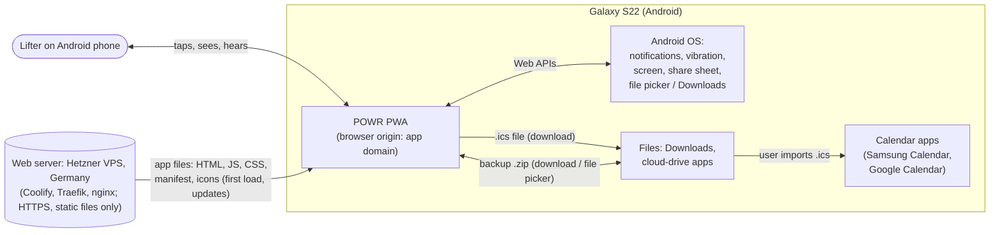
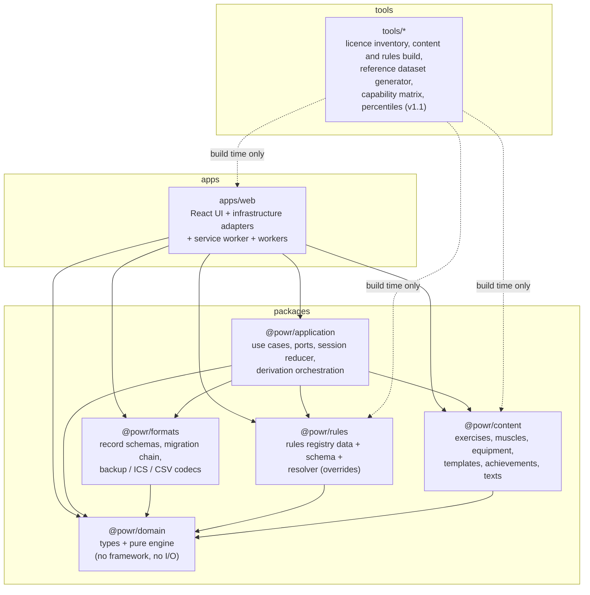
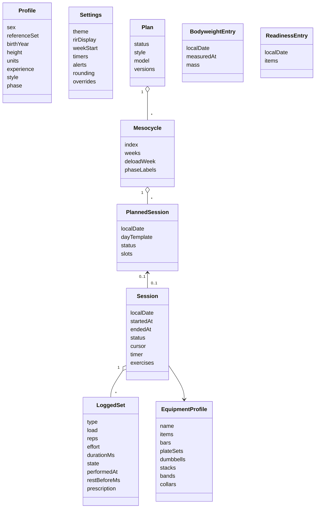
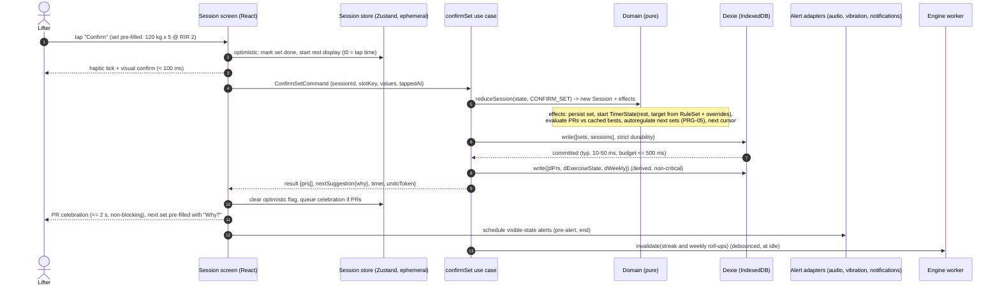
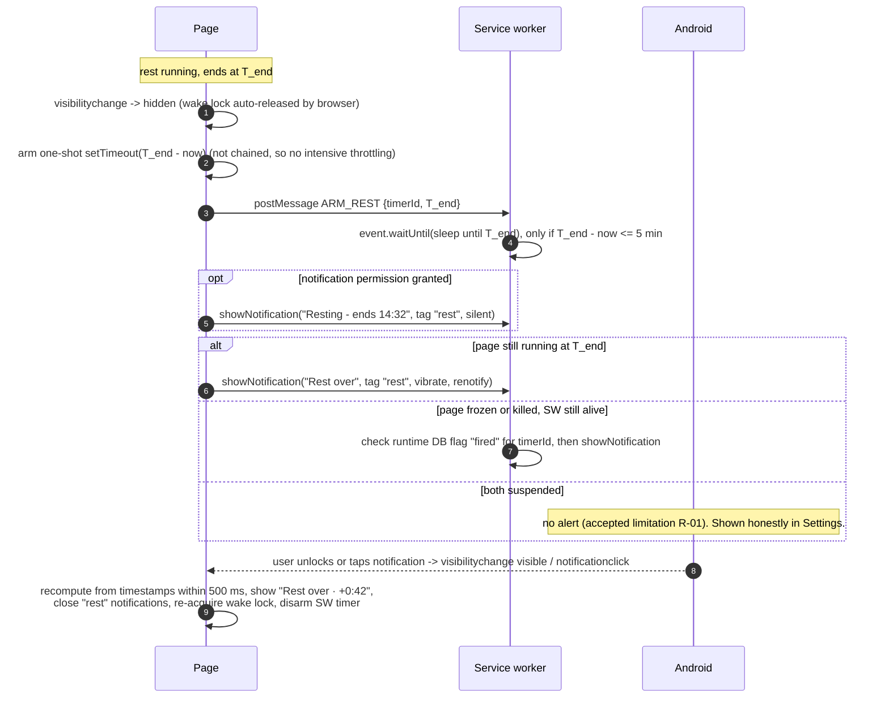
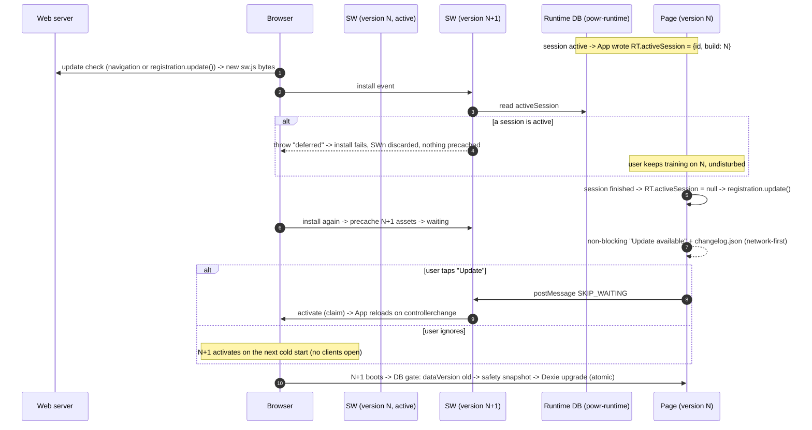
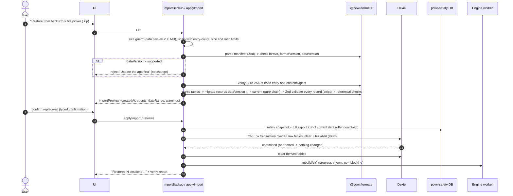
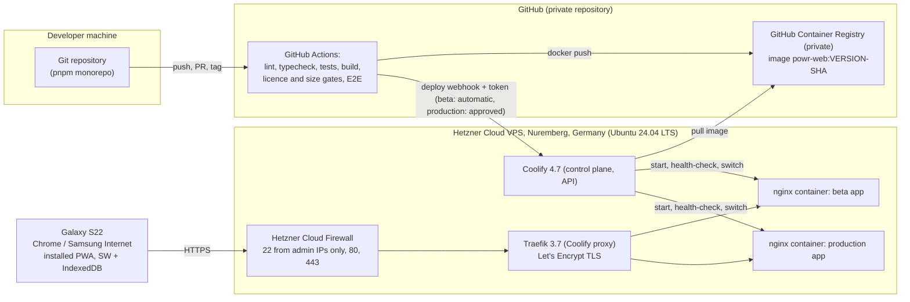
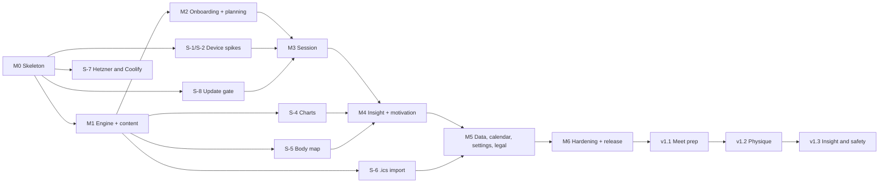

# POWR: Technical Concept (architecture documentation, arc42)

> Local-first, offline training planner and tracker PWA. This document tells the implementation agent **how** to build what the PRD specifies.

## 0. Document information

| Field | Value |
|---|---|
| Title | POWR (working title): Technical Concept |
| Version | 0.2 |
| Date | 2026-11-24 |
| Status | Draft v0.2: all open questions resolved; only spikes/validation tasks remain |
| Owner / publisher | Simeon Zimmermann, SZ WEB DEVELOPMENT, Switzerland |
| Author | Architecture agent, for the product owner (sole developer) |
| Audience | Implementation agent, product owner, testers |
| Sources | (1) **PRD v0.2** `docs/PRD.md`, authoritative for all requirements. (2) **Evidence base** `reports/Strength and hypertrophy evidence base.md` ("EB"), source of all training formulas and defaults. (3) Braindump `app.requirements.md` (background). (4) **npm registry metadata**, queried 2026-11-23: versions, licences and publish dates of every recommended package (Appendix B). (5) **MDN browser-compat-data 8.1.10**, which lists Chrome for Android 158 and Samsung Internet 31.0 (Blink 148, released 2026-09-23) as current: browser capability claims (Appendix C). (6) Vendor and platform documentation (Appendix D). (7) **Product-owner decisions of 2026-11-24** on the open questions (hosting on Hetzner + Coolify, oxlint and oxfmt instead of ESLint and Prettier, domain strategy, GitHub, Labs audio test); new facts re-checked on the npm registry, GitHub and vendor docs on 2026-11-24. |
| Structure | arc42 (sections 1–12) plus appendices. Architecture decisions are recorded as ADRs in `docs/adr/` (index: `docs/adr/README.md`). |

### 0.1 Conventions

- **PRD IDs** (`DAT-05`, `NFR-REL-01`, `TC-03`, `V-01`, `E-1` …) and **EB references** (`EB §Load › e1RM algorithm`) are used exactly as in the PRD.
- **ADR-nnnn** points to `docs/adr/nnnn-*.md`.
- **[Assumption TA-nn]** marks a technical assumption made here. They are collected in §2.4. The ones that would change the architecture are also in the **Open questions** at the end.
- **[Verified: …]** marks a browser or vendor fact checked against a named source on 2026-11-23. **[Device test]** marks a capability that must be confirmed on the Galaxy S22 (Chrome and Samsung Internet) before it is relied on.
- Type sketches are TypeScript and illustrative. They fix names, shapes and responsibilities, not final code.
- "MVP", "v1.1", "v1.2", "v1.3" and "Later" are the PRD release tags (§10).

### 0.2 Reading guide for the implementation agent

1. Read §1–§4 for the goals and the solution strategy (about 15 minutes).
2. Read §5 for the package layout and the dependency rules you must not break.
3. Build the walking skeleton in Appendix A, milestone M0, using §7 (deployment), §8.2–§8.4 (persistence, backup, service worker) and §8.21 (CI).
4. Before each feature, read the matching cross-cutting concepts in §8 and the runtime scenarios in §6.

### 0.3 Change log

| Version | Date | Change |
|---|---|---|
| 0.1 | 2026-11-23 | First complete draft: arc42 sections 1–12, appendices, 21 ADRs, 8 open questions |
| 0.2 | 2026-11-24 | Product-owner decisions applied. **Resolved:** OQ-T1 = C (beta on a subdomain of the publisher's business domain; production domain chosen after the trademark check V-05, never changed afterwards); OQ-T2 = **Hetzner Cloud VPS (Germany) + self-hosted Coolify** (a new option: §7 and ADR-0011 rewritten, privacy wording changed from "Swiss hosting" to "EU hosting with a Swiss publisher", new operations section §7.6); OQ-T3 = B (background-audio keep-alive tested in S-1, opt-in Labs only if it clearly works); OQ-T5 = A (private GitHub + Actions). **Linting and formatting:** ESLint + typescript-eslint replaced by **oxlint** (type-aware via `oxlint-tsgolint`); Prettier replaced by **oxfmt** (ADR-0017). Consequences: layer boundaries re-designed (pnpm isolation + TypeScript project references + oxlint `no-restricted-imports` overrides + an architecture test; dependency-cruiser dropped, §5.2, ADR-0001); **TypeScript moved from 6.0 to 7.0** (ADR-0002); Lingui literal-string enforcement re-designed (§8.15, ADR-0016); Tailwind class sorting through oxfmt. **Adopted defaults, pending confirmation:** OQ-T4 = A, OQ-T6 = A, OQ-T7 = A, OQ-T8 = A. New open questions OQ-T9…OQ-T11. Roadmap spikes updated (S-1 includes the audio test, S-7 is now the Hetzner/Coolify setup). **Final 2026-11-24:** OQ-T4, T6, T7, T8 confirmed (A); OQ-T9 = hosted free-tier uptime monitor, preferably EU-based (service chosen in S-7); OQ-T10 = warn now, block later for the alpha JS-plugin rules; OQ-T11 = DNS stays at the current provider (`beta.`, `coolify.` and CAA records), business-domain name to be filled in by the product owner in S-7/WP0.7. All open questions are resolved. |

---

## 1. Introduction and goals

### 1.1 Requirements overview

POWR is a free, closed-source Progressive Web App for bodybuilders, powerlifters and hybrid lifters. Its core loop (PRD §4) is: onboarding → equipment and profile → generated mesocycle plan → workout session (fast logging, pre-filled suggestions, timers) → progression engine (e1RM, double progression, RPE-based loads, deloads) → analytics, body map, motivation, bodyweight, calendar export → local data management.

The architecture is driven by these requirements:

| Driver | What it means technically | PRD |
|---|---|---|
| Pure PWA, no backend, no account | All logic and data run in the browser. The web server only serves static files. | C-01…C-03, NG-01, NG-13 |
| Fully offline after first load | Precache the whole app. Make zero runtime requests to third parties. | PWA-03, NFR-PRIV-02 |
| Never lose a confirmed set | Durable, atomic writes; survive process kill; atomic migrations and imports; manual backup as the only transfer path | DAT-02, DAT-05…08, DAT-14, NFR-REL-01…08 |
| Timers that are correct even when the page is throttled or frozen | Timestamp-based timers. Wake lock while training. Best-effort notifications when hidden. Honest capability status. | TMR-04…06, PWA-06…08, C-10 |
| Evidence-based, explainable, deterministic engine | Pure functions driven by a versioned rules registry. Every suggestion carries a "why" trace. | PRG-01…18, NFR-MNT-01/02, LEG-05 |
| Closed source, permissive licences only | Licence inventory generated from the shipped bundle. CI fails on unknown or copyleft licences. | LEG-06, LEG-08, NFR-MNT-08 |
| Gym ergonomics and accessibility | One-handed, large targets, WCAG 2.2 AA, light/dark themes | NFR-A11Y-01…11, NFR-USE-01…07, SET-01 |
| Performance on the Galaxy S22 | Cold start ≤ 2 s, set commit ≤ 500 ms, charts ≤ 500 ms on 5 years of data | NFR-PERF-01…10 |

### 1.2 Quality goals

The five goals below are derived from the PRD NFRs and listed in priority order. When two goals conflict, the higher one wins. For example, strict IndexedDB durability costs a few milliseconds per write (goal 5) but protects data (goal 1), so strict durability is used.

| Prio | Quality goal | Scenario in one sentence | PRD NFRs |
|---|---|---|---|
| **Q1** | **Data integrity and durability** | A set the user saw confirmed survives a process kill, a browser update, an app update with a schema migration, and a backup round-trip, bit for bit. | NFR-REL-01…08, DAT-02, DAT-05…07, DAT-14 |
| **Q2** | **Offline reliability in the gym** | In airplane mode, after backgrounding and screen lock, the session resumes at the right set with correct timers within 500 ms. | PWA-03, PWA-04, TMR-04, WKT-14, NFR-PERF-02 |
| **Q3** | **Correct, deterministic and explainable training logic** | Every engine output reproduces the EB reference values and can be explained by naming its rule, its inputs and its parameter versions. | NFR-MNT-01/02, NFR-REL-03, PRG-09, PRG-18 |
| **Q4** | **Privacy and licence compliance** | No byte of user data and no request leaves the origin, and every distributed component has an approved permissive licence. | NFR-PRIV-01…06, NFR-SEC-01…03, LEG-06, LEG-08, NFR-MNT-08 |
| **Q5** | **Fast, accessible one-handed UX** | A set done as prescribed is logged with one tap in under 100 ms of visual feedback, operable with TalkBack and at 200% font scale. | NFR-PERF-01…10, NFR-A11Y-01…11, NFR-USE-01 |

Maintainability by a single developer is not ranked as a goal. It is a constraint (§2.2) that shapes every decision: few moving parts, boring and well-maintained dependencies, and strong automated tests.

### 1.3 Stakeholders

| Stakeholder | Role | Expectations of the architecture |
|---|---|---|
| Simeon Zimmermann (SZ WEB DEVELOPMENT) | Product owner, publisher, sole developer (React, Node, TypeScript), and operator of the hosting server (Hetzner VPS with Coolify) | A stack he already knows; low operating cost; a small, well-documented operations workload (§7.6); quick feedback from automated tests; legal compliance as a publisher |
| Implementation agent | Builds from this document | Unambiguous structure, interfaces, rules and a build order |
| End users (personas P1–P4) | Lifters on Android phones | Fast, offline, private and trustworthy; never loses data |
| Testers / pilot users | Usability and device tests | Test hooks, a reference dataset, a diagnostics export, a beta channel |
| Legal reviewer | Reviews privacy notice, imprint, licences (V-04, V-06) | Licence inventory, a precise data-flow description, hosting location (Germany) and logging facts (no access logs) |
| Content author (developer, possibly an external artist later) | Writes exercises, mappings, cues, artwork | Data-driven content with validation and clear schemas |

---

## 2. Constraints

### 2.1 Technical constraints

| ID | Constraint | Source |
|---|---|---|
| TC-C01 | Pure PWA served as static files from a self-operated web server (Hetzner Cloud VPS with Coolify, decided 2026-11-24). No application backend, no serverless functions, no push, no background sync, no native wrapper. | C-01, C-10, NG-13, NG-14 |
| TC-C02 | Data stays in browser storage of one origin. It moves between devices only by a user-initiated backup file. | C-03, DAT-01 |
| TC-C03 | Target: Galaxy S22 with current Chrome (primary) and Samsung Internet (fully supported for core flows). Other Android best effort. iOS and desktop not targeted. | C-04, C-14, NFR-COMP-01…03 |
| TC-C04 | Supported browser baseline: **Chromium 130+**, that is Chrome for Android 130+ and Samsung Internet 28+ (Blink 130, released 2025-04-02 per MDN BCD). Older browsers see an "update your browser" screen. **Resolved 2026-11-24: A (OQ-T4).** | NFR-COMP |
| TC-C05 | No runtime request to any third-party origin. Fonts, icons, sounds and content are self-hosted or bundled. | NFR-PRIV-02 |
| TC-C06 | English UI, all strings externalized, locale-aware formatting | C-06, NFR-MNT-04, NFR-L10N-01/02 |
| TC-C07 | Training logic parameters ship as versioned data with evidence tags, source IDs and `verified` flags | PRG-18, NFR-MNT-01 |
| TC-C08 | First-visit transfer for full offline install ≤ 3 MB compressed | NFR-PERF-07 |

### 2.2 Organisational constraints

| ID | Constraint | Consequence |
|---|---|---|
| OC-01 | One developer, proficient in React, Node and TypeScript | React + TypeScript everywhere; Node/TS for tooling and content pipelines; no second language in the stack |
| OC-02 | Phased delivery: MVP → v1.1 → v1.2 → v1.3 (PRD §10) | Feature flags by release tag (§8.22); forward-compatible data model |
| OC-03 | No analytics, so quality comes from tests, device protocols and pilot users | Strong test automation (§8.20); local diagnostics (§8.17) |
| OC-04 | Low running cost; no paid SaaS required | One small Hetzner VPS (entry plans from € 5.49/month excl. VAT); GitHub Actions free tier; no paid SCA tools |
| OC-05 | Repository host and CI: private GitHub repository with GitHub Actions (decided 2026-11-24, OQ-T5) | §8.21 |
| OC-06 | The publisher operates the hosting server himself: hardening, updates, Coolify upgrades, configuration backups, uptime monitoring, DNS | Operations runbook and responsibilities in §7.6; spike S-7 |

### 2.3 Legal and licence constraints

| ID | Constraint | Source |
|---|---|---|
| LC-01 | Closed source. Distributed components need permissive licences (MIT, BSD, Apache-2.0, ISC, 0BSD, Zlib, CC0, Unlicense, OFL for fonts, CC BY for content). Copyleft (GPL, AGPL, LGPL, MPL, EPL …) is blocked unless reviewed. Share-alike and non-commercial content is excluded by default. | C-09, LEG-08 |
| LC-02 | CI fails on an unknown, unapproved or copyleft licence in any distributed component | NFR-MNT-08, TC-18 |
| LC-03 | OpenPowerlifting (AGPL) code is not ported, copied or adapted. Scoring is reimplemented from official IPF documents and published coefficient sets. OPL test values are test vectors only. | ANL-07, LEG-08 |
| LC-04 | Original artwork (body map) and original text (cues). No exercise media in MVP. | OQ-08, §8.4 PRD |
| LC-05 | Publisher identification and privacy notice in app and on the website. revFADP/nDSG primary; GDPR to be confirmed (V-06). The privacy notice names the hosting set-up: a server in Germany (EU) rented from Hetzner Online GmbH and operated by the Swiss publisher, with access logs disabled (§7.4). | LEG-02, LEG-09, NFR-PRIV-06 |
| LC-06 | Wellness scope: no diagnosis, no injury prediction, no risk scores | LEG-07, EB §Gaps #25 |

### 2.4 Technical assumptions

| ID | Assumption | Impact if wrong | Where decided |
|---|---|---|---|
| TA-01 | A Hetzner Cloud VPS in Nuremberg (Germany) with at least 2 vCPU / 4 GB RAM runs Coolify, its Traefik proxy with Let's Encrypt, and two nginx containers (beta, production); Traefik and nginx can run without access logs; Coolify's deploy webhook works from GitHub Actions | Adjust sizing or configuration; worst case serve the nginx image without Coolify (plain Docker Compose + Caddy) | ADR-0011, spike S-7 |
| TA-02 | The system font stack (Roboto or the Samsung system font) is acceptable; no brand font in MVP. **Resolved 2026-11-24: A (OQ-T7).** | Add a self-hosted OFL font (about 50–100 KB) | §8.9, OQ-T7 |
| TA-03 | Baseline is Chromium 130+ (Samsung Internet 28+). **Resolved 2026-11-24: A (OQ-T4).** | Lower baseline means more polyfills and testing | §2.1, OQ-T4 |
| TA-04 | ~~GitHub private repository plus GitHub Actions~~ **Resolved 2026-11-24 (OQ-T5 = A)**; now constraint OC-05 | — | OQ-T5 |
| TA-05 | The PRD reference dataset (A-11: 1,300 sessions, 40,000 sets, 1,800 bodyweight entries) is representative of heavy users | Re-tune indexes and derived caches | §8.19 |
| TA-06 | A data-only backup of the reference dataset is about 8–15 MB of JSON before compression and about 1–2 MB as a ZIP | Change chunking strategy | §8.3 |
| TA-07 | Progress photos (v1.2) are stored as Blobs in IndexedDB, not OPFS, pending spike S-3 | Switch photo storage to OPFS behind the same port | §8.2.8 |
| TA-08 | ~~The production origin is fixed before public launch~~ **Resolved 2026-11-24 (OQ-T1 = C):** beta runs on a subdomain of the publisher's business domain; the production domain is chosen after the trademark check (V-05) and never changed afterwards | A changed origin strands all users' local data (§11, T-01); beta users move with backup/restore (§7.8) | OQ-T1 |
| TA-09 | The developer authors the ≥ 150-exercise library as YAML data (possibly AI-assisted, always reviewed) | Content milestone slips | §8.12 |

### 2.5 Conventions

- TypeScript `strict`, ES modules only, no default exports in packages, named exports.
- Conventional Commits; semantic versioning for the app (§7.8).
- Units in identifiers: `…Ms`, `…Kg`, `…Pct` (fraction 0–1 unless named `…Percent`).
- Dates: `LocalDate` strings `YYYY-MM-DD` for calendar days; `InstantTz` for moments (§8.1).

---

## 3. Context and scope

### 3.1 Business context



| Partner | Input to POWR | Output from POWR | PRD |
|---|---|---|---|
| User | Profile, equipment, plan edits, logged sets, bodyweight, check-ins, settings | Plans, pre-filled sets, timers and alerts, charts, body map, explanations, celebrations | §5 |
| Android OS (via the browser) | Visibility changes, permission grants, files picked, notification taps | Notifications, vibration, wake lock, share-sheet payloads, downloaded files | PWA-05…14 |
| File system (Downloads, cloud-drive apps via the Android file picker) | Backup `.zip` for restore | Backup `.zip`, `.ics`, CSV (v1.3), diagnostics `.txt` (v1.3) | DAT-05/06, CAL-01, DAT-11, DAT-16 |
| Calendar apps | — (the user imports the `.ics` file manually) | `.ics` file with planned sessions | CAL-01…05 |
| Web server (Hetzner VPS, operated by the publisher) | App files (first load, update checks) | Plain GET requests. No user data is ever sent. No access logs are kept (§7.4). | NFR-PRIV-01, NFR-PRIV-06 |

### 3.2 Technical context

| Channel | Technology | Direction | Notes |
|---|---|---|---|
| App delivery | HTTPS GET from the web server (Traefik → nginx); service worker precache | Server → device | Only requests the app ever makes: navigation, precache downloads, `sw.js` update checks, `changelog.json` on update. All same-origin (CSP `connect-src 'self'`). |
| Local persistence | IndexedDB (Dexie) databases on the app origin | Internal | §8.2 |
| OS integration | Screen Wake Lock, Vibration, Notifications (via service worker), Web Audio, Web Share, File System Access save picker (where available), `<input type=file>`, manifest shortcuts, share target (v1.3) | Both | §8.8, Appendix C |
| Calendar | RFC 5545 `.ics` file | Out | §8.13 |
| Backup | ZIP container with JSON tables and a manifest (ADR-0013) | Both | §8.3 |

### 3.3 External interfaces

| Interface | Format | Version field | Delivery | Release |
|---|---|---|---|---|
| Backup / restore | `.zip` (`application/zip`): `manifest.json` + `data/<table>.json` (+ `photos/…` in photo parts from v1.2; encrypted payload from v1.3) | `formatVersion` (container) + `dataVersion` (record schema) | Download or save picker. Never Web Share (Chrome excludes `.zip` and `.json`, PRD P-04). Import via file picker (and share target from v1.3). | MVP |
| Calendar export | `.ics` (`text/calendar`), RFC 5545, UTC times, stable UIDs | `PRODID` with app version | Download. Web Share only if `navigator.canShare({files})` returns true for the file at runtime (Chrome excludes `.ics`). | MVP |
| Training log export | CSV (UTF-8 with BOM, RFC 4180), one row per set; bodyweight CSV | Documented, fixed header row per version; first column `powr_csv_version` | Web Share (CSV is allowed in Chrome) or download | v1.3 |
| Diagnostics export | `.txt` containing pretty-printed JSON (so it can go through the share sheet, which allows `text/plain`) | `diagnosticsVersion` | Web Share or download | v1.3 (logging from MVP) |
| Share cards | PNG images | — | Web Share | v1.2 |
| App shortcuts | Manifest `shortcuts` → deep-link URLs (`/session/start?source=shortcut`, `/body/log`, `/timer`, `/history/last`) | — | OS launcher | MVP |
| Share target | Manifest `share_target` (POST, `multipart/form-data`, accepts `application/zip`) → SW → restore flow | — | OS share sheet | v1.3 |

---

## 4. Solution strategy

| Concern | Decision | Quality goals | ADR |
|---|---|---|---|
| Repository and modularity | pnpm-workspace monorepo with framework-free packages (`domain`, `rules`, `content`, `formats`, `application`) and one app (`apps/web`); package boundaries enforced by pnpm strictness, TypeScript project references, oxlint import rules and an architecture test | Q3, maintainability | ADR-0001, ADR-0021 |
| Framework and build | React 19 + TypeScript 7.0 (native compiler) + Vite 8 (Rolldown), React Compiler on | Q5, OC-01 | ADR-0002 |
| UI components and styling | shadcn/ui components (copied into the repo) on **Base UI** primitives, Tailwind CSS v4 with CSS-variable design tokens | Q5 | ADR-0003, ADR-0004 |
| Routing | TanStack Router (type-safe routes and search params, code splitting, navigation blockers for the back gesture) | Q5, Q2 | ADR-0014 |
| Persistence | IndexedDB via **Dexie 4** with strict durability for user-confirmed writes; derived data in rebuildable tables; separate tiny runtime DB for service-worker flags | Q1, Q2 | ADR-0006 |
| State | Dexie `liveQuery` for persisted state, Zustand for ephemeral cross-screen UI state, router search params for view state, pure reducer for the active session | Q2, Q5 | ADR-0005 |
| Offline and updates | `vite-plugin-pwa` (injectManifest) with a custom service worker on Workbox precaching. Update prompt only; install is **gated** while a workout is active; migrations never start mid-session. | Q1, Q2 | ADR-0008 |
| Engine | Pure, deterministic TypeScript functions. Every result carries an `Explanation`. Parameters are injected as a resolved `RuleSet`. Heavy recomputes run in a Web Worker. | Q3 | ADR-0020 |
| Rules registry | YAML parameter tables with evidence tags, source IDs and `verified` flags, validated against a typed schema at build time and compiled to versioned JSON; user overrides layer on top | Q3 | ADR-0012 |
| Content | YAML exercise library, muscle taxonomy, equipment catalog, templates, validated and coverage-tested at build time | Q3 | ADR-0012 (shared pipeline), §8.12 |
| Timers and alerts | Timestamp model persisted with the session; wake lock during workouts; Web Audio and vibration while visible; page timeout plus service-worker `waitUntil` timer plus notification when hidden; capability matrix drives an honest status | Q2 | ADR-0019 |
| Backup | ZIP container (fflate), per-entry SHA-256, single record-migration chain shared with the local DB, Zod validation, atomic replace-all restore, safety snapshot; AES-GCM encryption in v1.3 | Q1, Q4 | ADR-0013 |
| Validation | Zod 4 (JIT disabled for CSP) for import, forms, content and rules schemas; JSON Schema export documents the backup format | Q1, Q4 | ADR-0009 |
| Dates and time | Temporal API through the `temporal-polyfill` ponyfill (native Temporal exists only in Chrome 144+ and Samsung Internet 31+) | Q1, Q3 | ADR-0015 |
| Charts | Apache ECharts 6 (tree-shaken, lazy-loaded) for analytics; hand-written SVG sparklines on Home | Q5 | ADR-0007 |
| i18n | Lingui 6 (ICU messages, compiled catalogs, lint rule against literal strings) plus `Intl` formatters | TC-C06 | ADR-0016 |
| Testing | Vitest 5 (unit, property with fast-check, component tests in browser mode), Playwright 1.65 (E2E with offline, update and interruption tests), axe-core, migration fixtures, manual S22 protocol | Q1, Q3, Q5 | ADR-0010 |
| Quality gates | oxlint (type-aware) + oxfmt; layer boundaries via pnpm isolation, TypeScript project references, oxlint import restrictions and an architecture test; licence inventory from the bundle graph; size budgets; Lighthouse CI | Q4, maintainability | ADR-0001, ADR-0017, ADR-0018 |
| Hosting | Hetzner Cloud VPS in Germany with self-hosted Coolify: Traefik with Let's Encrypt in front of an own nginx container image (strict headers, no access logs); images built once in CI, deployed via Coolify webhook, rollback by image; beta and production as separate Coolify applications on separate domains | Q4, Q2 | ADR-0011 |

The core idea in one paragraph: **all truth lives in raw, append-mostly logs in IndexedDB; everything else is a deterministic function of those logs, the content version and the rules version.** The UI only renders those functions' outputs, and every output can be recomputed, verified ("Verify data", NFR-REL-03) and explained. That one rule covers backups (derived data need not be exported), migrations (only raw records migrate), explainability (traces come from the same functions), and testability (pure functions plus fixtures).

---

## 5. Building block view

### 5.1 Level 1: monorepo packages



| Package | Responsibility | May depend on | Must not contain | PRD |
|---|---|---|---|---|
| `@powr/domain` | Entities, value objects and **all calculations**: units and rounding, plate math, e1RM, trend filter, progression, warm-ups, volume accounting, deload/taper/return, readiness, PRs, streaks, scoring, bodyweight trend, nutrition (v1.2), plan generation and validation, explanation types. Owns the `RuleSet` *type* and the `ExerciseDef` *type*. | `temporal-polyfill` only | React, Dexie, DOM, `Date.now()`, `Math.random()`, `fetch`, Zod, any I/O | PRG-*, PLN-*, EXL-05, WKT-06/07, MOT-01/03/04, ANL-07, BOD-02…09, RDY-02 |
| `@powr/rules` | Rules registry: YAML parameter tables, source registry, Zod schema, build script producing `rules.json` (versioned, hashed), resolver that applies context variants and user overrides and returns a `ResolvedRuleSet` with provenance | `@powr/domain`, `zod` (build + resolver validation), `yaml` (build only) | Calculations | PRG-18, NFR-MNT-01, LEG-05 |
| `@powr/content` | Exercise library, muscle taxonomy (§7.2 PRD), equipment catalog and presets, program templates, achievement definitions (v1.2), educational texts, body-map region IDs; schemas, linter, coverage tests; build output `content.json` | `@powr/domain`, `zod`, `yaml` (build only) | Calculations beyond validation | EXL-01…05, EQP-01/02, §7.1–7.6 PRD |
| `@powr/formats` | Persisted record schemas per `dataVersion`, the **record migration chain** (used by the Dexie upgrade and by backup import), backup container codec (manifest, hashing, zip), `.ics` serializer, CSV serializer (v1.3), JSON Schema export of the backup format | `@powr/domain`, `zod`, `fflate` | UI, Dexie | DAT-05…10, CAL-01…05, DAT-11, NFR-MNT-03 |
| `@powr/application` | Use cases (commands and queries), **ports** (repository, clock, platform), the active-session reducer and effect descriptions, derivation and recompute orchestration, plan-generation orchestration, import/export orchestration | `@powr/domain`, `@powr/rules`, `@powr/content`, `@powr/formats` | React, Dexie, DOM APIs (only through ports) | All functional domains |
| `apps/web` | React UI (routes, features, design system), infrastructure adapters (Dexie repositories, platform adapters for wake lock, audio, vibration, notifications, files, share, storage), composition root, service worker, engine Web Worker, i18n catalogs | Everything above | Business rules (they live in domain/application) | All UI requirements |
| `tools/*` | Node/TS scripts: licence inventory and attributions generator, reference dataset generator, capability-matrix compiler, percentile derivation pipeline (v1.1, after V-03), release-notes compiler | Any (build-time only) | Anything shipped to users | LEG-06/08, PWA-13, ANL-08, NFR-MNT-07 |

### 5.2 Dependency rules and how they are enforced

v0.2 replaces ESLint (and with it `eslint-plugin-boundaries`) by oxlint (ADR-0017). The enforcement now uses four layers that need no alpha features. The details are in ADR-0001.

1. **Direction:** `apps/web → application → {formats, rules, content} → domain`. No cycles. `domain` depends on nothing internal.
2. **Package level, hard gate (1): pnpm isolation.** pnpm's strict `node_modules` layout means a package can only import what its own `package.json` declares, so an undeclared cross-package import fails to resolve. Each package's `package.json` lists only the allowed internal dependencies.
3. **Package level, hard gate (2): TypeScript project references.** Every package has a `composite` `tsconfig.json` whose `references` list exactly its allowed internal packages. `tsc -b` (TypeScript 7.0, which supports build mode) fails on an import from a non-referenced package and refuses circular references.
4. **Inside a package: oxlint native rules with path overrides.** `oxlint.config.ts` uses `overrides` with `files` globs and the native rules `no-restricted-imports` (`patterns` with gitignore-style `group` globs and messages), `no-restricted-globals` and `import/no-cycle`. All three are native, non-alpha rules [Verified: oxc.rs rule pages, 2026-11-24]. Inside `apps/web`, the element rules are:

   | Element (path) | May import | Rule (`no-restricted-imports` patterns for these files) |
   |---|---|---|
   | `src/app/**` (composition root, router, providers) | everything in `apps/web` | — |
   | `src/features/**` (screens and feature components) | `ui`, `hooks`, `i18n`, `@powr/application` types, `@powr/domain` types and pure helpers | forbid `dexie`, `dexie-react-hooks`, `**/infrastructure/**`, `**/sw/**`, `workbox-*` |
   | `src/hooks/**` (query and command hooks) | `@powr/application`, `src/app/container` | forbid `dexie`, `**/infrastructure/**`, `**/features/**` |
   | `src/infrastructure/**` (Dexie, platform adapters, workers) | `@powr/*`, browser APIs | forbid `**/features/**`, `**/ui/**`, `**/hooks/**` |
   | `src/ui/**` (design system) | `ui` only, Base UI, Tailwind utilities | forbid `@powr/*`, `**/features/**`, `**/hooks/**`, `**/infrastructure/**` |
   | `src/sw/**` (service worker) | `workbox-*`, `src/infrastructure/runtime-db` only | forbid `react`, `dexie`, `@powr/*`, everything under `src/` except `infrastructure/runtime-db` |

   In `packages/domain/**`, `no-restricted-imports` forbids `react`, `dexie`, `zod` and every `@powr/*` package, and `no-restricted-globals` bans `Date`, `performance`, `crypto`, `window`, `document`, `localStorage`, `setTimeout`, `setInterval`, `fetch`. Time and IDs come in as arguments.
5. **Architecture test (Vitest, `tools/arch-test`).** A small test runs with the unit tests and checks what lint rules cannot express:
   - the allowed internal-dependency matrix, read from every `package.json` and `tsconfig.json` `references`;
   - that no file in `packages/domain/src` contains `Math.random`, `Date.now` or `new Date(` (oxlint's `no-restricted-globals` covers globals, not member calls).
   It replaces the dependency-cruiser cross-check of v0.1. dependency-cruiser 18.9 supports TypeScript `< 7` or `≥ 7.1` but not 7.0, and its alternative swc parser is marked experimental, so it is deferred until TypeScript 7.1 (TD-07).

`eslint-plugin-boundaries` through oxlint's JS plugins was rejected. JS plugins are alpha and not subject to semver [Verified: oxc.rs JS plugins page], and the plugin relies on ESLint settings and import resolvers that are not documented as supported.

### 5.3 Level 2: `apps/web` internal structure

```text
powr/
├─ package.json                 # root scripts only; "packageManager": "pnpm@12.x"
├─ pnpm-workspace.yaml          # apps/*, packages/*, tools/*
├─ tsconfig.base.json           # strict, noUncheckedIndexedAccess, exactOptionalPropertyTypes
├─ oxlint.config.ts             # oxlint: type-aware, react, jsx-a11y, import; layer overrides (§5.2)
├─ .oxfmtrc.json                # oxfmt: printWidth, Tailwind class sorting, import sorting
├─ .vscode/                     # extensions.json (oxc.oxc-vscode), settings.json (format on save)
├─ deploy/                      # Dockerfile (nginx:1.30-alpine + dist), nginx.conf (headers, cache, SPA), runbook.md
├─ licence-policy.yaml          # SPDX allowlist, denylist, approved exceptions (LEG-08)
├─ assets-inventory.yaml        # non-npm assets: artwork, icons, sounds, data sets (LEG-08)
├─ .github/workflows/ci.yml, deploy.yml, rollback.yml
├─ docs/  (PRD.md, technical-concept.md, adr/, formats/, device-tests/, release-notes/)
├─ apps/web/
│  ├─ index.html                # theme-color metas, CSP-compatible (no inline script)
│  ├─ vite.config.ts            # react(+compiler), lingui, tanstack router, pwa(injectManifest), licence plugin
│  ├─ public/                   # icons (regular + maskable), screenshots, robots.txt
│  ├─ src/
│  │  ├─ main.tsx               # bootstrap: theme pre-paint, capability probe, DB open/migrate gate, render
│  │  ├─ app/                   # container.ts (composition root), router.tsx, providers, error boundaries
│  │  ├─ routes/                # TanStack Router route files (thin: params, loaders, lazy components)
│  │  ├─ features/
│  │  │  ├─ onboarding/  session/  plan/  exercises/  bodymap/  progress/
│  │  │  ├─ body/  calendar/  data/  settings/  about/  home/
│  │  ├─ hooks/                 # useLive*, useCommand*, useCapabilities, useReducedMotion…
│  │  ├─ ui/                    # shadcn/Base UI components, tokens.css, icons/, charts/ (EChart wrapper, Sparkline)
│  │  ├─ i18n/                  # lingui config, locales/en/messages.po, compiled catalogs
│  │  ├─ infrastructure/
│  │  │  ├─ db/                 # Dexie schema (versions), repositories, unit of work, runtime-db
│  │  │  ├─ platform/           # wakeLock, audio, haptics, notifications, files, share, storage, install
│  │  │  ├─ workers/            # engine.worker.ts + typed RPC client
│  │  │  ├─ diagnostics/        # log ring buffer, perf marks
│  │  │  └─ capabilities/       # feature detection + shipped device-test matrix
│  │  └─ sw/                    # service-worker.ts (precache, navigation, install gate, alerts, share target)
│  └─ e2e/                      # Playwright specs, fixtures, reference dataset loader
├─ packages/
│  ├─ domain/src/   units/ time/ ids/ equipment/ loading/ e1rm/ trend/ progression/ warmup/
│  │                volume/ planning/ deload/ readiness/ prs/ streaks/ scoring/ bodyweight/
│  │                nutrition/ explain/ index.ts
│  ├─ rules/        data/*.yaml  sources.yaml  src/schema.ts  src/resolve.ts  scripts/build.ts
│  ├─ content/      data/exercises/*.yaml  data/muscles.yaml  data/equipment.yaml  data/presets.yaml
│  │                data/templates/*.yaml  data/education/*.md  src/schema.ts  scripts/{build,lint}.ts
│  │                ids.lock.json   # every ID ever published (stability check)
│  ├─ formats/      src/records/v1.ts … vN.ts  src/migrations/  src/backup/  src/ics/  src/csv/
│  └─ application/  src/ports/  src/usecases/  src/session/  src/derivation/  src/importexport/
└─ tools/  licence/  arch-test/  dataset/  capability-matrix/  release-notes/  percentiles/ (v1.1)
```

### 5.4 Domain engine modules

| Module (`@powr/domain/…`) | Responsibility | PRD | EB |
|---|---|---|---|
| `units` | `Mass`, `Length`, conversions, display rounding inputs | SET-02, NFR-REL-07 | — |
| `time` | `LocalDate`, `InstantTz`, week keys, week-start math, day differences (Temporal) | SET-11, NFR-REL-05 | — |
| `equipment` | Requirement expressions (`allOf` / `anyOf`), availability check, missing-item explanation | EQP-03/04, EXL-04 | — |
| `loading` | Achievable-load rounding service, plate calculator (both directions), dumbbell, kettlebell and stack rounding | WKT-07, PRG-07 | §Defaults › Progression |
| `e1rm` | Effective reps, equations (Wathan default, Epley, Brzycki), exact RTS lookup, set weighting, session e1RM, curve classes, personal curve, correction factors | PRG-01, PRG-05 | §Load (all) |
| `trend` | Local-level Kalman filter on log e1RM, change labelling ("likely" / "very likely real"), rep-range artefact flags | PRG-02, ANL-02 | §Load › Real change, › e1RM drift |
| `progression` | Double progression, RPE-based load, linear with stall rule, increments, calibration, in-session autoregulation, next-session suggestions | PRG-03…08, PRG-10 | §Progression |
| `warmup` | Ramp generator with pruning and rounding | WKT-06 | §Session › Warm-up |
| `volume` | Hard-set rule, fractional and direct counting, technique credits, weekly summaries, roll-up of sub-regions, competition-lift volume | EXL-05, WKT-04, ANL-03, MAP-04 | §Volume, §Session › Techniques |
| `planning` | Template selection, exercise selection and ranking (MAP-03), volume allocation, scheduling, duration estimate, constraint validation report | PLN-01…14, MAP-02/03 | §Defaults › Volume, › Session |
| `deload` | Planned and reactive deloads, return-from-break, taper and peaking (v1.1), attempts (v1.1) | PRG-11…13, PLN-16/17 | §Progression › Deloads, › Tapering, › Breaks |
| `readiness` | Rolling 28-day z-scores, composite, adjustments | RDY-02/03 | §Monitoring › Readiness |
| `prs` | PR detection and recomputation | MOT-01 | §Load › Real change |
| `streaks` | Weekly adherence, breaks, grace | MOT-03/04 | — |
| `scoring` | Wilks, Wilks2020, DOTS, IPF Points, IPF GL, allometric index | ANL-07 | §Scoring |
| `bodyweight` | EMA trend with gaps and winsorizing, regression rate | BOD-02 | §Nutrition › Trend smoothing |
| `nutrition` | RMR hierarchy, TDEE recalibration, macros, guardrails, cut planner (v1.1/v1.2) | BOD-04…09 | §Nutrition |
| `explain` | `Explanation`, `ParamRef`, `Fact` types and builders | PRG-09, MAP-03, LEG-05 | §How to read the evidence tags |

### 5.5 Key interfaces (ports)

Ports are defined in `@powr/application/ports` and implemented in `apps/web/src/infrastructure`. Tests use in-memory fakes.

```ts
// Minimal observable, structurally compatible with Dexie's liveQuery result
export interface Observable<T> { subscribe(o: { next(v: T): void; error?(e: unknown): void }): { unsubscribe(): void } }

export interface Clock {
  now(): InstantTz;              // wall clock with offset and IANA zone
  monotonicMs(): number;         // performance.now() based, for in-page timer math
}
export interface IdGenerator { next(): string }   // UUIDv7, time-ordered for index locality

export type TableName =
  | 'meta' | 'profile' | 'settings' | 'equipmentProfiles' | 'customExercises' | 'exerciseUserData'
  | 'plans' | 'plannedSessions' | 'sessions' | 'sets' | 'bodyweights' | 'measurements'
  | 'readiness' | 'breaks' | 'meets' | 'photos' | 'photoBlobs'
  | 'dExerciseState' | 'dSessionE1rm' | 'dPrs' | 'dWeekly' | 'dStreak';

export interface UnitOfWork {
  /** One IndexedDB transaction, strict durability. All writes inside commit or none do. */
  write<T>(tables: readonly TableName[], fn: (tx: Repositories) => Promise<T>): Promise<T>;
  read<T>(tables: readonly TableName[], fn: (tx: Repositories) => Promise<T>): Promise<T>;
}

export interface Repositories {
  sessions: SessionRepo; sets: SetRepo; plans: PlanRepo; bodyweights: BodyweightRepo;
  settings: SettingsRepo; equipment: EquipmentRepo; derived: DerivedRepo; meta: MetaRepo; /* … */
}

export interface SessionRepo {
  get(id: SessionId): Promise<Session | undefined>;
  getActive(): Promise<Session | undefined>;
  put(s: Session): Promise<void>;
  observeActive(): Observable<Session | undefined>;
}
export interface SetRepo {
  add(s: LoggedSet): Promise<void>; put(s: LoggedSet): Promise<void>; delete(id: SetId): Promise<void>;
  bySession(id: SessionId): Promise<LoggedSet[]>;
  byExercise(id: ExerciseId, range?: { from?: LocalDate; to?: LocalDate }): Promise<LoggedSet[]>;
  observeByExercise(id: ExerciseId, range?: { from?: LocalDate }): Observable<LoggedSet[]>;
}

export interface ContentCatalog {
  readonly version: string;                     // e.g. "1.0.4+sha.3f2a"
  exercise(id: ExerciseId): ExerciseDef | undefined;  // built-in or custom, merged
  exercises(): readonly ExerciseDef[];
  muscles(): MuscleTaxonomy; equipment(): EquipmentCatalog; templates(): readonly TemplateDef[];
}
export interface RulesProvider {
  readonly version: string;                     // registry semver + hash
  resolve(ctx: RuleContext, overrides: readonly ParamOverride[]): ResolvedRuleSet;
}

// Platform ports (all optional capabilities report support honestly)
export interface WakeLockPort { readonly supported: boolean; acquire(): Promise<'held' | 'denied' | 'unsupported'>; release(): Promise<void> }
export interface HapticsPort { readonly supported: boolean; vibrate(pattern: readonly number[]): boolean }
export interface AudioPort { unlock(): Promise<boolean>; play(cue: CueId, volume: number): void }
export interface AlertScheduler {
  /** Arms all available hidden-state paths for one rest end; idempotent per timerId. */
  armRestEnd(a: { timerId: string; endsAtEpochMs: number; title: string; body: string }): Promise<void>;
  disarm(timerId: string): Promise<void>;
  status(): Promise<HiddenAlertStatus>;          // 'supported' | 'limited' | 'not-supported' + reasons
}
export interface FileGateway {
  save(f: { name: string; blob: Blob; mime: string }): Promise<'saved' | 'downloaded' | 'cancelled'>;
  pick(accept: readonly string[]): Promise<File | null>;
}
export interface ShareGateway { canShare(d: ShareData): boolean; share(d: ShareData): Promise<'shared' | 'cancelled'> }
export interface StoragePort {
  persisted(): Promise<boolean>; requestPersist(): Promise<boolean>;
  estimate(): Promise<{ usage: number; quota: number } | null>;
}
export interface EngineWorker {                // typed RPC over postMessage (no library)
  recompute(scope: DirtyScope): Promise<RecomputeReport>;
  verifyAll(): Promise<VerifyReport>;
  generatePlan(input: PlanInput): Promise<PlanProposal>;
}
export interface Logger { debug(c: string, d?: object): void; info(c: string, d?: object): void; error(c: string, e: unknown, d?: object): void }
```

Use cases are plain async functions taking a dependency object, for example:

```ts
export async function confirmSet(deps: Deps, cmd: ConfirmSetCommand): Promise<ConfirmSetResult> // §6.2
export async function generatePlan(deps: Deps, input: OnboardingAnswers): Promise<PlanProposal>  // §6.1
export async function exportBackup(deps: Deps, opts: ExportOptions): Promise<ExportResult>       // §6.4
export async function importBackup(deps: Deps, file: File): Promise<ImportPreview>             // §6.5
export async function applyImport(deps: Deps, preview: ImportPreview): Promise<ImportResult>
export async function exportIcs(deps: Deps, range: IcsRange): Promise<File>                    // §6.6
```

### 5.6 Domain model

Logical entities follow PRD §7.7. **Raw** entities are the source of truth and are backed up. **Derived** entities are rebuildable caches and are not backed up (NFR-REL-03).



Core type sketches (in `@powr/domain`):

```ts
type Brand<T, B extends string> = T & { readonly __brand: B };
export type ExerciseId = Brand<string, 'ExerciseId'>;  // 'ex.barbell-back-squat' (content) | 'cx.<uuidv7>' (custom)
export type MuscleId   = Brand<string, 'MuscleId'>;    // 'mu.quads' | 'mu.quads.vasti' (sub-region rolls up to parent)
export type EquipmentId = Brand<string, 'EquipmentId'>;
export type SessionId = Brand<string, 'SessionId'>; export type SetId = Brand<string, 'SetId'>;
export type LocalDate = Brand<string, 'LocalDate'>;   // 'YYYY-MM-DD' (Temporal.PlainDate string)

export type MassUnit = 'kg' | 'lb';
export interface Mass { readonly value: number; readonly unit: MassUnit }  // stored as entered (§8.1)
export interface InstantTz { readonly epochMs: number; readonly offsetMin: number; readonly zone: string }

export interface Effort { readonly rir: number | null; readonly source: 'entered' | 'none'; readonly openEnded?: boolean } // rir 0..10 step 0.5; RPE = 10 - rir

export type SetType = 'warmup' | 'working' | 'top' | 'backoff' | 'amrap' | 'timed';
export type TechniqueKind = 'drop' | 'restPause' | 'myoReps' | 'cluster' | 'lengthenedPartials' | 'partialExtension';

export interface LoggedSet {
  readonly id: SetId; readonly sessionId: SessionId; readonly exerciseId: ExerciseId;
  readonly slotKey: string;               // stable key of the exercise within the session
  readonly index: number;                 // order within the exercise
  readonly type: SetType;
  readonly technique?: { kind: TechniqueKind; miniSets?: number; drops?: number };
  readonly load: Mass | null;             // external load; negative value for assistance (WKT-11)
  readonly reps: number | null; readonly repsLeft?: number; readonly repsRight?: number;
  readonly durationMs?: number;           // timed sets (TMR-09)
  readonly effort: Effort;
  readonly state: 'done' | 'skipped';
  readonly flags: { failure?: boolean; failedRep?: boolean; pain?: boolean };
  readonly performedAt: InstantTz; readonly localDate: LocalDate;  // denormalized for indexes
  readonly restBeforeMs?: number;         // TMR-08
  readonly prescription?: PrescriptionSnapshot;  // what was suggested, for M5/M6 and "overrides recorded" (PRG-03)
  readonly note?: string;
}

export interface Session {
  readonly id: SessionId; readonly plannedSessionId?: string;
  readonly localDate: LocalDate; readonly startedAt: InstantTz; readonly endedAt?: InstantTz;
  readonly status: 'active' | 'finished' | 'partial' | 'discarded';
  readonly equipmentProfileId: string;
  readonly exercises: readonly SessionExercise[];   // order, prescription snapshot, notes, superset groups
  readonly cursor: { slotKey: string; setIndex: number } | null;
  readonly timer: TimerState | null;                // persisted, timestamp-based (§8.8)
  readonly versions: VersionStamp;                   // engine, rules and content versions used (PRG-18)
}

export interface TimerState {
  readonly id: string; readonly kind: 'rest' | 'warmupRest' | 'transition' | 'set';
  readonly mode: 'countdown' | 'countup';
  readonly startedAtEpochMs: number; readonly targetMs: number; readonly adjustMs: number; // ±15 s steps
  readonly softMinMs?: number; readonly fired: { pre: boolean; end: boolean };
}

export type Prescription =
  | { mode: 'fixed'; sets: number; reps: number; load: Mass }
  | { mode: 'percent'; sets: number; reps: number; pct: number; of: 'e1rm' | 'trainingMax' }
  | { mode: 'rpe'; sets: number; reps: number; targetRir: number }
  | { mode: 'doubleProgression'; sets: number; repRange: readonly [number, number]; targetRir: readonly [number, number] }
  | { mode: 'topBackoff'; top: { reps: number; targetRir: number }; backoff: { sets: number; reps: number; offset: { pct: number } | { targetRir: number } } }
  | { mode: 'amrap'; load: { pct: number } | { fixed: Mass }; stopAtRir?: number }
  | { mode: 'timed'; sets: number; durationS: number }
  | { mode: 'technique'; technique: TechniqueKind; base: Prescription };

export interface ExerciseDef {
  readonly id: ExerciseId; readonly name: LocalizedText; readonly synonyms: readonly string[];
  readonly pattern: MovementPattern; readonly mechanics: 'compound' | 'isolation';
  readonly competitionLift?: 'squat' | 'bench' | 'deadlift'; readonly variantOf?: ExerciseId;
  readonly substitutionGroups: readonly string[];
  readonly equipment: { allOf: readonly EquipmentId[]; anyOf: readonly (readonly EquipmentId[])[] };
  readonly muscles: readonly MuscleCredit[];
  readonly load: { type: LoadType; curveClass: 'benchLike' | 'legPressLike' | 'pooled'; unilateral: boolean; bodyweightLoaded: boolean; increment?: Mass };
  readonly defaults: { repRange: Record<Goal, readonly [number, number]>; restClass: RestClass; tempo: string; fixedRom: boolean; stretchEmphasis: boolean };
  readonly ranking: { overloadSuitability: 0 | 1 | 2 | 3; subRegions?: readonly MuscleId[] };
  readonly cues: readonly LocalizedText[]; readonly custom: boolean; readonly status: 'active' | 'deprecated'; readonly replacedBy?: ExerciseId;
}
export interface MuscleCredit { readonly muscle: MuscleId; readonly credit: 1 | 0.5 | 0.25 | 0; readonly evidence: 'H' | 'EMG' | 'C'; readonly source: SourceId }
export interface LocalizedText { readonly en: string }   // translation-ready content text (NFR-MNT-04)

export interface VersionStamp { readonly engine: string; readonly rules: string; readonly content: string }
```

Derived entities (`dExerciseState`, `dSessionE1rm`, `dPrs`, `dWeekly`, `dStreak`, later `dAchievements`) carry the `VersionStamp` they were computed with. A mismatch with the running versions marks them stale and triggers a background rebuild (§8.2.8).

---

## 6. Runtime view

### 6.1 Onboarding → plan generation (ONB-01…12, PLN-01, NFR-PERF-09)

1. **First launch.** `main.tsx` applies the stored theme before first paint, probes capabilities and opens the DB (§6.7). No profile exists, so the router redirects to `/onboarding/welcome`.
2. **Safety gate (ONB-01, LEG-01/03).** The user acknowledges the disclaimer (versioned), the privacy summary and the age confirmation. The use case `acknowledgeLegal` writes `meta.legalAck = { disclaimerVersion, privacyVersion, ageConfirmedAt }`. A route guard blocks all training routes until this record matches the current versions.
3. **Steps (ONB-02…09).** Each step is a route `/onboarding/:step` with a React Hook Form form validated by a Zod schema. After each step, `saveOnboardingDraft` writes `meta.onboardingDraft` (ONB-12 resumability). Killing the app resumes at the saved step.
4. **Equipment (ONB-06, EQP-02/03).** Choosing a preset copies the preset's item list and load details from `@powr/content` into a new `EquipmentProfile` draft. The user refines it.
5. **Plan proposal (ONB-10).** The UI calls `generatePlan(input)`. The application layer resolves the `RuleSet` for the context (style, level, sex reference, age band) and sends `{answers, equipment, ruleSet, contentVersion, seed?}` to the **engine worker** (`EngineWorker.generatePlan`). The domain generator (§8.7.6) returns a `PlanProposal`: split, weekly calendar, per-muscle volume, duration estimates, constraint report and an `Explanation` per key choice ("Upper/Lower because you train 4 days and want both strength and size"). Budget: ≤ 1 s (NFR-PERF-09); measured with `performance.measure`.
6. **Adjust and regenerate.** Changing days, duration or style re-runs step 5. Generation is deterministic: same input, same content and rules versions, same plan (PLN-01).
7. **Accept.** `acceptPlan` writes, in one strict transaction: `profile`, `settings`, `equipmentProfiles`, `plans` (with mesocycles and `VersionStamp`), `plannedSessions` for the mesocycle, the first `bodyweights` entry (ONB-02) and clears `meta.onboardingDraft`.
8. **System setup (ONB-11).** Explained, tap-initiated requests for: install (`beforeinstallprompt` where available, otherwise illustrated instructions), notification permission, persistent storage (`navigator.storage.persist()`), and a backup explainer. Each outcome is stored and shown in Settings.

"Just let me log" (ONB-12) skips steps 4–7 and creates profile and settings only (freestyle, PLN-15).

### 6.2 Logging a set → engine suggestion → rest timer (WKT-03, PRG-03/05, MOT-01/02, TMR-01…06)



Details:

- **One tap** confirms the pre-filled values (M1). The pre-filled RIR is visible on the chip, so confirming it records `effort.source = 'entered'` (§8.7.7).
- **Durability.** The set and the session cursor/timer are written in one IndexedDB transaction with `durability: 'strict'` (Dexie option `chromeTransactionDurability: 'strict'`). Chrome 121 changed the IndexedDB default to "relaxed", where the commit event can fire before data reaches disk. [Verified: developer.chrome.com, "A change to the default durability mode in IndexedDB"]
- **Failure path.** If the write fails (for example `QuotaExceededError`), the optimistic state is rolled back, the timer stops, and an actionable error sheet appears (NFR-REL-04).
- **Autoregulation.** When a top set's logged RPE differs from target, the reducer asks `progression.autoregulate()` for adjusted back-off loads. They are shown as suggestions with a reason ("Top set RPE 9 instead of 8 → back-offs −2.5%") and routed through the rounding service (WKT-07).
- **Undo (WKT-12).** The result carries an `undoToken`, the pre-change snapshot of the affected records kept in memory for ≥ 10 s. Undo writes the snapshot back in one transaction, restores the timer, and re-derives PR state for the exercise.
- **Rest timer.** `TimerState` lives inside the session record, so it survives process kill. The display recomputes remaining time from timestamps at 4 Hz while visible. There is no per-second state write.

**Screen locked or app hidden** (TMR-04/06, PWA-06/08):



Both paths write a `fired` flag for the `timerId` into the runtime DB before showing the notification, and both use the same notification `tag`. A second notification for the same timer therefore cannot appear. Chrome on Android freezes background renderers after a 5-minute grace period [Verified: Blink "Freezing task queues in background on mobile" intent-to-ship], so rests longer than 5 minutes while hidden are expected to be unreliable. Spike S-1 measures all of this (§8.8.5).

### 6.3 App update while a workout is in progress (PWA-04, DAT-14, TC-04)



Rules:

1. **Install gate.** The service worker's `install` handler first reads `activeSession` from the separate `powr-runtime` database. If a session is active it rejects the install before downloading anything. The browser retries on the next update check. The app calls `registration.update()` when the session ends.
2. **Pre-session check.** When the user starts a session while an update is already `waiting`, the start sheet offers "Update first (recommended, about 2 s)". This closes the gap where a waiting worker could activate on a cold start in the middle of a session.
3. **Residual edge case (accepted, risk T-05).** An update was waiting, the user declined it, started a session, and the process was killed mid-session. The cold start then activates N+1. N+1 resumes the session. If a data migration is pending, it runs with a safety snapshot and must preserve the in-progress session; migration tests cover this case. If testing shows the edge case in practice, the fallback design is version pinning (the service worker keeps serving N's shell from a retained precache while `activeSession.build = N`).
4. **Never auto-`skipWaiting`.** `registerType: 'prompt'`; `clientsClaim` only after a user-accepted `SKIP_WAITING`.
5. **Failed migration** (DAT-14, NFR-REL-02). Dexie runs upgrades inside the IndexedDB `versionchange` transaction. If an upgrade throws, the transaction aborts and the database stays at the old version with the old data. N+1 then shows a recovery screen: "Your data is safe. [Export backup] [Export diagnostics]". It also opens the DB read-only in Dexie's dynamic mode for the export. Rolling back means redeploying N's container image (Coolify rollback, §7.5). N's `sw.js` differs from N+1's, so clients install it as an update. Because the DB is still at the old version, N opens it normally.

### 6.4 Backup export (DAT-05, DAT-08, NFR-PERF-08)

1. User taps "Export backup" (Settings → Data, or the backup reminder on Home).
2. `exportBackup` opens one **read-only transaction** over all raw tables and reads every record (consistent snapshot; derived tables are skipped).
3. The records are serialized per table to UTF-8 JSON (`data/<table>.json`, arrays sorted by primary key for deterministic output).
4. For each entry: SHA-256 via `crypto.subtle.digest`, byte length and record count.
5. A `manifest.json` (§8.3.2) is built with `formatVersion`, `dataVersion`, app, rules and content versions, `createdAt` with offset, counts, date range, entry hashes and a `contentDigest`.
6. fflate builds the ZIP (manifest first, `deflate` level 6), off the main thread via fflate's async API.
7. Delivery through `FileGateway.save`: the File System Access save picker where present (`showSaveFilePicker`, Chrome Android 132+ and Samsung Internet 29+ per MDN BCD; **[Device test]** for the Android picker and cloud-drive providers), otherwise an `<a download>` Blob download into Downloads. **Never** Web Share (`.zip` is not on Chrome's share allowlist, PRD P-04).
8. On `saved` or `downloaded`, write `meta.lastBackup = { at, counts, bytes }`. The backup reminder resets (DAT-08). The UI states where the file went and recommends copying it off the phone.

Budget: ≤ 10 s for the reference dataset without photos (NFR-PERF-08); expected 1–3 s on the S22.

### 6.5 Backup import with migration (DAT-06, DAT-07, NFR-SEC-02, NFR-REL-02)



- Every failure before the transaction leaves the data untouched, and the transaction itself is atomic (no partial import).
- Text fields are only ever rendered as React text nodes (no HTML, no Markdown from user data). Numeric fields are range-checked by the schemas.
- Import is offline-capable and needs no network.

### 6.6 `.ics` export (CAL-01…05)

1. The user picks a range (rest of week, mesocycle, next N weeks, until meet), a default time for days without one, and an optional alarm.
2. `exportIcs` loads the planned sessions in range and builds events with the domain duration estimate (PLN-14) and a description listing the main exercises and set counts.
3. For each event, the local wall-clock start (`PlainDate` + `PlainTime`) is converted to an instant with `Temporal.ZonedDateTime` in the device zone, so each event's DST offset is correct. It is written as UTC (`DTSTART:20261124T170000Z`). Calendar apps display it at the same local wall-clock time before and after a DST change (CAL-03).
4. `UID` = `powr-<plannedSessionId>@<app-domain>` (stable, CAL-04). `SEQUENCE` = the planned session's edit revision. `DTSTAMP` = export time.
5. `@powr/formats/ics` serializes: CRLF line endings, line folding at 75 octets, text escaping, `VALARM` (`ACTION:DISPLAY`, `TRIGGER:-PT30M`) when chosen.
6. Delivery: download (`text/calendar`, `powr-plan-2026-11-23.ics`). Web Share is offered only if `navigator.canShare({ files: [file] })` returns true at runtime. A short import guide follows (Samsung Calendar, Google Calendar), wording finalized after device test V-02.

### 6.7 First load, installation and first offline launch (PWA-01…03, M9)

1. First visit online: the host serves `index.html` and the entry chunks. `main.tsx` renders the welcome screen and registers `/sw.js` (scope `/`) after first render, so registration does not compete with first paint.
2. The service worker installs and precaches the full app: all JS/CSS chunks (including lazy routes and the chart chunk), `content.json`, `rules.json`, icons, the manifest and the attributions data. Target ≤ 3 MB compressed (NFR-PERF-07; expected about 1.2–1.8 MB, §8.19). The onboarding UI shows "Ready for offline use" once `navigator.serviceWorker.ready` resolves and the precache is complete.
3. Next launch in airplane mode: the service worker answers navigations with the precached `index.html` (navigation route) and assets cache-first. The app opens the DB and works fully (PWA-03).
4. Installation: Chrome fires `beforeinstallprompt`, which the app defers and offers after onboarding or after the first finished session (PWA-02). Samsung Internet support for the event is listed in MDN BCD (5.0+), but the actual install UX is a **[Device test]** (P-07). The fallback is illustrated instructions.
5. **Boot sequence** (every start):
   1. Read the theme from `localStorage` and set `data-theme` and the theme-color meta (no flash).
   2. Probe capabilities (§8.23), synchronously where possible.
   3. **DB gate:** open `powr` with Dexie. If the stored version is older than the code's `DATA_VERSION`: if user data exists, write a safety snapshot ZIP into `powr-safety` first, then let Dexie run the upgrade. While this runs, a blocking "Updating your data…" screen shows (typically < 1 s).
   4. Read the active session. If one exists, route to `/session` and restore timers from timestamps (WKT-14, TMR-04). If it was left open for more than 6 h, ask "Finish session at last logged set?".
   5. Render Home. Start the background stale-derived check (§8.2.8) in the worker.

### 6.8 Storage eviction and recovery (DAT-03, DAT-04, NFR-REL-08, R-02)

| Situation | Detection | Response |
|---|---|---|
| Persistence not granted | `navigator.storage.persisted() === false` at boot | Settings → Data shows "Storage protected: No" with one sentence on the risk. The backup cadence default becomes 7 days (DAT-08). `persist()` is re-requested at the meaningful moments: after onboarding, after `appinstalled`, after notification permission is granted (PRD P-03). |
| Whole origin evicted, or site data cleared by the user | **Not detectable.** IndexedDB, Cache Storage and `localStorage` of the origin are cleared together, so the app simply boots as a first run. | The welcome screen always offers "Restore from a backup" as a first-class action next to "Get started". The privacy notice and backup guide say plainly that clearing site data deletes everything (DAT-03). |
| Only the HTTP cache or Cache Storage cleared (data intact) | The service worker finds no precache entry | Online: re-download (NFR-REL-08). Offline: the browser cannot load the app. This is unavoidable; the data is unaffected. |
| Quota pressure | `QuotaExceededError` (Dexie `QuotaExceededError`) on write; `navigator.storage.estimate()` | Write fails visibly and the optimistic UI rolls back. An error sheet offers "Export backup", "Delete old photos" (v1.2), and shows the storage breakdown (DAT-04, NFR-REL-04). Photo capture checks headroom before saving. |
| DB open failure (corruption, `UnknownError`) | Dexie open rejects | Recovery screen: retry, export what can be read (dynamic-mode open), restore from backup, export diagnostics. Never auto-delete. |
| Another tab holds an old DB version during upgrade | Dexie `blocked` / `versionchange` events | Old tab closes its connection and shows "POWR was updated in another window. Reload." |

### 6.9 Editing a past session → recompute (WKT-15, NFR-REL-03, NFR-PERF-06)

1. The user edits a set in a past session. If the set produced a PR, the UI first asks `prs.previewEffect(edit)` and shows "This will remove a PR".
2. `editSet` writes the raw change (strict transaction) and records a `DirtyScope { exerciseIds, fromDate, weeks }`.
3. The engine worker recomputes forward from `fromDate` for the affected exercises: session e1RMs, trend states, PR bests, weekly volume, streaks. It writes derived tables in batches. Dexie's cross-context change propagation makes `liveQuery` subscribers in the page re-render.
4. Budget ≤ 2 s, non-blocking (NFR-PERF-06). The UI shows a subtle "Updating stats…" indicator while the worker runs.

---

## 7. Deployment view

### 7.1 Infrastructure overview

Decided by the product owner on 2026-11-24 (OQ-T2): a **Hetzner Cloud VPS in Germany running self-hosted Coolify**. The PWA itself does not change. It is still a folder of static files with no backend, and only the way those files are served is affected.



**Deployed artifact.** One OCI image per commit, `ghcr.io/<owner>/powr-web:<version>-<sha>`: the official `nginx:1.30-alpine` image (nginx 1.30 is the current stable branch, BSD-2-Clause; 1.30.8 released 2026-11-23 [Verified: GitHub nginx/nginx releases]) plus `dist/` and the project's `deploy/nginx.conf`. `dist/` contains `index.html`, `sw.js`, `manifest.webmanifest`, `assets/*` (content-hashed JS, CSS, `content.<hash>.json`, `rules.<hash>.json`, worker chunks), `icons/*`, `changelog.json`, `version.json` and `legal/*` (privacy notice and imprint as static HTML for the website, LEG-09). The **same image** is promoted from beta to production; it is never rebuilt for production.

### 7.2 Hosting decision and comparison (ADR-0011)

| Option | Score (max 65) | Summary |
|---|---|---|
| **Hetzner Cloud VPS (Germany) + self-hosted Coolify** (decided) | **57** | EU jurisdiction. The publisher controls the whole HTTP path, including logs, which can be switched off. Full header control in a version-controlled `nginx.conf`. Atomic container swaps and image-based rollback. Low cost. The price is server operations by the publisher (§7.6) and a single point of failure (§7.7). |
| Cloudflare Pages (US) | 53 | Best developer experience (atomic deploys, previews, global CDN), but a US provider and provider-controlled logging |
| Infomaniak web hosting (Switzerland) | 50 | Swiss jurisdiction; `.htaccess` headers; log retention controlled by the host; deploys not atomic |
| Bunny.net Storage + CDN (EU) | 50 | EU CDN; IP anonymization by default and 3-day log retention; deploys not atomic |

**Privacy story.** It changes from "Swiss hosting" to **"EU hosting, Swiss publisher"**:

- The app files are served from a server in Germany. The server is rented from Hetzner Online GmbH and operated by the publisher.
- No access logs are kept (§7.4), and no user data ever reaches the server (NFR-PRIV-01).
- Hetzner acts as infrastructure provider; a data-processing agreement with Hetzner is concluded.
- Germany is an EU state. Whether that is unproblematic under revFADP for the little personal data involved (transient connection data) is confirmed in the legal review (V-06).

The privacy notice (§8.2 PRD, LEG-02) must name Hetzner, the location and the no-logging configuration. The PRD itself is unchanged; the notice text is drafted from this section.

**Location and size.**

- **Location: Nuremberg (`nbg1`), Germany.** Falkenstein (`fsn1`) is equivalent. Hetzner Cloud also offers Helsinki, Finland, but Germany is closer to the publisher and most users in Switzerland and central Europe; jurisdiction and price are the same (Hetzner locations: Germany, Finland, Singapore, USA [Verified: hetzner.com/cloud, 2026-11-24]).
- **Size:** a shared-vCPU instance with **at least 2 vCPU and 4 GB RAM**. Coolify's documented minimum is 2 cores, 2 GB RAM and 10 GB disk [Verified: coolify.io installation docs]. Builds run in GitHub Actions, not on the server, so this is plenty. Entry plans start at € 5.49/month excl. VAT [Verified: hetzner.com/cloud]; the exact server type is chosen in spike S-7.
- **OS:** Ubuntu 24.04 LTS (a Coolify-supported LTS release).

### 7.3 Serving, TLS, HTTP headers, CSP and caching

**Serving: own nginx container image (chosen)** vs Coolify's Static build pack (runner-up):

| Criterion | Own nginx image built in CI | Coolify Static build pack |
|---|---|---|
| Config under version control | Yes, `deploy/nginx.conf` reviewed in PRs | The nginx config is generated and edited in the Coolify UI and baked in at image build [Verified: Coolify static build pack docs] |
| Build once, promote the same artifact | Yes, the identical image goes to beta and production | Coolify builds from the repository on the server |
| Testable in CI | Yes: the E2E suite and the header smoke test run against the same image | Only after deployment |
| Rollback | Redeploy an earlier immutable image tag | Coolify retained images only (subject to cleanup) |
| Effort | One Dockerfile (about 10 lines) + `nginx.conf` | Least effort |

nginx was chosen over Caddy for the container because Coolify's own static pack uses nginx and the configuration below is standard. Caddy would work as well.

**TLS and reverse proxy.** Traefik, Coolify's default proxy (new configurations use Traefik v3.7 [Verified: Coolify proxy docs]), terminates TLS with automatically issued **Let's Encrypt** certificates, redirects HTTP to HTTPS, and routes each domain to its container on the internal Docker network. Response headers are set in nginx, so they are identical in CI tests, beta and production; Traefik passes them through.

`deploy/nginx.conf` (excerpt; validated in spike S-7 and by the CI header smoke test):

```nginx
# deploy/security-headers.conf: included in every location, because a location that sets
# any add_header drops the headers inherited from the server block
add_header Content-Security-Policy "default-src 'self'; script-src 'self'; style-src 'self'; img-src 'self' blob: data:; font-src 'self'; connect-src 'self'; worker-src 'self'; manifest-src 'self'; object-src 'none'; base-uri 'none'; form-action 'none'; frame-ancestors 'none'; upgrade-insecure-requests" always;
add_header Strict-Transport-Security "max-age=63072000; includeSubDomains" always;
add_header X-Content-Type-Options "nosniff" always;
add_header Referrer-Policy "no-referrer" always;
add_header Permissions-Policy "camera=(self), microphone=(), geolocation=(), payment=(), usb=(), bluetooth=(), serial=(), hid=(), midi=(), display-capture=()" always;
add_header Cross-Origin-Opener-Policy "same-origin" always;
add_header Cross-Origin-Resource-Policy "same-origin" always;
```

```nginx
# deploy/nginx.conf (excerpt)
server {
  listen 8080;
  root /usr/share/nginx/html;
  server_tokens off;
  access_log off;                       # privacy: no access logs (§7.4)
  error_log /dev/stderr crit;           # only critical server errors
  types { application/manifest+json webmanifest; }

  # --- Caching (NFR-REL-08, PWA-04) ---
  location ~ ^/(sw\.js|index\.html|manifest\.webmanifest|changelog\.json|version\.json)$ {
    include /etc/nginx/security-headers.conf;
    add_header Cache-Control "no-cache" always;
  }
  location /assets/ {
    include /etc/nginx/security-headers.conf;
    add_header Cache-Control "public, max-age=31536000, immutable" always;
    try_files $uri =404;                # a missing hashed asset is a 404, never index.html
  }
  location /icons/ {
    include /etc/nginx/security-headers.conf;
    add_header Cache-Control "public, max-age=604800" always;
  }

  # --- SPA fallback for deep links (PWA-12) ---
  location / {
    include /etc/nginx/security-headers.conf;
    try_files $uri $uri/ /index.html;
  }
}
```

A CI test runs the image and asserts the full header set on `/`, `/sw.js`, a hashed asset, an icon and a deep link.

CSP notes (unchanged from v0.1):

- No inline scripts or styles in `index.html`. The pre-paint theme script is an external file loaded synchronously in `<head>`.
- React sets inline styles through the CSSOM (`element.style`), which `style-src 'self'` does not block. Base UI and ECharts behave the same way.
- **Zod 4 must run JIT-less:** call `z.config({ jitless: true })` at startup, because Zod's JIT uses `new Function`, which this CSP forbids.
- `canvas-confetti` is used with `useWorker: false` (its worker uses a `blob:` URL).
- `'wasm-unsafe-eval'` is added to `script-src` only if v1.3 adopts Argon2id via `hash-wasm` (§8.3.6).
- Trusted Types are enforced in development and E2E builds now and in production later (TD-03).

The CSP header doubles as a **verifiable privacy claim**: anyone can read it in the browser's network panel, and `connect-src 'self'` means the browser itself refuses any connection to another origin (R-17, §8.18).

### 7.4 Logging and privacy configuration (NFR-PRIV-06)

| Component | Setting | Verified in |
|---|---|---|
| nginx (app containers) | `access_log off`; `error_log` at level `crit` only | CI image test |
| Traefik (Coolify proxy) | Access log **disabled** (Traefik writes none unless `accesslog` is configured); if access logs are ever needed for debugging, enable them temporarily with `ClientHost` and request headers dropped | S-7 (inspect Coolify's generated proxy configuration) |
| Docker | `json-file` log rotation (`max-size 10m`, `max-file 3`) so container output never accumulates | S-7 |
| Coolify | Optional instance telemetry or usage reporting switched off where the settings offer it | S-7 |
| Hetzner | Sees only network-level traffic; TLS terminates on the publisher's server | DPA with Hetzner |

Privacy-notice wording to be drafted (for legal review V-06): "The app files are served from a server in Germany that we rent from Hetzner Online GmbH and operate ourselves. We do not keep access logs. Your training data never reaches this server."

### 7.5 CI/CD, promotion and rollback

**Chosen: GitHub Actions builds, tests and pushes the image, then calls Coolify's deploy webhook.** Coolify runs each environment as a "Docker image" application pulling from GHCR. Its documentation recommends exactly this flow: build and push in Actions, then `POST` the application's deploy webhook URL with a bearer API token that has the **Deploy** permission, after all checks pass [Verified: Coolify docs, GitHub Actions guide]. The runner-up is Coolify's GitHub App integration. It was rejected because Coolify would rebuild from source on the server: the deployed artifact would not be the tested one, and builds would compete with serving on a small VPS.

1. Every push: the full CI pipeline (§8.21) builds `dist/`, then the image, then runs E2E and the header smoke test against that image.
2. **Beta** (`main`, automatic): push `powr-web:<version>-<sha>` to GHCR (immutable tag), update the beta application's image tag via the Coolify API, call its deploy webhook.
3. **Production** (tag `vX.Y.Z`, GitHub environment with manual approval): retag the **already tested** beta image as `powr-web:vX.Y.Z`, update the production application's image tag, call its deploy webhook.
4. Coolify pulls the image, starts the new container, waits for the health check (`GET /version.json`), then switches Traefik to it. There are no half-uploaded file sets, which removes v0.1's non-atomic-deploy risk.
5. Post-deploy smoke test from CI: `/version.json` shows the expected version; CSP, HSTS and `Cache-Control` headers are correct on `/`, `/sw.js` and an asset.
6. **Rollback:** Coolify's rollback (UI, or `POST /applications/{uuid}/rollback` with a retained image [Verified: Coolify rollback docs]), or the `rollback.yml` workflow, which redeploys any earlier immutable GHCR tag. All release images stay in GHCR, so rollback never depends on Coolify's image cleanup. After a failed data migration, rolling back to N is safe: N's `sw.js` differs from N+1's, clients install it as an update, and the DB is still at N's version (§6.3).

Secrets: `COOLIFY_TOKEN` (Deploy permission only) and the webhook URLs live in GitHub environment secrets. The server pulls from GHCR with a read-only package token.

### 7.6 Operations responsibilities (the publisher now runs a server)

| Area | Measures | Cadence |
|---|---|---|
| Server hardening | SSH keys only (`PasswordAuthentication no`, root login disabled, sudo user). **Hetzner Cloud Firewall** in front of the server: 22 from admin IPs only, 80 and 443 open. It is used instead of `ufw` because Docker bypasses host firewall rules. `unattended-upgrades` for security updates with an automatic-reboot window (for example 04:00). Optional `fail2ban`. | Once at setup; reviewed quarterly |
| Coolify | Coolify UI and API reachable only via `coolify.<business-domain>` over TLS, strong password and 2FA; API tokens scoped to Deploy; Coolify auto-update off; manual upgrades after reading release notes, with a Hetzner snapshot taken first | Monthly, and immediately for security releases (Coolify publishes frequent releases: 4.7.0–4.7.6 in November 2026) |
| Base images | Rebuild the app image when `nginx:1.30-alpine` gets security updates (Dependabot for Docker); keep Traefik at Coolify's supported version | Weekly check |
| Backups | The server holds **no user data**, so backups only protect configuration. Coolify instance backup (its database) to S3-compatible storage outside the server, for example Hetzner Object Storage (to verify in S-7). Hetzner server backups or a snapshot before every upgrade. `deploy/runbook.md` documents a full rebuild: new VPS → install Coolify → restore → DNS. Target: under 2 hours. | Daily (Coolify backup); before upgrades (snapshot) |
| Uptime monitoring | External HTTP check of `https://beta.<business-domain>/version.json` and the production `version.json` every 5 minutes, plus a certificate-expiry check; alerts by e-mail or push. **Resolved 2026-11-24 (OQ-T9):** a hosted free-tier uptime monitor, preferably EU-based; the concrete service is chosen during spike S-7. | Continuous |
| DNS | A and AAAA records for `beta.<business-domain>` and `coolify.<business-domain>` at the business domain's **current DNS provider** (resolved 2026-11-24, OQ-T11; the business-domain name is filled in by the product owner in S-7/WP0.7); the production domain after V-05; a CAA record allowing Let's Encrypt; registrar lock and 2FA at the registrar | At setup; production domain at launch |
| Access | 2FA on Hetzner, GitHub and Coolify; the production deploy needs approval in GitHub | Continuous |
| Incident runbook | Server down: installed clients keep working offline; restore from snapshot or rebuild from the runbook; post an incident note if users are affected | As needed |

### 7.7 Availability: a single VPS is a single point of failure

The impact is limited by design. Installed clients run entirely from the service-worker cache and keep their data locally, so a server outage does not stop training, logging or backups. An outage blocks only:

- first visits and new installs;
- app updates;
- the update-check and changelog requests, which fail silently and are retried.

No user data is at risk. This is accepted for MVP (risk T-14). Later options: a CDN in front (for example Bunny.net in the EU; it must preserve the response headers and `no-cache` for `sw.js`), or a second VPS with DNS failover.

### 7.8 Environments, release channels and versioning

| Environment | URL | Built from | Purpose |
|---|---|---|---|
| Local dev | `http://localhost:5173` (secure context) | working tree | Vite dev server, SW disabled by default; on-device debugging via Chrome remote debugging with port forwarding |
| Local preview / image test | `http://localhost:4173` (`vite preview`) and `http://localhost:8080` (the nginx image via Docker) | `vite build` | Production build with SW, used by Playwright; the image run proves the real headers |
| CI | ephemeral | each push / PR | All gates (§8.21) |
| **Beta channel** | `https://beta.<business-domain>` (OQ-T1 = C) | `main` (automatic) | Coolify project `powr`, environment `beta`, one Docker-image application. Developer's own phone, pilot testers, device protocol runs. |
| **Production** | `https://<production-domain>`, chosen after the trademark check V-05 and **never changed afterwards** | tag `vX.Y.Z` (manual approval) | Coolify project `powr`, environment `production`. Public release. |

**Beta users and the production launch (T-01).** Beta and production are different origins, so their data is separate. When production launches:

1. The beta app shows a "POWR has moved" banner with a guided flow: export a backup → open the production app → restore. It uses the normal backup format (§8.3).
2. Beta keeps running for at least 3 months after launch, so no tester loses data.
3. Beta then switches to a static "moved" page that still serves the app shell, so data can still be exported before beta is retired.

| Versioned artifact | Scheme | Bumped when | Recorded in |
|---|---|---|---|
| App | SemVer `X.Y.Z` + short git SHA | Every release | `version.json`, image tag, About screen, backup manifest, diagnostics |
| `dataVersion` (local schema and record shapes) | Integer, monotonic (1, 2, 3 …) | Any change to stored record shapes or Dexie indexes | Dexie `db.version(n)`, backup manifest, `@powr/formats/records/vN.ts` |
| Backup container `formatVersion` | Integer (major) | Container layout changes (rare) | `manifest.json` |
| Rules registry | SemVer + content hash, for example `1.3.0+9c1e` | MAJOR: a parameter removed or its meaning changed. MINOR: new parameters or changed default values. PATCH: metadata only (labels, sources). | `rules.json`, `VersionStamp` on plans, suggestions and derived data |
| Content | SemVer + content hash | MAJOR: an ID removed (forbidden, deprecate instead). MINOR: new or changed exercises, mappings, templates. PATCH: text fixes. | `content.json`, `VersionStamp` |
| Engine | `@powr/domain` SemVer | MINOR/MAJOR whenever outputs for the same inputs change | `VersionStamp` |
| Legal texts | `disclaimerVersion`, `privacyVersion` integers | Text change (including the v0.2 hosting wording) | `meta.legalAck`, re-acknowledgement (ONB-01) |
| Capability matrix | Date-stamped | After each device-test run | Settings → About → Device support (PWA-13) |
| Server image | `powr-web:<version>-<sha>` and `powr-web:vX.Y.Z` (immutable) | Every build / release | GHCR, Coolify deployment history |


---

## 8. Cross-cutting concepts

### 8.1 Domain model, units, dates and identifiers (TC-02, NFR-REL-05, NFR-REL-07, SET-02, SET-11)

**Loads and bodyweight.**

- A `Mass` is stored **as entered**: `{ value, unit }`, with `value` limited to 3 decimals at input. Switching the display unit never rewrites stored values, so 225 lb stays exactly 225 lb however often the display unit changes (NFR-REL-07).
- Calculations convert to kg as float64 using the exact factor 1 lb = 0.45359237 kg and round only at the boundary, through one of two functions:
  - `roundToAchievable(target, implement, mode)` for loads the user should lift (WKT-07). Every suggested load anywhere goes through it (PRG-03, WKT-06, PLN-17).
  - `formatMass(mass, displayUnit, precision)` for display only (0.1 for kg and lb, or the implement increment when smaller).
- Suggested loads are produced **in the implement's unit**: kg plates give kg loads, lb plates give lb loads. When the display unit differs, the UI shows both: "60 kg (132.3 lb)".
- **Plate math** works in integer hundredths of the plate set's own unit (1.25 kg → 125, 2.5 lb → 250), so sums are exact. The barbell solver is a bounded knapsack over plate *pairs*, with the per-side target as an integer; it prefers heavier plates first and never uses more plates than exist (EQP-03, WKT-07). A mixed-unit inventory (rare) is converted into the bar's unit with exact factors and flagged in the UI.
- Rounding modes: `nearest-ties-down` (default), `down`, `up` (SET-05). For a non-loadable target the service returns `{ below, above, exact: false, reason }`, which gives "61 kg not loadable: 60 kg or 62.5 kg" and "max loadable 97.5 kg" exactly as in WKT-07.
- Assisted variants store the assistance as negative load. Bodyweight-loaded e1RM uses the bodyweight **trend** value at the set's date plus the added load (WKT-11, A-19).

**Lengths.** `{ value, unit: 'cm' | 'in' }`, stored as entered, converted with 1 in = 2.54 cm.

**Dates and times** (Temporal via `temporal-polyfill`, ADR-0015):

| Concept | Representation | Rule |
|---|---|---|
| Moment (set confirmed, session start) | `InstantTz { epochMs, offsetMin, zone }` | Captured from the device at the moment. Durations use `epochMs` differences only, so they are immune to time-zone changes. |
| Calendar day (session day, bodyweight day, planned day) | `LocalDate` `'YYYY-MM-DD'` | Fixed when the record is created (the session keeps the local date at its start even if the zone changes mid-session). |
| Planned time of day | `PlainTime` string `'HH:MM'` | Wall-clock in whatever zone the device is in; converted to an instant only for `.ics` export. |
| Week | `weekStart: LocalDate` | Derived from `LocalDate` and the user's week-start setting (default from `Intl.Locale.prototype.getWeekInfo()`, available in Chrome Android 130+ and Samsung Internet 28+ per MDN BCD; fallback Monday). Changing the setting recomputes the derived weekly tables and streaks. |
| Timer time | `startedAtEpochMs` + monotonic anchor | §8.8.1 |

DST and clock changes: "same local wall-clock time" logic always uses `Temporal.ZonedDateTime` arithmetic, never `epochMs + 24 h`. Session order uses `epochMs` with the record's sequence index as tie-breaker, so a backwards clock jump cannot reorder sets within a session (NFR-REL-05).

**Identifiers.**

- User-created records use **UUIDv7** (time-ordered, which helps IndexedDB index locality), generated in infrastructure (`IdGenerator`).
- Content IDs are human-readable, permanent slugs (`ex.barbell-back-squat`, `mu.hamstrings.biarticular`, `eq.trap-bar`, `tpl.pl-4day`, `rule.progression.double.topReached`). They are **never reused or removed**; deprecated items carry `status: 'deprecated'` and `replacedBy`. `packages/content/ids.lock.json` lists every published ID, and the content build fails if one disappears.
- Rules parameter IDs (`rest.strength.default`) follow the same stability rule.

### 8.2 Persistence (TC-01, DAT-01…04, DAT-14, NFR-REL-01/02/04)

#### 8.2.1 Library and databases

**Dexie 4.4** (Apache-2.0) over IndexedDB, with `dexie-react-hooks` for `useLiveQuery`. Rationale and matrix: ADR-0006 (runner-up: SQLite WASM on OPFS).

| Database | Purpose | Notes |
|---|---|---|
| `powr` | All user data (raw) and derived caches | Versioned by `dataVersion`. Opened only by the page and the engine worker. |
| `powr-runtime` | Tiny key-value store shared with the service worker: `activeSession`, timer `fired` flags, update-gate info | Separate so that the service worker never holds a connection to `powr`; an open connection would block version upgrades. Schema frozen forever. |
| `powr-safety` | The latest 2 safety snapshots (backup ZIP Blobs) taken before imports and migrations | Shown in Settings → Data → "Safety copies" with download and delete. Auto-pruned after 30 days or after a newer regular backup. |
| `powr-diag` | Diagnostics log ring buffer and performance aggregates (§8.17) | Never contains training data. |

"Delete all data" (DAT-13) deletes all four databases, clears `localStorage` and `sessionStorage`, closes notifications, and returns to first-run onboarding. A Playwright test then asserts that `indexedDB.databases()` returns nothing for the origin.

#### 8.2.2 Schema and indexes (`dataVersion` 1, MVP)

| Table | Primary key | Indexes | Contents | Kind |
|---|---|---|---|---|
| `meta` | `key` | — | `legalAck`, `onboardingDraft`, `lastBackup`, `persistence` history, dismissed hints, install-prompt state | raw |
| `profile` | `id` (`'me'`) | — | Units, sex and reference set, birth year, height, experience, style, phase, meet info summary | raw |
| `settings` | `id` (`'me'`) | — | Theme, display preferences, timers, alerts, rounding, week start, **parameter overrides** (`ParamOverride[]`) | raw |
| `equipmentProfiles` | `id` | `isDefault` | Items, bars, plate sets, dumbbells, kettlebells, stacks, bands, collars | raw |
| `customExercises` | `id` | `status` | `ExerciseDef` with `custom: true` | raw |
| `exerciseUserData` | `exerciseId` | `*flags` (multi-entry: `fav`, `hidden`, `avoid`) | Favorite, hidden, avoided, setup notes, per-exercise rest override, last exercise note; mapping overrides (v1.3) | raw |
| `plans` | `id` | `status` | Plan with mesocycles, week templates, periodization model, `VersionStamp` | raw |
| `plannedSessions` | `id` | `localDate`, `[planId+localDate]`, `status` | Scheduled instance with slots and prescriptions, revision counter (for `.ics` `SEQUENCE`) | raw |
| `sessions` | `id` | `localDate`, `status`, `startedAtMs`, `plannedSessionId` | `Session` (exercises, cursor, timer, versions) | raw |
| `sets` | `id` | `sessionId`, `[exerciseId+performedAtMs]`, `localDate` | `LoggedSet` (about 40,000 in the reference dataset) | raw |
| `bodyweights` | `id` | `localDate`, `measuredAtMs` | Mass, time, note | raw |
| `measurements` | `id` | `[kind+localDate]` | Circumferences and skinfolds | raw |
| `readiness` | `id` | `localDate` | Check-in items | raw |
| `breaks` | `id` | `startDate` | Planned breaks (PLN-12), retroactive break weeks (MOT-04) | raw |
| `meets` | `id` | `date` | Meet details (ONB-09); attempt plans from v1.1 | raw |
| `dExerciseState` | `exerciseId` | — | Trend filter state (strength and all-sets), bests per rep count, correction factor, personal curve fit, calibration status, `VersionStamp` | derived |
| `dSessionE1rm` | `[exerciseId+sessionId]` | `[exerciseId+localDate]` | One point per exercise per session: raw session e1RM, weight, smoothed mean and band. Chart source. | derived |
| `dPrs` | `id` | `exerciseId`, `setId`, `localDate`, `type` | PR records | derived |
| `dWeekly` | `weekStart` | — | Per-muscle fractional and direct hard sets, per-lift heavy sets, volume load, adherence | derived |
| `dStreak` | `id` (`'me'`) | — | Current and best streak, per-week state | derived |

Later releases add `photos` and `photoBlobs` (v1.2), `phaseGoals` and `annotations` (v1.2), `attemptPlans` (v1.1) and `pain` (v1.3). Their record schemas are already reserved in `@powr/formats` so that importing a newer backup into an older app is rejected cleanly rather than half-understood.

Index design follows the hot queries: the active session (`status`); the exercise history and the last-time panel (`[exerciseId+performedAtMs]`, newest first with `reverse().limit(n)`); the calendar month (`localDate` range); this week's volume (`dWeekly` by key). Charts read `dSessionE1rm` (at most about 1,300 points per exercise for 5 years), never raw sets.

#### 8.2.3 Schema versioning and migrations (DAT-14, NFR-MNT-03, R-13)

- `DATA_VERSION` (integer) lives in `@powr/formats`. Dexie's `db.version(DATA_VERSION)` uses the same number.
- Every version has its record schemas in `@powr/formats/records/vN.ts` (Zod) and, if records change, a pure function `migrateVnToVn+1(table, record) → record | null` (null drops the record). The Dexie upgrade applies the chain with `table.toCollection().modify()`. **Backup import uses the same chain** (§8.3.4), so there is exactly one migration implementation per change.
- Migration style: expand → migrate → contract. A field is never repurposed; it is added under a new name, migrated, and the old one is removed in a later version.
- Upgrades run inside IndexedDB's `versionchange` transaction, so a throwing migration aborts and leaves the old version and data intact (NFR-REL-02). A safety snapshot is written to `powr-safety` before the upgrade starts (§6.7).
- **Migrations must preserve an in-progress session** (§6.3, edge case T-05). Each migration test includes an active-session fixture.
- **Tests per version:** a fixture database for every historical `dataVersion` is created in `fake-indexeddb` (Apache-2.0) under Vitest, upgraded with the current code, and compared with an expected snapshot. Committed fixtures are never deleted.

#### 8.2.4 Transactional integrity during logging (DAT-02, NFR-REL-01, NFR-PERF-03)

- **One user action = one transaction.** The use case declares its table scope; all writes happen inside `UnitOfWork.write`.
- All `powr` raw writes use `chromeTransactionDurability: 'strict'` (Dexie 4.4 option, verified in the 4.4.7 type definitions). Derived-table writes use `'relaxed'` because they can always be recomputed.
- No non-IndexedDB `await` inside a transaction (Web Crypto, `fetch`, timers), because an IndexedDB transaction auto-commits when it has no pending requests (Dexie raises `TransactionInactiveError`). Pure computation happens before the transaction; the transaction only reads and writes.
- "Only one active session" (WKT-01) is checked **inside** the write transaction that creates a session.
- "Finish session" atomically updates the session status, the planned session status and `powr-runtime.activeSession`. The runtime DB update follows in a second step; if it is lost, the boot sequence reconciles it from `sessions.status`.
- Acceptance test (DAT-02): a Playwright script runs a scripted workout and kills the browser context at random points (`browserContext.close()` and a process kill in a Chromium-launched test). After restart, every set whose confirmation was rendered is present and no partial state is visible.

#### 8.2.5 Persistent storage (DAT-03)

`navigator.storage.persist()` exists in Chrome Android 55+ and Samsung Internet 6.0+ [Verified: MDN BCD]. Chromium decides silently, based on engagement, installation, bookmarks and notification permission (PRD P-03). It is requested after an explanation and user tap in onboarding (ONB-11), again on `appinstalled`, and again after notification permission is granted. The result is stored with a timestamp in `meta.persistence`. Settings → Data shows "Storage protected: Yes/No". If No, backup reminders default to 7 days (DAT-08) and become more prominent.

#### 8.2.6 Quota handling (DAT-04, NFR-REL-04)

- Settings → Data shows `navigator.storage.estimate()` usage and quota, plus a per-category estimate computed by the app (training data, photos from v1.2, safety copies).
- Every write path maps `QuotaExceededError` (Dexie's `Dexie.QuotaExceededError`) to an actionable error: "Storage is full. Export a backup, then delete old safety copies or photos." No write ever fails silently.
- The photo capture flow (v1.2) checks headroom (≥ 50 MB free or ≥ 10× the photo size) before saving.

#### 8.2.7 Large blobs: progress photos (v1.2, TC-10)

| Criterion | IndexedDB Blobs (`photoBlobs` table) | Origin Private File System (OPFS) |
|---|---|---|
| Atomic with metadata | Yes, same transaction | No; two stores, orphan risk on crash |
| Delete completely (NFR-PRIV-05) | One transaction | File delete plus metadata delete, needs reconciliation |
| Browser support | Universal | Chrome Android 109+, Samsung Internet 21+ [Verified: MDN BCD `StorageManager.getDirectory`] |
| Performance | Chromium stores large IDB blobs as separate files; fine for about 500 KB images | Fastest for large or streamed files |
| Included in eviction and "delete all" | Same origin bucket | Same origin bucket |
| Backup streaming | Read Blob → ZIP entry | Read File → ZIP entry |

**Decision: IndexedDB Blobs**, behind a `PhotoStore` port so OPFS can replace it without touching use cases **[Assumption TA-07]**. Spike S-3 (at the start of v1.2) measures 300 photos of 400 KB on the S22: write, thumbnail grid scroll, compare view, export and delete.

Image pipeline, run in a worker:

1. `createImageBitmap(file, { imageOrientation: 'from-image' })`.
2. Draw on an `OffscreenCanvas`, long edge 1,600 px.
3. `convertToBlob({ type: 'image/webp', quality })`, reducing quality stepwise until the image is ≤ 500 KB (A-16). JPEG is the fallback.
4. Make a 320 px WebP thumbnail.
5. Re-encoding drops EXIF and GPS data (NFR-PRIV-05). A unit test asserts that the output contains no EXIF chunk.

Photos are never written to the gallery. Thumbnails can be blurred via CSS `filter` until tapped (MOT-07). Object URLs are revoked on unmount.

#### 8.2.8 Derived data and recompute strategy (TC-05, TC-14, NFR-REL-03, NFR-PERF-06)

| Trigger | Work | Where | Budget |
|---|---|---|---|
| Set confirmed | That exercise's session e1RM, trend step, PR check against cached bests, this week's volume | Main thread, inside the use case (pure functions over small inputs) | < 20 ms |
| Past session edited, deleted or backdated | Forward recompute from the edit date for affected exercises and weeks | Engine worker (`DirtyScope`) | ≤ 2 s (NFR-PERF-06) |
| Content, rules or engine version changed; derived stamp mismatch | Full rebuild of the affected derived tables | Engine worker at idle, with progress | ≤ 30 s for the reference dataset, non-blocking |
| "Verify data" (Settings → Data) | Rebuild everything in memory and diff against the stored derived tables; report mismatches, then repair | Engine worker | ≤ 30 s |
| Import | Clear derived, full rebuild | Engine worker | Within the import flow |

The engine worker is a module Web Worker with its own Dexie connection and a small typed RPC layer (about 80 lines; no Comlink dependency). Dexie propagates writes across contexts, so `liveQuery` subscribers in the page update automatically.

### 8.3 Backup, export and import file format (TC-06, DAT-05…10, NFR-MNT-03, ADR-0013)

#### 8.3.1 Container and layout

A standard **ZIP** file, `powr-backup-2026-11-23-1804.zip`, built and read with **fflate** (MIT, 0.8.3).

```text
powr-backup-2026-11-23-1804.zip
├─ manifest.json            # first entry, always deflated JSON
├─ data/
│  ├─ profile.json  settings.json  meta.json  equipmentProfiles.json  customExercises.json
│  ├─ exerciseUserData.json  plans.json  plannedSessions.json  sessions.json  sets.json
│  ├─ bodyweights.json  measurements.json  readiness.json  breaks.json  meets.json
│  └─ (v1.1+) attemptPlans.json  (v1.2+) photos.json phaseGoals.json annotations.json  (v1.3+) pain.json
└─ README.txt               # plain-English description of the format and a link to the public format doc
```

Why ZIP: any computer opens it, so the data stays usable without the app (DAT-05). It holds binary photos without base64 inflation (v1.2). Android file pickers and Downloads recognise `application/zip`. Encryption (v1.3) fits inside the same container. A plain JSON file was rejected because it cannot carry photos well; a custom extension was rejected because Android pickers filter by MIME type. Web Share cannot carry either `.zip` or `.json` in Chrome (PRD P-04), so this choice loses nothing on sharing. **Resolved 2026-11-24: A (OQ-T6).**

#### 8.3.2 Manifest

```ts
interface BackupManifest {
  format: 'powr-backup';
  formatVersion: 1;                      // container layout version
  dataVersion: number;                   // record schema version (= DATA_VERSION at export)
  app: { version: string; build: string };
  rulesVersion: string; contentVersion: string;
  createdAt: string;                     // ISO 8601 with offset, e.g. "2026-11-23T18:04:11.123+01:00"
  backupId: string;                      // UUIDv7; ties photo parts to their data part (v1.2)
  part: { kind: 'data' | 'photos'; index: number; count: number };
  encrypted: false | EncryptionHeader;   // v1.3, §8.3.6
  counts: Record<string, number>;        // records per table (DAT-05)
  dateRange: { from: string | null; to: string | null };   // first and last training day
  entries: { path: string; bytes: number; records?: number; sha256: string }[];
  contentDigest: string;                 // SHA-256 over "path\0sha256\n" lines sorted by path
}
```

#### 8.3.3 Integrity

- Per-entry SHA-256 (Web Crypto `crypto.subtle.digest`), plus `contentDigest` over all entries, plus ZIP's own CRC-32.
- Import verifies in this order: ZIP structure → manifest schema → `contentDigest` → each entry hash → record schemas → referential integrity (every `set.sessionId` exists, every `exerciseId` resolves to content or a custom exercise, and so on).
- A checksum detects corruption and accidental edits, but not deliberate tampering by someone who recomputes the hashes. The authenticity guarantee comes with encryption (v1.3, AES-GCM). Imported content is untrusted either way (NFR-SEC-02).

#### 8.3.4 Versioning, forward and backward migration (DAT-07)

- **Backward (old file → new app):** supported forever. Records are migrated with the same `@powr/formats` chain as the local DB (§8.2.3), from the file's `dataVersion` up to the current one, before validation.
- **Forward (new file → old app):** a file with `dataVersion` > supported, or an unknown `formatVersion`, is rejected with "This backup was made by a newer version of POWR. Update the app first." (DAT-06).
- **Fixtures:** `packages/formats/fixtures/backups/v<dataVersion>/*.zip` (small, medium, edge cases: unicode notes, unilateral sets, assisted loads, custom exercises, active session) are created at each `dataVersion` bump and kept forever. CI imports every one of them (NFR-MNT-03).
- **Documentation:** `docs/formats/backup-format.md` (human-readable) plus JSON Schema generated per `dataVersion` with `z.toJSONSchema()` (`docs/formats/schema/v<N>.json`), satisfying "a schema description is maintained with each format version".

#### 8.3.5 Validation and limits (NFR-SEC-02)

- Zod `strictObject` schemas: unknown keys are an error within a known `dataVersion`. Numbers are range-checked (reps 0–1,000, RIR 0–10 in 0.5 steps, loads −500…2,000 kg-equivalent). Strings are length-limited (notes ≤ 2,000 characters, names ≤ 120).
- Archive limits: data part ≤ 200 MB compressed; ≤ 64 entries in a data part; total uncompressed ≤ 1 GB; per-entry compression ratio ≤ 200 (zip-bomb guard). Unzip runs entry by entry with these checks.
- Everything is parsed with `JSON.parse` only; nothing is evaluated. Restored text is rendered only as React text nodes.

#### 8.3.6 Photos (v1.2, DAT-09) and encryption (v1.3, DAT-10)

**Photos.** The export dialog offers "with photos" or "without photos" and shows a size estimate. With photos, the export produces **one data part plus photo parts** (`powr-backup-…-photos-1of3.zip`), each ≤ 256 MB by default. Photo parts contain `photos/<id>.webp` stored uncompressed (WebP is already compressed) and a manifest with the same `backupId`. Restore needs the data part; photo parts can be added in the same session or later ("Add photos from backup"). Building a part streams fflate chunks into a Blob (Chromium keeps large Blobs on disk) or directly into a `FileSystemWritableFileStream` when the save picker is available. This keeps memory flat.

**Encryption.** An encrypted backup is still a `.zip`, holding `manifest.json` (unencrypted header data only: format, versions, KDF parameters, salt, chunk size, `backupId`; no counts or dates) and `payload.bin` (the inner, plain backup ZIP, encrypted).

- Cipher: AES-256-GCM via Web Crypto, chunked at 1 MiB. Nonce = 64-bit random prefix + 32-bit chunk counter. The additional authenticated data holds the header hash, chunk index and a last-chunk flag, which prevents reordering and truncation.
- Key derivation: **PBKDF2-HMAC-SHA-256** with 600,000 iterations (OWASP 2023 guidance) via Web Crypto. That needs no extra dependency and no `'wasm-unsafe-eval'`. Argon2id through `hash-wasm` (MIT, 4.13.0) is the alternative to decide at v1.3, with CSP impact (§7.3).
- The passphrase is never stored. The UI warns that a lost passphrase cannot be recovered (DAT-10). Decryption happens fully before the import preview; a wrong passphrase fails the first chunk's authentication.

#### 8.3.7 Delivery and Web Share limits

| Payload | Primary delivery | Web Share | Reason |
|---|---|---|---|
| Backup `.zip` | Save picker (Chrome Android 132+, Samsung Internet 29+ per MDN BCD; **[Device test]** with Android storage providers), else `<a download>` | **Never** | `.zip` and `.json` are not on Chrome's share allowlist (PRD P-04, Appendix C) |
| `.ics` | Download | Only if `navigator.canShare({ files })` is true at runtime | `.ics` is not allowlisted in Chrome; Samsung Internet unknown **[Device test]** |
| CSV (v1.3) | Web Share, else download | Yes | `text/csv` is allowlisted |
| Diagnostics (v1.3) | Web Share as `.txt`, else download | Yes | `text/plain` is allowlisted |
| Share cards (v1.2) | Web Share as PNG | Yes | Images are allowlisted |

Restore entry points: file picker (MVP); share target receiving `application/zip` from Files or cloud-drive apps (v1.3, PWA-10; manifest `share_target` is supported in Chrome Android 76+ and Samsung Internet 12+ per MDN BCD, **[Device test]** for ZIP files). File Handling (OS file associations) is not available on Android [Verified: MDN BCD `file_handlers`: not supported on Chrome Android or Samsung Internet], which confirms PRD P-10.

### 8.4 Offline operation and service worker (TC-04, PWA-01…05, PWA-03, NFR-REL-08, ADR-0008)

**Tooling.** `vite-plugin-pwa` 2.0 (supports Vite 8; verified from its `peerDependencies`) in **`injectManifest`** mode, with a hand-written service worker `src/sw/service-worker.ts` that uses Workbox 7.4 modules (`workbox-precaching`, `workbox-routing`). The manifest (`manifest.webmanifest`) is generated by the plugin from typed config. Icons and maskable icons come from `@vite-pwa/assets-generator` (MIT, build-time) using an original logo.

**Caching strategy.**

| Request | Strategy | Notes |
|---|---|---|
| Build assets (JS, CSS, worker chunks, `content.*.json`, `rules.*.json`, icons, fonts if any) | Precache, cache-first | Revisioned by content hash; the whole app including lazy routes and the chart chunk is precached, so every feature works offline (PWA-03) |
| Navigations (any app route) | `NavigationRoute` → precached `index.html` | Deep links and shortcuts work offline (PWA-05, PWA-12) |
| `/changelog.json`, `/version.json` | Network-first, 3 s timeout, cache fallback | Only fetched for the update notice |
| Anything else | Not handled (network) | There are no other runtime requests (NFR-PRIV-02) |

**Install gate (custom, not the default `precacheAndRoute`).** The service worker builds a `PrecacheController` from `self.__WB_MANIFEST` and handles `install` itself:

```ts
self.addEventListener('install', (event) => {
  event.waitUntil((async () => {
    if (await runtimeDb.get('activeSession')) throw new Error('deferred-active-session'); // nothing downloaded
    await precacheController.install(event);
  })());
});
self.addEventListener('activate', (event) => event.waitUntil(precacheController.activate(event))); // cleans old precache
```

**Update flow** (PWA-04; sequence in §6.3):

- `registerType: 'prompt'` via `virtual:pwa-register/react` (`useRegisterSW`). `onNeedRefresh` sets `appUi.updateAvailable`.
- The banner fetches `changelog.json` and shows the entries newer than the running version.
- `updateServiceWorker(true)` is only callable when no session is active. The service worker responds to the `SKIP_WAITING` message; the page reloads on `controllerchange`.
- Update checks run on app start, on return to the foreground (at most every 6 h), and right after a session finishes.

**Other service-worker duties.** Hidden-state rest alerts (`ARM_REST` / `DISARM` messages, §8.8.4); `notificationclick` (focus an existing client or open `/session`); share target POST handler (v1.3: stores the received file in `powr-runtime` and redirects to `/data/restore?source=share`). The service worker never touches `powr`. Size budget ≤ 20 KB compressed.

**Development.** The service worker is off in `vite dev` and on in `vite preview` and E2E runs. A "Reset app files" developer action (`?debug=1`) unregisters the worker and clears Cache Storage without touching data.

### 8.5 State management (ADR-0005)

| State | Owner | Mechanism | Examples |
|---|---|---|---|
| Persisted domain state | IndexedDB (`powr`) | Repository `observe*()` → Dexie `liveQuery` → `useObservable()` hook (built on `useSyncExternalStore`) | Active session, plan, exercise history, bodyweight entries, settings, derived weekly volume |
| Ephemeral cross-screen UI state | **Zustand 5** stores (`appUi`, `sessionUi`) | Small, typed stores with selectors | Optimistic pending set, celebration queue, undo token, update-available flag, deferred `beforeinstallprompt` event, capability snapshot, toasts |
| View state that belongs in the URL | TanStack Router search params (validated with Zod) | `Route.useSearch()` | Exercise filters, chart range, body-map view and mode, selected week |
| Local component state | React `useState` / `useReducer` | — | Open sheet, stepper focus |
| Form state | React Hook Form + Zod resolver | — | Onboarding steps, plan editor dialogs, equipment editor, custom exercise |

Rules:

1. Persisted data is **never copied** into Zustand. The only exception is a short-lived optimistic overlay, keyed by command ID and cleared on commit or rollback.
2. Components read data through feature hooks (`useActiveSession()`, `useExerciseHistory(id)`, `useWeeklyVolume(week)`) and write through command hooks (`useConfirmSet()`), which call application use cases. Components never call Dexie.
3. The **active session** is driven by a pure reducer in `@powr/application/session`:

   ```ts
   type SessionEvent =
     | { type: 'CONFIRM_SET'; slotKey: string; values: SetValues; at: InstantTz }
     | { type: 'EDIT_SET' | 'SKIP_SET' | 'ADD_SET' | 'DELETE_SET'; /* … */ }
     | { type: 'ADJUST_REST'; deltaMs: 15000 | -15000 } | { type: 'SKIP_REST' } | { type: 'RESTART_REST' }
     | { type: 'SUBSTITUTE'; slotKey: string; exerciseId: ExerciseId; scope: 'session' | 'mesocycle' }
     | { type: 'REORDER'; order: string[] } | { type: 'FINISH'; as: 'finished' | 'partial' } | { type: 'DISCARD' } | { type: 'UNDO'; token: string };
   type SessionEffect =
     | { kind: 'persist'; writes: Write[] } | { kind: 'armTimer'; timer: TimerState } | { kind: 'disarmTimer' }
     | { kind: 'celebrate'; prs: PrEvent[] } | { kind: 'cue'; cue: CueId } | { kind: 'invalidate'; scope: DirtyScope };
   function reduceSession(s: Session, e: SessionEvent, ctx: EngineContext): { session: Session; effects: SessionEffect[]; result: unknown };
   ```

   An effect runner in infrastructure executes the effects. Because the reducer is pure, property tests can replay random event sequences (fast-check) and check invariants: the cursor is always valid, no set is lost, and undo restores the exact previous state.
4. React Compiler (`babel-plugin-react-compiler` 1.0) handles memoization; there are no hand-written `useMemo`/`useCallback` unless a profile shows a need. Hook correctness is linted by oxlint's native `rules-of-hooks` and `exhaustive-deps` rules. The React Compiler's own lint rules (shipped in `eslint-plugin-react-hooks`) have no native oxlint equivalent. They run through oxlint's alpha JS plugins as non-blocking warnings and become blocking once oxlint JS plugins are stable (resolved 2026-11-24, OQ-T10). The build also uses the compiler's `logger` option to write a report of components it skipped (CI artifact).

### 8.6 Rules registry and evidence traceability (PRG-18, NFR-MNT-01, LEG-05, ADR-0012)

#### 8.6.1 Structure

```text
packages/rules/
├─ data/
│  ├─ load.yaml         # e1RM equations, effective reps, set weighting, RIR bias, unknown-effort policy, noise, change thresholds
│  ├─ volume.yaml       # bands, hard-set rule, credits, frequency, per-session caps, starting volume, rep ranges, RIR targets
│  ├─ progression.yaml  # double progression, RPE loading, increments, stall rule, calibration, trainee classification
│  ├─ deload.yaml       # deload, return from break, taper and attempts (v1.1)
│  ├─ session.yaml      # rest, tempo, warm-up ramp, technique credits, duration model, ordering
│  ├─ monitoring.yaml   # readiness thresholds, spacing, load spike, pain alert (v1.3)
│  ├─ scoring.yaml      # Wilks, Wilks2020, DOTS, IPF Points, IPF GL coefficient sets and clamps
│  ├─ nutrition.yaml    # (v1.2) protein, rates, RMR equations, guardrails, EMA alpha (MVP for BOD-02)
│  └─ ranking.yaml      # effectiveness and focus weights (MAP-03), labelled [INF]
├─ sources.yaml         # source registry (citation, URL, tag, status: active | excluded)
├─ src/schema.ts        # Zod schema per parameter ID (types, units, ranges)
├─ src/resolve.ts       # context variants + user overrides → ResolvedRuleSet (with provenance)
└─ scripts/build.ts     # validate → compile → dist/rules.json (+ version, hash) → registry diff report
```

Example rows:

```yaml
# data/session.yaml
- id: rest.strength.default
  value: { seconds: 180 }
  variants:
    - when: { competitionLift: [squat, deadlift] }
      value: { seconds: 240 }
  range: { min: { seconds: 150 }, max: { seconds: 300 } }
  guard: { never_below: { seconds: 120 }, scope: competitionLift }   # WKT-17 rule
  evidence: [SR]
  sources: [grgic-2018-rest]
  ebRef: "EB §Defaults › Session"
  verified: true
  userOverridable: true
  label: params.rest.strength

# data/volume.yaml
- id: volume.hypertrophy.perSessionSoftCap
  value: { fractionalSets: 11, directSets: 8 }
  evidence: [PREPRINT]
  sources: [remmert-2025-preprint]
  ebRef: "EB §Volume › Per-session returns"
  verified: false              # E-2: recheck against the published paper
  userOverridable: true
  label: params.volume.sessionCap
```

```ts
type EvidenceTag = 'MA' | 'SR' | 'RCT-T' | 'RCT-U' | 'RCT' | 'POS' | 'OBS' | 'DELPHI/SURVEY' | 'NARR' | 'PREPRINT' | 'PRACT' | 'OFFICIAL' | 'MODEL' | 'INF';
interface ParamDef<V> {
  id: ParamId; value: V; variants?: { when: Condition; value: V }[];
  range?: { min?: V; max?: V }; guard?: unknown; unit?: string;
  evidence: EvidenceTag[]; sources: SourceId[]; ebRef: string;
  verified: boolean;                 // checked against the primary source (or, for [INF] rows, reviewed against the EB text)
  blockedUntilVerified?: boolean;    // E-5: unverified equations are not resolvable at all
  userOverridable: boolean; label: string; since: string;
}
interface SourceDef { id: SourceId; citation: string; url?: string; tag: EvidenceTag; status: 'active' | 'excluded'; reason?: string }
interface ResolvedParam<V> { id: ParamId; value: V; origin: 'default' | 'variant' | 'user'; meta: ParamMeta }
```

#### 8.6.2 How the engine consumes it

- The app loads `rules.<hash>.json` (precached). `RulesProvider.resolve(ctx, overrides)` produces a `ResolvedRuleSet`: a typed tree (`rs.rest.strength.default.value`) whose leaves also carry `ParamMeta` (evidence, sources, verified, origin).
- `ctx` holds style, trainee level, sex reference, age band, release flags and the exercise context (competition lift, pattern, curve class). Variants are matched in declaration order; the first match wins.
- Domain functions receive the resolved set (or the slice they need) **as an argument**. No global configuration exists. Each function adds the `ParamRef`s it used to its `Explanation` (§8.7.3).
- Every plan, every suggestion snapshot (`LoggedSet.prescription`) and every derived record stores `VersionStamp.rules`, so outcomes can be traced to the registry version (PRG-18).

#### 8.6.3 User overrides (SET-03, SET-07, PLN-03, EXL-06)

- Stored in `settings.overrides: { paramId, value, setAt }[]` and validated against the parameter's schema.
- Out-of-range values are accepted with a note (TMR-02: "Values outside the allowed range are accepted with a brief note"; PLN-03 flags edits outside the evidence bands).
- Per-exercise overrides (rest, increment) live in `exerciseUserData`, which takes precedence over global overrides. Resolution order: **default → context variant → global user override → per-exercise user override**.
- "Reset to evidence default" deletes the override. Explanations show the origin: "Rest 2:00 (your setting; evidence default 3:00)".
- After a registry update the user's override stays. If the default it overrode changed, Settings marks it: "The evidence default changed from 3:00 to 2:45."

#### 8.6.4 Evidence labels in the UI (LEG-05)

| User-facing label | EB tags |
|---|---|
| Strong research | MA, SR, POS, RCT-T (replicated) |
| Limited research | RCT, RCT-U, OBS, PREPRINT, NARR |
| Coaching convention | PRACT, DELPHI/SURVEY |
| App estimate | INF, MODEL |
| Official standard | OFFICIAL |

A parameter with `verified: false` additionally shows "preliminary value". The "How POWR decides" page is generated from the registry and the education texts, so it cannot drift from the shipped values.

#### 8.6.5 Change process and testing

CI fails if any of these checks fails (`pnpm --filter @powr/rules build`):

1. Every row matches its schema; IDs are unique and stable (`ids.lock.json`).
2. Every source ID exists and none has `status: excluded`. The retracted Barbalho trials and the 2020 EJSS paper are in `sources.yaml` as excluded with reasons, so no parameter can cite them (EB §Gaps #23).
3. Every `blockedUntilVerified` row is unreachable from MVP code paths (the resolver throws if one is requested).
4. Golden tests: the engine reference suites (§8.20) run against the compiled registry.
5. Plan-matrix snapshot: the generator test matrix (§8.7.6) produces a summary snapshot. A changed default that changes plans shows up as a reviewed snapshot diff.
6. A **registry diff report** (markdown) lists added, removed and changed parameters with old and new values and evidence tags. It is attached to the CI run and copied into the release notes.

A list of all `verified: false` rows is printed on every build. Before each release it is reviewed against §7.8 PRD (E-items).

### 8.7 Calculation engine design (TC-05, TC-15, PRG-*, NFR-MNT-02, ADR-0020)

#### 8.7.1 Pure functions and determinism

- All engine code is in `@powr/domain`. It has no I/O and no hidden inputs: time, IDs, the rule set, the content catalog and the user's history are arguments.
- Banned in `domain` by lint (§5.2): `Date`, `Math.random`, `performance`, timers, DOM and storage APIs.
- Collections are sorted with explicit comparators and **ID tie-breakers** before any "pick best" step. JavaScript's `Array.prototype.sort` is stable, but ties are still broken by ID so results do not depend on input order.
- The only randomness is plan generation's opt-in "variety mode", which uses a seeded PRNG (`mulberry32`) with the seed stored in the plan.
- Same inputs + same `VersionStamp` → identical output. This is tested by running every golden test twice with shuffled input order.

#### 8.7.2 Numeric precision

- IEEE-754 float64 throughout; no decimal library. All formulas in EB are well-conditioned in the ranges used (bodyweight 30–250 kg, reps 1–30).
- Rounding happens only at defined boundaries: achievable loads (§8.1), display formatting, score display (2 decimals). Intermediate values are never rounded.
- Plate math uses integers (§8.1).
- Tests compare with explicit tolerances that match the source precision: ±0.01 for score vectors (ANL-07), ±0.1 percentage points for the %1RM tables, ±0.05 kg for e1RM worked examples.
- Kalman filter variances are floored (minimum variance 1e-8) to avoid degenerate gains.

#### 8.7.3 Explainability: "suggests, you confirm" (PRG-09, MAP-03, NFR-USE-04)

Every engine output that the UI presents as a suggestion, warning or score is a `Explained<T>`:

```ts
interface Explained<T> { value: T; why: Explanation }
interface Explanation {
  rule: RuleId;                        // e.g. 'progression.double.topReached'
  message: MessageId;                  // Lingui message ID, e.g. 'why.progression.double.topReached'
  args: Record<string, string | number | { mass: Mass } | { pct: number }>;
  facts: Fact[];                       // data used, e.g. { kind: 'lastSession', sets: [...] }
  params: ParamRef[];                  // registry parameters used, with evidence and origin
  children?: Explanation[];            // e.g. rounding step, autoregulation step
}
```

Example rendered in the "Why?" sheet: "Last time 3 × 12 @ RIR 2 → top of range reached → +2.5 kg (smallest increment with your plates) · Double progression · Strong research".

- The body-map "explained score" (MAP-03) is the same structure: the composite ranking returns its factor contributions (credit, evidence strength, stretch emphasis, overload suitability, sub-region coverage) as children with weights from `ranking.yaml`.
- Coverage check (PRG-09 "100% of suggestion types"): `RuleId` is a closed union. A test asserts that every `RuleId` has a message in the English catalog and an example rendering in the UI-spec story list.

#### 8.7.4 e1RM pipeline (PRG-01, PRG-05; EB §Load › e1RM algorithm)

```text
for each qualifying working set (not warm-up, band, timed or pure bodyweight):
  RIR       = effort.rir                                  (RPE = 10 − RIR)
  if effort.source == 'none': apply unknown-effort policy (§8.7.7, E-1)
  RIR_adj   = RIR + bias(exerciseClass, RIR)              (MVP: registry default 0 for RIR ≤ 2, +0.5 for RIR ≥ 3; v1.3: learned, PRG-15)
  r_eff     = reps + RIR_adj
  pct       = r_eff == 1 ? 1.0 : curve(exercise, r_eff)   (curve: personal fit, else class prior)
  e1RM      = load_kg / pct                               (bodyweight-loaded: (BW_trend + added) / pct)
  weight    = 1.0 if RPE ≥ 8 and r_eff ≤ 8; 0.5 if RPE 7–7.5 or r_eff 9–12; 0.1 if RPE < 7 or r_eff 13–15; excluded if r_eff > 15
              (all thresholds are registry parameters, EB §Defaults › Load)
              × 0.85^(k) for the k-th working set after the first (registry: setOrderDecay)
session_e1RM(exercise) = weighted top-set estimate (the max of weight × e1RM candidates, reported with its weight)
```

- **Equations** (registry `load.e1rm.equation`): Wathan (default), Epley, Brzycki. The exact RTS lookup table is available as an alternative "RTS" mode. Lombardi, Lander and O'Conner are not exposed (EB §Gaps #4). The Marzagao weight-dependent formula is **not shipped** (EB §Gaps #3: unverified).
- **Curve classes** (E-3): `benchLike` = Wathan/RTS; `legPressLike` = inverted Nuzzo 2024 leg-press means (table in the registry); `pooled` = inverted Nuzzo pooled means. Each content exercise declares its class.
- **Personal curve:** once an exercise has ≥ 6 qualifying sets with entered effort, spread over ≥ 3 distinct r_eff values between 3 and 15, a two-parameter exponential `pct(r) = a + (1 − a)·e^(−b·(r − 1))` is fitted (Gauss-Newton, fixed 20 iterations, deterministic start values from the class prior). It is shrunk toward the class prior with weight `n / (n + n0)`, `n0` from the registry. Until then the class prior is used.
- **Correction factor** (EB §Load › e1RM drift): each RPE ≥ 9 single or triple refreshes `heavyE1rm / formulaE1rm(recent high-rep sets)` per exercise (EWMA). It is applied only to the "all sets" trend, not to the strength trend.
- **Load for target** (PRG-05): `load = e1RM_strength_smoothed × pct(targetReps + targetRIR)`, then `roundToAchievable`. Worked example (PRD PRG-05): e1RM 150 kg, 5 @ RPE 8 → r_eff 7 → Wathan 80.6% → 120.9 kg (RTS 81.1% → 121.7 kg) → 120 kg with 2.5 kg steps, or 121 kg with 0.25 kg microplates. This is a golden test.

#### 8.7.5 Trend model and per-user calibration state (PRG-02, PRG-10, PRG-15; EB §Load › Real change)

- **Filter:** a local-level Kalman filter on `x = ln(e1RM)` per exercise, run twice: a **strength trend** (sets with r_eff ≤ 8) and an **all-sets trend**.
  - Prediction: `P += q · Δdays`, where `q` comes from `trend.processSdPctPerWeek` by trainee level ([INF]).
  - Observation: `z = ln(session_e1RM)` with `R = σ² / w`. σ is 0.04 for heavy sets (r_eff ≤ 5, RPE ≥ 9) and 0.09 for typical sets (EB: 3–5% and 8–10%); σ is widened for unknown effort and for novices in their first 4–8 weeks; `w` is the set weight.
- **Output:** smoothed e1RM and a 95% band, stored per session point in `dSessionE1rm`.
- **Change labels:** `Δ = x_now − x_ref` (reference: the smoothed value 4 weeks or 3 sessions earlier, whichever is older). The typical error TE (CV) comes from the registry by level (trained 2–4%, novice about 5.5%).
  - **Likely real:** |Δ| > 1 TE, and the sign held for ≥ 2 consecutive sessions (registry: 2–3).
  - **Very likely real:** |Δ| > 2.8 TE, or the 95% interval of Δ excludes 0.
  - Changes that coincide with a shift of the median rep range between blocks are flagged "possibly a rep-range effect".
- **Calibration state** in `dExerciseState`, all derived and recomputable from logs: filter means and variances, bests per rep count, correction factor, personal curve (a, b, n), calibration status (PRG-08: `uncalibrated → calibrating(1–2 exposures at RIR 3–4) → calibrated`), observed slope for trainee classification (PRG-10). From v1.3: RIR bias per exercise class from calibration sets (PRG-15), with mean, variance and n.

#### 8.7.6 Plan generator (TC-15, PLN-01…08, PLN-14)

A deterministic constructive algorithm with local repair:

1. **Template:** pick the split by style × days (PLN-02, content templates). A template defines day archetypes with **slots** (pattern, target muscles, priority, prescription mode per goal).
2. **Candidates:** filter exercises by equipment availability (EQP-04), avoided and hidden lists (EXL-08), and level rules (novice: ≤ 5 working exercises, no advanced techniques).
3. **Selection:** fill each slot with the top-ranked candidate (the same composite ranking as MAP-03), subject to the PLN-05 coverage rules (quads: squat/press + knee extension; hamstrings: hinge + curl; …). Coverage rules are hard constraints, resolved by a bounded backtracking search over the top 5 candidates per slot. Tie-breaks: favorites → history → ID.
4. **Volume allocation:** compute each muscle's weekly target (band, starting point ≤ 1.2× recent volume, priority muscles in the upper band; PLN-03). Assign integer sets to slots greedily by "deficit reduced per added set", respecting per-session soft caps (about 11 fractional sets, 2–3 heavy sets per lift) and frequency rules (PLN-04).
5. **Scheduling:** map day archetypes onto the chosen weekdays by evaluating all permutations (≤ 6! = 720) and choosing the one with the fewest spacing violations (24–48 h / 48–72 h), tie-broken lexicographically.
6. **Prescriptions:** rep ranges, RIR/RPE targets and rest classes from the registry by goal (PLN-07, TMR-02).
7. **Time fit:** estimate duration (PLN-14). If over budget + 10%, remove sets from the lowest-priority slots, then propose supersets. Anything still over is flagged with concrete fixes.
8. **Deload:** append the deload week (PLN-08, PRG-11).
9. **Validation report:** each PLN-01 constraint → `satisfied | violated { reason, unavoidable }`. The UI shows violations as soft warnings; tests assert on them.

**Test matrix (PLN-01, EQP-04):** 3 styles × 3 levels × 5 day counts × 6 budgets × 6 presets = 1,620 combinations. Each is generated twice (determinism), and properties are checked: only available exercises, bands met or flagged unavoidable, frequency, caps, time. Expected CI time is under 2 minutes with Vitest's parallel workers.

#### 8.7.7 Evidence items E-1…E-8 and "verify before hard-coding" (V-08)

**E-1 (sets logged without RIR/RPE): resolved.**

1. Data model: `Effort.source` is `'entered'` when the user saw and confirmed an RIR/RPE value (including the pre-filled chip on a one-tap confirm), and `'none'` when no effort value exists (RIR input switched off, freestyle without effort, cleared field, future CSV imports).
2. **e1RM PRs:** sets with `source: 'none'` are **non-informative**. They never create e1RM PRs (MOT-01). Load and rep PRs from actual load × reps are unaffected.
3. **Trend estimation:** they are included with a prior. The prior mean is the user's own median entered RIR for that exercise over the last 8 weeks at a similar rep count (±3 reps), or the registry default of 2 when no personal data exist. The prior SD is 1.5 reps, which widens σ (≈ +4.5% in quadrature), and the set weight is multiplied by 0.5. This uses the data without letting an optimistic assumption inflate e1RM; EB notes that assuming RIR > 0 raises e1RM, so it is not automatically conservative.
4. **Double progression:** a set with `source: 'none'` counts as meeting the RIR target only if its reps reached the top of the range ([INF], labelled in the "Why?" text).
5. **Volume:** counts as a hard set (EXL-05: RIR unknown counts).
6. Parameters: `load.unknownEffort.{priorRirDefault: 2, priorRirSd: 1.5, weightMultiplier: 0.5, personalPriorWindowWeeks: 8, eligibleForE1rmPr: false}`, tagged [INF], source "EB §Defaults › Load", `verified: true` (reviewed against EB).

**Other items:**

| Item | Handling in this architecture | Release |
|---|---|---|
| E-2 Preprint volume tiers and per-session caps | Rows ship with `verified: false` and show "preliminary value". Recheck against Pelland *Sports Med* 2026 and the published Remmert paper is a release-checklist item. | MVP |
| E-3 Exercise-class curves | Three classes in the registry; personal curve with shrinkage (§8.7.4) | MVP |
| E-4 0.25 credits and technique credits | Content mapping rows with credit 0.25 are tagged C and labelled "unvalidated convention". Technique credits are registry rows tagged [INF] and labelled "heuristic". Overridable from v1.3 (EXL-06, SET-07). | MVP |
| E-5 Unverified body-fat and RMR equations (metric Navy, JP3 women, JP7, Brozek, Cunningham 1980, Roza & Shizgal, De Lorenzo, PAL multipliers) | `blockedUntilVerified: true`. The resolver refuses them; the UI offers only the verified equations (Navy inch form, Mifflin, Tinsley, ten Haaf, Cunningham 1991). | v1.2 |
| E-6 IPF vs OPL coefficients | IPF document values (Women Equipped Bench C4 = 67.4926). OPL's single-lift IPF constants of unknown origin are not shipped. | MVP |
| E-7 Volume progression between mesocycles | `volume.progression.maxStepFactor = 1.2`, judged over ≥ 3 weeks (PRG-16) | v1.3 |
| E-8 RIR correction and VBT presets | Verification pass (Russo 2025, Weakley, Helms 2016, Jukic) before PRG-15. VBT stays out of scope (NG-06). | v1.3 |
| Scoring coefficients (LEG-08) | EB transcribed them from OPL source code. They are **re-transcribed from the official IPF formula PDF (IPF Points), the IPF GL document, and published Wilks/Wilks2020/DOTS coefficient sources**, each row citing that source. OPL and EB values are used only as test vectors. Rows stay `verified: false` until the cross-check is done; the bodyweight clamps are recorded as an app implementation choice. | MVP |
| FFMI normalization constant | 6.3 (Kouri 1995 abstract, the primary source), documented; no FFMI under 18 | v1.2 |
| Marzagao weight-dependent formula; Lombardi exponent; velocity equations | Not shipped | — |
| Activity (PAL) multipliers | Seeds only, `verified: false`, shown with ±10–15% band (BOD-06) | v1.2 |

#### 8.7.8 Execution and performance

- Per-set work runs synchronously in the use case (< 20 ms).
- Plan generation, forward recomputes, full rebuilds and "Verify data" run in the engine worker. The worker loads `content.json` and `rules.json` itself from the precache.
- PRG-03 budget (suggestions ≤ 200 ms per session): next-session suggestions for a planned session are computed when the session screen opens, from `dExerciseState` (no raw-set scan).
- NFR-PERF-09 (plan generation ≤ 1 s) is measured in a Vitest benchmark against the worst matrix case and on the S22.

### 8.8 Timers, wake lock, vibration, notifications and audio (TC-03, TMR-01…15, PWA-06…08, ADR-0019)

#### 8.8.1 Timer model (TMR-04, NFR-REL-05)

- Every timer is a `TimerState` stored in the session record: `startedAtEpochMs`, `targetMs`, `adjustMs`, `mode`, fired flags. Nothing counts ticks.
- While the page is alive, the display anchors to the monotonic clock: at `start` (or on resume) the app stores `anchor = { epochMs: Date.now(), mono: performance.now() }` in memory and computes `elapsed = (performance.now() − anchor.mono) + (anchor.epochMs − startedAtEpochMs)`. A device clock change while visible therefore does not move the timer.
- After a reload or process kill there is no monotonic anchor, so `elapsed = Date.now() − startedAtEpochMs`, clamped to ≥ 0. If the monotonic and wall-clock elapsed times disagree by more than 2 s, the app re-anchors and logs a `clock-jump` diagnostic.
- The display updates at 4 Hz with `requestAnimationFrame` gating while visible, and not at all while hidden (NFR-PERF-10: no timers or polling when no session is active).
- On `visibilitychange → visible`, `pageshow` and `resume` (Page Lifecycle), the state is recomputed immediately. Target: correct display within 500 ms (TMR-04 acceptance; NFR-PERF-02).
- Count-up mode (TMR-07), set timers (TMR-09), superset transitions (TMR-13) and the session clock (TMR-11: `now − session.startedAt`) use the same model. The global mini timer (TMR-12) is a layout component subscribed to the active session's timer.

#### 8.8.2 Alerts while visible (TMR-05, PWA-07, NFR-A11Y-09)

| Channel | Implementation | Notes |
|---|---|---|
| Visual | Timer ring changes to the "done" state; screen-edge pulse (no flashing above 3 Hz) | Always |
| Sound | **Synthesized with Web Audio** (`OscillatorNode` + `GainNode` envelopes): short beeps, a 3-2-1 pattern, a PR arpeggio. The `AudioContext` is created and resumed on the "Start session" tap (autoplay policy). | No audio files means nothing to license and nothing to download. In-app volume via gain (TMR-05). |
| Vibration | `navigator.vibrate([200, 100, 200])` at rest end, `[80]` pre-alert, `[30, 40, 60]` PR | Requires prior user activation in Chrome 60+ [Verified: MDN BCD note on `Navigator.vibrate`]; always true during a session. Feature-detected; audio and visual fallback. |
| Screen reader | `aria-live="polite"` region announces "Rest started, 2 minutes 30", "10 seconds left" (if pre-alert on), "Rest over" | No per-second announcements (NFR-A11Y-06) |

Alerts fire within 1 s of the target (TMR-05). Pre-alert at 10 s and the 3-2-1 countdown are optional (SET-03).

#### 8.8.3 Screen Wake Lock policy (PWA-06, R-15)

- Supported in Chrome Android 84+ and Samsung Internet 14+ [Verified: MDN BCD]. Behaviour under battery saver: **[Device test]**.
- Acquire `navigator.wakeLock.request('screen')` when all of these hold: a session is active, the session or mini-timer UI is visible, and the setting is on (default on, SET-10).
- The browser releases the lock automatically when the page is hidden; the app re-acquires it on `visibilitychange → visible`.
- Release explicitly on finish, discard, or when the setting is switched off.
- If the request is rejected (unsupported, battery saver, policy), Settings shows "Keep screen on: Not available right now" with the reason.

#### 8.8.4 Alerts while hidden or locked (TMR-06, PWA-08)

When the page becomes hidden with a rest timer running, the `AlertScheduler` arms **all available paths** for that `timerId` (sequence in §6.2):

1. **Page one-shot timeout** at `endsAt`. It is a single, unchained `setTimeout`, so Chrome's intensive throttling (chained timers after 5 minutes hidden) does not apply; it is aligned to 1-second checks (PRD P-02). It works only while the renderer is not frozen. Chrome on Android freezes background renderers after 5 minutes [Verified: Blink-dev intent "Freezing task queues in background on mobile"], and Android itself may suspend the process earlier: **[Device test]**.
2. **Service-worker timer:** the page posts `ARM_REST`; the service worker holds the message event open with `event.waitUntil()` until `endsAt`, but only for rests ending within 5 minutes (Chromium terminates a service-worker event that runs longer than 5 minutes; to be confirmed for Android in S-1). Whether Android keeps the service worker alive while the browser app is in the background is the central **[Device test]** question.
3. **Notifications** are shown via `ServiceWorkerRegistration.showNotification()`. That is the only notification path on Android Chrome and Samsung Internet [Verified: MDN BCD `Notification` notes].
   - On hide: an optional silent "Resting – ends at 14:32" notification (tag `rest`). It gives a correct end time even if no later alert arrives, and doubles as the "workout in progress" indicator (PWA-08); web notifications cannot show a live chronometer.
   - At `endsAt`: "Rest over" with `renotify: true` and the vibration pattern (tag `rest`).
4. **Dedupe:** whichever path fires first sets `fired[timerId]` in `powr-runtime`; the others check the flag first. The shared tag `rest` guarantees at most one visible rest notification.
5. **Return to the app:** disarm everything, close `rest` notifications (`getNotifications({ tag: 'rest' })`), recompute and show "Rest over · +0:42" if the rest ended while hidden (TMR-04), and re-acquire the wake lock.
6. `notificationclick` focuses the existing client or opens `/session`.

No path depends on a server or push messaging (NG-13).

#### 8.8.5 Honest status and the device-test spike plan (V-01, V-07, PWA-13, SET-04)

Settings → Alerts shows "Alerts while screen is locked: Supported / Limited / Not supported". The value comes from (a) runtime detection (service worker, notification permission, wake lock support) and (b) the **shipped capability matrix** (`capability-matrix.json`, compiled by `tools/capability-matrix` from device-test records), keyed by browser family and version range. Without a matching record the status is "Limited (best effort)". It never claims reliability that device tests did not show.

**Spike S-1: timer alerts (V-01, mandatory before technical-concept sign-off; final run before MVP release).**

| Dimension | Values |
|---|---|
| Devices | Galaxy S22 (record One UI and Android version); one non-Samsung Android phone with Chrome (NFR-COMP-04) |
| Browsers / modes | Chrome stable and Samsung Internet stable, each as **installed PWA** and as a browser tab |
| Conditions | Screen locked (power button); app switched (home button); battery saver off / on; notification permission granted / denied; Do Not Disturb off |
| Rest lengths | 60 s, 3 min, 5 min (plus 8 min to observe freezing) |
| Variants | A: page timeout only. B: service-worker `waitUntil` only. C: A + B (production design). D: C + "resting until" notification at hide time. E (experimental, see OQ-T3): C + media-session audio keep-alive |
| Measured | Alert delivered (yes/no), delay vs target (s), sound, vibration, notification shown, resume correctness (TMR-04: 1:30 ± 1 s within 500 ms), wake lock held / re-acquired, battery use over a 60-minute session |
| Repetitions | 3 per cell |
| Harness | `/debug/alerts` page in beta builds runs scripted rests and logs timestamps to `powr-diag`; results are exported and committed to `docs/device-tests/<date>-<device>.md` and `capability-matrix.json` |
| Status rule | **Supported:** ≥ 95% of runs alerted within 2 s for rests ≤ 5 min with the screen locked. **Limited:** some runs alerted, or alerts were late. **Not supported:** no run alerted. |

**Spike S-2: Samsung Internet and Android capabilities (V-07).** Install UX (`beforeinstallprompt` vs the browser's own install affordance), wake lock under battery saver, vibration, page-freezing timing, `navigator.canShare` results for `.ics`, `.csv`, `.png`, `.txt` and `.zip`, the save picker with Downloads and a cloud-drive provider, manifest shortcuts on the One UI launcher, theme-color in standalone mode, notification click focusing, persistent-storage grant behaviour, back-gesture behaviour in standalone mode.

**Optional variant E (audio keep-alive).** Pages playing audio are exempt from Chrome's timer throttling (PRD P-02) and may avoid freezing. A rest timer could play quiet audio with a Media Session entry so the page stays alive and can beep on time even when locked. This is still a pure PWA, but it costs battery, shows a media notification, and may be treated by Android as media playback. **Decided 2026-11-24 (OQ-T3 = B):** S-1 tests it on the S22 with both browsers. It ships only if it clearly helps (meets the "Supported" rule below the table for rests ≤ 5 min with the screen locked, with acceptable battery use), and then only as an opt-in "Labs" setting that is off by default.

#### 8.8.6 Energy (NFR-PERF-10, R-15)

No intervals, polling or wake locks exist outside an active session or running timer. The `AudioContext` is suspended (`ctx.suspend()`) when the session ends. The dark theme is the default during sessions if the system theme is dark (OLED saving).

### 8.9 UI architecture (ADR-0002, ADR-0003, ADR-0004, ADR-0014)

#### 8.9.1 Routing and navigation (PWA-12)

TanStack Router 1.170 with file-based route definitions (`@tanstack/router-plugin` for Vite), lazy route components, and Zod-validated search params.

| Route | Screen | Bottom-nav tab |
|---|---|---|
| `/` | Home dashboard (ANL-01) | Home |
| `/onboarding/$step` | Onboarding steps (guarded until complete) | — |
| `/plan`, `/plan/week/$n`, `/plan/edit/$planId`, `/plan/session/$plannedSessionId` | Plan overview, week, editor (PLN-09), planned session | Plan |
| `/session`, `/session/start`, `/session/summary/$id` | Active session, start sheet (readiness check-in), summary (WKT-13) | Train (centre) |
| `/explore/body-map`, `/explore/exercises`, `/explore/exercises/$id` | Body map (MAP-*), library (EXL-02), exercise detail (EXL-03, ANL-04) | Explore |
| `/progress`, `/progress/exercise/$id`, `/progress/volume`, `/progress/prs`, `/progress/calendar`, `/progress/scores` | Analytics (ANL-02…07) | Progress |
| `/body`, `/body/log` | Bodyweight and measurements (BOD-01…03) | via Home and Progress |
| `/settings/*`, `/data/*` | Settings (SET-*), data management (DAT-*), about, legal, licences | via header gear icon |
| `/timer` | Quick timer (v1.3) | — |

- **Back gesture:** every screen has a parent in the hierarchy. The router's `useBlocker` asks before discarding unsaved edits. Leaving `/session` with Back goes to Home while the session continues, with the mini timer showing (it never ends the session).
- **Deep links:** shortcuts and reloads restore the same screen. Sheets that hold meaningful state (for example "Why?" for a set) are reflected in search params.
- **Code splitting:** Home, Session and Onboarding are in the entry bundle's first lazy wave; Progress (with ECharts), Explore (with the body-map art), Settings and Data load on demand. Everything is precached, so on-demand loading is local and fast.

#### 8.9.2 Component library and design system

**shadcn/ui on Base UI primitives** (`@base-ui/react` 1.9, MIT; shadcn CLI 4.23, MIT), styled with **Tailwind CSS v4** (MIT). Matrix: ADR-0003 (runner-up: Mantine 9).

- shadcn components are **copied into `src/ui`** and owned by the project. That allows mobile-specific defaults (48 px targets, thumb-zone layouts) without fighting a library. Since July 2026, Base UI is shadcn's default primitive layer, and its Drawer supports swipe-to-dismiss and snap points (bottom sheets) [Verified: ui.shadcn.com changelog 2026-07 "Base UI default"; base-ui.com Drawer docs].
- Base UI components used: Dialog, AlertDialog, Drawer (bottom sheets), Popover, Menu, Select, Tabs, Toggle and ToggleGroup (RIR chips, segmented controls), Slider (readiness), Switch, Checkbox, RadioGroup, NumberField (stepper base), Toast (undo snackbar), Tooltip (rare on mobile), Accordion, ScrollArea.
- **Domain components** built on top: `LoadStepper` (increment-aware), `RepsStepper`, `RirChips` (0, 1, 2, 3, 4, 5+; plain-language label for novices), `SetRow`, `PlateBar` (WKT-07 visual), `TimerRing`, `MiniTimerBar`, `WhySheet`, `EvidenceBadge`, `BodyMap`, `HeatLegend`, `EmptyState`, `CapabilityNotice`.
- **Drag to reorder** (PLN-06, WKT-09) uses `@dnd-kit/core` (MIT, 6.3.1). Every drag has a tap alternative (Move up / Move down in the item menu, NFR-A11Y-04).

#### 8.9.3 Theming and design tokens (SET-01, PWA-14, NFR-A11Y-05)

- Tokens are CSS custom properties in `src/ui/tokens.css` and are mapped into Tailwind with `@theme inline`. Semantic tokens only in components: `--bg`, `--surface`, `--fg`, `--fg-muted`, `--primary`, `--on-primary`, `--danger`, `--success`, `--focus`, `--heat-0…5`, `--chart-1…8`, `--pr-accent`.
- Light and dark values via `light-dark()` (Chrome Android 123+, Samsung Internet 27+ per MDN BCD; inside the baseline) with `color-scheme` on `:root`. The theme setting (`light | dark | system`) sets `data-theme` on `<html>`, which pins `color-scheme`.
- No flash on load: a tiny external script in `<head>` reads `localStorage['powr.theme']` before first paint (CSP-compliant, no inline script).
- `theme-color`: two `<meta name="theme-color" media="(prefers-color-scheme: …)">` tags, updated by JavaScript when the user overrides the system theme (PWA-14).
- **Contrast gate:** `tools/tokens-check` computes WCAG contrast for every foreground/background token pair in both themes (≥ 4.5:1 text, ≥ 3:1 UI and graphics) and fails CI otherwise.

#### 8.9.4 Mobile-first patterns (NFR-A11Y-02/03/04, NFR-USE-05, WKT-02)

- **Bottom navigation** with 5 tabs (Home · Plan · Train · Explore · Progress) and a centre "Train" action (start or resume). The mini timer bar sits above the nav while a rest runs (TMR-12).
- **Thumb zone:** on the session screen the top 40% shows information (exercise, last time, setup notes, prescription); the bottom 60% holds all primary controls (steppers, RIR chips, full-width Confirm, timer controls).
- **Targets:** primary workout controls ≥ 48 × 48 CSS px with ≥ 8 px spacing; everything else ≥ 24 × 24. A "large controls" mode scales workout controls by 1.25 (SET-10).
- **Bottom sheets** (Base UI Drawer, `swipeDirection="down"`, snap points) for set editing, substitutions, "Why?", plate breakdown and filters. Every sheet also has a visible Close button.
- **Inputs:** `inputmode="decimal"` for loads and `numeric` for reps; units always next to values; weights and reps at ≥ 1.5× body text size (WKT-02).
- **Viewport:** `viewport-fit=cover` with `env(safe-area-inset-*)` padding; `interactive-widget=resizes-content` so the keyboard never covers the focused input; portrait orientation in the manifest; layouts reflow at 320 px width and at 200% font scale (NFR-A11Y-07), using `rem` units throughout.
- **Destructive actions:** undo snackbar (WKT-12) or confirmation; never a gesture-only path.

#### 8.9.5 Motion and reduced motion (NFR-A11Y-08)

- **No animation library.** CSS transitions and keyframes, the Web Animations API for imperative cases, and the **View Transitions API** for route changes (same-document view transitions: Chrome Android 111+, Samsung Internet 22+ per MDN BCD; feature-detected).
- `prefers-reduced-motion: reduce` and the in-app "Celebration animations" switch (SET-10) map to `data-motion="reduced"`. Under it, durations are 0, view transitions are skipped, and celebrations become static.
- Runner-up: Motion 14 (MIT), if gesture-driven animations grow beyond what CSS handles.

#### 8.9.6 PR celebration UX (MOT-02)

1. The `confirmSet` result contains `prs[]`, and all PRs from one set are merged into one celebration.
2. The `sessionUi` store queues it. An overlay card appears at the **top** of the screen; it never covers the bottom controls or blocks logging.
3. Card: scale-and-glow keyframe animation (≤ 600 ms), a short confetti burst from `canvas-confetti` (ISC, 1.9.4; `disableForReducedMotion: true`, `useWorker: false`), haptic `[30, 40, 60]`, and an optional synthesized arpeggio. Total duration ≤ 2 s. A tap dismisses it.
4. `aria-live="polite"` announces "New rep PR: 100 kg for 5".
5. Under reduced motion: a static badge, haptic only, same announcement.

#### 8.9.7 Forms, icons and typography

| Concern | Choice | Runner-up | Why |
|---|---|---|---|
| Forms | React Hook Form 7.92 (MIT) + `@hookform/resolvers` 7.0 with Zod | TanStack Form 1.33 (MIT) | Uncontrolled inputs keep re-renders low on long onboarding forms; mature; schema reuse with Zod |
| Icons | Lucide React 1.78 (ISC), tree-shaken per icon, plus **original** equipment and muscle icons drawn on the same 24 px / 2 px-stroke grid (recorded in `assets-inventory.yaml` as own work) | Tabler Icons 3.52 (MIT) | Consistent style, permissive licence, very active; neither set covers gym equipment fully (EQP-01 needs about 45 equipment icons) |
| Typography | System font stack (`system-ui, Roboto, sans-serif`; Samsung devices may use the system font), `font-variant-numeric: tabular-nums` for all numbers and timers. **Resolved 2026-11-24: A (OQ-T7).** | Self-hosted variable font under OFL (for example Inter via `@fontsource-variable/inter`) | Zero bytes and nothing to license; native feel; the PRD does not ask for a brand font |

### 8.10 Charts (TC-08, ANL-02…11, NFR-PERF-05, ADR-0007)

**Apache ECharts 6.1** (Apache-2.0; listed in the attributions with its NOTICE text), loaded as a lazy chunk on Progress and Exercise-detail routes and precached for offline use. Runner-up: Recharts 3.

- **Modular import only** (`echarts/core` plus `LineChart`, `ScatterChart`, `BarChart`, `CustomChart`; `GridComponent`, `TooltipComponent`, `DataZoomComponent`, `MarkLineComponent`, `MarkAreaComponent`, `LegendComponent`, `DatasetComponent`, `AriaComponent`; `CanvasRenderer`). The full package is about 359 KB gzipped (bundlephobia, 6.1.0); the tree-shaken chunk is expected at about 150–250 KB gzipped and is measured in spike S-4.
- **Wrapper:** an own `<EChart>` component of about 80 lines (init, `ResizeObserver`, `setOption`, `dispose`, event binding). The `echarts-for-react` dependency is not used.
- **Theme:** an ECharts theme object built at runtime from the CSS tokens (`--chart-1…8`, text, grid lines). It is re-applied when the theme changes; ECharts 6 supports dynamic theme registration and switching [Verified: ECharts 6.0 release notes].
- **Data preparation** is a pure function in `@powr/domain/charts`:
  - e1RM series come from `dSessionE1rm` (≤ ~1,300 points per exercise for 5 years): raw points as scatter, smoothed line, and the 95% band as a stacked area pair.
  - Ranges over 1 year are aggregated to weekly maxima before rendering, and line series also use ECharts `sampling: 'lttb'`.
  - Annotations (mesocycles, deloads, breaks) are `markArea`s; PRs are distinct symbols with labels.
  - Comparison of up to 3 exercises is normalized to % change (ANL-02).
- **Interaction** (ANL-11):
  - Tap for tooltip (`triggerOn: 'click'`).
  - `dataZoom` of type `inside` (pinch and pan) plus a `slider` range control.
  - Range presets (4 w / 12 w / 6 m / 1 y / all) map to `dataZoom` start and end.
  - Tapping a point opens the underlying sets in a sheet.
- **Accessibility** (ANL-11, NFR-A11Y-06/10):
  - The container has `role="img"` and an `aria-label` holding a domain-generated one-sentence summary ("Squat e1RM rose 4% over 12 weeks").
  - `aria.enabled` with `aria.decal.show` adds patterns for colour-blind users [Verified: ECharts handbook, ARIA best practices].
  - Series also differ by symbol shape and dash style.
  - A "View as table" toggle renders an HTML `<table>` with a caption from the same data. Because a canvas chart is not keyboard-navigable, the table is the accessible equivalent.
  - Animations are off under reduced motion.
- **Budget:** render ≤ 500 ms for full history, interaction ≤ 100 ms (NFR-PERF-05), measured on the S22 in S-4 with the reference dataset.
- **Home sparklines** (bodyweight trend, mini volume bars) are a hand-written SVG component (about 60 lines), so ECharts never loads on the cold-start path.

### 8.11 Interactive body map (TC-09, MAP-01…08, §7.2 PRD)

- **Artwork:** original, one neutral figure (A-15), front and back views, fixed `viewBox`. Each display group of the PRD §7.2 taxonomy is one closed path group carrying its muscle ID (for example `mu.chest`); sub-region paths are nested for v1.2 drill-down (MAP-07). It is drawn by the developer or commissioned with a written transfer of rights (OQ-08) and recorded in `assets-inventory.yaml`.
- **Pipeline:** exported SVG → SVGO 4.1 (MIT, build-time) → `packages/content/scripts/bodymap.ts` converts it to typed JSON `{ view, regions: [{ muscleId, paths: string[], hitPath?: string, neighbours: { up, down, left, right } }] }`. The build validates that every display group exists in each view where it is visible and that no unknown IDs appear.
- **Rendering:** a React component draws the paths. Fill comes from tokens (selection or heat band). The selected state uses a thicker outline plus a pattern, not colour alone (EXL-03, NFR-A11Y-05).
- **Hit targets (MAP-01):** each region has an invisible enlarged hit path: the region outline with a 12–16-unit stroke, `opacity: 0` and `pointer-events: all`, so both the fill area and the stroke band receive taps. Smaller regions are drawn above larger ones. A Playwright test measures every region's on-screen box at 360 × 780 px. Regions under 44 × 44 CSS px are listed in content as `smallRegion: true` and get a chip row below the figure (MAP-01 fallback).
- **Accessibility (MAP-06, NFR-A11Y-06):**
  - The SVG is `role="group"` with `aria-label="Front view, body map"`. Each region is `role="button"` with an `aria-label` that includes its state ("Chest, 12 fractional sets this week, in target range") and `aria-pressed`.
  - Focus is a roving `tabindex`: one region is tabbable, and arrow keys move along the precomputed `neighbours`. A visible focus ring is drawn as an outline path.
  - The **list view** (muscles grouped front and back, same counts and actions) is one tap away and is announced as the alternative.
  - TalkBack behaviour with SVG buttons is a **[Device test]** item.
- **Heat map (MAP-04):**
  - Five bands from `dWeekly` (below floor < 4, below target, in target, high 20–30, very high > 30) map to a sequential, CVD-safe palette (`--heat-0…5`).
  - "Below floor" also gets a diagonal hatch and "very high" a cross-hatch (SVG `<pattern>`). The planned remainder is a dashed outline overlay.
  - A test simulates protanopia, deuteranopia and tritanopia with `colorjs.io` (MIT, dev-only) and asserts a minimum ΔE between adjacent bands (NFR-A11Y-10).
- **Taxonomy mapping:** sub-region credits roll up to display groups in `@powr/domain/volume`. The same function feeds the heat map, the volume chart and the plan editor (ANL-03 "one calculation").
- **Ranking (MAP-02/03):** `planning.rankExercises(muscle, mode, ctx)` returns `Explained<RankedExercise[]>`, filtered by the active equipment profile, avoided and hidden lists.

### 8.12 Content pipeline (NFR-MNT-06, EXL-01…05, EQP-01/02, §7.1–7.6 PRD)

**Authoring.** One YAML file per exercise under `packages/content/data/exercises/<pattern>/<id>.yaml`, so each change is a small diff. Shared files cover the muscle taxonomy, the equipment catalog and presets, templates, educational texts (Markdown with front matter) and, from v1.2, achievements.

```yaml
# data/exercises/squat/ex.barbell-back-squat.yaml
id: ex.barbell-back-squat
name: { en: Barbell back squat }
synonyms: [back squat, high-bar squat, low-bar squat]
pattern: squat
mechanics: compound
competitionLift: squat
substitutionGroups: [sg.squat-pattern]
equipment:
  allOf: [eq.barbell-olympic, eq.plates]
  anyOf: [[eq.power-rack, eq.squat-stand]]
mappingTemplate: squat-deep          # expands to the EB §Session › Mapping row; overrides allowed below
muscles:
  - { muscle: mu.quads.vasti, credit: 1.0, evidence: H, source: kubo-2019 }
  - { muscle: mu.glutes.max,  credit: 0.5, evidence: H, source: plotkin-2023 }
  - { muscle: mu.adductors,   credit: 0.5, evidence: H, source: kubo-2019 }
  - { muscle: mu.hamstrings,  credit: 0,   evidence: H, source: kubo-2019 }   # "squats don't count for hamstrings"
load: { type: barbell, curveClass: pooled, unilateral: false, bodyweightLoaded: false }
defaults: { restClass: strength, tempo: "controlled-X", fixedRom: true, stretchEmphasis: true,
            repRange: { strength: [1, 6], hypertrophy: [6, 12] } }
ranking: { overloadSuitability: 3 }
cues:
  - { en: "Brace before you unrack and keep the bar over mid-foot." }
  - { en: "Sit down between your hips until your hip crease is below the knee." }
  - { en: "Drive up with intent, chest and hips rising together." }
```

**Build (`pnpm --filter @powr/content build`), Node/TS scripts.** CI fails if any step fails.

1. **Schema validation** (Zod) of every file. Required fields per PRD §7.1.
2. **Content lint** (EXL-01, NFR-MNT-06):
   - 3–6 cues of ≤ 140 characters each.
   - Every muscle credit has an evidence tag and a source ID that exists in `@powr/rules/sources.yaml`, and the source is not excluded.
   - Credit 0.25 must be tagged C.
   - Every `equipment` ID exists in the catalog.
   - Every exercise is in at least one substitution group.
   - No duplicate names or synonyms.
3. **Coverage tests:**
   - For each gym preset × each body-map display group, ≥ 2 available exercises credit the group ≥ 0.5 (EXL-01).
   - Every PLN-02 style × days cell has a template.
   - Every pain region and display group has artwork (§8.11).
4. **ID stability:** every ID in `ids.lock.json` still exists, and the lock file is append-only.
5. **Compile:** emit `content.json` (minified; about 40 KB gzipped for 150 exercises) with `version` (SemVer from `package.json`) and a content hash. Educational Markdown is compiled at build time with `mdast-util-from-markdown` (MIT, 2.1) into a restricted JSON AST (headings, paragraphs, lists, emphasis, internal links). React renders that AST, so no HTML string is ever injected.
6. **Inventory:** content is original work and is recorded as such in `assets-inventory.yaml`. Data facts from third parties (scoring coefficients from IPF documents, and the percentile dataset in v1.1) get attribution entries (LEG-06).

**Achievements (v1.2)** use a small declarative criteria format, evaluated by `@powr/domain` (no `eval`):

```yaml
- id: ach.bench-1xbw
  category: strength
  criteria: { metric: e1rmStrength, exercise: ex.barbell-bench-press, op: ">=", value: { bodyweightMultiple: { female: 0.75, male: 1.0 } } }   # illustrative thresholds; the real catalog is a v1.2 design deliverable
  tier: bronze
  safetyReviewed: true          # MOT-05 unsafe-behaviour sign-off
```

**Percentile tables (v1.1, ANL-08, after V-03).** `tools/percentiles` (Node/TS, own code, no AGPL tooling):

1. Read the licence-cleared competition dataset.
2. Filter to drug-tested, unequipped entries and take the best per lifter per year.
3. Compute percentiles by sex × age class × weight class.
4. Validate against van den Hoek 2024 published values (spot checks with tolerance).
5. Emit `percentiles.<datasetDate>.json` into the content package with provenance and the attribution text.

Until V-03 clears, the app ships the fallback (points and bodyweight-multiple milestones).

### 8.13 Calendar export (`.ics`) and CSV (TC-07, CAL-01…05, DAT-11)

| Option for `.ics` | Licence / version | Assessment |
|---|---|---|
| **Own serializer in `@powr/formats/ics`** (chosen) | — | About 150 lines; full control of UTC conversion, line folding, UIDs, `SEQUENCE` and `VALARM`; no dependency to review |
| `ical-generator` (runner-up) | MIT, 11.1.4, zero dependencies | Good and maintained; time-zone handling needs an adapter; more surface than needed |
| `ics` | ISC, 3.12.1; depends on `yup`, `nanoid`, `runes2` | More transitive dependencies |

Format:

- `VCALENDAR` with `VERSION:2.0`, `PRODID:-//SZ WEB DEVELOPMENT//POWR <version>//EN`, `CALSCALE:GREGORIAN`, `METHOD:PUBLISH`.
- `VEVENT` with `UID`, `DTSTAMP`, `DTSTART` in UTC (or `VALUE=DATE` for all-day), `DURATION`, `SUMMARY` ("POWR · Upper A (Week 3)"), `DESCRIPTION` (main exercises × sets), `SEQUENCE`, `STATUS:CONFIRMED`, and an optional `VALARM`.
- Re-export may add `STATUS:CANCELLED` events for removed sessions; whether calendar apps honour them is part of V-02.
- No personal data beyond training content (CAL-02).

Tests: golden files; round-trip parse with `node-ical` (Apache-2.0, 0.27.6, dev-only); property tests for folding (every line ≤ 75 octets, CRLF) and escaping; a DST-spanning export (CAL-03: same local wall-clock time before and after the change); manual validation of a sample export with an RFC 5545 validator before each release; Samsung and Google Calendar import (V-02).

**CSV (v1.3):** one row per set (date, time, session, exercise ID and name, set type, load value, load unit, load in kg, reps, RIR, RPE, duration, notes) and a bodyweight CSV. RFC 4180 quoting, UTF-8 with BOM, `.` as decimal separator, ISO dates. **CSV-injection guard:** cells starting with `=`, `+`, `-` or `@` are prefixed with `'` (except pure numbers).

### 8.14 Accessibility (NFR-A11Y-01…11, WCAG 2.2 AA)

| Requirement | Measure |
|---|---|
| A11Y-01 WCAG 2.2 AA | Base UI's WAI-ARIA patterns; oxlint's native `jsx-a11y` rules; axe-core in component and E2E tests; manual TalkBack audit per major release |
| A11Y-02 target sizes | Tokens `--target-primary: 48px`, `--target-min: 24px`; a Playwright check measures all interactive elements on the session screen |
| A11Y-03 one-handed | Session layout rule (§8.9.4), checked by an E2E assertion that primary controls lie in the lower 60% at 360 × 780 |
| A11Y-04 no gesture-only | Every swipe or drag has a tap alternative; code review checklist item |
| A11Y-05 contrast | Token contrast gate in CI (§8.9.3); colour never the only signal |
| A11Y-06 screen readers | Accessible names on all controls (lint); body-map semantics (§8.11); chart summaries and tables (§8.10); polite live region for timers without flooding |
| A11Y-07 font scaling and reflow | `rem` sizing, no fixed heights on text containers; Playwright runs at 320 px width and with root font-size 200% |
| A11Y-08 reduced motion | `data-motion` switch (§8.9.5) |
| A11Y-09 multimodal alerts | §8.8.2; no flashing > 3 Hz |
| A11Y-10 CVD-safe palettes | Simulation test for heat and chart palettes (§8.11) plus non-colour encodings |
| A11Y-11 audit per major release | Release checklist: axe report + TalkBack protocol + font-scale and reflow pass |

Focus management: route changes move focus to the page `<h1>`; sheets trap focus and return it on close (Base UI); after "Confirm set", focus moves to the next set's primary control.

### 8.15 Internationalisation readiness and formatting (TC-16, NFR-MNT-04, NFR-L10N-01/02, ADR-0016)

- **Lingui 6** (MIT): `t` and `<Trans>` macros, ICU MessageFormat (plurals: "1 set" / "3 sets"), PO catalogs in `src/i18n/locales/en/messages.po`, compiled at build time (runtime about 2.4 KB gzipped). Requires `@lingui/vite-plugin` (supports Vite 8) and the Babel macro plugin through `@rolldown/plugin-babel` (verified in peer dependencies; build integration checked in M0).
- **Message IDs:** UI copy uses source-string IDs (English text). Engine explanations, warnings and evidence labels use **explicit, stable IDs** (`why.progression.double.topReached`), because `@powr/domain` returns IDs and arguments, never English strings.
- **Enforcement** (re-designed in v0.2 for oxlint, ADR-0016):
  1. oxlint's native `react/jsx-no-literals` rule on `apps/web/src/**` (blocking). It catches literal text in JSX, which is where almost all UI copy lives. It is configured with an allow-list for symbols such as "·" and "×" and for non-text props (`className`, `data-testid`, route paths).
  2. Strings outside JSX (toasts, `aria-label` values built in code, notification texts) must go through Lingui's `t` macro. This is a code-review checklist item. `eslint-plugin-lingui`'s `no-unlocalized-strings` runs through oxlint's alpha JS plugins as a **non-blocking warning** and becomes blocking once JS plugins are stable (resolved 2026-11-24, OQ-T10). Native rules and the Lingui catalog check stay blocking.
  3. CI runs `lingui extract` and fails if the English catalog is out of date.
  4. The domain-message coverage test (§8.7.3).
- **Formatting:** one module `src/i18n/format.ts` wraps `Intl.NumberFormat`, `Intl.DateTimeFormat`, `Intl.RelativeTimeFormat`, `Intl.PluralRules` and duration formatting. It uses the **device locale** (`navigator.languages[0]`) for numbers and dates while the UI language stays English (NFR-L10N-01). Units are part of messages (`{value} kg`), never string-concatenated.
- **Week start:** default from `new Intl.Locale(locale).getWeekInfo().firstDay` (Chrome Android 130+, Samsung Internet 28+ per MDN BCD), fallback Monday, user override (SET-11).
- **Expansion:** Lingui's pseudo-locale (+30% length, accented characters) runs in component tests of the key screens to catch truncation (NFR-L10N-02).
- **Content text** uses `LocalizedText { en }`, so a future locale adds keys without a schema change.

### 8.16 Error handling (NFR-REL-04, NFR-USE-04)

| Error class | Examples | Handling | User sees |
|---|---|---|---|
| Validation (expected) | Implausible set (> 3× e1RM, > 100 reps, WKT-03), invalid form input | `Result` error from the use case; inline message linked by `aria-describedby` | "That's more than 3× your current e1RM. Save anyway?" |
| Storage | `QuotaExceededError`, `DatabaseClosedError`, `UnknownError`, `VersionError` | Mapped to `StorageError` kinds in the infrastructure; one retry after 200 ms for `UnknownError`; optimistic UI rollback | Actionable sheet: what happened, what to do (export, free space, reload) |
| Import | Wrong file, unsupported version, hash mismatch, schema violation, too large | `ImportError` kinds; nothing written | Specific message (DAT-06), never partial import |
| Platform capability | Wake lock denied, vibration unsupported, notification permission denied | Capability state; feature degrades | One-sentence explanation where the feature is expected (PWA-13) |
| Engine "cannot compute" | No e1RM yet, blocked unverified equation | `Explained` "unavailable" result | Calibration prompt or "needs more data" with reason |
| Bug (unexpected exception) | Anything else | React error boundaries (global, per route; the session route has its own boundary that reloads the session from the DB), `window.onerror`, `unhandledrejection` → diagnostics log | "Something went wrong. Your data is saved." + Reload + (v1.3) Export diagnostics |

Expected failures are typed `Result<T, E>` values in `@powr/application`. Exceptions are reserved for bugs. Messages follow the tone rules (MOT-10) and always say what the user can do (NFR-USE-04).

### 8.17 Diagnostics without telemetry (DAT-16, C-12, R-12)

- **Local log ring buffer** in `powr-diag`: up to 1,000 entries, `{ seq, ts, level, code, route, appVersion, data }`. Each log `code` declares an allowlist of fields, so no free text, notes, names or body data are logged.
- **Performance samples:** the last 200 samples per metric (cold start, set-commit latency, chart render, recompute, export and import duration, plan generation), from `performance.mark` / `measure`, plus p50/p75/p95 aggregates.
- **Capability snapshot:** detection results, permission states, persistence state, storage estimate, browser family and major version.
- **On-device success metrics** (M5–M8) are computed by domain functions and shown in Insights. They enter a diagnostics file only if the user ticks the box (DAT-16).
- **Export** (v1.3 UI; available to beta testers from M0 via `?debug=1`): the user previews the content, then exports a `.txt` file (pretty JSON) through Web Share (allowed type) or download. Nothing is ever sent automatically.

### 8.18 Security and privacy (NFR-SEC-01…03, NFR-PRIV-01…06, R-17)

**Threats and mitigations:**

| Threat | Mitigation |
|---|---|
| XSS through imported data or content | React text rendering only; no `dangerouslySetInnerHTML`; Markdown compiled to an AST at build time; strict CSP without `unsafe-inline` or `unsafe-eval`; Trusted Types in dev/E2E (prod later, TD-03) |
| Malicious backup file | Size and zip-bomb limits; strict schemas; hashes; atomic apply; preview before apply (§8.3.5) |
| Supply-chain compromise | Minimal dependencies (each new runtime dependency needs a licence, maintenance and size check); committed lockfile with `--frozen-lockfile`; pnpm blocks dependency build scripts unless allowlisted (`allowBuilds` in `pnpm-workspace.yaml`; it replaced `onlyBuiltDependencies` in pnpm 11); `minimumReleaseAge: 10080` (7 days; pnpm's default is 1 day) for new versions; Dependabot; `pnpm audit --prod` gate before each release (NFR-SEC-01) |
| Server or account compromise serving altered code | Server hardening (§7.6: SSH keys only, Hetzner Cloud Firewall, automatic security updates, timely Coolify and base-image updates); 2FA on GitHub, Hetzner and Coolify; Coolify API token limited to the Deploy permission; production deploys need GitHub environment approval; read-only registry token on the server; HSTS; release notes publish SHA-256 checksums of the deployed files and the image digest |
| Device theft or shared phone | OS encryption and screen lock (NFR-SEC-03, stated in the privacy notice); blurred photo thumbnails (v1.2); app lock is a Later item; backup encryption (v1.3) |
| CSV formula injection when a user opens an export | Prefixing rule (§8.13) |

**Privacy by construction:**

- No cookies, no identifiers, no fingerprinting (NFR-PRIV-03).
- `Referrer-Policy: no-referrer`; `Permissions-Policy` disables unused powerful features.
- Permissions are requested only after an explanation and a tap (NFR-PRIV-04).
- The only network traffic is same-origin GET requests for static files.

**Making the privacy claims verifiable** (closed source, R-17):

1. The CSP header (`connect-src 'self'`, no third-party script or font sources) is visible to anyone and enforced by the browser.
2. An E2E **network-log test** records every request during the full E2E suite and fails if any request goes to another origin, or if any non-GET request occurs at all (NFR-PRIV-02).
3. An in-app "Verify it yourself" help page explains the airplane-mode test and how to inspect requests with Chrome's remote DevTools.
4. The privacy notice lists exactly which requests the app makes (app files, update check), where the server is (Germany, Hetzner), and that no access logs are kept (NFR-PRIV-06, §7.4).
5. Release notes publish the SHA-256 of every deployed file, so anyone can compare what is served with what was released.

### 8.19 Performance budgets and measurement (TC-14, NFR-PERF-01…10)

| Budget | Target | How measured |
|---|---|---|
| Entry JS (Home route, first wave) | ≤ 230 KB gzipped (React, router, Dexie, Temporal ponyfill, used Base UI parts, app code); calibrated in M0 | `size-limit` (MIT, 14.3) in CI per chunk |
| Entry CSS | ≤ 30 KB gzipped | `size-limit` |
| Full precache (NFR-PERF-07) | ≤ 2.0 MB compressed (stricter than the PRD's 3 MB, leaving headroom for v1.x) | Build script sums the precache manifest; CI fails above budget |
| Cold start to interactive Home (NFR-PERF-01) | ≤ 2.0 s, first content ≤ 1.0 s (p75 of 10 runs, S22, installed, airplane mode, reference dataset) | `performance.mark('home-interactive')` after Home data render; manual S22 runs with remote DevTools; Lighthouse CI (mobile preset) on preview builds as a regression guard |
| Warm resume (NFR-PERF-02) | ≤ 500 ms, timers correct | Marks on `visibilitychange`; device protocol |
| Set confirm (NFR-PERF-03) | ≤ 100 ms visual / ≤ 500 ms durable | Event Timing API (`PerformanceEventTiming`) for the tap; transaction `complete` timestamp; logged to diagnostics |
| Navigation and scroll (NFR-PERF-04) | ≤ 300 ms; ≥ 55 fps | Long lists use CSS `content-visibility: auto` with `contain-intrinsic-size`; `@tanstack/react-virtual` (MIT, 3.14) only if profiling shows a need; Chrome DevTools performance trace on S22 |
| Charts (NFR-PERF-05) | ≤ 500 ms render / ≤ 100 ms interaction | Spike S-4; marks around `setOption` and `finished` events |
| Recompute (NFR-PERF-06) | ≤ 2 s, non-blocking | Worker timings; Playwright perf test with the reference dataset |
| Export / import (NFR-PERF-08) | ≤ 10 s each | Playwright perf test; S22 manual run |
| Plan generation (NFR-PERF-09) | ≤ 1 s | Vitest bench (worst matrix case) + S22 |
| Idle energy (NFR-PERF-10) | No timers, polling or wake locks when idle | E2E test build instruments `setInterval`/`setTimeout`/`requestAnimationFrame` and asserts none remain 5 s after a session ends |

The **reference dataset** (A-11) comes from `tools/dataset`, a seeded generator producing a realistic 5-year history (1,300 sessions, 40,000 sets, 1,800 bodyweight entries, plans, PRs, breaks) as a backup ZIP. It is used by E2E performance tests and imported on the S22 for manual measurements. CI uses relative thresholds (fail if more than 20% slower than the stored baseline); absolute budgets are confirmed on the device.

### 8.20 Testing strategy (TC-13, NFR-MNT-02/03/05, NFR-A11Y-11, ADR-0010)

| Level | Tool | Scope | Runs |
|---|---|---|---|
| Unit, domain | Vitest 5.1 (Node environment) | Every engine module against EB reference values | Every push |
| Property-based | fast-check 4.11 inside Vitest | Invariants of plate math, rounding, units, e1RM, volume, session reducer, generator, migrations, backup round-trip, `.ics` | Every push (fixed seed in CI, random seed nightly) |
| Content and rules | Vitest + build scripts | Schemas, lint, coverage, ID locks, excluded sources, plan matrix | Every push |
| Migration | Vitest + `fake-indexeddb` 6.2 (Apache-2.0) | Dexie upgrade from every historical `dataVersion` fixture; backup import of every fixture ZIP | Every push |
| Component | Vitest browser mode (`@vitest/browser-playwright` 5.1, real Chromium) + Testing Library 16.3 + user-event 14.6 + axe-core 4.14 | Steppers, RIR chips, session screen states, sheets, body map semantics, chart table view, forms | Every push |
| E2E | Playwright 1.65 (Chromium with Android device emulation, 360 × 780, DPR 3) against `vite preview` with the service worker | Onboarding → plan; full workout; offline checklist (`context.setOffline(true)`); update flow (serve N, start session, swap to N+1, verify gate, finish, accept); interruption recovery (close context after set N, reopen at N+1); backup round-trip via download and upload; delete-all; network-log privacy test; axe scans; timers with Playwright's clock API and simulated visibility changes | Every push to `main` and PRs |
| Performance | Playwright + reference dataset; Vitest bench; Lighthouse CI 0.16 | Budgets in §8.19 (relative in CI) | `main` and nightly |
| Device (manual) | S22 Chrome and Samsung Internet + one other Android; written protocol in `docs/device-tests/` | V-01 (timers), V-02 (`.ics`), V-07 (capabilities), offline checklist (M9), TalkBack audit, 200% font scale, battery saver, performance budgets | Before each release; S-1/S-2 spikes early |
| Usability (manual) | Moderated sessions (n ≥ 8) | M1–M4, M13 | MVP beta |

**Reference suites required by NFR-MNT-02** (all in `packages/domain/test/reference/`, data tables copied from EB with their section reference in the file header):

| Suite | Reference values |
|---|---|
| Rep-max equations | Implied %1RM for Epley, Brzycki and Wathan at 1, 2, 3, 5, 8, 10, 12, 15, 20 reps (EB §Load › Rep-max equations table; ±0.1 pt); edge cases r_eff = 1 → 100%, Brzycki undefined ≥ 37 |
| RTS chart | All 26 r_eff rows of the one-dimensional RTS lookup (EB §Load › RTS chart) |
| e1RM and load-for-target | Worked examples: 4 @ RPE 8 → 83.7% (RTS) / 83.1% (Wathan); PRG-05 example (150 kg e1RM, 5 @ 8 → 120.9 / 121.7 kg → 120 kg or 121 kg with microplates) |
| Scoring | Wilks M 100 kg / 1000 kg → 608.58907; F 60 / 500 → 557.4434. Wilks2020 coefficient tests (M 40→1.3895 … 200→0.6123; F 40→1.8486 … 150→0.9635). IPF Points M classic 93 / 777.5 → 741.32; F classic 73 / 337.5 → 546.67. GL M equipped 92.04 / 1035 → 112.85; F classic bench 70.50 / 122.5 → 96.78. Cross-check table (M 83/700, M 100/800, F 63/400, F 76/450 → Wilks, Wilks2020, DOTS, GL, allometric). All ±0.01. |
| Warm-up | Rules 1–3 and pruning (WKT-06) for heavy, compound and isolation cases with a given plate inventory |
| Plate calculator | EQP-03/WKT-07 examples (max 97.5 kg; 61 kg → 60 / 62.5 kg; 101 kg → 97.5 kg with reason); microplates; lb inventories; mixed units |
| Bodyweight EMA | α 0.1 with gaps (α_eff = 1 − (1 − α)^Δdays), initialisation from the first 3–7 weigh-ins, winsorising > 2–2.5%, 14–28-day regression rate |
| Volume | Fractional vs direct (5 curls + 5 rows = 7.5 fractional / 5 direct biceps); hard-set rule (RIR ≤ 4 or unknown; > 20 reps only at RIR ≤ 2); technique credits and caps (WKT-04) |
| Progression | Double progression example (30 kg 12/12/12 @ RIR 2–3 → 32.5 kg × 8); stall rule; increments by level; calibration |
| Deload, taper, return | PRG-11 deload content; PRG-13 break table; PLN-16 taper (v1.1) |
| Readiness | z-scores against a 28-day window; thresholds; no flags before 7–14 entries |
| `.ics` | RFC 5545 structure, folding, escaping, DST (CAL-03) |
| Backup | Round-trip: export → delete all → import gives identical raw entities and identical recomputed derived values (DAT-05, NFR-REL-06) |

**Property examples:** the plate solver never uses more plates than exist, and its result is loadable and on the correct side of the target for the rounding mode; `roundToAchievable` is idempotent; a kg↔lb display switch never changes stored values; e1RM is monotonic in load and in reps; fractional volume is additive over sets; any random valid onboarding input yields a plan whose exercises are all available; arbitrary session event sequences never lose a confirmed set, and undo restores the exact prior state; any generated dataset survives export → import unchanged.

Coverage targets: `@powr/domain` ≥ 95% lines and branches; `@powr/formats` and `@powr/application` ≥ 85%; UI not gated by coverage (covered by component and E2E tests).

### 8.21 Build, CI/CD, code quality, dependency and licence policy (NFR-MNT-08, TC-18, ADR-0017, ADR-0018)

**Toolchain:** pnpm 12 workspaces (resolved 2026-11-24: A, OQ-T8); **TypeScript 7.0.x** (native compiler; `tsc -b` with project references; ADR-0002); Vite 8; oxlint 1.95 with `oxlint-tsgolint` for type-aware rules; oxfmt 0.80 (beta) for formatting; Node 26 in CI (the even-numbered LTS line; the developer machine runs 26.13).

**CI pipeline** (`.github/workflows/ci.yml`):

```text
install (pnpm, cached, --frozen-lockfile)
 ├─ lint: oxlint --type-aware (incl. jsx-a11y, react, import/no-cycle, layer overrides; JS-plugin rules as warnings)
 │        · oxfmt --check · knip · lingui extract (catalog up to date)
 ├─ typecheck: tsc -b (TypeScript 7.0, project references = package boundaries)
 ├─ test:unit+property+content+rules+migration+arch (Vitest, parallel)
 └─ build:rules → build:content → build:web (Vite, PWA, licence plugin)
      ├─ licence gate (tools/licence check)          → fail on unknown / denied / unapproved
      ├─ size gate (size-limit, precache total)
      ├─ build image (deploy/Dockerfile: nginx:1.30-alpine + dist + nginx.conf) → header smoke test
      ├─ test:component (Vitest browser mode)
      ├─ test:e2e (Playwright against the image: functional, offline, update, interruption, privacy network log, axe)
      ├─ lighthouse-ci (mobile)
      └─ artifacts: dist/, licence-inventory.json, attributions.json, registry-diff.md, compiler report, reports
deploy-beta (main, after green): push image to GHCR → set image tag via Coolify API → deploy webhook → smoke checks
deploy-prod (tag vX.Y.Z, manual approval): retag tested image → Coolify deploy webhook → smoke checks (§7.5)
rollback (workflow_dispatch: tag) → Coolify redeploy of an earlier immutable image
```

**Code quality:**

- **oxlint** (`oxlint.config.ts`), see ADR-0017:
  - Native rule groups: correctness, suspicious, `typescript`, `react` (including `rules-of-hooks`, `exhaustive-deps`, `jsx-no-literals`), `jsx-a11y`, `import` (including `no-cycle`), `unicorn` subsets.
  - Type-aware rules (for example `no-floating-promises`, `no-misused-promises`) via `--type-aware` with `oxlint-tsgolint`, which uses TypeScript 7.0's Go implementation; 60 of the 62 typescript-eslint type-aware rules are supported [Verified: oxc.rs type-aware page].
  - Layer rules as path `overrides` (§5.2).
  - Alpha JS plugins (`eslint-plugin-lingui`, `eslint-plugin-react-hooks` compiler rules) as non-blocking warnings now, blocking once oxlint JS plugins are stable (resolved 2026-11-24, OQ-T10).
- **oxfmt** for all formatting (TS/TSX, JSON, YAML, CSS, Markdown, HTML), with `sortTailwindcss` and `sortImports` enabled and the version pinned exactly. Formatter upgrades land as separate "chore: reformat" commits. There is no Prettier in the repository.
- **Editor:** the Oxc VS Code extension (`oxc.oxc-vscode`) runs both oxlint and oxfmt through their language servers. It is recommended in `.vscode/extensions.json`, and `.vscode/settings.json` sets it as default formatter with format on save [Verified: oxc.rs editors page]. TypeScript 7's language service comes from the TypeScript 7 VS Code extension.
- `knip` (ISC, 6.48; parses with oxc and is built against TypeScript 7.0.2) for unused files, exports and dependencies.
- Conventional Commits. Release notes come from `docs/release-notes/<version>.md` and are compiled by `tools/release-notes` into `changelog.json`, which the in-app changelog and the update notice read (NFR-MNT-07).

**Dependency policy:** a new **runtime** dependency needs (a) a permissive licence, (b) recent maintenance activity, (c) a justified size, (d) no third-party network access at runtime. It is recorded in the PR description. Dependabot opens weekly grouped updates (npm, GitHub Actions and the Docker base image); major upgrades go through the full CI pipeline and a beta period.

**Licence gate (LEG-08, NFR-MNT-08, TC-18), `tools/licence`:**

1. A small Vite/Rolldown plugin collects the module IDs of every emitted chunk in `generateBundle` and maps them to packages (`name@version`), resolving the nearest `package.json`. The result is the **exact set of distributed packages**, not an over-approximation.
2. For each package it reads the SPDX expression from `package.json`, the licence and NOTICE files, and the copyright lines.
3. It evaluates every package against `licence-policy.yaml` with `spdx-expression-parse` and `spdx-satisfies` (MIT). For dual licences, the permissive option is selected and recorded (for example `jszip`'s `MIT OR GPL-3.0-or-later` → MIT; jszip is not used, but this is the rule).
4. It merges `assets-inventory.yaml` (artwork, icons, fonts if any, data sources such as the IPF coefficient documents and later the percentile dataset).
5. It **fails the build** on: a missing or unparseable licence, any denied licence, any licence not on the allowlist without an approved exception entry (reviewer, date, scope, rationale).
6. It emits `licence-inventory.json` (all components: distributed runtime, plus build-only tools from `pnpm licenses list --json` marked `distributed: false`), a release artifact, and `attributions.json` (distributed only, with full licence and NOTICE texts where required). The second file is precached and rendered by Settings → About → "Open-source licences / attributions" (LEG-06). An E2E test asserts that the screen lists exactly the inventory's distributed entries.

```yaml
# licence-policy.yaml (excerpt)
allowed: [MIT, ISC, BSD-2-Clause, BSD-3-Clause, Apache-2.0, 0BSD, Zlib, CC0-1.0, Unlicense, OFL-1.1, CC-BY-4.0, BlueOak-1.0.0, Python-2.0]
denied:  [GPL-*, AGPL-*, LGPL-*, MPL-*, EPL-*, EUPL-*, CDDL-*, CC-BY-SA-*, CC-BY-NC-*, SSPL-*, BUSL-*]
devOnlyAllowed: [MPL-2.0]          # e.g. axe-core 4.14 for tests; never distributed
exceptions: []                      # { package, version, licence, scope, reviewer, date, rationale }
```

### 8.22 Feature flags and release tags (OC-02, PRD §10)

- `apps/web/src/features.ts` declares every feature with its release tag and requirement IDs:

  ```ts
  export const FEATURES = {
    meetPrep:        { release: 'v1.1', reqs: ['PLN-16', 'PLN-17', 'BOD-09'] },
    percentiles:     { release: 'v1.1', reqs: ['ANL-08', 'MOT-06'], requires: 'licence:V-03' },
    progressPhotos:  { release: 'v1.2', reqs: ['MOT-07', 'MOT-08', 'PWA-11', 'DAT-09'] },
    nutritionTargets:{ release: 'v1.2', reqs: ['BOD-05', 'BOD-06', 'BOD-07', 'BOD-08'] },
    backupEncryption:{ release: 'v1.3', reqs: ['DAT-10'] },
    shareTarget:     { release: 'v1.3', reqs: ['PWA-10'] },
    // …
  } as const satisfies Record<string, FeatureDef>;
  ```

- **Build-time switch:** `RELEASE_TARGET` (`mvp | v1.1 | v1.2 | v1.3 | next`) is injected with Vite `define`. `isEnabled('meetPrep')` folds to a constant, so disabled features are tree-shaken out of production builds. The beta channel builds with `next`.
- **Runtime switches** exist only for capability-dependent behaviour (§8.23) and for an optional "Labs" section (opt-in experiments such as the exact RTS lookup or the audio keep-alive, if approved).
- **Data model and flags:** record schemas for later releases may exist earlier (reserved in `@powr/formats`), but the UI and engine paths stay behind flags. Content and rules rows carry a `since` release so the resolver can exclude rows of unreleased features.

### 8.23 Capability detection and graceful degradation (PWA-13, TC-11, NFR-COMP)

| Capability | Detection | When missing | Status in Data from |
|---|---|---|---|
| Service worker / offline | `'serviceWorker' in navigator` | App works online only; banner "Offline mode unavailable in this browser" | MDN BCD + E2E |
| Screen Wake Lock | `'wakeLock' in navigator`, request result | "Keep screen on: not supported" (PWA-06) | MDN BCD: Chrome 84+, Samsung 14+; battery saver **[Device test]** |
| Vibration | `'vibrate' in navigator` and return value | Audio and visual only (PWA-07) | MDN BCD; device test |
| Notifications | `'Notification' in self`, `Notification.permission`, `registration.showNotification` | Hidden-state status "Not supported" or "Limited" (TMR-06) | MDN BCD + S-1 |
| Persistent storage | `navigator.storage.persist`, `persisted()` | Shorter backup cadence (DAT-08) | MDN BCD |
| Storage estimate | `navigator.storage.estimate` | Usage shown as "unknown" (DAT-04) | MDN BCD |
| Web Share (files) | `navigator.canShare({ files })` per file type | Download fallback (PWA-09) | Runtime check; Samsung allowlist **[Device test]** |
| Save picker | `'showSaveFilePicker' in window` | `<a download>` | MDN BCD: Chrome Android 132+, Samsung 29+; **[Device test]** |
| Install prompt | `beforeinstallprompt` fired | Illustrated instructions (PWA-02) | **[Device test]** (P-07) |
| App shortcuts | Manifest only (no runtime API) | Not shown by the launcher | MDN BCD: Chrome Android 84+, Samsung 14+; One UI launcher **[Device test]** |
| Share target (v1.3) | Manifest only | File-picker restore | MDN BCD: Chrome 76+, Samsung 12+; ZIP **[Device test]** |
| Badging API | Not used | — | Not supported on Chrome Android or Samsung Internet (MDN BCD) |
| File Handling | Not used | — | Not supported on Android (MDN BCD; PRD P-10) |
| Traefik | Reverse proxy used by Coolify; terminates TLS with Let's Encrypt certificates |
| Temporal | Not detected; ponyfill always used | — | Native only in Chrome 144+ / Samsung 31+ (MDN BCD) |

Detection runs at boot and on permission changes (`navigator.permissions.query` where available). The results are combined with the shipped device-test matrix to produce Settings → About → Device support (PWA-13) and the Alerts status (TMR-06).

---

## 9. Architecture decisions

The decisions are recorded as lightweight MADR files in `docs/adr/` (index: `docs/adr/README.md`). Each ADR holds the context, the options with a weighted matrix where the choice is significant, the decision and its consequences.

| ADR | Decision | Runner-up | Status |
|---|---|---|---|
| [0001](adr/0001-repository-structure-pnpm-monorepo.md) | pnpm-workspace monorepo: `domain`, `rules`, `content`, `formats`, `application`, `apps/web`, `tools` | Single app with lint-enforced folders | Accepted (v0.2: boundaries via pnpm + TS project references + oxlint overrides + arch test) |
| [0002](adr/0002-frontend-framework-and-build-tooling.md) | React 19.3 + **TypeScript 7.0** + Vite 8.3, React Compiler | Rsbuild | Accepted (v0.2: TypeScript 6.0 → 7.0) |
| [0003](adr/0003-ui-component-library.md) | shadcn/ui on Base UI 1.9 | Mantine 9 | Accepted |
| [0004](adr/0004-styling-and-design-tokens.md) | Tailwind CSS 4.3 + CSS-variable tokens (`light-dark()`) | CSS Modules + CSS variables | Accepted |
| [0005](adr/0005-state-management.md) | Dexie `liveQuery` + Zustand 5 + URL state + pure session reducer | Dexie `liveQuery` + Jotai | Accepted |
| [0006](adr/0006-indexeddb-library-and-persistence.md) | Dexie 4.4, strict durability, separate runtime/safety/diag DBs, photos as IDB Blobs | SQLite WASM on OPFS | Accepted (photos: revisit after S-3) |
| [0007](adr/0007-charts.md) | Apache ECharts 6.1 (modular, lazy) + own SVG sparklines | Recharts 3 | Accepted (confirm in S-4) |
| [0008](adr/0008-pwa-tooling-and-service-worker-strategy.md) | vite-plugin-pwa 2.0 `injectManifest` + Workbox 7.4 precaching, prompt-only updates, install gate | Serwist 9 | Accepted |
| [0009](adr/0009-validation-schema-library.md) | Zod 4 (`jitless`) | Valibot 1.5 | Accepted |
| [0010](adr/0010-testing-stack.md) | Vitest 5 + fast-check 4 + Testing Library + Playwright 1.65 + axe-core | Jest + Cypress | Accepted |
| [0011](adr/0011-hosting.md) | **Hetzner Cloud VPS (Germany) + self-hosted Coolify 4.7**: Traefik + Let's Encrypt, own nginx image, GitHub Actions → GHCR → Coolify webhook | Cloudflare Pages | Accepted (product-owner decision 2026-11-24; setup in S-7) |
| [0012](adr/0012-rules-registry.md) | YAML parameter tables + Zod schema → versioned `rules.json`; user overrides layered | TypeScript constant tables | Accepted |
| [0013](adr/0013-backup-file-format.md) | ZIP container (fflate) + manifest + SHA-256 + shared migration chain; AES-GCM in v1.3 | Single JSON file | Accepted (resolved 2026-11-24: A, OQ-T6) |
| [0014](adr/0014-router.md) | TanStack Router 1.170 | React Router 8 | Accepted |
| [0015](adr/0015-date-and-time-handling.md) | Temporal via `temporal-polyfill` 1.0 (ponyfill) | date-fns 4 + `@date-fns/tz` | Accepted |
| [0016](adr/0016-internationalisation.md) | Lingui 6 + `Intl`; literal strings caught by oxlint `react/jsx-no-literals` | i18next + react-i18next | Accepted (v0.2: enforcement re-designed) |
| [0017](adr/0017-lint-and-format.md) | **oxlint 1.95** (type-aware via oxlint-tsgolint) + **oxfmt 0.80** (beta) | ESLint 10 + Prettier 3 | Accepted (product-owner decision 2026-11-24) |
| [0018](adr/0018-licence-compliance-tooling.md) | Own inventory from the bundle graph + SPDX policy gate + attributions JSON | `rollup-plugin-license` | Accepted |
| [0019](adr/0019-timer-and-alert-architecture.md) | Timestamp timers; wake lock; Web Audio + vibration visible; page + SW timers + notifications hidden; honest status | Visible-only alerts | Accepted (calibrated by S-1; audio keep-alive tested, Labs only: OQ-T3 = B) |
| [0020](adr/0020-calculation-engine-design.md) | Pure functional core, injected `ResolvedRuleSet`, `Explained<T>` results, worker for heavy work | Generic rules-engine library | Accepted |
| [0021](adr/0021-package-manager.md) | pnpm 12 | Bun | Accepted (resolved 2026-11-24: A, OQ-T8) |

---

## 10. Quality requirements

### 10.1 Quality tree

```text
Quality
├─ Q1 Data integrity and durability
│   ├─ Durable set logging ............................... QS-01, QS-02
│   ├─ Atomic migrations and imports ...................... QS-12, QS-17
│   ├─ Lossless backup round-trip .......................... QS-05
│   └─ No unit drift ...................................... QS-15
├─ Q2 Offline reliability in the gym
│   ├─ Full offline operation .............................. QS-14
│   ├─ Correct timers after backgrounding ................. QS-03
│   ├─ Updates never interrupt a workout .................. QS-04
│   ├─ Interruption recovery ............................... QS-19
│   └─ Server outage does not affect installed clients .... QS-22
├─ Q3 Correct, deterministic, explainable logic
│   ├─ Reference vectors ................................... QS-08
│   ├─ Data-driven parameters .............................. QS-07
│   ├─ Explanations for every suggestion .................. QS-20
│   └─ Recomputable derived data ........................... QS-13
├─ Q4 Privacy and licence compliance
│   ├─ No third-party requests ............................. QS-06
│   └─ Licence gate ........................................ QS-11
└─ Q5 Fast, accessible one-handed UX
    ├─ Performance budgets ................................. QS-09, QS-16, QS-18
    └─ Accessibility ....................................... QS-10, QS-21
```

### 10.2 Quality scenarios

| ID | Scenario (stimulus → response → measure) | PRD | Verified by |
|---|---|---|---|
| QS-01 | The browser process is killed at a random moment during a scripted workout → after restart every set whose confirmation was rendered exists and nothing partial is visible → 0 lost confirmed sets in 200 randomized kills | NFR-REL-01, DAT-02 | Playwright kill test |
| QS-02 | User taps Confirm on a pre-filled set → visual confirmation and durable commit → ≤ 100 ms / ≤ 500 ms p75 on S22 | NFR-PERF-03, M1 | Event Timing + transaction marks; device run |
| QS-03 | A 2:30 rest started at T; app backgrounded or locked for 60 s, then brought back → shows 1:30 ± 1 s within 500 ms | TMR-04, NFR-PERF-02 | Playwright clock + visibility simulation; S-1 on device |
| QS-04 | Version N+1 is deployed while a session runs on N → session continues on N without prompts or reloads; update offered after finish and applied only on accept or next cold start | PWA-04, DAT-14 | Playwright update test; device run |
| QS-05 | Export → delete all → import → raw entities identical and derived values recomputed identically | DAT-05, NFR-REL-06 | Property test + E2E with reference dataset |
| QS-06 | The full E2E suite runs while recording network traffic → 0 requests to other origins, 0 non-GET requests | NFR-PRIV-01/02 | Privacy network-log test |
| QS-07 | The developer changes a default rest time in the registry → no code change; registry diff report shows the change; plans generated afterwards carry the new `rules` version | NFR-MNT-01, PRG-18 | Rules build + snapshot |
| QS-08 | CI runs the reference suites → 100% of scoring, e1RM, RTS, warm-up, plate, EMA, volume vectors pass within stated tolerances | NFR-MNT-02, M11 | Vitest reference suites |
| QS-09 | Open the squat e1RM chart with 5 years of data and pinch-zoom → first render ≤ 500 ms, interaction ≤ 100 ms on S22 | NFR-PERF-05 | S-4, device protocol |
| QS-10 | A TalkBack user selects "Hamstrings" on the body map and hears its weekly sets and status, then opens the ranked list → all reachable by swipe navigation and the list alternative | NFR-A11Y-06, MAP-06 | TalkBack protocol + component tests |
| QS-11 | A PR adds a dependency licensed GPL-3.0 (or without licence) that ends up in the bundle → CI fails with the package named | NFR-MNT-08, LEG-08 | Licence gate test fixture |
| QS-12 | A migration throws halfway through the upgrade → DB remains at the old version with old data; recovery screen offers export; redeploying N restores normal use | NFR-REL-02, DAT-14 | Migration failure test (fake-indexeddb + E2E) |
| QS-13 | The user edits a set 8 weeks back → e1RM trend, PRs, volume and streaks are updated consistently within 2 s, UI stays responsive | NFR-PERF-06, NFR-REL-03, WKT-15 | Perf test + "Verify data" diff = 0 |
| QS-14 | Installed app in airplane mode → 100% of the offline checklist passes (onboarding, plan, logging, timers, analytics, body map, backup/restore, `.ics`) | PWA-03, M9 | Playwright offline suite + device checklist |
| QS-15 | User enters 225 lb, switches display to kg and back 10 times → still exactly 225 lb; plate breakdown unchanged | NFR-REL-07, SET-02 | Property test |
| QS-16 | Cold start of the installed app with the reference dataset → interactive Home ≤ 2.0 s, first content ≤ 1.0 s p75 | NFR-PERF-01 | Device run; Lighthouse CI as guard |
| QS-17 | A backup with one altered byte in `sets.json` is imported → rejected with a clear message before any write | NFR-SEC-02, DAT-06 | Unit + E2E |
| QS-18 | No session active and no timer → no intervals, polling or wake locks after 5 s | NFR-PERF-10 | Instrumented E2E |
| QS-19 | Process killed after confirming set N → reopen resumes at set N+1 with correct timer | WKT-14 | Playwright interruption test |
| QS-20 | Any suggestion type rendered → has a "Why?" with rule, data and parameter evidence label | PRG-09, NFR-USE-04 | RuleId coverage test |
| QS-21 | Root font size 200% at 320 px width → no loss of content or function on core screens | NFR-A11Y-07 | Playwright layout checks |
| QS-22 | The VPS is unreachable for 2 hours → installed clients start, log sessions, run timers and export backups normally; only first visits and updates fail; the service is restored from the runbook within 2 hours of starting | PWA-03, NFR-REL-08 | E2E offline suite; restore drill once before launch (S-7) |

---

## 11. Risks and technical debt

### 11.1 Risks

PRD risks with a technical side are carried over (IDs kept); new technical risks have IDs T-nn.

| ID | Risk | L | I | Mitigation in this architecture |
|---|---|---|---|---|
| R-01 | Rest-end alerts late or missing while locked or hidden | M | M | §8.8: wake lock default on; page + SW timers; notifications; honest status; S-1 device test; optional Labs audio keep-alive (OQ-T3) |
| R-02 | Data loss through eviction, clearing site data, uninstall, lost phone | M | VH | Strict durability; persistence requests; backup reminders; "Restore from backup" on the welcome screen; safety snapshots; clear privacy-notice wording |
| R-03 | Users never back up, then switch phones | H | H | Backup in onboarding; reminders after N sessions; save picker to cloud-drive providers where available; share-target restore (v1.3) |
| R-04 | `.ics` import differs between calendar apps | M | M | UTC times; stable UIDs; `SEQUENCE`; V-02 device test before MVP; guide text from test results |
| R-05 | Samsung Internet differs or lags (install, wake lock, share) | M | M | Chromium 130 baseline; capability detection; S-2; per-browser status texts |
| R-07 | e1RM noise causes false PRs or trends | H | M | Set weighting; strength vs all-sets trends; Kalman smoothing; change labels; E-1 policy (no e1RM PRs from unknown effort) |
| R-09 | Copyleft or unlicensed components slip in | M | H | Bundle-graph licence gate; SPDX policy; assets inventory; review of every new dependency |
| R-11 | Photo storage and backup size grow large | M | M | WebP ≤ 500 KB; separate photo parts; streaming export; storage display; S-3 |
| R-12 | No telemetry, so bugs go unnoticed | H | M | Local log ring buffer; diagnostics export; beta channel with pilot testers; extensive automated tests |
| R-13 | Schema migration bug corrupts data | L | VH | Single migration chain; `versionchange` atomicity; safety snapshots; fixtures for all versions; active-session fixtures; staged rollout via beta |
| R-14 | Browser platform changes (throttling, APIs) | M | M | Feature detection; device tests per release; no unstable APIs in core paths |
| R-15 | Battery drain from the wake lock | M | L | Wake lock only during sessions while visible; setting; dark theme |
| R-16 | Users misreport RIR | H | M | Conservative calibration; bias defaults; unknown-effort policy; PRG-15 in v1.3 |
| R-17 | Closed source weakens trust in privacy claims | M | M | CSP header as evidence; network-log test; "Verify it yourself" page; published checksums |
| T-01 | **Changing the production domain later strands all users' local data** (IndexedDB is per origin) | M | VH | Decided OQ-T1 = C: beta on a subdomain of the business domain; the production domain is chosen after V-05 and never changed. Beta users get a guided backup/restore migration path to production, and beta stays up at least 3 months after launch (§7.8) |
| T-02 | UI primitive churn (shadcn's move to Base UI in 2026; Radix slowing) | M | L | Components are copied into the repo; Base UI is now the default base and MUI-maintained; the domain components isolate the app from primitives |
| T-03 | TypeScript 7.0 ships without a programmatic API (new API expected in 7.1), so tools that `import 'typescript'` break | M | L | v0.2 toolchain checked: Vite, Vitest, Babel plugins (React Compiler, Lingui), TanStack Router, knip and oxlint-tsgolint do not need it; dependency-cruiser does and is deferred (TD-07). Fallback: `@typescript/typescript6` (6.0.2) via an npm alias for a single tool |
| T-04 | ECharts chunk too large or too slow on the S22 | L | M | Modular import; lazy chunk; S-4 early; Recharts as runner-up behind the same wrapper interface |
| T-05 | Cold start mid-session with a waiting update activates N+1 mid-workout | L | M | Install gate; pre-session update prompt; migrations preserve active sessions; version-pinning fallback design (§6.3) |
| T-06 | Mismatched files during a deploy | L | L | Container swap after health check (Coolify) makes deploys atomic; nginx returns 404 (never `index.html`) for missing hashed assets; precache makes the window tiny |
| T-07 | Strict IndexedDB durability adds latency on the S22 | L | L | Measured in M0 and S-3; budget 500 ms has a wide margin; relaxed only for derived data |
| T-08 | Lingui macro or React Compiler Babel plugins misbehave under Vite 8 / Rolldown | L | M | Verified peer ranges; validated in the M0 skeleton; fallbacks: Lingui without macros (`i18n._` with explicit IDs), compiler off |
| T-09 | Workbox maintenance slows | L | L | Only `workbox-precaching` and `workbox-routing` used; Serwist (Workbox fork, active) is a drop-in runner-up |
| T-10 | Derived-cache invalidation bugs show wrong numbers | M | M | Version stamps; dirty scopes; "Verify data" diff; property tests comparing incremental vs full rebuild |
| T-11 | Content authoring effort (150+ exercises, mappings, cues) delays MVP | H | M | Mapping templates from EB tables; lint and coverage tests guide completion; start content in M1 in parallel with the engine |
| T-12 | Single developer: knowledge concentrated in one person | H | M | This concept, ADRs, typed interfaces, high test coverage, scripted builds |
| T-13 | Android freezes background pages earlier than 5 minutes, making SW and page timers useless when locked | M | M | Only discoverable on device (S-1); status note reflects results; background-audio keep-alive tested in S-1 and offered as opt-in Labs only if it clearly works (OQ-T3 = B) |
| T-14 | **Single VPS is a single point of failure** | M | L | Installed clients run offline from the SW cache, so an outage blocks only first visits, installs and updates; external uptime monitoring; snapshot and rebuild runbook (≤ 2 h); optional EU CDN or second VPS later (§7.7) |
| T-15 | Server security and operations burden on a solo developer (unpatched OS, outdated Coolify, leaked deploy token) | M | M | §7.6: SSH keys only, Hetzner Cloud Firewall, unattended upgrades, monthly Coolify updates with snapshots, Deploy-only tokens, 2FA everywhere; the server holds no user data |
| T-16 | oxlint JS plugins are alpha, so Lingui and React Compiler lint coverage is weaker than with ESLint | M | L | Native `react/jsx-no-literals`, `rules-of-hooks`, `exhaustive-deps`, `jsx-a11y`; JS-plugin rules as non-blocking warnings; `lingui extract` check; compiler bail-out report; promote to blocking when JS plugins are stable (OQ-T10) |
| T-17 | oxfmt is beta, so formatting may change between versions or differ from Prettier in edge cases | M | L | Pin the exact version; upgrades as separate reformat commits; formatting is cosmetic and covered by `oxfmt --check` |

### 11.2 Technical debt accepted on purpose

| ID | Debt | Why accepted | Revisit |
|---|---|---|---|
| TD-01 | Restore is replace-all only; no merge | PRD A-06, DAT-15 Won't | Later |
| TD-02 | Photos stored as IndexedDB Blobs | Simpler atomicity; behind `PhotoStore` port | v1.2 (S-3) |
| TD-03 | Trusted Types not enforced in production in MVP | ECharts tooltip compatibility to confirm | v1.1 |
| TD-04 | No automated real-device E2E (only emulated Chromium + manual device protocol) | No device farm; cost | When a free option appears |
| TD-05 | PBKDF2 instead of a memory-hard KDF for backup encryption | No WASM, no CSP change | v1.3 decision |
| TD-06 | Personal load–rep curve uses a simple shrinkage fit, not a full Bayesian model | Enough for MVP; data scarce | v1.3 with PRG-15 |
| TD-07 | No whole-workspace dependency graph tool (dependency-cruiser dropped: it does not support TypeScript 7.0) | Boundaries are still enforced by pnpm, TS project references, oxlint overrides and the arch test | When TypeScript 7.1 ships (dependency-cruiser 18.9 already accepts ≥ 7.1) |
| TD-08 | Literal-string enforcement outside JSX relies on review and a non-blocking alpha JS-plugin rule | oxlint has no native equivalent of `lingui/no-unlocalized-strings` | When oxlint JS plugins are stable |

---

## 12. Glossary

Technical terms only. Domain terms (e1RM, RIR, mesocycle, …) are defined in the PRD glossary (§12 PRD).

| Term | Meaning |
|---|---|
| ADR / MADR | Architecture Decision Record; MADR is a lightweight Markdown template for it |
| arc42 | Template for architecture documentation (12 sections) used here |
| BCD | MDN browser-compat-data, the dataset behind MDN's compatibility tables |
| Coolify | Open-source (Apache-2.0), self-hosted platform for deploying containers and managing a reverse proxy on one's own servers |
| Composition root | The single place (`src/app/container.ts`) where ports are bound to adapters |
| CSP | Content Security Policy, an HTTP header restricting what a page may load or execute |
| Derived data | Values computed from raw logs (e1RM, PRs, volume, streaks), stored only as rebuildable caches |
| Dexie / `liveQuery` | IndexedDB wrapper library / its reactive query function that re-runs when the underlying data changes |
| Durability (strict / relaxed) | IndexedDB transaction option: strict flushes to disk before reporting completion |
| Engine worker | Dedicated Web Worker running heavy engine work (recompute, plan generation) |
| `Explained<T>` / Explanation | Engine result type carrying the value and a trace of rule, data and parameters used |
| fast-check | Property-based testing library: generates many random inputs to check invariants |
| fflate | Small JavaScript compression library used for ZIP read and write |
| GHCR | GitHub Container Registry, which stores the app's container images |
| HSTS | HTTP Strict Transport Security header forcing HTTPS |
| IndexedDB | Browser transactional object database, per origin |
| Install gate | Service-worker install handler that refuses to install a new version while a workout is active |
| injectManifest | vite-plugin-pwa mode where the developer writes the service worker and the plugin injects the precache list |
| Kalman filter (local level) | Recursive estimator for a slowly changing level observed with noise; used for the e1RM trend |
| LTTB | Largest-Triangle-Three-Buckets downsampling algorithm for line charts |
| Monorepo / workspace | One repository with several packages managed together (pnpm workspaces) |
| OPFS | Origin Private File System, a per-origin file system for web apps |
| oxlint / oxfmt / oxlint-tsgolint | Rust-based linter and formatter of the Oxc project / the companion binary that runs type-aware lint rules with TypeScript 7's Go implementation |
| Origin | Scheme + host + port; the browser's storage and security boundary |
| Port / adapter | An interface the application defines / its concrete implementation (hexagonal architecture) |
| Precache | Files a service worker downloads at install so the app works offline |
| Ponyfill | A polyfill imported as a module without patching globals |
| PWA | Progressive Web App |
| React Compiler | Build-time compiler that memoizes React components automatically |
| Project references (TypeScript) | `tsconfig` mechanism declaring which other projects a project may depend on; `tsc -b` builds them in order and rejects cycles |
| Rolldown | Rust-based bundler used by Vite 8 |
| Rules registry | Versioned data tables of training parameters with evidence metadata (`@powr/rules`) |
| `ResolvedRuleSet` | The registry after applying context variants and user overrides, with provenance |
| Service worker | Background script that intercepts network requests and enables offline use |
| SPDX | Standard identifiers and expressions for software licences (e.g. `MIT OR Apache-2.0`) |
| Temporal | Modern JavaScript date-time API (`PlainDate`, `ZonedDateTime`, `Instant`) |
| Trusted Types | Browser API that blocks DOM-XSS sinks unless values pass a policy |
| UUIDv7 | Time-ordered UUID format |
| VPS | Virtual private server (here a Hetzner Cloud instance) |
| View Transitions API | Browser API for animated transitions between DOM states |
| WebAPK | Android package Chrome generates when a PWA is installed |
| Web Share / share target | Send content to / receive content from Android's share sheet |
| Zod | TypeScript-first schema validation library |

---

## Appendix A. Implementation roadmap

### A.1 Approach

1. Build a **walking skeleton** first: every architectural layer exists end-to-end, deployed, tested and offline, before features are added.
2. Run the **device and feasibility spikes early**, because their results change designs (timer alerts, Samsung Internet, storage, charts, body-map hit targets, `.ics` import, hosting).
3. Deliver features as vertical slices aligned to PRD §10 (MVP → v1.1 → v1.2 → v1.3).

Durations below are indicative for one developer **[Assumption]** and only show relative size.

### A.2 Milestone M0: walking skeleton (about 3 weeks)

| WP | Content | Done when |
|---|---|---|
| WP0.1 | Repository: pnpm workspace, TypeScript 7.0 `tsconfig` project references, oxlint (type-aware, layer overrides, JS-plugin warnings), oxfmt, Oxc VS Code settings, Vitest, Playwright, knip, architecture test | `pnpm lint && pnpm test` green on an empty slice; a forbidden cross-layer import fails |
| WP0.2 | CI workflow (§8.21) including the **licence gate** (`tools/licence` v1) and `size-limit` | A GPL test fixture makes CI fail; a clean build passes |
| WP0.3 | App shell: Vite 8, React 19 + React Compiler, TanStack Router, Tailwind v4 tokens, shadcn/Base UI init, Lingui (macro under Rolldown verified), light/dark/system theme, CSP-compatible `index.html` | Shell renders with theme switch; no CSP violations in E2E |
| WP0.4 | PWA: manifest, icons, `injectManifest` service worker with **install gate**, update prompt, offline navigation | Playwright: install → offline reload works; update test passes |
| WP0.5 | Persistence: Dexie `powr` v1 (meta, settings, sessions, sets), `powr-runtime`, `UnitOfWork` with strict durability; a minimal "log one set" screen with a content stub (3 exercises) | Set survives process kill (QS-01 basic) |
| WP0.6 | Backup: ZIP + manifest + SHA-256 + Zod + migration-chain skeleton; import preview and atomic replace-all | Round-trip property test green; tampered-file test rejects |
| WP0.7 | Deploy: `deploy/Dockerfile` + `nginx.conf` (headers, caching, SPA fallback, no access logs), GHCR push, Coolify beta application, deploy webhook, smoke checks, `rollback.yml` (needs S-7) | `beta.<business-domain>` serves the skeleton with correct CSP, HSTS and caching; a rollback to the previous image works. Setup item: **fill in the business domain (product owner)** |
| WP0.8 | Diagnostics ring buffer, `?debug=1`, `/debug/alerts` harness (for S-1), capability probe page (for S-2) | Harness exports results as a file |

**M0 exit:** installable on the S22 (Chrome and Samsung Internet), works offline, one logged set survives a kill, backup round-trip works, CI green.

### A.3 Early spikes

| Spike | Question | When | Output | Blocks |
|---|---|---|---|---|
| **S-1** Timer alerts (V-01) | Which hidden-state alert paths work on the S22 (Chrome, Samsung Internet; locked, switched, battery saver; 60 s / 3 min / 5 min)? **Includes the background-audio keep-alive test (variant E, decided OQ-T3 = B):** does it deliver on-time alerts with the screen locked, at what battery cost, and how does the media notification look? | End of M0 (needs WP0.8); final run in M6 | Device-test record, `capability-matrix.json`, status texts, ADR-0019 update, go/no-go for the Labs audio option | M3 alert implementation; technical-concept sign-off |
| **S-2** Samsung Internet and Android capabilities (V-07) | Install UX, wake lock under battery saver, vibration, freezing, `canShare` per type, save picker, shortcuts, share target, back gesture | With S-1 | Capability matrix entries; fallback texts | M5 PWA polish |
| **S-3** Storage | (a) Strict-durability latency and reference-dataset query times on the S22 (M0/M1). (b) Photo Blobs in IndexedDB vs OPFS (start of v1.2). | (a) M0, (b) v1.2 | Measurements; TA-07 confirmed or ADR-0006 amended | (a) M3, (b) v1.2 photos |
| **S-4** Charts | ECharts modular chunk size; render and pinch-zoom latency with 5 years of data; a11y table view | M1 | Bundle number; timings; go/no-go vs Recharts | M4 charts |
| **S-5** Body map | Artwork pipeline (SVG → JSON), hit targets at 360 px, TalkBack with SVG buttons | M1 | Prototype; list of small regions | M4 body map; artwork brief |
| **S-6** `.ics` import (V-02) | Samsung Calendar and Google Calendar: multi-event import, alarms, re-import updates vs duplicates, cancellations | M1 (hand-made files) | Import guide wording; CAL-04 behaviour | M5 calendar |
| **S-7** Hetzner + Coolify setup | Provision the VPS (Nuremberg, ≥ 2 vCPU / 4 GB, Ubuntu 24.04 LTS); hardening (SSH keys, Hetzner Cloud Firewall, unattended upgrades); install Coolify and enable 2FA; Traefik with Let's Encrypt for `beta.` and `coolify.` subdomains; confirm Traefik writes no access log; Docker log rotation; GHCR pull credentials; deploy webhook from Actions; rollback; Coolify instance backup to S3-compatible storage; choose the hosted free-tier uptime monitor (preferably EU-based, OQ-T9); DNS records at the current provider (`beta.`, `coolify.`, CAA for Let's Encrypt, OQ-T11); **fill in the business domain (product owner)**; restore drill from the runbook | M0 | Working beta environment, `deploy/runbook.md`, confirmed TA-01 | WP0.7 |
| **S-8** Update gate on device | Install gate and pre-session prompt on Chrome and Samsung Internet with a real deploy | End of M0 | Confirmation or version-pinning fallback | M3 |

### A.4 MVP milestones (after M0)

| Milestone | Work packages | PRD scope | Depends on |
|---|---|---|---|
| **M1 Engine and content foundations** (about 6 weeks) | Domain: units, time, loading/plates, e1RM, trend, progression, warm-ups, volume, scoring, bodyweight EMA, explanations; all **reference suites**. Rules registry v1 (all MVP parameters with sources). Content pipeline, taxonomy, equipment catalog and presets, first 60 exercises (to 150+ by M4), templates. | PRG-01…08, PRG-18, WKT-06/07, EXL-01/05, ANL-07 (engine), BOD-02 (engine) | M0 |
| **M2 Onboarding and planning** (about 5 weeks) | Onboarding flow and drafts; equipment editor; plan generator + matrix tests; plan preview with explanations; plan editor with live validation; scheduling, missed sessions, breaks; templates; next-mesocycle proposal | ONB-01…13, EQP-01…05/07, PLN-01…15, PRG-10…13 (planning side) | M1 |
| **M3 Workout session** (about 6 weeks) | Session screen and reducer; logging incl. set types and techniques; supersets; warm-up sets; plate calculator UI; substitutions; on-the-fly changes; notes; undo; all MVP timers; wake lock; alerts (after S-1); guardrails; interruption recovery; finish and summary; readiness check-in; deloads and return from break in sessions | WKT-01…16, TMR-01…13, PRG-03…13, RDY-01…03, PWA-06…08 | M1, M2 (freestyle can start after M1), S-1, S-8 |
| **M4 Insight and motivation** (about 6 weeks) | Home dashboard; ECharts charts; volume analytics; exercise library and detail; body map and heat map; PRs, celebrations, streaks; bodyweight and measurements; scores | ANL-01…07/11, MAP-01…06, EXL-02…09, MOT-01…04/10, BOD-01…03 | M3, S-4, S-5 |
| **M5 Data, calendar, settings, legal, PWA polish** (about 4 weeks) | Persistence UI, reminders, delete-all, migrations hardening; `.ics` export; all MVP settings; legal texts, "How POWR decides", attributions screen; install promotion, shortcuts, Web Share, back gesture, device-support screen | DAT-01…08/13/14, CAL-01…05, SET-01…06/08…11, LEG-01…09, PWA-01…05/09/12…14 | M4, S-2, S-6 |
| **M6 Hardening and release** (about 4 weeks) | S22 performance pass; accessibility audit (axe + TalkBack); final device protocol (V-01, V-02, V-07); usability tests (M1–M4, M13); copy review (MOT-10, LEG-07); legal review (V-05, V-06); licence review (V-04); production deploy | §10.3 PRD exit criteria | M5 |



### A.5 Post-MVP releases

| Release | Work packages | Prerequisites |
|---|---|---|
| **v1.1 Meet prep** | Peaking and taper generator (PLN-16); attempt planner with points (PLN-17); weight-class cut planner + cut guardrails (BOD-09, BOD-08 part); percentile pipeline (ANL-08) or fallback; strength levels (MOT-06); milestone calendar events (CAL-06); Trusted Types in production (TD-03) | V-03 licence review for percentiles; registry rows for taper/attempts verified |
| **v1.2 Physique** | Spike S-3b; progress photos capture, storage, comparison (MOT-07/08, PWA-11); photo backups in parts (DAT-09); body-fat and FFMI with verified equations only (BOD-04, E-5); phase goals, calorie targets, macros, guardrails (BOD-05…08); annotations (BOD-10); achievements (MOT-05); share cards (MOT-09); sub-region drill-down (MAP-07); figure choice (MAP-08, commissioned art) | E-5 verification pass; artwork licences (V-04) |
| **v1.3 Insight and safety** | Pain log (RDY-04); plateau detection (PRG-14); RIR calibration loop (PRG-15); volume adaptation (PRG-16); load-change awareness (PRG-17); load metrics (ANL-09); reports (ANL-10); multiple equipment profiles (EQP-06); mapping overrides (EXL-06); exercise media (EXL-10); backup encryption (DAT-10); CSV export (DAT-11); diagnostics export UI (DAT-16); share target (PWA-10); time-cap mode (WKT-17); session RPE (WKT-18); short-rest hint (TMR-14); quick timer (TMR-15); minimum-dose mode (PLN-18); advanced settings (SET-07) | E-8 verification before PRG-15; KDF decision (TD-05) |

---

## Appendix B. Technology stack (versions and licences checked on the npm registry, 2026-11-23)

| Concern | Choice (version) | Licence | Runner-up | Distributed? |
|---|---|---|---|---|
| Language | TypeScript 7.0.2 (native compiler, stable since 2026-07-08; `tsc -b`); fallback `@typescript/typescript6` 6.0.2 via npm alias only for a tool that needs the classic API | Apache-2.0 | TypeScript 6.0 | No |
| UI framework | React 19.3.1 + react-dom | MIT | — (given) | Yes |
| Build tool | Vite 8.3.8 (Rolldown), `@vitejs/plugin-react` 6.3, `babel-plugin-react-compiler` 1.0 | MIT | Rsbuild | No |
| PWA plugin / SW | vite-plugin-pwa 2.0.0 (`injectManifest`), workbox-precaching / -routing / -window 7.4.1 | MIT | Serwist 9.5 | SW: yes |
| Router | @tanstack/react-router 1.170.46 (+ router-plugin) | MIT | react-router 8.5 | Yes |
| UI components | shadcn/ui (CLI 4.23, code copied in) on @base-ui/react 1.9.0 | MIT | Mantine 9.8 | Yes |
| Styling | Tailwind CSS 4.3.5, `tailwind-merge` 3.7, `clsx` 2.1, `class-variance-authority` 0.7 (Apache-2.0) | MIT / Apache-2.0 | CSS Modules | CSS + small runtime |
| State | zustand 5.1.0 + Dexie `liveQuery` | MIT | jotai 3.0 | Yes |
| IndexedDB | dexie 4.4.7, dexie-react-hooks 4.4.0 | Apache-2.0 | @sqlite.org/sqlite-wasm 3.54 | Yes |
| Validation | zod 4.6.7 (`jitless`) | MIT | valibot 1.5 | Yes |
| Forms | react-hook-form 7.92.0, @hookform/resolvers 7.0.8 | MIT | @tanstack/react-form 1.33 | Yes |
| Date and time | temporal-polyfill 1.0.8 (ponyfill) | MIT | date-fns 4.4 + @date-fns/tz 1.5 | Yes |
| i18n | @lingui/core and /react 6.12.0, @lingui/vite-plugin, @lingui/cli | MIT | i18next 27 + react-i18next 18 | Core: yes |
| Charts | echarts 6.1.0 (modular) | Apache-2.0 | recharts 3.11 | Yes |
| ZIP | fflate 0.8.3 | MIT | client-zip 2.5 (write-only) | Yes |
| `.ics` | Own serializer; `node-ical` 0.27.6 for tests | — / Apache-2.0 | ical-generator 11.1 | Own code |
| Animation | CSS + WAAPI + View Transitions; canvas-confetti 1.9.4 | ISC | motion 14.14 | Yes |
| Drag and drop | @dnd-kit/core 6.3.1 | MIT | @dnd-kit/react 0.5 (pre-1.0) | Yes |
| Icons | lucide-react 1.78.0 + original icons | ISC | @tabler/icons-react 3.52 | Yes |
| Markdown (build-time) | mdast-util-from-markdown 2.1.0 | MIT | — | No |
| Unit / component tests | vitest 5.1.1, @vitest/browser-playwright 5.1.1, @testing-library/react 16.3.3, @testing-library/user-event 14.6.13 | MIT | jest 30 | No |
| Property tests | fast-check 4.11.0 | MIT | — | No |
| E2E | @playwright/test 1.65.1 | Apache-2.0 | cypress 16 | No |
| Accessibility tests | axe-core 4.14.1 (dev-only, MPL-2.0 allowed as non-distributed tool) | MPL-2.0 | — | No |
| IndexedDB in Node tests | fake-indexeddb 6.2.8 | Apache-2.0 | — | No |
| Lint | oxlint 1.95.0 + oxlint-tsgolint 7.0.2008 (type-aware); optional JS plugins (alpha, warnings only): eslint-plugin-lingui 0.16.0, eslint-plugin-react-hooks 7.1.1; knip 6.48.0 | MIT / ISC | ESLint 10 + typescript-eslint 8 | No |
| Format | oxfmt 0.80.0 (beta since 2026-02-24; TS/TSX, JSON, YAML, CSS, Markdown, HTML; built-in Tailwind class sorting) | MIT | Prettier 3.10 | No |
| Editor integration | Oxc VS Code extension `oxc.oxc-vscode` (oxlint + oxfmt language servers); TypeScript 7 VS Code extension | — | — | No |
| Licence tooling | own `tools/licence` + spdx-expression-parse 5.0.0 + spdx-satisfies 6.0.1 + `pnpm licenses` | MIT | rollup-plugin-license 3.7 | No |
| Budgets | size-limit 14.3.0, @lhci/cli 0.16.1 | MIT / Apache-2.0 | — | No |
| Build-time content | yaml 2.9.1, svgo 4.1.0, @vite-pwa/assets-generator 2.0.0, colorjs.io 0.7.1 (tests) | ISC / MIT | — | No |
| Package manager | pnpm 12.23.0 (resolved 2026-11-24: A, OQ-T8) | MIT | Bun | No |
| Hosting server | Hetzner Cloud VPS, Nuremberg (Germany), Ubuntu 24.04 LTS, ≥ 2 vCPU / 4 GB | Service | Cloudflare Pages | Server-side |
| Deployment platform | Coolify 4.7.6 (self-hosted; released 2026-11-19) | Apache-2.0 | Plain Docker Compose + Caddy | Server-side |
| Reverse proxy / TLS | Traefik 3.7 (Coolify default) with Let's Encrypt | MIT | Caddy (Coolify alternative) | Server-side |
| Web server image | `nginx:1.30-alpine` (stable branch; 1.30.8 released 2026-11-23) + `deploy/nginx.conf` | BSD-2-Clause | Coolify Static build pack | Server-side |
| Container registry | GitHub Container Registry (private) | Service | — | — |
| Uptime monitoring | Hosted free-tier HTTP uptime monitor, preferably EU-based; the concrete service is chosen in spike S-7 (OQ-T9) | Service | — | — |
| Virtual lists (only if needed) | @tanstack/react-virtual 3.14.28 | MIT | CSS `content-visibility` (default) | If used |

Server-side components (Coolify, Traefik, nginx, Alpine packages) run on the publisher's server and are not distributed to users, so they do not appear on the in-app attributions screen. They are recorded in `licence-inventory.json` as `distributed: false`. Every distributed package above has a licence on the LEG-08 allowlist. Final approval happens in the licence gate (V-04), which also covers their transitive dependencies.

**Maintenance signals of the distributed runtime dependencies** (npm registry "modified" timestamp, which tracks the latest publish, and weekly downloads from the npm downloads API where it answered; queried 2026-11-23):

| Package | Last registry update | Weekly downloads | Assessment |
|---|---|---|---|
| react / react-dom | 2026-11-23 | ≈ 276 M | Very active |
| @tanstack/react-router | 2026-10-22 | ≈ 29 M | Very active |
| @base-ui/react | 2026-10-09 | ≈ 32 M | Very active (shadcn default base since July 2026) |
| tailwindcss | 2026-11-23 | ≈ 190 M | Very active |
| zustand | 2026-11-06 | ≈ 97 M | Very active |
| dexie | 2026-10-23 | ≈ 3.6 M | Active; dexie-react-hooks last updated 2026-03-26 (stable) |
| zod | 2026-10-12 | ≈ 470 M | Very active |
| react-hook-form | 2026-11-21 | ≈ 68 M | Very active |
| temporal-polyfill | 2026-11-04 | ≈ 8.8 M | Active |
| echarts | 2026-05-19 | ≈ 11.4 M | Active (Apache project; 6.1 in May 2026) |
| workbox-precaching / -routing / -window | 2026-05-04 | ≈ 12.7 M | Maintained, slower cadence (risk T-09) |
| lucide-react | 2026-11-23 | ≈ 144 M | Very active |
| @lingui/core | 2026-11-03 | n/a | Active |
| fflate | 2026-07-20 | n/a | Stable, low churn |
| canvas-confetti | 2025-10-25 | n/a | Stable, low churn; tiny |
| @dnd-kit/core | 2024-12-05 | n/a | Quiet; the maintained successor `@dnd-kit/react` (2026-10-31) is pre-1.0. Acceptable for one non-critical feature (drag reorder with a tap alternative); revisit in v1.x |

Tooling and server-side components checked on 2026-11-24 (latest publish or release): oxlint 1.95.0 and oxfmt 0.80.0 (2026-11-23), oxlint-tsgolint 7.0.2008 (2026-11-21), TypeScript 7.0.2 (2026-07-08; daily 7.1 dev builds, 7.1.0-beta on 2026-10-20), Coolify 4.7.6 (2026-11-19, about 66,000 GitHub stars), Traefik 3.7.20 / 3.8.0 (2026-11-23), nginx 1.30.8 stable (2026-11-23). All are actively maintained.

---

## Appendix C. Browser capability matrix (MDN browser-compat-data 8.1.10)

Minimum versions; "current" per BCD = Chrome for Android 158, Samsung Internet 31.0 (Blink 148). The baseline in this concept is Chromium 130+ / Samsung Internet 28+.

| Capability | Chrome Android | Samsung Internet | Within baseline? | Device test needed for |
|---|---|---|---|---|
| Screen Wake Lock | 84 | 14.0 | Yes | Behaviour under battery saver; re-acquire after unlock (V-01) |
| `navigator.vibrate` | 32 (user activation required since 60) | 2.0 | Yes | Whether it works while hidden (assumed no, PRD P-09) |
| `ServiceWorkerRegistration.showNotification` | 42 | 4.0 | Yes | Delivery while locked/backgrounded; vibration on notification (V-01) |
| `Notification` constructor | Partial: SW only on Android | Partial: SW only | n/a | — |
| `StorageManager.persist` | 55 | 6.0 | Yes | Grant behaviour after install / notification permission |
| `StorageManager.estimate` | 61 | 8.0 | Yes | — |
| OPFS (`getDirectory`, sync access handles) | 109 | 21.0 | Yes | Only if S-3b selects OPFS |
| Badging API (`setAppBadge`) | Not supported | Not supported | — | Not used |
| Web Share (`share`, `canShare`) | 61 / 75 | 8.0 / 11.0 | Yes | Samsung Internet file-type allowlist |
| Manifest `shortcuts` | 84 | 14.0 | Yes | One UI launcher display (PWA-05) |
| Manifest `share_target` | 76 | 12.0 | Yes | ZIP files from Files / cloud apps (v1.3) |
| Manifest `file_handlers` | Not supported | Not supported | — | Not used (confirms P-10) |
| `beforeinstallprompt` | 44 | 5.0 | Yes | Actual install UX on Samsung Internet (P-07) |
| `showSaveFilePicker` / `showOpenFilePicker` | 132 | 29.0 | Yes | Android picker and cloud providers |
| Media Session | 57 | 7.0 | Yes | Only for the optional audio keep-alive (S-1 variant E) |
| Compression Streams | 80 | 13.0 | Yes | — |
| Page Lifecycle `freeze` / `resume` | 68 | 10.0 | Yes | Actual freezing time when locked |
| `IDBTransaction.durability` | 83 | 13.0 | Yes | Latency of strict mode (S-3a) |
| View Transitions (same-document) | 111 | 22.0 | Yes | — |
| CSS `light-dark()` | 123 | 27.0 | Yes | — |
| `Intl.Locale.getWeekInfo` | 130 | 28.0 | Yes (sets the baseline) | — |
| Temporal | 144 | 31.0 | No → ponyfill | — |

---

## Appendix D. References (checked 2026-11-23)

- PRD Appendix C platform references (notification triggers, timer throttling, persistent storage, Web Share allowlist, Google Calendar import).
- MDN browser-compat-data 8.1.10, npm package `@mdn/browser-compat-data`: <https://github.com/mdn/browser-compat-data>
- npm registry metadata for all packages in Appendix B: <https://registry.npmjs.org/>; bundle sizes: <https://bundlephobia.com/>
- Chrome: "A change to the default durability mode in IndexedDB" (Chrome 121 default relaxed): <https://developer.chrome.com/blog/indexeddb-durability-mode-now-defaults-to-relaxed>
- Blink-dev: "Intent to Ship: Freezing task queues in background on mobile" (5-minute grace, Android): <https://groups.google.com/a/chromium.org/g/blink-dev/c/NKtuFxLsKgo>
- Chrome: Page Lifecycle API: <https://developer.chrome.com/docs/web-platform/page-lifecycle-api>
- Vite 8 announcement (stable 2026-03-12, Rolldown): <https://vite.dev/blog/announcing-vite8>
- shadcn/ui changelog, "Base UI default" (July 2026): <https://ui.shadcn.com/docs/changelog/2026-07-base-ui-default>
- Base UI Drawer (swipe to dismiss, snap points): <https://base-ui.com/react/components/drawer>
- Apache ECharts 6 new features: <https://echarts.apache.org/handbook/en/basics/release-note/v6-feature>; ARIA and decals: <https://echarts.apache.org/handbook/en/best-practices/aria/>
- Hetzner Cloud (locations, pricing from € 5.49/month excl. VAT, stateful firewalls): <https://www.hetzner.com/cloud/>
- Coolify: repository and releases (Apache-2.0, v4.7.6 on 2026-11-19) <https://github.com/coollabsio/coolify>; installation requirements <https://coolify.io/docs/get-started/installation>; proxies (Traefik default, v3.7) <https://coolify.io/docs/knowledge-base/server/proxies>; Static build pack (nginx) <https://coolify.io/docs/applications/build-packs/static>; GitHub Actions deploy webhook <https://coolify.io/docs/applications/ci-cd/github/actions>; rollbacks <https://coolify.io/docs/applications/deployments/rollbacks>
- nginx releases (BSD-2-Clause): <https://github.com/nginx/nginx/releases>; Traefik (MIT): <https://github.com/traefik/traefik>
- Oxc: linter config, overrides and JS plugins (alpha) <https://oxc.rs/docs/guide/usage/linter/config.html>, <https://oxc.rs/docs/guide/usage/linter/js-plugins.html>; type-aware linting <https://oxc.rs/docs/guide/usage/linter/type-aware.html>; rules <https://oxc.rs/docs/guide/usage/linter/rules.html>; formatter <https://oxc.rs/docs/guide/usage/formatter.html>, sorting <https://oxc.rs/docs/guide/usage/formatter/sorting.html>, migration from Prettier <https://oxc.rs/docs/guide/usage/formatter/migrate-from-prettier.html>, editors <https://oxc.rs/docs/guide/usage/formatter/editors.html>; "Oxfmt Beta" (2026-02-24) <https://oxc.rs/blog/2026-02-24-oxfmt-beta>
- TypeScript 7.0 announcement (2026-07-08; `--build` supported, no programmatic API until 7.1, `@typescript/typescript6` side-by-side package): <https://devblogs.microsoft.com/typescript/announcing-typescript-7-0/>
- Hosting options compared in ADR-0011 but not chosen: Infomaniak `.htaccess` FAQ <https://www.infomaniak.com/en/support/faq/2210/create-and-use-a-htaccess-and-userini-file>; Bunny.net CDN logging <https://bunny.net/docs/cdn/logging>
- OWASP Password Storage Cheat Sheet (PBKDF2-HMAC-SHA256 iteration guidance): <https://cheatsheetseries.owasp.org/cheatsheets/Password_Storage_Cheat_Sheet.html>
- pnpm settings (`allowBuilds`, `minimumReleaseAge`): <https://pnpm.io/settings>; pnpm 11 release notes: <https://pnpm.io/blog/releases/11.0>
- RFC 5545 iCalendar: <https://www.rfc-editor.org/rfc/rfc5545>; RFC 4180 CSV: <https://www.rfc-editor.org/rfc/rfc4180>
- WCAG 2.2: <https://www.w3.org/TR/WCAG22/>

---

## Open questions

**All open questions are resolved as of 2026-11-24.** What remains are the spikes (Appendix A.3) and the PRD validation tasks (V-01…V-08), plus one setup input: the product owner fills in the business-domain name during S-7 / WP0.7.

| ID | Topic | Resolution (all 2026-11-24) |
|---|---|---|
| OQ-T1 | Production domain and timing | **Resolved: C**. Beta on `beta.<business-domain>`; the production domain is chosen after the trademark check V-05 and never changed |
| OQ-T2 | Hosting provider | **Resolved: Hetzner Cloud VPS (Nuremberg) + self-hosted Coolify** (a new option; §7, ADR-0011) |
| OQ-T3 | Background-audio keep-alive | **Resolved: B**. Tested in S-1; opt-in Labs only if it clearly works |
| OQ-T4 | Minimum browser baseline | **Resolved: A**. Chromium 130+ / Samsung Internet 28+ |
| OQ-T5 | Repository host and CI | **Resolved: A**. Private GitHub repository + GitHub Actions |
| OQ-T6 | Backup container format | **Resolved: A**. `.zip` with JSON tables and a manifest (ADR-0013) |
| OQ-T7 | Typography | **Resolved: A**. System font stack for MVP |
| OQ-T8 | Package manager | **Resolved: A**. pnpm 12 (ADR-0021) |
| OQ-T9 | Uptime monitoring service | **Resolved:** a hosted free-tier uptime monitor, preferably EU-based; the concrete service is chosen during S-7 |
| OQ-T10 | oxlint alpha JS plugins | **Resolved: warn now, block later** |
| OQ-T11 | Business domain and DNS for beta | **Resolved:** DNS stays at the domain's current provider; business-domain name to be filled in by the product owner |

**OQ-T1 · Production domain (origin) and its timing.** **Resolved 2026-11-24: C.**
- Beta runs on a subdomain of the publisher's business domain (`beta.<business-domain>`).
- The production domain is chosen only after the "POWR" trademark check (V-05) and never changed afterwards.
- Consequences: §2.4 TA-08 and §7.8 (beta-to-production migration via backup/restore; beta stays up at least 3 months after launch). Risk T-01 is kept.

**OQ-T2 · Hosting provider.** **Resolved 2026-11-24: Hetzner Cloud VPS in Germany (Nuremberg) running self-hosted Coolify.**
- Traefik with Let's Encrypt; own `nginx:1.30-alpine` image; GitHub Actions → GHCR → Coolify deploy webhook; rollback by immutable image.
- Consequences: §7 rewritten, ADR-0011 rewritten, privacy story "EU hosting, Swiss publisher", constraint OC-06, risks T-14 and T-15, spike S-7.

**OQ-T3 · Background-audio mode for lock-screen rest alerts.** **Resolved 2026-11-24: B.** Tested in spike S-1 on the S22; shipped only as an opt-in "Labs" setting, and only if it clearly works (§8.8.5, ADR-0019).

**OQ-T4 · Minimum browser baseline.** **Resolved 2026-11-24: A.** Chromium 130+ / Samsung Internet 28+ (April 2025); older browsers see an "update your browser" screen (§2.1 TC-C04).

**OQ-T5 · Repository host and CI provider.** **Resolved 2026-11-24: A.** Private GitHub repository with GitHub Actions (OC-05, §7.5, §8.21).

**OQ-T6 · Backup container format.** **Resolved 2026-11-24: A.** A `.zip` with JSON tables, a manifest and later photo parts (§8.3, ADR-0013).

**OQ-T7 · Typography.** **Resolved 2026-11-24: A.** The system font stack for MVP, revisited with branding after the trademark check (§8.9.7).

**OQ-T8 · Package manager.** **Resolved 2026-11-24: A.** pnpm 12 (ADR-0021).

**OQ-T9 · Uptime monitoring service.** **Resolved 2026-11-24.**
- A hosted free-tier uptime monitor, preferably EU-based, checks `version.json` on beta and production every 5 minutes and checks certificate expiry. It alerts by e-mail or push.
- The concrete service is chosen during spike S-7; no vendor is fixed in this concept.
- The monitor sees only the public URL, never user data (§7.6).

**OQ-T10 · oxlint's alpha JS plugins.** **Resolved 2026-11-24: warn now, block later.**
- `eslint-plugin-lingui` (`no-unlocalized-strings`) and the React Compiler rules of `eslint-plugin-react-hooks` run through oxlint's alpha JS plugins as **non-blocking warnings**. They become blocking once oxlint JS plugins are stable.
- Native oxlint rules (including `react/jsx-no-literals`, `rules-of-hooks`, `exhaustive-deps`, `jsx-a11y` and the layer rules) and the Lingui catalog check **stay blocking** (§8.15, §8.21, ADR-0016, ADR-0017; risk T-16, TD-08).

**OQ-T11 · Business domain and DNS for the beta subdomain.** **Resolved 2026-11-24.**
- DNS stays at the business domain's current provider. The records to add are A/AAAA for `beta.<business-domain>` and `coolify.<business-domain>`, plus a CAA record allowing Let's Encrypt (§7.6).
- The exact business-domain name was not given. It stays a placeholder: setup item "Fill in the business domain (product owner)" in spike S-7 and WP0.7.
